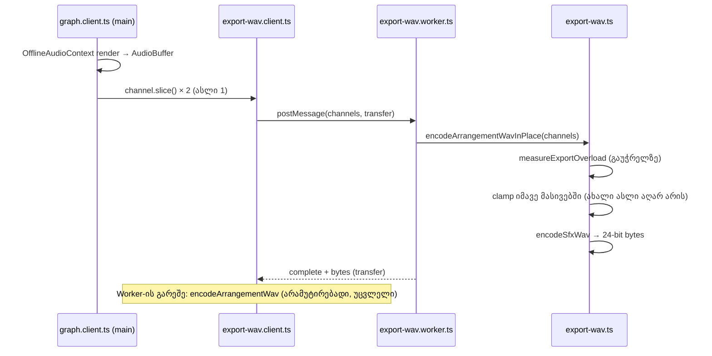

# Studio Lab — WAV + MP3-ის გულწრფელი შენიშვნა, timeout-ის ტექსტი და ერთი float ასლით ნაკლები WAV worker-ში (SRW-20 ეტაპი 3b-2)

**თარიღი:** 2026-10-22
**სტატუსი:** C PASS (Round 91), გამოქვეყნდა 77cd5b6 (D-29z56)
**შეცვლილი პროექტი:** Store

## კონტექსტი

SRW-20-ის (Arrangement-ის ექსპორტი) ბოლო ეტაპში სამი მჭიდროდ დაკავშირებული საკითხი დარჩა:

1. **GATE86-S2 (Low)** — WAV + MP3 რეჟიმის შენიშვნა („ან ორივე შეიქმნება, ან არცერთი“) მიწოდებასაც ჰპირდებოდა. შექმნისთვის ეს მართალია (C round 90 CX-BOTH: ბოლო ფაზამდე ფაილი არ ჩნდება), მაგრამ ბრაუზერმა მეორე ავტომატურ ჩამოტვირთვაზე შეიძლება ნებართვა მოითხოვოს ან დაბლოკოს.
2. **R87-L-TIMEOUT-RELOAD-TEXT (Low)** — MP3 encoder-ის 120 წამიანი timeout-ის ტექსტი გვერდის გადატვირთვას ითხოვდა. Round 87-დან lab encoder timeout-ზე reset-დება და იმავე გვერდზე ხელახალი ცდა მუშაობს (C round 87 PX-RETRY, C round 90 CX-LOAD).
3. **GATE89-S2 (Medium, მეხსიერება)** — WAV worker ყოველ არხზე ქმნიდა დამატებით clamp-ის `Float32Array` ასლს, თუმცა მიღებული არხები უკვე worker-ის საკუთრებაა (transfer-ით მოსული ასლები).

## მიდგომა

- **შენიშვნა:** ყველაზე მცირე გულწრფელი ცვლილება — ტექსტი ინარჩუნებს „ორივე ან არცერთი“-ს შექმნისთვის და ამატებს, რომ ბრაუზერმა მეორე ფაილზე შეიძლება ნებართვა მოითხოვოს. ელემენტი, კლასები და label (`WAV + MP3 · ორი ფაილი`) არ შეცვლილა.
- **Timeout-ის ტექსტი:** „გადატვირთე გვერდი“ შეიცვალა „შეამოწმე ინტერნეტი“-თ, ისე რომ მეორე წინადადება ჩატვირთვის შეცდომის ტექსტს დაემთხვა. „120 წამში“ რჩება (C MP-TIMEOUT: 120.394 წმ). Context-ში სხვა არაფერი შეცვლილა (timer, guard, reset, state-ის რიგი).
- **მეხსიერება:** `export-wav.ts`-ში დაემატა ერთი ახალი export — `encodeArrangementWavInPlace`. ის ჯერ overload-ს ზომავს გაუჭრელ sample-ებზე (გადატვირთვის გაფრთხილება ამაზეა დამოკიდებული), შემდეგ იმავე გამოსახულებით clamp-ს აკეთებს **გადაცემულ მასივებში**, და იმავე მასივებს გადასცემს `encodeSfxWav`-ს. ახალი `Float32Array` არ იქმნება. Worker ახლა ამ ფუნქციას იძახებს.
- **რა არ შეცვლილა:** `encodeArrangementWav` (byte-identical, არამუტირებადი; EW1 ზომავს input-ს გამოძახების შემდეგ), `export-wav.client.ts`-ის no-Worker fallback (ისევ არამუტირებად ფუნქციას იყენებს) და `graph.client.ts`-ის `.slice()` (AudioBuffer-ის არხის transfer შეუძლებელია).
- **ალტერნატივა, რომელიც უარვყავით:** `encodeArrangementWav`-ის in-place-ად გადაქცევა — ის fallback-ში გამომძახებლის მონაცემებს შეცვლიდა და EW1-ს დაარღვევდა. საერთო private helper-იც არ დაგვჭირდა; ახალი ფუნქცია 14 ხაზია.

### In-place-ის კონტრაქტი

`encodeArrangementWavInPlace` მხოლოდ ისეთი მასივებისთვისაა, რომლებიც გამომძახებელს ეკუთვნის და შემდეგ აღარ წაიკითხავს. დღეს ასეთი მხოლოდ WAV worker-ია: ის transfer-ით იღებს `graph.client.ts`-ის ასლებს და მათ მეტად არავინ კითხულობს. ფუნქციის შემდეგ მასივები clamp-ულ მნიშვნელობებს შეიცავს (NaN რჩება NaN, როგორც ადრე). `SharedArrayBuffer`-ზე დაფუძნებული არხი transfer-ის ნაცვლად გაზიარდებოდა და clamp გამომძახებელსაც შეეხებოდა; დღეს ეს შეუძლებელია, რადგან `.slice()` ყოველთვის ჩვეულებრივ `ArrayBuffer`-ს აბრუნებს. საკუთრებას ტიპები არ აკონტროლებს — მხოლოდ mutable `Float32Array[]` პარამეტრი (readonly მასივი არ გადაეცემა).

## არქიტექტურა

### მეხსიერების მსჯელობა

ადრე worker-ის პიკი იყო: rendered buffer + transfer-ის ასლი + clamp-ის ასლი + bytes. ახლა clamp-ის ასლი აღარ არის. 10M არანჟირებაზე (29 206 176 frame, stereo float32) ერთი ასლი ≈ 29 206 176 × 2 × 4 B ≈ 234 MB.

B-ის baseline გამოქვეყნებულ ხეზე `35c8403` (იგივე probe, იგივე runner-ის ტიპი): renderer-ის ΔHWM ექსპორტზე **739 / 748 / 748 MB** (before 450/447/441, after 1189/1195/1189). C-ის MEM-WAV10 მწკრივის ზღვარი: ΔHWM ≤ 639 MB სამივე ვალიდურ გაშვებაში.

## შეცვლილი ფაილები

| ფაილი | ცვლილება |
|---|---|
| `app/lib/arrangement/export-wav.ts` | ახალი `encodeArrangementWavInPlace`; `encodeArrangementWav` უცვლელი |
| `app/lib/arrangement/export-wav.worker.ts` | worker იძახებს in-place ვარიანტს; progress, complete, transfer და error path უცვლელია |
| `app/components/arrangement/ArrangementExportDialog.tsx` | მხოლოდ `BOTH_FORMAT_NOTE` |
| `app/contexts/ArrangementContext.tsx` | მხოლოდ 120 წამიანი timeout-ის ტექსტი `exportMp3`-ში |
| `app/lib/arrangement/__tests__/export-mp3.test.tsx` | `BOTH_NOTE` და `LOAD_TIMEOUT_MESSAGE` მუდმივები |
| `app/lib/arrangement/__tests__/export-progress-ui.test.tsx` | `LOAD_TIMEOUT_MESSAGE` მუდმივა |
| `app/lib/arrangement/__tests__/export-range-ui.test.tsx` | WAV + MP3 radio-ს label+note სტრიქონი |
| `app/lib/arrangement/__tests__/export-wav-in-place.test.ts` | ახალი: IP1–IP5 |
| `docs/implementation/2026/quarter-IV/078-studio-lab-export-cancel.md` | სტატუსის ხაზი (GATE90-S6) |
| `docs/implementation/2026/quarter-IV/079-studio-lab-export-notes-and-memory.md` | ეს დოკუმენტი |

## პრობლემები და გადაწყვეტები

- **პრობლემა:** in-place clamp-ის შემდეგ overload-ის გაზომვა peak-ს `MAX_24BIT_SAMPLE`-ზე დაიყვანდა და გაფრთხილება გაქრებოდა. **გადაწყვეტა:** `measureExportOverload` clamp-მდე იძახება; IP1 და mutation b ამას ამოწმებს, ბრაუზერში კი C-ის WAV5-REG (`გადატვირთვა: პიკი +1.7 dBFS — 498 sample…`).
- **პრობლემა:** `encodeArrangementWav`-ის in-place-ად გადაქცევა მარტივი ჩანდა, მაგრამ fallback-ში გამომძახებლის მასივს შეცვლიდა. **გადაწყვეტა:** ცალკე ფუნქცია; IP5 და EW1 იცავს არამუტირებად ქცევას (mutation d ორივეს აწითლებს).
- **პრობლემა:** უფრო გრძელმა სტრიქონებმა Biome-ის formatter-ს გადატანა მოსთხოვა. **გადაწყვეტა:** გადატანა მხოლოდ ნებადართული დეკლარაციების შიგნით (`BOTH_FORMAT_NOTE`, `BOTH_NOTE`, worker-ის გამოძახება).

## ტესტირება

- ახალი `export-wav-in-place.test.ts`: IP1 (bytes და report oracle-ის ტოლია, peak 1.5), IP2 (იგივე მასივის ობიექტები clamp-ულია), IP3 (progress), IP4 (worker-ის მოდული in-place-ით კოდირებს და მხოლოდ bytes-ს გადასცემს), IP5 (`encodeArrangementWav` input-ს არ ცვლის და შედეგი ემთხვევა).
- Mutation proofs a–f scratch ასლში (`tmp/studio-real-loop/a-round-91/mut/`): ყველა ექვსი mutation მინიმუმ ერთ ტესტს აწითლებს.
- Targeted vitest (66 ფაილი), `npm run typecheck`, `npm run lint` და scoped Biome — A-ის ანგარიშში (`a-round-91.md`).
- ბრაუზერის მიღება (MEM-WAV10, WAV5-REG, CX-WAVPHASE-R, NOTE-BOTH, TIMEOUT-TEXT) C-ის round 91-ის საქმეა.

## TODO / შემდეგი ნაბიჯები

- **GATE90-S1** ღიაა: render-ის ფაზაში გაუქმების შემდეგ შესაძლო დარჩენილი მეხსიერება. C-ის MEM-CANCEL მწკრივი ზომავს; გადაწყვეტილება (დადასტურდა / ვერ გამეორდა / გაურკვეველია) B-ის წესით მიიღება. Cancel-ის კოდი ამ რაუნდში არ შეცვლილა.
- C PASS-ის შემდეგ SRW-20 სრულდება და B root-ს უგზავნის frontend-architect-ის checkpoint q14-ის მოთხოვნას (მათ შორის `useArrangementExport`-ის წინადადება).
