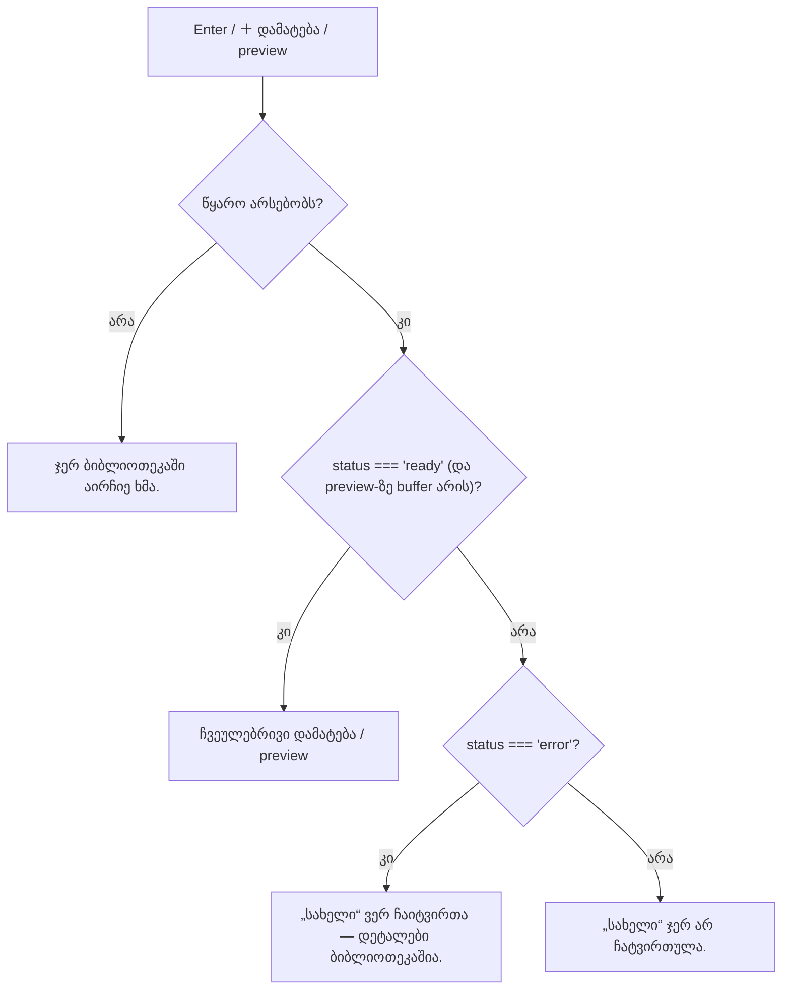

# Studio — ჩავარდნილი ბიბლიოთეკის წყაროს უარის ტექსტი (Lows, ნაწილი 3b)

**თარიღი:** 2026-10-23
**სტატუსი:** C PASS (Round 96), გამოქვეყნდა ce44036 (D-29z61)
**შეცვლილი პროექტი:** Store

## კონტექსტი

C round 95-მა ბრაუზერში `/middle-east.mp3`-ის მოთხოვნა შეწყვიტა. ბიბლიოთეკის რიგი სწორად აჩვენებდა `შეცდომა: ფაილი ვერ ჩაიტვირთა (ქსელი)`-ს, მაგრამ ამ რიგზე Enter-ის დაჭერისას სტატუსი ხდებოდა `„Middle East — საჯარო preview“ ჯერ არ ჩატვირთულა.` (C-R95-N1, Low).

ეს ტექსტი გულისხმობს, რომ ფაილი ჯერ კიდევ იტვირთება და ლოდინის შემდეგ მოვა. ჩავარდნილი ფაილი აღარ მოვა. იგივე ტექსტი ჰქონდა preview-ის უარსაც (`startLibraryPreview`) და დამატების უარსაც (`addSourceToActiveTrack`).

## მიდგომა

- **ტექსტი მიმდინარე მდგომარეობას მიჰყვება.** თუ წყაროს `sourceStates[id].status` არის `error`, სტატუსი ზუსტად ასეა: `„<სახელი>“ ვერ ჩაიტვირთა — დეტალები ბიბლიოთეკაშია.`. ეს იმეორებს კოლექციის `failed` სტატუსის ლექსიკას, რომელიც მომხმარებელმა უკვე ნახა.
- **ჩატვირთვის დროს ტექსტი უცვლელია:** `„<სახელი>“ ჯერ არ ჩატვირთულა.` (მდგომარეობა არ არსებობს, `loading`-ია, ან preview-ს buffer ჯერ არ აქვს). უცნობი id ან არჩევანის არქონა კვლავ `ჯერ ბიბლიოთეკაში აირჩიე ხმა.`-ს იძლევა.
- **Preview-ის გზაზე** `stopLibraryPreview()` კვლავ სტატუსამდე იძახება, ამიტომ წინა preview ჩერდება.
- **Loader-ის დეტალი სტატუსში არ გადადის** (არც შეცდომის ტექსტი, არც URL, არც stack) — ის რიგში უკვე ჩანს.
- ტექსტი ერთ არა-exported ფუნქციაშია (`librarySourceFailedMessage`), სხვა module-level შეტყობინებების გვერდით. `useArrangement()`-ის ფორმა არ შეცვლილა.
- **რა არ შეიცვალა და რატომ:** `dropLibrarySource`-ის ტექსტი (`ეს ხმა ჯერ არ ჩატვირთულა — დაელოდე და სცადე თავიდან.`) და drop-ghost-ის label (`ArrangementLane.tsx`) იგივე დარჩა. შეცდომის რიგი `draggable=false`-ია (C round 95), ამიტომ ჩავარდნილ წყაროზე რეალური მომხმარებელი მათ ვერ მიაღწევს. ისინი იცავენ race-ს, როცა drag ჩატვირთვის დასრულებამდე იწყება.
- **ალტერნატივა, რომელიც უარვყავით:** „თავიდან ცდის“ ღილაკი. ეს ახალი ფუნქციაა და ამ Low-ის ფარგლებს სცდება.

## არქიტექტურა

## შეცვლილი ფაილები

| ფაილი | ცვლილება |
|---|---|
| `app/contexts/ArrangementContext.tsx` | `librarySourceFailedMessage`; `startLibraryPreview`-ისა და `addSourceToActiveTrack`-ის უარის ბლოკებში `error`-ის შტო |
| `app/lib/arrangement/__tests__/failed-source-refusal.test.tsx` | ახალი: FS1–FS8 (8 ტესტი) |
| `docs/implementation/2026/quarter-IV/083-studio-lab-demo-loader-error-text.md` | მხოლოდ სტატუსის ხაზი |
| `docs/implementation/2026/quarter-IV/084-studio-failed-source-refusal-text.md` | ეს დოკუმენტი |

## პრობლემები და გადაწყვეტები

- **პრობლემა:** FS4-ისთვის preview jsdom-ში რეალურად უნდა დაიწყოს, თორემ „წინა preview ჩერდება“ ვერ შემოწმდება. **გადაწყვეტა:** `library-preview.test.tsx`-ის fake `AudioContext` და საათი დაკოპირდა (import-ის გარეშე); ტესტი ჯერ ამოწმებს `libraryPreviewSourceId === 'ok'`-ს. Mutation d (`stopLibraryPreview()` მხოლოდ შეცდომის შტოდან მოხსნილი) FS4-ს წითლად აქცევს `'ok'`-ით.
- **პრობლემა:** ტექსტი მიმდინარე მდგომარეობას უნდა მიჰყვებოდეს და არა ქეშირებულს. **გადაწყვეტა:** FS8 — `slow` ჯერ ჩატვირთვის ტექსტს იძლევა, შემდეგ reject ხდება და შემდეგი დამატება შეცდომის ტექსტს იძლევა.

## ტესტირება

- `tmp/studio-real-loop/...` ბილიკები loop-ის დროებითი scratch-ია და რეპოში არ ინახება; შედეგები ქვემოთ სრულადაა ჩაწერილი.
- ახალი `failed-source-refusal.test.tsx` (8 ტესტი, ზუსტი `toBe`, type assertion-ის გარეშე): FS1 (დამატება ჩავარდნილზე, `(ქსელი)` არ ჩანს, კლიპი და Undo არ ემატება), FS2 (არჩევანით დამატება), FS3 (ჩატვირთვისას — ძველი ტექსტი), FS4 (preview ჩერდება და შეცდომის ტექსტი), FS5 (preview ჩატვირთვისას — ძველი ტექსტი), FS6 (უცნობი id), FS7 (მზა წყარო ერთ კლიპს ამატებს, დამატების ზუსტი ტექსტით), FS8 (გვიანი ჩავარდნა).
- **Fail-before** (B-ის baseline snapshot, scratch): წითელია FS1, FS2, FS4, FS8 — ზუსტად B-ის მოლოდინი; FS3, FS5, FS6, FS7 მწვანეა.
- **Mutation proofs a–f** (`tmp/studio-real-loop/a-round-96/mut/`): a → FS1/FS2/FS8, b → FS4, c → FS1/FS2/FS3/FS4/FS5/FS8, d → FS4, e → FS1/FS2/FS4/FS8, f → FS1/FS2/FS8. მუტაციების გარეშე 8/8 მწვანეა.
- Targeted vitest, `npm run typecheck`, `npm run lint` და scoped Biome — `tmp/studio-real-loop/a-round-96.md`-ში.
- ბრაუზერის შემოწმება (FAIL-ADD, FAIL-PREVIEW, FAIL-DBL, FAIL-BOTH, LOADING-REG, READY-REG) — C-ის რაუნდი.

## TODO / შემდეგი ნაბიჯები

- C PASS-ის შემდეგ C-R95-N1 იხურება.
- შემდეგი: რეგრესიის რაუნდი (2026-10-24-დან).
