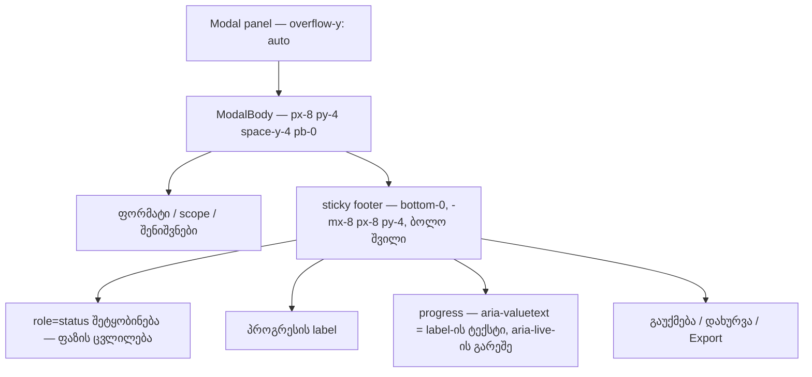

# Studio — ექსპორტის dialog-ის footer-ს ქვემოთ ზოლი აღარ ჩანს, პროგრესი კი ხმამაღლა იკითხება

**თარიღი:** 2026-10-23
**სტატუსი:** C PASS (Round 101), გამოქვეყნდა 56231c0 (D-29z66)
**შეცვლილი პროექტი:** Store

## კონტექსტი

ექსპორტის dialog-ის sticky footer (doc 083, D-29z53) ინახავს სტატუსს, პროგრესის label-ს, `<progress>`-ს და ღილაკებს. Footer `ModalBody`-ის ბოლო შვილია. საერთო `Modal.tsx`-ში `ModalBody`-ს აქვს `py-4`, ამიტომ footer-ის ქვემოთ `ModalBody`-ის ქვედა padding-ის 16 px ზოლი რჩებოდა. Footer-ის ზემოთ გადახვეული შიგთავსი ამ ზოლში ჩანდა (`GATE89-S4-FOOTER-MX8-COUPLING`, `A-R88-REVIEW-EDGES` #4).

B-მ ეს Chromium-ში გაზომა (`b-round-100-probe/probe-strip-result.json`, ერთი კლიპი, უმოქმედო dialog). A-მ რედაქტირებამდე იგივე probe გაუშვა და იგივე რიცხვები მიიღო (`a-round-101/repro-before.json`):

- **1280×720:** scrollTop 0-ზე footer პანელის კიდეს ეკვრის (gap 0). მაქსიმალურ scroll-ზე (61 = 707 − 646) footer-ის ქვედა კიდე 667-ზეა, პანელის შიდა ქვედა კიდე კი 683-ზე. **Gap 16 px-ია**, და `elementFromPoint` ქვედა კიდიდან 4 px-ით ზემოთ `ModalBody`-ს პოულობს და არა footer-ს.
- **1440×900:** პანელი არ ივსება (707 = 707), მაგრამ **gap scroll-ის გარეშეც 16 px-ია**. ზოლი dialog-ის ყოველ გახსნაზე ჩანს.
- **`pb-0`-ის სიმულაცია** (probe-მა `ModalBody`-ს runtime-ში `pb-0` დაუმატა): `padding-bottom` 0px-ია და gap ორივე viewport-ზე 0-ია. 1280-ზე max scroll 45 ხდება (691 − 646).

იმავე footer-ზე ორი სხვა Low იყო:

- `<progress>`-ს `aria-valuetext` არ ჰქონდა. Screen reader მას შიშველ პროცენტად კითხულობდა, MP3 encoder-ის ჩატვირთვისას კი (`value`-ის გარეშე) არაფერს ამბობდა (`GATE89-S6-PROGRESS-VALUETEXT`).
- დახურვის ღილაკის guard `event.repeat === true`-ს ამოწმებდა, დანარჩენი სამი guard კი უბრალოდ `event.repeat`-ს (`GATE97-S4-REPEAT-EQ-TRUE-NIT`).

## მიდგომა

- **ზოლი:** `ModalBody`-ს გამოძახების ადგილას დაემატა `pb-0`. Footer-ის `pt-4 pb-4` გაერთიანდა `py-4`-ად. Footer-ს საკუთარი 16 px ქვედა padding რჩება, ამიტომ ღილაკები პანელის კიდეს არ ეხება.
  - B-ის probe-მა აჩვენა, რომ generated CSS-ში `pb-0` იმარჯვებს `py-4`-ზე. `ModalBody` კლასებს `cn()`-ის გარეშე აერთებს (`px-8 py-4 space-y-4 pb-0`), შედეგს კი stylesheet-ის რიგი წყვეტს.
  - **უარყოფილი ალტერნატივები:**
    - footer-ის გატანა `ModalBody`-ის გვერდით: ეს ცვლის sticky/scroll container-ის კავშირს, focusin guard-ს (`footer.contains`, `target.contains(footer)`) და FT1-ს („ModalBody-ის ბოლო შვილი“). ცვლილება უფრო დიდია, შედეგი კი იგივე პიქსელები.
    - `Modal.tsx`-ის შეცვლა: ფაილი დაცულია.
  - **მიღებული coupling:** footer-ის `-mx-8` / `px-8` ისევ იმეორებს `ModalBody`-ის `px-8`-ს. სანამ `Modal.tsx` გაყინულია, ეს მიღებული კავშირია. GATE89-S4-ის coupling-ის ნაწილი ჩაწერილ სიგნალად რჩება და ბაგად არ ითვლება.
- **`aria-valuetext`:** `<progress>`-ს მიეცა `formatArrangementExportProgress(progress)`. ეს ის ფუნქციაა, რომელიც ხილულ label-ს წერს, ამიტომ წაკითხული ტექსტი ყველა ფაზაში ხილულს უდრის: `რენდერი · N%`, `WAV-ის ჩაწერა · N%`, `MP3 encoder-ის ჩატვირთვა…` (`value`-ის გარეშე) და `MP3-ის შექმნა · N%`. ახალი import, state ან helper არ დამატებულა.
  - **`aria-live` არ დამატებულა.** ფაზის ცვლილებას უკვე `role="status"` შეტყობინება აცხადებს. Live region ზოლზე ყოველ პროცენტს წაიკითხავდა (gate 89 #6).
- **`=== true`:** guard ახლა `event.key === 'Enter' && event.repeat`-ს ამოწმებს. `KeyboardEvent.repeat` boolean-ია, ამიტომ ქცევა იდენტურია. ცვლილების აზრი ისაა, რომ ოთხივე ღილაკის guard ერთნაირად იკითხება (ARCH-R97-ის მოლოდინი). ორ ფორმას ვერცერთი ტესტი ვერ გაარჩევს, ამიტომ ახალი ტესტი არ დაწერილა. არსებული HE1–HE7 უცვლელი და მწვანეა.

## არქიტექტურა

## შეცვლილი ფაილები

- `app/components/arrangement/ArrangementExportDialog.tsx` — `ModalBody`-ის `pb-0`, footer-ის `py-4`, `<progress>`-ის `aria-valuetext`, დახურვის guard-ის პირობა.
- `app/lib/arrangement/__tests__/export-dialog-footer.test.tsx` — ბოლოში დამატებული ტესტები FS1, FV1, FV2 (არსებული ხაზები უცვლელია).
- `docs/implementation/2026/quarter-IV/088-studio-preview-toggle-hold-enter.md` — სტატუსის ხაზი (C PASS, round 100, გამოქვეყნდა 17d944d).
- `docs/implementation/2026/quarter-IV/089-studio-export-footer-strip-valuetext.md` — ეს დოკუმენტი.

## პრობლემები და გადაწყვეტები

- **პრობლემა:** jsdom-ს layout არ აქვს, ამიტომ ტესტი 16 px-იან gap-ს ვერ გაზომავს. **გადაწყვეტა:** FS1 მხოლოდ კლასების lock-ია, და ეს მის სათაურშიც წერია. პიქსელების მიღება ბრაუზერის რიგებია: STRIP-1280 და STRIP-1440.
- **პრობლემა:** A-ს პირველი probe-ის გაშვება dev server-ის ცივ სტარტზე ვერ დაელოდა ბიბლიოთეკის option-ს (90 s timeout). **გადაწყვეტა:** გვერდის დიაგნოსტიკამ აჩვენა, რომ option-ები ჩაიტვირთა. მეორე გაშვება კოდის შეცვლის გარეშე წარმატებით დასრულდა.

## ტესტირება

- **Fail-before** (გაფართოებული ტესტი baseline-ის snapshot-ზე `cbee8cc6`, scratch-ში): წითელია FS1 და FV1. FV2 და შვიდი არსებული ტესტი მწვანეა. ეს B-ის მოლოდინს ემთხვევა.
- **Mutations** (scratch-ში): `pb-0`-ის მოხსნა → FS1; `aria-valuetext` მუდმივად → FV1; `aria-live="polite"` ზოლზე → FV2; footer-ზე `pt-4 pb-4`-ის დაბრუნება → FS1. Mutation-ის გარეშე 10/10 მწვანეა.
- `npm run typecheck`, `npm run lint`, Biome კომპონენტსა და ტესტზე, და დაკავშირებული ტესტები (`a-round-101/targeted-list.txt`) — შედეგები A-ს ანგარიშშია.
- **ბრაუზერი (A, მხოლოდ Chromium, B-ის probe-ის ასლი):** რედაქტირებამდე gap 16 px იყო 1280-ის max scroll-ზე და 1440-ზე scroll-ის გარეშე. რედაქტირების შემდეგი რიცხვები `a-round-101/repro-after.json`-შია. სრული მიღება (wheel scroll, done მდგომარეობა, VALUETEXT, FOCUS-REG, CLOSE-HOLD-REG) C-ის საქმეა.

## TODO / შემდეგი ნაბიჯები

- C round 101: STRIP-1280, STRIP-1440, VIS-RENDER-REG, VALUETEXT, FOCUS-REG, CLOSE-HOLD-REG, EXPORT-REG და დანარჩენი რიგები.
- `A-R88-REVIEW-EDGES` #1–#3 ღიაა: focus guard ზომავს radio-ს და არა მის label-ბარათს, mouse focus-ზეც scroll-ავს, და ახალი focusin-ის გარეშე footer-ის ზრდას არ ითვალისწინებს. ეს ცალკე რაუნდია.
- `-mx-8`/`px-8`-ის coupling `ModalBody`-სთან — გადასახედია, როცა `Modal.tsx` აღარ იქნება დაცული.
- განმეორებითი Enter-ის საერთო helper — root-ის არქიტექტურული checkpoint-ის შემდეგ.
