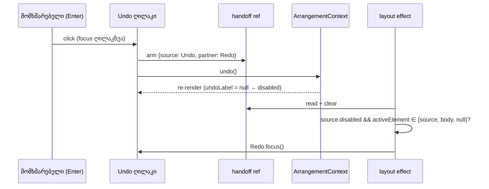

# Studio — თვითგამორთვადი ღილაკი keyboard focus-ს თავის ჯგუფში ტოვებს

**თარიღი:** 2026-10-23
**სტატუსი:** Round 108 — C PASS, გამოქვეყნებულია `32a6b08`-ში (gate 108; D-29z73; C-R107-01, FL-HISTORY, FL-ZOOM).
**შეცვლილი პროექტი:** Store

## კონტექსტი

Studio-ში რამდენიმე ღილაკი საკუთარი მოქმედების შემდეგ თავად ითიშება (`disabled`). თუ მომხმარებელი მას keyboard-ით (Tab → Enter) იყენებს, Chromium გამორთულ ღილაკს focus-ს ართმევს და `document.activeElement` ხდება `<body>`. შემდეგი Enter workspace-ის Enter handler-ს აღწევს, რომელიც ბიბლიოთეკის აქტიურ ელემენტს ახალ კლიპად ამატებს. მომხმარებელი ამას არ ითხოვდა.

- **C-R107-01 (Medium) — `0 dB` (Clip Gain reset):** gain 1 dB → Tab `0 dB`-ზე → Enter. Reset სრულდება, ღილაკი ითიშება (0 dB ინახება როგორც `gainDb`-ის არქონა), focus → BODY. მეორე Enter ამატებს კლიპს (`… დაემატა მუსიკა ხაზზე 01:41.352-ზე …`, 1 → 2). მტკიცებულება: `tmp/studio-real-loop/c-round-107/out/gain-focus-1280x720.json`.
- **FL-HISTORY (B probe, Medium) — `Undo`, `Redo`, `⌫ წაშლა`:** ბოლო undo/redo ან მონიშნული კლიპის წაშლა ღილაკს თიშავს, focus → BODY, შემდეგი Enter ამატებს კლიპს. Undo-ს შემთხვევაში ეს დამატება ახლად შექმნილ redo ჩანაწერსაც შლის. მტკიცებულება: `tmp/studio-real-loop/b-round-107/probe/out/focus-loss-1280x720.json`, `delete-focus-1280x720.json`.
- **FL-ZOOM (B probe, Low) — `↩ Zoom`:** ისტორიის ბოლო ნაბიჯი ღილაკს თიშავს, focus → BODY, Enter ამატებს კლიპს (2 → 3).

## მიდგომა

### F1 — focus-ის გადაცემა პარტნიორზე

როცა ქვემოთ ჩამოთვლილი ღილაკი **focus-ის ქონისას** აქტიურდება და მოქმედების შედეგად შემდეგ render-ზე **გამორთულია**, focus მის პარტნიორზე გადადის:

| ღილაკი | პარტნიორი | რატომ არის პარტნიორი ვალიდური |
|---|---|---|
| `0 dB` (დეტალების პანელი) | Clip Gain-ის input | ერთ აუდიო კლიპზე ყოველთვის ჩართულია; მისი `onKeyDown` განმეორებულ Enter-ს უგულებელყოფს. |
| `Undo` | `Redo` | წარმატებული undo ყოველთვის ქმნის redo ჩანაწერს. |
| `Redo` | `Undo` | წარმატებული redo ყოველთვის ქმნის undo ჩანაწერს. |
| `⌫ წაშლა` | `Undo` | წარმატებული წაშლა წერს `Undo: …წაშლა…`; შემდეგი Enter წაშლას აბრუნებს. |
| `↩ Zoom` | `Fit` | Fit არასოდეს ითიშება. |

- **„Focus-ის ქონა“** ნიშნავს `document.activeElement === event.currentTarget` click-ის მომენტში. ეს მოიცავს keyboard Enter/Space-ს და mouse click-ს, რომელმაც ღილაკს focus მისცა (Chromium click-ზე ღილაკს focus-ს აძლევს).
  - `0 dB` ინარჩუნებს `onMouseDown` `preventDefault`-ს. Mouse click მას focus-ს არასოდეს აძლევს, ამიტომ focus არ გადადის და იქ რჩება, სადაც იყო.
- **მხოლოდ ამოწურვისას:** თუ მოქმედების შემდეგ ღილაკი ისევ ჩართულია (კიდევ არის undo ნაბიჯი ან zoom ისტორია, ან მოქმედება უარყოფილია, მაგ. drag-ის დროს), focus არ გადადის. N ჩანაწერზე N დაჭერა = N undo, focus ბოლომდე Undo-ზე რჩება.
- **მხოლოდ თუ focus სხვაგან არ წასულა:** focus გადადის მხოლოდ მაშინ, როცა `document.activeElement` თავად გამორთული ღილაკია, `document.body` ან `null`. jsdom focus-ს გამორთულ ღილაკზე ტოვებს, Chromium კი BODY-ზე ჩამოაგდებს. ორივე შემთხვევა დამუშავებულია.
- პარტნიორი იღებს `focus()`-ს option-ების გარეშე (ელემენტები უკვე ეკრანზეა).

**მექანიზმი.** `ArrangementTransport`-ში თითო ღილაკის `onClick` ჯერ „აიარაღებს“ (arm) ლოკალურ ref-ს: წყარო ღილაკი და მისი პარტნიორი, მხოლოდ თუ წყაროს focus ჰქონდა. შემდეგ იძახებს მოქმედებას. `useIsomorphicLayoutEffect` dependency array-ის გარეშე ყოველ render-ზე კითხულობს და ასუფთავებს ამ ref-ს. თუ წყარო ახლა `.disabled`-ია, პარტნიორი ჩართულია და focus წყაროზე, BODY-ზე ან `null`-ზეა, focus პარტნიორზე გადადის. Dependency array-ის გარეშე ref ყოველი render-ის შემდეგ სუფთავდება, მათ შორის უარყოფილი მოქმედების შემდეგაც, რადგან ახალი სტატუსი re-render-ს იწვევს (doc 092). გამონაკლისი: drag-ის დროს ზედიზედ მეორე უარყოფილი Undo/Redo იგივე სტატუსს წერს, `reduceArrangementStatus` მას ტოვებს და re-render არ ხდება. ამ დროს arm-ი შემდეგ render-მდე რჩება. ის მაინც ამოქმედდება მხოლოდ მაშინ, თუ იმ render-ზე წყარო გამორთულია და focus წყაროზე ან BODY-ზეა (დარჩენილი რისკი, იხ. TODO).

`0 dB`-ისთვის reset 0-ზე წარმატებისას ღილაკს ყოველთვის თიშავს. ამიტომ `resetClipGain` click-ის მომენტში ამოწმებს, ჰქონდა თუ არა ღილაკს focus, და წარმატებული `setClipGain`-ის შემდეგ input-ს პირდაპირ აძლევს focus-ს.

### F2 — ღილაკი Enter-ის ერთ დაჭერაზე ერთხელ მოქმედებს

`Undo`, `Redo`, `⌫ წაშლა` და `↩ Zoom` განმეორებულ Enter keydown-ს არსებული კონვენციით ბლოკავენ: `event.key === 'Enter' && event.repeat` → `preventDefault()`, `stopPropagation`-ის გარეშე. Space და სხვა ღილაკები უცვლელია.

- **რატომ:** მის გარეშე Undo-ზე დაჭერილი Enter ყველა ნაბიჯს გააუქმებდა, შემდეგ F1-ით Redo-ზე გადავიდოდა და ყველაფერს დააბრუნებდა.
- **კონტრაქტი:** **ღილაკი** Enter-ის ერთ დაჭერაზე ერთხელ მოქმედებს. **Shortcut-ები** Ctrl/Cmd+Z, Ctrl/Cmd+Y / Ctrl/Cmd+Shift+Z და +/− კვლავ მეორდება (HK5, უცვლელი).
- `0 dB`-ს ეს guard უკვე ჰქონდა (round 107).
- **`Fit` — არ განხორციელდა.** D-29z73 Fit-ზეც ითხოვდა guard-ს, მაგრამ გაყინული ტესტი `app/lib/arrangement/__tests__/export-toolbar-hold-enter.test.tsx:269–272` (TH5) ამოწმებს, რომ Fit-ზე განმეორებული Enter **არ** იბლოკება. დავალების წესით გაყინული ტესტი არ იცვლება, ამიტომ ეს ნაწილი B-ს დაუბრუნდა. შედეგი: Chromium-ში `↩ Zoom`-ზე დაჭერილი Enter ბოლო ნაბიჯზე Fit-ზე გადადის და Fit-ის repeat გრძელდება (ყოველი repeat ახალ Fit-ს აკეთებს). ამ რაუნდის C-ის არცერთი სტრიქონი ↩ Zoom-ზე Enter-ს არ აჭერს; ეს ცნობილი ხარვეზია.

### უარყოფილი ალტერნატივები

- **`aria-disabled` `disabled`-ის ნაცვლად:** focus ღილაკზე დარჩებოდა, მაგრამ ტესტები და C-ის ხელსაწყოები `.disabled`-ს კითხულობენ, Undo/Redo-ს title-ები კი უცვლელი უნდა დარჩეს. ამასთან, ყოველ handler-ს თავისი no-op შემოწმება დასჭირდებოდა.
- **დოკუმენტის დონის ან capture-phase focus listener:** გლობალური ქცევაა, ყველა ღილაკს ეხება და ძნელად ტესტირებადია. D-29z73 მას კრძალავს.
- **workspace-ის Enter-on-body კონტრაქტის შეცვლა:** ეს ცალკე, მომხმარებლისთვის დასმული კითხვაა (B-R107-ENTER-ON-BODY). `StudioWorkspace.tsx`, `ArrangementContext.tsx` და window handler გაყინულია.

## არქიტექტურა

## შეცვლილი ფაილები

- `app/components/arrangement/ArrangementTransport.tsx`: `Undo`/`Redo`/`Fit` ref-ები, handoff ref, `armFocusHandoff`, ერთი layout effect, `preventRepeatedEnterKeyDown`. `Undo`, `Redo`, `⌫ წაშლა` და `↩ Zoom` ღილაკებს აქვთ arm + მოქმედება და repeat guard. `Fit`-ს დაემატა მხოლოდ `ref`. Play, ↤, პოზიცია, Split, Loop, Follow, Zoom slider, ⇔ და Export byte-identical-ია.
- `app/components/arrangement/ArrangementDetailPanel.tsx`: Clip Gain input-ის ref; `resetClipGain` იღებს ღილაკს და წარმატებისას, თუ ღილაკს focus ჰქონდა, input-ს აძლევს focus-ს. `commitClipGain` და `handleClipGainKeyDown` უცვლელია.
- `app/lib/arrangement/__tests__/self-disabling-focus.test.tsx` (ახალი): FL1–FL10. FL10 code-reviewer-ის შენიშვნით დაემატა. ის ფარავს Chromium-ის შემთხვევას, როცა focus commit-მდე უკვე BODY-ზეა. FL9 ჩართულ ღილაკებზე მოწმდება. FL6 იყენებს ლოკალურ stateful wrapper-ს: რეალური `zoomTimelineBack` (`StudioWorkspace.tsx`, გაყინული) unit ტესტით არ მოწმდება, ის C-ის FL-ZOOMBACK-ით მოწმდება.
- `docs/implementation/2026/quarter-IV/092-studio-status-repeat-announcement.md`: მხოლოდ სტატუსის ხაზი (round 107 — C PASS, `fc08617`).
- ეს დოკუმენტი.

## პრობლემები და გადაწყვეტები

- **პრობლემა:** jsdom გამორთული ღილაკიდან focus-ს არ აშორებს, ამიტომ „activeElement არ არის BODY“ ტიპის შემოწმება fix-ამდეც მწვანეა. **გადაწყვეტა:** ყოველი handoff-ის assertion არის `expect(document.activeElement).toBe(<პარტნიორი>)`, ხოლო implementation focus-ს გადასცემს, როცა activeElement წყაროა, BODY ან `null`.
- **პრობლემა:** dependency-ებზე მიბმული effect უარყოფილი მოქმედების შემდეგ (label-ები არ იცვლება) ref-ს „აიარაღებულს“ დატოვებდა. **გადაწყვეტა:** effect dependency array-ის გარეშე ყოველ render-ზე ასუფთავებს ref-ს. drag-ის დროს განმეორებული უარყოფის შემთხვევა (re-render-ის გარეშე) ნაწილობრივ ღია რჩება.
- **პრობლემა:** D-29z73-ის Fit guard გაყინულ TH5-ს ეწინააღმდეგება. **გადაწყვეტა:** Fit guard არ დაემატა, ტესტი არ შეცვლილა, საკითხი B-ს გადაეცა (m9 არ გაშვებულა).

## ტესტირება

- **Fail-before** (scratch `tmp/studio-real-loop/a-round-108/mut/`, ორი code ფაილი = B-ის snapshot-ები, საბოლოო ტესტ-ფაილი): წითელი FL1, FL3 (მეორე click, l.310), FL4 (მეორე click, l.325), FL5, FL6, FL9, FL10; მწვანე FL2, FL7, FL8. ემთხვევა B-ის მოლოდინს (FL10 დამატებითია).
- **Mutations** (scratch; კონტროლი წინ და ბოლოს 10/10 მწვანე):

  | ID | მუტაცია | წითელი |
  |---|---|---|
  | m1 | `0 dB` handoff ამოღებულია | FL1 |
  | m2 | `0 dB` focus-ის ქონის შემოწმების გარეშე | FL2 |
  | m3 | handoff ყოველ undo-ზე, არა მხოლოდ ამოწურვისას | FL3 (პირველი click, l.306), FL4 (l.321) |
  | m4 | Redo → Undo handoff ამოღებულია | FL4 |
  | m5 | ⌫ handoff ამოღებულია | FL5 |
  | m6 | ↩ Zoom handoff ამოღებულია | FL6, FL10 |
  | m7 | arm focus-ის ქონის შემოწმების გარეშე | FL7 |
  | m8 | Undo-ს repeat guard ამოღებულია | FL9 |
  | m9 | Fit-ის guard | არ გაშვებულა: guard არ განხორციელდა (TH5) |
  | m10 | effect-ში `activeElement === document.body` შტო ამოღებულია | FL10 |

- **Targeted vitest:** 66 ფაილი, 1125 ტესტი, ყველა მწვანე (`tmp/studio-real-loop/a-round-108/targeted-list.txt`).
- `npm run typecheck`, `npm run lint` (0 diagnostic შეცვლილ ფაილებში), `npx biome check` სამ code/test ფაილზე: სუფთა.
- **ბრაუზერის self-check** (Chromium, 1280×720; A-ს მტკიცებულებაა და არა C-ის მიღება): FL-UNDO, FL-DELETE, FL-GAIN-KEYBOARD. ყველა მოსალოდნელად იქცევა. იხ. `tmp/studio-real-loop/a-round-108/browser/`.

## TODO / შემდეგი ნაბიჯები

- C-ის round 108 სტრიქონები (FL-GAIN-*, FL-UNDO*, FL-REDO, FL-DELETE, FL-ZOOMBACK, რეგრესიები).
- Fit-ის repeat guard წინააღმდეგობაშია TH5-თან; საჭიროა B-ის გადაწყვეტილება.
- B-R107-ENTER-ON-BODY: კითხვა მომხმარებლისთვის.
- დაჭერილი Enter-ის toolbar sweep, რომელიც ARCH-R107-SHARED-ENTER-GUARD-ს ელოდება.
- GATE107-S1..S4.
- დარჩენილი რისკი: drag-ის დროს ზედიზედ ორი უარყოფილი Undo/Redo arm-ს შემდეგ render-მდე ტოვებს (იხ. მიდგომა). საჭიროების შემთხვევაში B-მ განსაზღვროს გამკაცრება.
