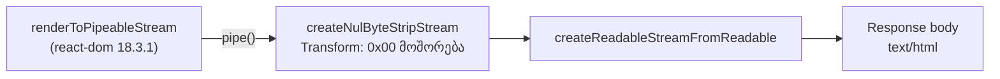

# SSR — სერვერის HTML-ში NUL byte-ები აღარ ხვდება

**თარიღი:** 2026-10-23
**სტატუსი:** Round 109 — C PASS, გამოქვეყნებულია `1fe3ba2`-ში (gate 109; D-29z74; C-R23-01, C-R38-01).
**შეცვლილი პროექტი:** Store

## კონტექსტი

**C-R23-01 (Medium).** Server-rendered HTML-ში raw `0x00` (NUL) byte-ები ხვდებოდა. B-მ `32a6b08`-ზე გაზომა: `GET /studio-lab` აბრუნებდა 69 307 byte-ს, მათ შორის **4 NUL-ს** (offset 6142/6143 და 26810/26811). შედეგი ერთნაირი იყო Chrome-ის (`onShellReady`) და Googlebot-ის (`onAllReady`) user agent-ით. მტკიცებულება: `tmp/studio-real-loop/b-round-108/probe/ssr-baseline-result.json`.

**C-R38-01 (Medium).** ამავე მიზეზის მეორე გამოვლინებაა. NUL-ის პირველი წყვილი ⌫ ღილაკის `aria-label`-ში ხვდებოდა (`…კლიპის წა\0\0შლა…`), მეორე კი სათაურის ტექსტში (`Arrangement · \0\0მთლიანი პროექტი`). ბრაუზერის HTML parser attribute-ში თითო NUL-ს U+FFFD-ით ცვლის, ამიტომ screen reader-ს გაფუჭებული label-ი ესმოდა.

`/`, `/products`, `/about` და `/studio/middle-east` დღეს NUL-ს არ შეიცავს, თუმცა საფრთხე ყველა ქართულ SSR გვერდს ეხება. Markup-ის ცვლილება chunk-ის საზღვარს გადაწევს, NUL-იც ახალ ადგილას გამოჩნდება (rounds 24–26-ში offset-ები ასე გადაინაცვლა).

**მიზეზი (react-dom 18.3.1 server).** `writeStringChunk` მოკლე string chunk-ს 2048-byte-იან view-ში encode-ავს. როცა chunk იქ აღარ ეტევა, view-ს **მთლიანად** აგზავნის, ჩაუწერელი (ნულოვანი) byte-ების ჩათვლით, და არა მხოლოდ ჩაწერილ ნაწილს. ტექსტი სრულია, ზედმეტია მხოლოდ `0x00` byte-ები. B-ის repro აპლიკაციის კოდის გარეშე: `b-round-108/probe/nul-repro2.cjs`, `nul-repro3.cjs`. 400 ქართულ-label-იანი ღილაკი იძლევა 5 NUL-ს, ASCII ვარიანტი კი 0-ს. NUL-ების მოშორების შემდეგ output byte-byte-ით ემთხვევა `renderToString`-ს.

## მიდგომა

**Lossless byte filter.** `app/entry.server.tsx`-ში React-ის `pipe()`-სა და response body-ს შორის `PassThrough`-ის ნაცვლად დგას `Transform`. ის ყოველი chunk-იდან `0x00` byte-ებს შლის. ეს უდანაკარგოა, რადგან:

- UTF-8-ში `0x00` არასოდეს არის multi-byte სიმბოლოს lead ან continuation byte. მისი წაშლა სიმბოლოს ვერ გაყოფს და ვერ შეცვლის, მაშინაც კი, თუ სიმბოლო ორ chunk-ზეა გაყოფილი.
- ვალიდური HTML raw NUL-ს საერთოდ არ შეიცავს.

**Filter-ის ქცევა:**

- მუშაობს მხოლოდ byte-ებზე: არც `toString`, არც `TextDecoder`. Stream object mode-ში არ არის და `decodeStrings` ჩართულია, ამიტომ Node-ის `Writable` string chunk-ს `_transform`-მდე თვითონ აქცევს `Buffer`-ად. სხვა ტიპის chunk `TypeError`-ით სრულდება.
- Fast path: თუ chunk-ში NUL არ არის, იგივე object უცვლელად გადაეცემა (zero-copy, როგორც `PassThrough`-ში).
- თუ NUL არის, filter ითვლის ნულებს, ზუსტი სიგრძის buffer-ს გამოყოფს და NUL-ებს შორის მონაკვეთებს აკოპირებს. მხოლოდ NUL-ებისგან შემდგარი chunk არაფერს გადასცემს.
- Chunk-ებს შორის არაფერი გროვდება, React-ის streaming უცვლელია. Backpressure-ს Node-ის `Transform` მართავს.
- Logging-ი, header-ები და შეცდომების დამალვა არ დამატებულა.

**უარყოფილი ალტერნატივები:**

- **React 19.** საჭიროებს `package.json`/lockfile-ის ცვლილებას (აკრძალულია) და მთელ Store-ს რეგრესიის რისკის ქვეშ აყენებს.
- **`renderToString`.** ყველა route-ზე ცვლის streaming-ისა და Suspense-ის ქცევას.
- **Decode → `replace(/\0/g, '')` → re-encode თითო chunk-ზე (`toString`-ით).** 3-byte-იანი ქართული სიმბოლო შეიძლება chunk-ებს შორის გაიყოს და U+FFFD-ად იქცეს. Mutation m2 ამას ამტკიცებს: SN3 წითლდება. `node:string_decoder` გაყოფილ სიმბოლოს სწორად გადაიტანს, მაგრამ ამატებს მდგომარეობას chunk-ებს შორის და decode/encode-ს ყოველ response-ზე. Byte filter-ი იგივე შედეგს იძლევა მდგომარეობის გარეშე და NUL-ის გარეშე chunk-ს უცვლელად ატარებს (code-reviewer-ის შენიშვნა).

**Ownership-ის შენიშვნა.** `app/entry.server.tsx` არ არის `global_forbidden_files`-ში და არც დაცული auth/purchase ფაილია. მაგრამ plan §6-ის A-ს ფაილების სიაშიც არ არის, ისევე როგორც ახალი `app/lib/ssr/` დირექტორია. B-მ ეს ფაილები A-ს **მომხმარებლის 2026-10-23-ის გადაწყვეტილების საკუთარი წაკითხვით** გადასცა („ჯერ ღია Medium-ები, შემდეგ T12“). ეს ამ ფაილზე მომხმარებლის პირდაპირი ნებართვა არ არის. Root-მა gate-ზე შეიძლება უარი თქვას. ამ შემთხვევაში რაუნდი არ გამოქვეყნდება, C-R23-01 მომხმარებელს კითხვად დაუბრუნდება და გამოსწორებულად არ ჩაითვლება.

## არქიტექტურა

`isbot`-ის მიხედვით `onAllReady`/`onShellReady`-ის არჩევა, `ABORT_DELAY`, header-ები, `onShellError`, `onError` და `setTimeout(abort, …)` უცვლელია.

## შეცვლილი ფაილები

- `app/lib/ssr/strip-nul-bytes.server.ts` (ახალი): `stripNulBytes` (pure byte filter) და `createNulByteStripStream` (`Transform` factory). `.server.ts` suffix ფაილს client bundle-ში არ უშვებს.
- `app/entry.server.tsx`: import block-ი და ერთი ხაზი. `new PassThrough()`-ის ნაცვლად `createNulByteStripStream()`, `node:stream`-ის import აღარ სჭირდება.
- `app/lib/ssr/__tests__/strip-nul-bytes.server.test.ts` (ახალი): SN1–SN7.
- `docs/implementation/2026/quarter-IV/093-studio-self-disabling-button-focus.md`: მხოლოდ სტატუსის ხაზი (round 108 C PASS, `32a6b08`).

## პრობლემები და გადაწყვეტები

- **პრობლემა:** ტესტის fixture-ში ღილაკს `type` არ აქვს, ამიტომ Biome `useButtonType` warning-ს იძლევა. `type`-ის დამატება კი B-ის repro-ს shape-ს შეცვლიდა, მაშინ როცა `renderToString`-ის equality oracle მხოლოდ იმ shape-ზეა გადამოწმებული. **გადაწყვეტა:** ერთი დასაბუთებული `biome-ignore` (პროექტში უკვე არსებული პრაქტიკა). Fixture byte-byte-ით B-ის repro-ს ემთხვევა.
- **პრობლემა:** entry-ის wiring-ის ტესტს (SN7) სრული `EntryContext` სჭირდება `as`/`any`-ის გარეშე. **გადაწყვეტა:** ის აწყობილია სრულად აკრეფილი object literal-ით (Remix 2.17.2-ის `FutureConfig`, `StaticHandlerContext`). `RemixServer` mock-ია და fixture-ს რენდერავს. Googlebot UA ტესტს `onAllReady` path-ზე გადაიყვანს.
- **პრობლემა:** filter-ი ყველა SSR response-ზე მუშაობს. **გადაწყვეტა:** fast path NUL-ის გარეშე chunk-ს არ აკოპირებს. შეცდომა ისევე ვრცელდება, როგორც `PassThrough`-ში. ახალი buffer `Buffer.alloc`-ით (ნულებით) იქმნება, რომ count-ის შეცდომამ არაინიციალიზებული heap მეხსიერება HTML-ში ვერ გაჟონოს.
- **პრობლემა (code-reviewer M1):** პირველ ვერსიაში string/`Uint8Array` chunk-ების გარდაქმნის helper-ი იყო, რომელიც `decodeStrings`-ის გამო არასოდეს სრულდებოდა. **გადაწყვეტა:** helper-ი წაიშალა; დარჩა `Buffer.isBuffer` შემოწმება. SN4 ახლა ცხადად ამოწმებს string chunk-ს Writable-ის decoding-ის შემდეგ.

## ტესტირება

**Unit (Vitest, `// @vitest-environment node`), 8 ტესტი:**

- SN1: chunk NUL-ის გარეშე უცვლელია.
- SN2a / SN2b: NUL დასაწყისში, შუაში, ბოლოში, ზედიზედ და მხოლოდ NUL-ებისგან შემდგარ chunk-ში, pure ფუნქციაზე (SN2a) და stream-ზე (SN2b).
- SN3: `წაშლა`-ს byte-ები ცალკეულ `write()`-ებად იწერება, `[0,0]` chunk კი ერთი სიმბოლოს byte-ებს შორის დგას. შედეგი ზუსტად `წაშლა`-ა.
- SN4: string chunk `'a\0b'` → `ab` (Writable-ის string decoding-ის შემდეგ).
- SN5: upstream control. ფილტრის გარეშე react-dom 18.3.1 ჯერ კიდევ იძლევა NUL > 0-ს.
- SN6: იგივე fixture ფილტრით იძლევა NUL 0-ს და ზუსტად უდრის `renderToString`-ს.
- SN7: `entry.server`-ის default export-ის response body იძლევა NUL 0-ს და უდრის `renderToString`-ს.

**Fail-before** (scratch, `entry.server.tsx` = snapshot, module = identity `Transform`): წითელია SN2a, SN2b, SN3, SN4, SN6 და SN7. მწვანეა SN1 და SN5.

**Mutations** (scratch; control 8/8 მწვანეა mutation-ებამდეც და მათ შემდეგაც):

| Mutation | წითელი ტესტები |
|---|---|
| m1 — identity transform | SN2a, SN2b, SN3, SN4, SN6, SN7 |
| m2 — decode/replace/re-encode | SN3 |
| m3 — მხოლოდ პირველი NUL იშლება | SN2a, SN2b, SN3, SN6, SN7 |
| m4 — entry ისევ `new PassThrough()` | SN7 |

**Self-check dev server-ზე** (`ssr-baseline.cjs`; 5 გვერდი × 2 UA × 2 run): ყველგან NUL 0-ია. `/studio-lab` 69 303 byte-ია (69 307 − 4). ყველა `sha256` ემთხვევა B-ის `sha256Stripped`-ს, streaming კი შენარჩუნებულია (`chunked`, `/studio-lab`-ზე 36 data event). ბრაუზერში შემოწმება C-ს ეკუთვნის.

## TODO / შემდეგი ნაბიჯები

- react-dom-ის განახლებისას (როცა SN5 NUL-ს აღარ აჩვენებს) filter-ი და SN5 წაიშალოს.
- PROD-SSR-NUL (gate): production build-ზე `/studio-lab`-ის NUL 0-ის შემოწმება.
- Root-ის gate-მა უნდა დაადასტუროს ან უარყოს ownership-ის წაკითხვა (იხ. ზემოთ).
