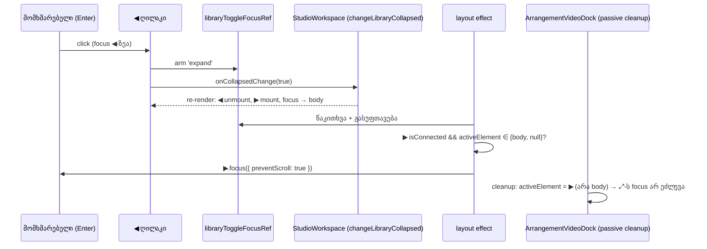

# Studio — ბიბლიოთეკის ◀ / ▶ / × keyboard focus-ს აღარ კარგავს

**თარიღი:** 2026-10-23
**სტატუსი:** Round 110 — C PASS, გამოქვეყნებულია `832fee2`-ში (gate 110; D-29z75; B-R108-LIB-FOCUS-LOSS).
**შეცვლილი პროექტი:** Store

## კონტექსტი

**B-R108-LIB-FOCUS-LOSS (Medium).** ბიბლიოთეკის სამი ღილაკი გააქტიურებისას თავის თავს unmount-ს უკეთებს:

- ◀ (`arrangement-library-collapse`) ბიბლიოთეკას კეცავს, მაგრამ ◀ მხოლოდ გაშლილ panel-ში არსებობს;
- ▶ (`arrangement-library-expand`) ბიბლიოთეკას შლის, მაგრამ ▶ მხოლოდ დაკეცილ rail-ში არსებობს;
- × (`arrangement-library-search-clear`) ძიებას ასუფთავებს, მაგრამ × მხოლოდ არაცარიელი query-ის დროს ჩანს.

Focus-იანი ელემენტის წაშლის შემდეგ Chromium focus-ს `<body>`-ზე გადააქვს. შემდეგი Enter workspace-ის Enter handler-ს აღწევს (`StudioWorkspace.tsx`, გაყინული). ის ბიბლიოთეკის აქტიურ ხმას ახალ კლიპად ამატებს, მომხმარებელს კი ეს არ მოუთხოვია. B-მ ეს ორჯერ გაზომა რეალურ Chromium-ში (`32a6b08`-ზე და `1fe3ba2`-ზე, 1280×720). სამივე ღილაკზე მეორე Enter-მა კლიპების რაოდენობა 0-დან 1-მდე გაზარდა. მტკიცებულება: `tmp/studio-real-loop/b-round-109/probe/lib-focus-probe-result.json`.

ეს იგივე კლასის ბაგია, რაც [093](093-studio-self-disabling-button-focus.md)-ში (C-R107-01). იქ ღილაკი `disabled` ხდებოდა, აქ კი DOM-იდან ქრება, ამიტომ 093-ის `source.disabled` პირობა აქ არ გამოდგება.

## მიდგომა

### F1 — focus ღილაკის პარტნიორზე გადადის

| გააქტიურებული ღილაკი | პარტნიორი | როდის | რატომ |
|---|---|---|---|
| ◀ დაკეცვა | ▶ გახსნა | layout effect-ში, render-ის შემდეგ, რომელიც ▶-ს mount-ს უკეთებს | იგივე toggle-ია მეორე მდგომარეობაში, ბიბლიოთეკის იმავე ზედა-მარცხენა ადგილას. კიდევ ერთი Enter მოქმედებას აბრუნებს. |
| ▶ გახსნა | ◀ დაკეცვა | იგივე, სარკისებურად | იგივე მიზეზი. |
| × გასუფთავება | ძიების input (`arrangement-library-search`) | სინქრონულად, `onClick`-ში `setQuery('')`-ის შემდეგ | input გაშლილ ბიბლიოთეკაში ყოველთვის mount-ებულია. Escape input-ში უკვე ასუფთავებს query-ს და focus-ს იქვე ტოვებს. workspace Enter-ს text input-ში არ ამუშავებს (`isTypingTarget`). |

წესები:

- **„Focus ჰქონდა“** ნიშნავს, რომ click-ის მომენტში `document.activeElement === event.currentTarget`. ეს მოიცავს keyboard Enter/Space-ს და mouse click-საც, რადგან Chromium click-ზე ღილაკს focus-ს აძლევს. 093 F1-ის მსგავსად, mouse ◀-ის შემდეგ focus ▶-ზეა.
- **მხოლოდ თუ focus სხვაგან არ გადასულა.** Layout effect focus-ს მხოლოდ მაშინ გადაიტანს, როცა `document.activeElement` არის `document.body` ან `null`. სხვა კომპონენტის მიერ გადატანილ focus-ს (მაგ. video dock-ის ⤢) არ ართმევს.
- **მხოლოდ armed click.** ref-ს მხოლოდ ◀/▶-ის `onClick` „აიარაღებს“. ვიდეოს ⤢-ის მიერ ბიბლიოთეკის დროებით გახსნა (`expandFloatingVideo`), ვიდეოს დაბრუნებით ხელახლა დაკეცვა (`returnFloatingVideo`, window Escape-ის ჩათვლით) და პირველი render focus-ს არ ცვლის.
- **მექანიზმი — მხოლოდ ref-ები, ახალი state-ის გარეშე** (`render-budget.test.tsx` `ArrangementLibrary`-ის render-ებს ითვლის). `libraryToggleFocusRef` ინახავს პარტნიორის ტიპს (`'expand'` / `'collapse'`), ხოლო ▶-სა და ◀-ს საკუთარი ref აქვთ. ერთი `useIsomorphicLayoutEffect` dependency array-ის გარეშე ყოველ render-ზე კითხულობს და ასუფთავებს armed ref-ს. თუ პარტნიორი mount-ებულია (`isConnected`) და activeElement არის body ან `null`, effect პარტნიორს `focus({ preventScroll: true })`-ს აძლევს (იხ. პრობლემები). თუ მშობელი ცვლილებას უარყოფს, ref შემდეგ render-ზე სუფთავდება, focus კი წყარო ღილაკზე რჩება.

### F2 — ერთი Enter, ერთი მოქმედება

F1-ის შემდეგ დაჭერილი Enter-ის განმეორებითი keydown-ები ▶-ზე, შემდეგ ◀-ზე და ა.შ. მოხვდებოდა (ping-pong). ამიტომ ◀, ▶ და × ღილაკებს აქვთ ლოკალური `preventRepeatedLibraryEnter`: `Enter` + `event.repeat` → `preventDefault()`, `stopPropagation`-ის გარეშე. ეს `ArrangementTransport.tsx`-ის `preventRepeatedEnterKeyDown`-ის კონვენციაა (093 F2). გაყინული ფაილიდან import არ ხდება. Space და დანარჩენი key-ები უცვლელია.

### უარყოფილი ალტერნატივები

- **ორივე ღილაკი mount-ებული დარჩეს და ერთი CSS-ით დაიმალოს:** იცვლება rail-ისა და panel-ის layout, width transition და floating video-ს გაზომვები (`floating-video.test.tsx`). diff უფრო დიდი და სარისკოა.
- **workspace-ის Enter-on-body კონტრაქტის შეცვლა:** ეს მომხმარებლის ღია კითხვაა (B-R107-ENTER-ON-BODY), `StudioWorkspace.tsx` კი გაყინულია.
- **document-level focus listener:** გლობალური და იმპლიციტურია; D-29z73-ში უკვე უარყოფილია.
- **× → პირველი option:** მომხმარებელი ძიებაში იყო. search-clear-ის სტანდარტული ქცევა input-ში დაბრუნებაა და Escape-საც ემთხვევა.

## არქიტექტურა

Layout effect passive effect-ის cleanup-ზე ადრე სრულდება. ამიტომ, როცა ◀ გაფართოებულ ვიდეოსაც აბრუნებს, focus უკვე ▶-ზეა და dock-ის cleanup ⤢-ს აღარ ეხება (`floating-video.test.tsx` l.710–726). ვიდეოს ✕/Escape-ზე ref armed არ არის, ამიტომ dock-ის საკუთარი წესი უცვლელად მუშაობს.

## შეცვლილი ფაილები

- `app/components/arrangement/ArrangementLibrary.tsx`: `MouseEvent` type import და `useIsomorphicLayoutEffect` import; ▶/◀/search input-ის ref-ები და `libraryToggleFocusRef`; layout effect; `changeLibraryCollapsedFromToggle`, `clearLibrarySearch`, `preventRepeatedLibraryEnter`. ◀, ▶ და ×-ს დაემატა `ref`/`onKeyDown` და შეეცვალათ `onClick`, input-ს კი დაემატა `ref`. Class, label, title და `data-testid` byte-identical-ია.
- `app/lib/arrangement/__tests__/library-focus-handoff.test.tsx` (ახალი): LF0–LF11 (13 ტესტი). LF10 და LF11 code-reviewer-ის შენიშვნებით დაემატა.
- `docs/implementation/2026/quarter-IV/094-studio-ssr-nul-bytes.md`: მხოლოდ სტატუსის ხაზი (round 109 — C PASS, `1fe3ba2`).
- ეს დოკუმენტი.

## პრობლემები და გადაწყვეტები

- **პრობლემა:** LF4 თავდაპირველად LF1–LF3-ის ნაწილი იყო. fail-before-ში ის focus-ის assertion-ზე წითლდებოდა და კლიპების დათვლამდე არ აღწევდა. **გადაწყვეტა:** LF4 ცალკე ტესტია და მხოლოდ კლიპებს ითვლის, context-ით (`arrangement.clips.length`) და `[data-clip-id]`-ით. fail-before-ში ის კლიპების რაოდენობაზე წითლდება (3 ≠ 2).
- **პრობლემა:** LF8-ში Space-ის შემოწმება სრულ `StudioWorkspace`-ში ყოველთვის `defaultPrevented` იყო, რადგან workspace-ის window handler Space-ს transport toggle-ად იყენებს. **გადაწყვეტა:** LF8 `ArrangementLibrary`-ს workspace-ის გარეშე, ლოკალური host-ით mount-ს უკეთებს. ასე მოწმდება მხოლოდ ბიბლიოთეკის guard.
- **პრობლემა:** LF7 („focus სხვაგან გადავიდა“) რეალურ `StudioWorkspace`-ში ვერ დაიწერება. **გადაწყვეტა:** იგივე ლოკალური host-ის `onCollapsedChange` setter-მდე host-ის Play-ს აძლევს focus-ს. effect-ს Play არ უნდა წაართვას.
- **პრობლემა (code-reviewer S1, Chromium-ში დადასტურდა):** ▶-ის Enter-ზე ◀ focus-ს იღებს, როცა aside-ის სიგანე transition-ის დასაწყისში ჯერ კიდევ 40 px-ია. ამ დროს Chromium `overflow-hidden` aside-ს ჰორიზონტალურად ასქროლავდა, რომ ◀ ჩანდეს: `scrollLeft` 243 px იყო და transition-ის ბოლოს 1 px დარჩა. შედეგად შიგთავსი მარჯვნიდან „შემოდიოდა“. **გადაწყვეტა:** `focus({ preventScroll: true })`, როგორც `ArrangementVideoDock`-ის ⠿-ზე. ხელახალი გაზომვა: `scrollLeft` მთელი transition-ის განმავლობაში 0-ია (`tmp/studio-real-loop/a-round-110/probe/scroll-probe-result*.json`). LF11 ამოწმებს `preventScroll` ოფციას.
- **პრობლემა (code-reviewer S2):** ერთსა და იმავე commit-ში ◀-ის handoff-ისა და dock-ის cleanup-ის რიგითობა დადებითად არ მოწმდებოდა. **გადაწყვეტა:** LF10 — ვიდეო float-შია, focus-იანი ◀ click → focus ▶-ზეა (არა ⤢-ზე და არა BODY-ზე).
- **პრობლემა:** ბრაუზერის პირველი self-check გაშვება dev server-ის reload-ს დაემთხვა (option-ი 30 წამში არ გამოჩნდა). **გადაწყვეტა:** ერთხელ გავიმეორე; ორივე მცდელობა ანგარიშშია ჩაწერილი.

## ტესტირება

- **Fail-before** (scratch `tmp/studio-real-loop/a-round-110/mut/`, `ArrangementLibrary.tsx` = B-ის snapshot): წითელი LF1, LF2, LF3, LF4, LF8, LF9, LF10, LF11; მწვანე LF0 (hazard-ის კონტროლი), LF5, LF5b, LF6, LF7. ემთხვევა B-ის მოლოდინს (LF10/LF11 დამატებითია).
- **Mutations** (scratch; კონტროლი წინ და ბოლოს 13/13 მწვანე):

  | ID | მუტაცია | წითელი |
  |---|---|---|
  | m1 | handoff-ის `focus()` ამოღებულია | LF1, LF2, LF3, LF4, LF9, LF10, LF11 |
  | m2 | arm „focus ჰქონდა“ შემოწმების გარეშე | LF5b |
  | m3 | effect-ში body/`null` შემოწმება ამოღებულია | LF7 |
  | m4 | ◀/▶-ის repeat guard ამოღებულია | LF8, LF9 |
  | m5 | არასწორი პარტნიორი (◀ → ძიების input) | LF1, LF4, LF9, LF10, LF11 |
  | m6 | `preventScroll` ამოღებულია | LF11 |

- **Targeted vitest:** 13 ფაილი, 309 ტესტი, ყველა მწვანე (`tmp/studio-real-loop/a-round-110/targeted-list.txt`; მათ შორის `floating-video`, `render-budget`, `self-disabling-focus`).
- `npm run typecheck`, `npm run lint` (0 diagnostic შეცვლილ ფაილებში), `npx biome check` ორ code/test ფაილზე: სუფთა.
- **ბრაუზერის self-check** (Chromium, 1280×720; A-ს მტკიცებულებაა და არა C-ის მიღება): B-ის `lib-focus-probe.cjs`. სამივე ღილაკზე Enter 1-ის შემდეგ focus პარტნიორზეა, Enter 2-ის შემდეგ კლიპები 0 → 0. console error და აკრძალული request არ ყოფილა. იხ. `tmp/studio-real-loop/a-round-110/probe/`.

## TODO / შემდეგი ნაბიჯები

- C-ის round 110 სტრიქონები: LF-COLLAPSE, LF-EXPAND, LF-CLEAR, LF-MOUSE, LF-HOLD, LF-VIDEO-NEUTRAL, LF-SWEEP-NEG, FV-710, რეგრესიები.
- B-R107-ENTER-ON-BODY: კითხვა მომხმარებლისთვის (უნდა დაამატოს თუ არა Enter-მა BODY-ზე რამე).
- code-reviewer S3 (Low, დღეს ვერ ხდება): თუ მშობელი ცვლილებას უარყოფს და ბიბლიოთეკას თავიდან არ არენდერებს, armed ref შემდეგ ვიდეოზე დამოკიდებულ collapse-მდე რჩება. `changeLibraryCollapsed` ყოველთვის commit-დება, ამიტომ რეალურად არ ვლინდება.
- code-reviewer S5 (Medium, ამ რაუნდის ფარგლებს გარეთ): თუ ვიდეომ ბიბლიოთეკა დროებით გახსნა და focus ბიბლიოთეკის შიგნითაა (◀ ან option), Escape-ით დაბრუნება ბიბლიოთეკას კეცავს და focus BODY-ზე ვარდება; შემდეგი Enter კლიპს ამატებს (0 → 1). A-მ Chromium-ში 1440×900-ზე გაიმეორა (`tmp/studio-real-loop/a-round-110/probe/s5-probe-result.json`). გზა გაყინულ `returnFloatingVideo`-ზე გადის, ამიტომ ეს B-ის ახალი დავალების საკითხია.
- საერთო focus-handoff helper-ის საკითხი (`ArrangementTransport` + `ArrangementLibrary`): architecture checkpoint-ის კითხვაა და ამ რაუნდში არ გაკეთდა.
