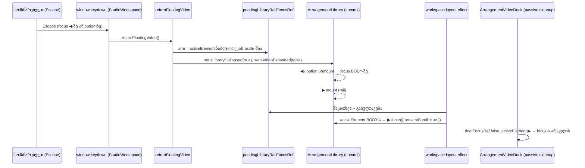

# Studio — floating video-ს Escape-ით დაბრუნება keyboard focus-ს ბიბლიოთეკაში ინარჩუნებს

**თარიღი:** 2026-10-23
**სტატუსი:** Round 111 — C PASS, გამოქვეყნებულია `6abd3f3`-ში (gate 111; D-29z76; C-R110-01).
**შეცვლილი პროექტი:** Store

## კონტექსტი

**C-R110-01 (Medium).** C-მ round 110-ში რეალურ Chromium-ში იპოვა და გაიმეორა (1440×900 და 1280×720). მტკიცებულება: `tmp/studio-real-loop/c-round-110/out/lf-video.json` (`s5-collapse-button`, `s5-option`), `c-round-110/out/reg.json` (`s5_1280`), `c-round-110/shots/s5-*.png`. A-ს საკუთარი repro: `a-round-110/probe/s5-probe-result.json`.

სცენარი: `/studio-lab` → Decline → Middle East option-ზე focus → ArrowDown (არჩეულია CZABA hero) → mouse ◀ (ბიბლიოთეკა იკეცება) → mouse ⤢ (ბიბლიოთეკა ვიდეოსთვის იხსნება) → focus ◀-ზე **ან** არჩეულ option-ზე → Escape → Enter.

შედეგი იყო: Escape-ის შემდეგ ვიდეო დაბრუნებულია, ბიბლიოთეკა დაკეცილია, `activeElement` კი BODY-ა. Enter კლიპს ამატებს (0 → 1).

მიზეზი: window Escape-ის branch იძახებს `returnFloatingVideo`-ს. ბიბლიოთეკა ვიდეოსთვის იყო გახსნილი (`libraryOpenedForVideo`), ამიტომ ის ხელახლა იკეცება. focus-იანი ◀ ან option გაშლილ panel-შია და unmount-დება. Chromium focus-ს BODY-ზე გადაიტანს, workspace-ის Enter branch კი აქტიურ წყაროს ამატებს.

ეს იგივე კლასის ბაგია, რაც [093](093-studio-self-disabling-button-focus.md)-ში (C-R107-01) და [095](095-studio-library-toggle-focus.md)-ში (B-R108-LIB-FOCUS-LOSS). Round 110-მა ბიბლიოთეკის საკუთარი ღილაკები გაასწორა. ეს გზა კი workspace-დან იმართება, ამიტომ round 110-ის armed ref აქ არ მუშაობს. D-29z75-ის თანახმად ასეც იყო ჩაფიქრებული: „ვიდეოს მიერ გამოწვეული collapse focus-ს არასოდეს გადაიტანს“.

## მიდგომა

### წესი (D-29z76, ცვლის D-29z75 F1-ს)

- **ადრე:** ვიდეოს მიერ გამოწვეული collapse/expand focus-ს არასოდეს გადაიტანს.
- **ახლა:** workspace ბიბლიოთეკის გარეთ მყოფ focus-ს არასოდეს **იღებს**. ის მხოლოდ **გადაარჩენს** focus-ს, რომელიც ბიბლიოთეკაში იყო, როცა `returnFloatingVideo`-მ ის დაკეცა და focus BODY-ზე აღმოჩნდებოდა.
- **სად მიდის focus:** ▶-ზე (`arrangement-library-expand`), ბიბლიოთეკის rail-ის ერთადერთ control-ზე. ის იმავე რეგიონშია, სადაც მომხმარებელი მუშაობდა, და D-29z75-საც ემთხვევა (ბიბლიოთეკაში focus-ით collapse → ▶). კიდევ ერთი Enter ბიბლიოთეკას ხსნის (focus → ◀, round 110-ის handoff) და ვიდეოს ხელახლა არ ააფრენს.

### მექანიზმი (მხოლოდ ref-ები, ახალი state-ის გარეშე)

1. **Arm.** `returnFloatingVideo`-ში, მხოლოდ `libraryOpenedForVideo` branch-ში და setter-ებამდე, ვინახავთ, არის თუ არა `document.activeElement` BODY-სგან განსხვავებული ელემენტი ბიბლიოთეკის aside-ის შიგნით (`contains`). შედეგი იწერება `pendingLibraryRailFocusRef`-ში. ამ მომენტში DOM ჯერ არ შეცვლილა, ამიტომ შემოწმება ზუსტია.
2. **Rescue.** ერთი `useIsomorphicLayoutEffect` dependency array-ის გარეშე, `pendingRowFocusRef`-ის effect-ის გვერდით. ის ref-ს კითხულობს და ასუფთავებს. თუ ref armed იყო და `activeElement` არის BODY ან `null`, ▶-ს ეძლევა `focus({ preventScroll: true })`.
3. **▶-ის პოვნა** ხდება module-level helper-ით `libraryRailExpandButton`, `trackRowNameButton`-ის გვერდით. ის იმავე `querySelector('[data-testid="…"]')` მიდგომას იყენებს.
4. **`preventScroll: true` სავალდებულოა.** Round 110-მა მის გარეშე overflow-hidden aside-ის `scrollLeft`-ის 243 px-იანი ნახტომი გაზომა (`a-round-110/probe/scroll-probe-result-before-preventScroll.json`).

### როდის არაფერს აკეთებს (ქცევა უცვლელია)

- focus ბიბლიოთეკის გარეთ იყო (Play, ⤢, ✕, timeline, BODY). arm-ის შემოწმება `false`-ს აბრუნებს;
- ბიბლიოთეკა ვიდეოსთვის **არ** იყო გახსნილი. `returnFloatingVideo` მას არ კეცავს და არაფერი unmount-დება;
- focus ძიების input-შია. window handler typing target-ს უგულებელყოფს (`isTypingTarget`), input-ში Escape კი მხოლოდ query-ს ასუფთავებს. ვიდეო floating რჩება, როგორც დღეს.

### რატომ არის უსაფრთხო

- **ძველი arm არ რჩება.** armed branch ყოველთვის იძახებს `setIsLibraryCollapsed(true)`-ს გაშლილ ბიბლიოთეკაზე, ამიტომ render აუცილებლად მოჰყვება. effect კი ref-ს ყოველ render-ზე ასუფთავებს.
- **Video dock-თან race არ არის.** workspace-ის layout effect commit-ის layout ფაზაში მუშაობს. dock-ის passive float cleanup (`ArrangementVideoDock.tsx`) მოგვიანებით ეშვება. იმ დროს `activeElement` უკვე ▶-ია და არა BODY, ამიტომ dock focus-ს არ გადაიტანს. ამ გზაზე dock-ის `floatFocusRef` ისედაც `false`-ია, რადგან focus ბიბლიოთეკაში იყო.
- **Render-ების რაოდენობა უცვლელია:** მხოლოდ ref-ები (`render-budget.test.tsx`).

### უარყოფილი ალტერნატივები

- **ბიბლიოთეკის მხარეს focus-within flag (onFocus/onBlur aside-ზე):** B-ის probe (`b-round-110/probe/blur-on-remove-result.json`, Chromium 143.0.7499.4) აჩვენებს, რომ focus-იანი ღილაკის წაშლა `blur`/`focusout`-ს სინქრონულად იწვევს, `relatedTarget: null`-ით. blur-ზე დაფუძნებული flag დამოკიდებული იქნებოდა იმაზე, მიიტანს თუ არა React ამ event-ს წასაშლელ node-ზე. ეს React-ის შიდა დეტალია. `returnFloatingVideo`-ში snapshot ნებისმიერ DOM ცვლილებამდე კეთდება და event-ების აღრიცხვას არ საჭიროებს.
- **focus ⤢-ზე (float-ის გამომძახებელზე):** focus ბიბლიოთეკაში იყო და არა float-ში. ⤢ + Enter ვიდეოს ისევ ააფრენდა და ბიბლიოთეკას გახსნიდა. ეს მომხმარებლის ბოლო კონტექსტზე დიდი მოქმედებაა.
- **Enter-on-body-ის შეცვლა:** ეს მომხმარებლის ღია კითხვაა (B-R107-ENTER-ON-BODY).
- **Escape-ზე ბიბლიოთეკა გაშლილი დარჩეს:** ეს ცვლის შეთანხმებულ float/return კონტრაქტს (`floating-video.test.tsx`, video dock).
- **document-level focus listener:** უარყოფილია D-29z73-ში.

## არქიტექტურა

## შეცვლილი ფაილები

- `app/components/arrangement/StudioWorkspace.tsx` — ოთხი ნაწილი: helper `libraryRailExpandButton`, ref `pendingLibraryRailFocusRef`, arm `returnFloatingVideo`-ის `libraryOpenedForVideo` branch-ში და deps-free rescue layout effect. Escape/Enter branch-ები, JSX, class-ები, label-ები და `data-testid`-ები უცვლელია.
- `app/lib/arrangement/__tests__/library-video-return-focus.test.tsx` — ახალი ტესტები VR0–VR7.
- `docs/implementation/2026/quarter-IV/095-studio-library-toggle-focus.md` — მხოლოდ სტატუსის ხაზი (round 110 C PASS, `832fee2`).
- ეს დოკუმენტი.

## პრობლემები და გადაწყვეტები

- **პრობლემა:** round 110-ის armed ref მხოლოდ ◀/▶-ის click-ზე მუშაობს, Escape-ის გზა კი workspace-დან იმართება. **გადაწყვეტა:** arm-ი გადავიდა `returnFloatingVideo`-ში, იმ ადგილას, სადაც collapse წყდება.
- **პრობლემა:** ფართო arm (focus-ის მდებარეობის გარეშე) BODY-ზე ან float-ის ✕-ზე მყოფ focus-საც ▶-ზე გადაიტანდა. **გადაწყვეტა:** arm მოითხოვს, რომ focus ბიბლიოთეკის aside-ში იყოს. effect კი დამატებით ამოწმებს BODY/`null`-ს. m2/m3 mutation-ები ამ ორივე დაცვას ამოწმებს.
- **პრობლემა:** jsdom-ში Escape `window`-ზე პირდაპირ dispatch-ით typing target-ს ვერ დაინახავდა. **გადაწყვეტა:** ტესტები Escape-ს `document.activeElement`-ზე აგზავნიან და ის `window`-მდე ადის, ისე როგორც ბრაუზერში.

## ტესტირება

- **ახალი ტესტი:** `library-video-return-focus.test.tsx`, 10 ტესტი (VR0, VR1, VR2, VR3a, VR3b, VR4, VR4b, VR5, VR6, VR7). კლიპები ითვლება context API-ითაც და `[data-clip-id]`-ითაც.
- **Fail-before** (scratch, `StudioWorkspace.tsx` = B-ის snapshot): წითელია VR1, VR2, VR3a, VR3b, VR7; მწვანეა VR0, VR4, VR4b, VR5, VR6.
- **Mutations** (scratch, control 10/10 მწვანეა წინ და ბოლოს):
  - m1 (arm არასოდეს) → VR1, VR2, VR3a, VR3b, VR7;
  - m2 (უპირობო arm) → VR0, VR4b;
  - m3 (m2 + BODY/`null` შემოწმების გარეშე) → VR0, VR4, VR4b;
  - m4 (helper ◀-ს აბრუნებს) → VR1, VR2, VR3a, VR3b, VR7;
  - m5 (`preventScroll`-ის გარეშე) → VR7.
- **Targeted vitest, typecheck, lint, Biome** და Chromium self-check probe: იხ. `tmp/studio-real-loop/a-round-111.md`.
- რეალური ბრაუზერის მიღება C-ის round 111-ია.

## TODO / შემდეგი ნაბიჯები

- **B-R107-ENTER-ON-BODY:** უნდა დაამატოს თუ არა რამე Enter-მა BODY-ზე. ეს მომხმარებლის ღია კითხვაა და ეს ცვლილება მას არ ეხება.
- **საერთო focus-handoff helper:** focus-ის გადარჩენის მსგავსი ლოგიკა ახლა ოთხ ადგილასაა (093, 095-ის ◀/▶, 095-ის ×, 096). ეს architecture checkpoint-ის კითხვაა root-ისთვის და ამ round-ში refactor არ კეთდება.
