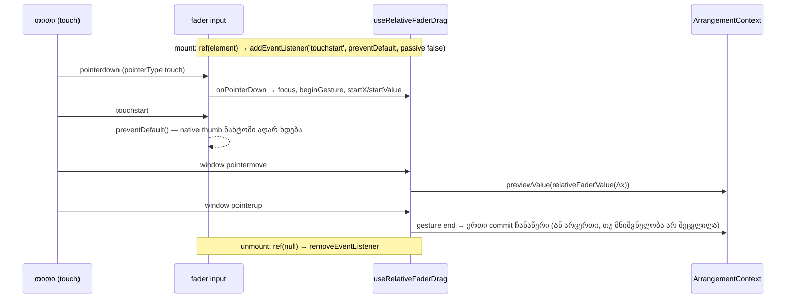

# Studio — fader-ზე touch დაჭერა მნიშვნელობას აღარ ახტუნებს

**თარიღი:** 2026-10-23
**სტატუსი:** Round 113 — C PASS (`c-round-113.json`, gate 113 `c2837f1`).
**შეცვლილი პროექტი:** Store

## კონტექსტი

**A-R38-REVIEW-TOUCH (Medium).** round 38-მა (D-29z3) fader-ებზე relative drag შემოიტანა: mouse-ით დაჭერა მნიშვნელობას არ ცვლის, მხოლოდ შემდგომი მოძრაობა ცვლის მას, საწყისი მნიშვნელობიდან. touch-ის შემოწმება მაშინ ღიად დარჩა.

C-მ round 112-ში (§4.5) ეს ქცევა Chromium 143-ში გაზომა: `hasTouch: true`, 1440×900, CDP `Input.dispatchTouchEvent`. მტკიცებულება: `tmp/studio-real-loop/c-round-112/out/touch.json`, `c-round-112/shots/touch-*-1440.png`. touchStart thumb-ისგან შორს (სიგანის 15 % მოპირდაპირე ბოლოდან), ყოველ სამ ცდაში:

- მუსიკის **Volume** 1.00 → 0.09;
- მუსიკის **Pan** C → 50R;
- **Master** 0.0 → −54.5 dB.

ნახტომი ხდებოდა touchStart-ზე, ჯერ კიდევ მოძრაობამდე. ყოველი ნახტომი ისტორიაში ცალკე ჩანაწერს წერდა („Undo: Volume“ და სხვა). შესაბამისად, შემთხვევითი შეხება მიქსსაც ცვლიდა და Undo-ს ისტორიასაც. mouse-ით დაჭერა იმავე წერტილში არ ხტებოდა.

მიზეზი: `useRelativeFaderDrag` `pointerdown`-ზე იძახებს `preventDefault()`-ს. ეს თიშავს mouse-ის თავსებადობის event-ებს, მაგრამ touch-ის native default action-ს (slider thumb-ის შეხების წერტილში გადატანას) არა. `touch-none` (`touch-action: none`) input-ებზე უკვე იყო და ნახტომს არ აჩერებდა.

## მიდგომა

round 38-ში წინასწარ ჩაწერილი შესწორება (`backlog.json` → A-R38-REVIEW-TOUCH `note`) გამოვიყენეთ: fader-ის `<input>`-ზე native, **non-passive** `touchstart` listener, რომელიც მხოლოდ `preventDefault()`-ს იძახებს.

- **სად.** საერთო `useRelativeFaderDrag` hook-ში (B-ის R1). ერთი ცვლილება ფარავს ოთხივე relative-drag fader-ს: ხაზის Volume (ვიდეოს Volume-ის ჩათვლით), ხაზის Pan, Master და ჯგუფის Volume. Zoom slider-ს relative drag არ აქვს, ამიტომ არ შეცვლილა და C-ისთვის positive control-ად რჩება.
- **API.** hook ახლა აბრუნებს `RelativeFaderDragBinding`-ს: `{ onPointerDown, ref }`. ალტერნატივა იყო ცალკე მეორე hook, მაგრამ მაშინ ახალ fader-ზე touch დაცვა შეიძლება დაგვავიწყდეს. ერთი binding ნიშნავს, რომ relative drag და touch დაცვა ყოველთვის ერთად მოდის. `onPointerDown` ზუსტად უცვლელია.
- **რატომ ref callback.** React-ის `onTouchStart` root-ზე passive listener-ადაა რეგისტრირებული, ამიტომ `preventDefault()` იქ არაფერს აკეთებს. listener უნდა დაემატოს თვითონ input-ს. ref callback სტაბილურია (`useCallback`, ცარიელი deps). როცა element იცვლება ან ქრება (მაგ. ხაზის დაკეცვა ან unmount), ის listener-ს ძველიდან ხსნის და ახალს ამატებს. listener-ი input-ის mount-ისას ემატება და არა პირველ pointerdown-ზე.
- **Pan-ის ref.** Pan-ს უკვე ჰქონდა `panSliderRef` (focus-ისთვის reset ღილაკიდან). ორივე ერთ სტაბილურ callback-ში გაერთიანდა, type assertion-ის გარეშე. ამისთვის `panSliderRef` ახლა `HTMLInputElement | null` ტიპისაა.
- **შეგნებული გვერდითი ცვლილება (R4).** გაუქმებული `touchstart` touch-ზე `click`/`dblclick`-საც თიშავს. ამიტომ ორმაგი **tap** touch ეკრანზე fader-ს აღარ აბრუნებს default-ზე. keyboard, mouse-ის double-click და reset ღილაკები უცვლელად მუშაობს. B-მ ეს info სიგნალად აღრიცხა (TOUCH-DOUBLE-TAP-RESET).

Ableton-თან შესაბამისობა: **არ ეხება**. Live დესკტოპის პროგრამაა და ბრაუზერის `<input type=range>`-ზე touch-ის ქცევას არ ეხება.

## არქიტექტურა

## შეცვლილი ფაილები

- `app/hooks/useRelativeFaderDrag.ts` — `RelativeFaderDragBinding` ტიპი, module-level `preventFaderTouchStartDefault` და სტაბილური `ref` callback, რომელიც native non-passive `touchstart` listener-ს ამატებს და ხსნის. `onPointerDown`-ის ლოგიკა უცვლელია.
- `app/components/arrangement/ArrangementLane.tsx` — ხაზის Volume-ზე `ref`, Pan-ზე `panSliderRef`-თან გაერთიანებული სტაბილური ref.
- `app/components/arrangement/ArrangementMaster.tsx` — Master Volume-ზე `ref`.
- `app/components/arrangement/ArrangementGroupHeader.tsx` — ჯგუფის Volume-ზე `ref`.
- `app/lib/arrangement/__tests__/fader-touch.test.tsx` (ახალი) — FT1–FT7.

## პრობლემები და გადაწყვეტები

- **Problem:** React-ის `onTouchStart` passive-ია, ამიტომ მასში `preventDefault()` ვერ აჩერებს native ქცევას. **Solution:** native `addEventListener('touchstart', …, { passive: false })` თვითონ input-ზე, ref callback-ით.
- **Problem:** inline ref callback ყოველ render-ზე ჯერ `null`-ით, მერე element-ით იძახება, ასე რომ listener ყოველ render-ზე მოიხსნებოდა და თავიდან დაემატებოდა. **Solution:** hook-ის `ref` და Pan-ის გაერთიანებული ref ორივე `useCallback`-ითაა სტაბილური. FT3/FT4 რეგისტრაციების რაოდენობას ითვლის. mutation m4-მა (inline Pan ref) ორივე წითლად აქცია.
- **Problem:** `useRef<HTMLInputElement>(null)` React 18-ის ტიპებში readonly `RefObject`-ს აბრუნებს, ამიტომ ref-ების გაერთიანება `current`-ის მინიჭებას ვერ შეძლებდა. **Solution:** `useRef<HTMLInputElement | null>(null)`, რომელიც `MutableRefObject`-ს აბრუნებს. type assertion არ დაგვჭირდა.

## ტესტირება

`fader-touch.test.tsx` (jsdom 27, რომელიც `passive` listener-ს პატივს სცემს):

- **FT1:** cancelable `touchstart` default-prevented-ია მუსიკის Volume-ზე, Pan-ზე, Master-ზე, ჯგუფის Volume-სა და ვიდეოს Volume-ზე.
- **FT2 (must-not):** Zoom-ზე არ არის prevented, და listener-იც არ აქვს.
- **FT3:** ხუთივე input-ზე (ოთხი fader და ვიდეოს Volume) ზუსტად ერთი `touchstart` რეგისტრაციაა, ზუსტად `{ passive: false }` options-ით.
- **FT4:** re-render-ები listener-ს თავიდან არ არეგისტრირებს. unmount-ის შემდეგ იგივე input აღარ არის prevented. ხელახალი mount ერთ რეგისტრაციას აკეთებს.
- **FT7:** მუსიკის ხაზის დაკეცვისას ძველი Volume და Pan input-ები აღარ არის prevented. გაშლის შემდეგ ახალ input-ებს თითო რეგისტრაცია აქვს და prevented არის. ეს ამოწმებს შემთხვევას, როცა hook იგივე რჩება, მაგრამ element იცვლება.
- **FT5:** touch დაჭერა მოძრაობის გარეშე ოთხივე fader-ზე მნიშვნელობას არ ცვლის და ისტორიაში არაფერს წერს.
- **FT6:** touch-ის relative drag (−25 px, 100 px სიგანეზე) მუსიკის Volume-ს 0.6-დან 0.35-მდე ცვლის, ერთი „Volume“ ჩანაწერით, ისევე როგორც F2-ში. Undo საწყის მნიშვნელობას აბრუნებს.

mutation-ები (დროებითი ლოკალური ცვლილება, შემდეგ აღდგენილი):

| mutation | შედეგი |
|---|---|
| m1: `preventDefault()` ამოღებულია | წითელი: FT1, FT4, FT7, FT5, FT6 |
| m2: `passive: true` | წითელი: FT1, FT3, FT4, FT7, FT5, FT6 |
| m3: ძველი listener-ის მოხსნა ამოღებულია | წითელი: FT4, FT7 |
| m4: inline Pan ref | წითელი: FT3, FT4 (FT7-მდე გაშვებული) |
| m5: options-ის გარეშე რეგისტრაცია | წითელი: FT3, FT7 |

FT5 და FT6 m1/m2-ზე მხოლოდ საერთო `defaultPrevented` შემოწმების გამო წითლდება. jsdom-ს native thumb არ აქვს, ამიტომ მათი მნიშვნელობისა და ისტორიის შემოწმებები ნახტომს ვერ დაიჭერს. ისინი `onPointerDown`-ის touch გზას იცავს რეგრესიისგან.

მეზობელი ფაილები მწვანეა: `fader-click`, `fader-guards`, `fader-focus-order`, `pan-release-recovery`, `master-ui`, `track-group-mix-ui`, `meter-ui`, `context-hygiene`. სულ fader-touch-ის ჩათვლით 9 ფაილი და 167 ტესტი. `npm run typecheck` სუფთაა. `npm run lint` exit 0-ით სრულდება, ახალი ფაილები გაფრთხილებებს არ იძლევა.

შეზღუდვა: unit ტესტები მხოლოდ wiring-ს ამოწმებს. native slider-ის რეალურ ქცევას touch-ზე C ამოწმებს Chromium-ში (TC-* rows).

## TODO / შემდეგი ნაბიჯები

- [x] C round 113: TC-ZOOM, TC-START, TC-REL, TC-UNDO, TC-TAP, TC-DTAP (info), MC-*, KB-ARROW, TC-VIDEO-VOL, 1440×900 და 1280×720 — შესრულდა (C PASS, `c-round-113.json`).
- რეალურ touch მოწყობილობაზე (iPad/Android) შემოწმება Tech Lead-ის სიაში რჩება (R38-T).
- TOUCH-DOUBLE-TAP-RESET: info სიგნალია, დაგეგმილი არ არის.
