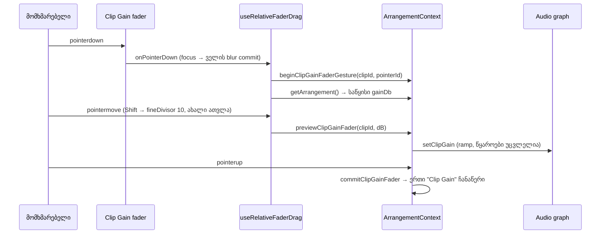

# Studio — Clip Gain fader დეტალების პანელში

**თარიღი:** 2026-10-23
**სტატუსი:** Round 114 — C PASS (`c-round-114.json`, gate 114 `38c0e21`).
**შეცვლილი პროექტი:** Store

## კონტექსტი

T12-GAIN-VOLUME-ის პირველი ეტაპი. Clip Gain უკვე არსებობდა: კლიპზე ინახება `gainDb` (ნაგულისხმევი 0, non-destructive), დეტალების პანელში იყო რიცხვითი ველი (ბიჯი 0.1) და `0 dB` ღილაკი. T12.8/T12.9 მოითხოვს slider-ს dB-ში, უფრო ზუსტ drag-ს (fine) და ნაგულისხმევზე დაბრუნებას double-click-ით. Ableton Live 12-ში Clip-ის Gain slider dB-შია (§8.4.7), Shift + drag კონტროლებზე ზუსტ რეჟიმს რთავს (§42.6), double-click კი პარამეტრს ნაგულისხმევზე აბრუნებს (§42.4).

## მიდგომა

- **fader:** `<input type="range">` (−60…+24 dB, ბიჯი 0.1, `w-24`) Clip Gain-ის ბლოკში, `0 dB` ღილაკის სტრიქონში, ღილაკის წინ. Tab-ის რიგი DOM-ის მიხედვით არის: ველი → fader → `0 dB`. ბლოკი `w-32`-დან `w-48`-მდე გაფართოვდა. პანელის სიმაღლე და სტრიქონების რაოდენობა არ შეცვლილა.
- **drag:** არსებული `useRelativeFaderDrag` (round 38-ის „დაჭერა არ ახტუნებს“ და round 113-ის touch guard). ჰუკს დაემატა არჩევითი `fineDivisor`. Clip Gain მას 10-ს აწვდის: Shift-ზე ერთი პიქსელი 10-ჯერ ნაკლებ dB-ს ნიშნავს. Shift-ის დაჭერა ან აშვება drag-ის შუაში ათვლას თავიდან იწყებს წინა pointer x-იდან და მიმდინარე მნიშვნელობიდან, ამიტომ მნიშვნელობა არ ხტება. როცა `fineDivisor` არ არის მითითებული (track, group, Master, Pan), გამოთვლა ზუსტად ძველია.
- **context (R7, ვარიანტი b):** Master-ის მსგავსი ცალკე preview/commit წყვილი: `previewClipGainFader`, `commitClipGainFader`, `beginClipGainFaderGesture`, `blurClipGainFader`, დამატებით `flushPendingClipGain`. ალტერნატივა იყო `MixVolumeTarget`-ის მესამე სახე `'clip'`. ის უარვყავით, რადგან `previewVolumeTarget` და `flushPendingVolume` ჩანაწერს მყარად `Volume`-ს არქმევს და group-ის flush-ის ლოგიკა აქვს. მესამე სახე track/group-ის საერთო გზას შეცვლიდა, ეს კი R7-ის მკაცრ შეზღუდვას ეწინააღმდეგება.
- **ისტორია:** drag-ის დროს მნიშვნელობა ცოცხლად ისმის და ჩანს. `gainDb` `scheduleKey`-ში არ შედის, ამიტომ წყაროები თავიდან არ იწყება. pointerup ან lost capture წერს ზუსტად ერთ `Clip Gain` ჩანაწერს. მოძრაობის გარეშე დაჭერა ჩანაწერს არ წერს. კლავიატურაზე ყოველი ArrowLeft/Right ±0.1 dB-ია და keyup-ზე **ერთ ჩანაწერს** წერს, track Volume-ის მსგავსად.
- **დაუმთავრებელი preview-ის flush:** Clip Gain-ის დაუმთავრებელი preview ავტომატურად ინახება, როცა იწყება ნებისმიერი სხვა ცვლილება (`applyEdit`), Undo/Redo, Volume/Master-ის preview ან Volume/Pan/Master-ის gesture. ასე Clip Gain-ის ცვლილება სხვის ჩანაწერში არ ერევა. როცა Clip Gain-ის preview არ არის, ეს გამოძახებები არაფერს აკეთებს და track/Master-ის ქცევა უცვლელია.
- **ველის სინქრონი (R5):** fader-ზე დაჭერა ველს ფოკუსს აცლის, ველის blur კი აკრეფილ ტექსტს ცალკე ჩანაწერად ინახავს. drag-ის საწყისი მნიშვნელობა იკითხება ცოცხალი arrangement-იდან (`getArrangement()`) და არა props-იდან, ამიტომ „−3 აკრეფა → drag“ ორ ჩანაწერს წერს: ჯერ −3.0-ს, შემდეგ −3.0 + Δ-ს.
- **disabled:** fader გამორთულია იმავე მიზეზით, რაც ველი: ვიდეოკლიპი, რამდენიმე კლიპი ან არჩევანის არქონა. ორივეს ერთი და იგივე `title` და `aria-describedby` აქვს. რამდენიმე კლიპის რედაქტირება ეტაპი 2-ია.

## არქიტექტურა

## შეცვლილი ფაილები

| ფაილი | დანიშნულება |
|---|---|
| `app/hooks/useRelativeFaderDrag.ts` | არჩევითი `fineDivisor`; Shift-ის გადართვაზე ათვლა თავიდან იწყება |
| `app/contexts/ArrangementContext.tsx` | Clip Gain fader-ის preview/commit/begin/blur და `flushPendingClipGain` |
| `app/components/arrangement/ArrangementDetailPanel.tsx` | fader, double-click reset, disabled მიზეზი |
| `app/components/arrangement/StudioWorkspace.tsx` | ახალი props-ის გადაცემა პანელისთვის |
| `app/lib/arrangement/__tests__/clip-gain-fader.test.tsx` | CF1–CF14 |
| `docs/implementation/2026/quarter-IV/097-studio-fader-touch-no-jump.md` | round 113-ის სტატუსი (R9) |

## პრობლემები და გადაწყვეტები

- **პრობლემა:** Shift-ზე ახალი ათვლა მიმდინარე მოძრაობის x-ით ამ მოძრაობის Δ-ს კარგავდა (+10 px უხეში + 10 px ზუსტი 9.2-ის ნაცვლად 8.4 გამოდიოდა). **გადაწყვეტა:** ახალი ათვლა იწყება წინა pointermove-ის x-იდან, გადართვის მოძრაობა კი უკვე ახალ რეჟიმში ითვლება.
- **პრობლემა:** jsdom pointerdown-ს disabled input-ზეც აწვდის, ამიტომ ვიდეოკლიპზე ან რამდენიმე კლიპზე „მოჩვენებითი“ gesture შეიძლებოდა დაწყებულიყო. **გადაწყვეტა:** პანელი fader-ის pointerdown-სა და double-click-ს უგულებელყოფს, როცა Clip Gain-ს მიზეზი აქვს.
- **პრობლემა:** ისტორია ცვლილებებს სტრუქტურულად ადარებს, ამიტომ პირველი მუტაცია „double-click 0-ზე წერს ჩანაწერს“ ვერაფერს ამოწმებდა. **გადაწყვეტა:** მუტაცია ნამდვილ 0 → 0.1 → 0 ჩანაწერებს წერს და CF6 წითლდება.

- **პრობლემა:** პირველ ვერსიაში fader ცალკე სტრიქონზე იდგა. 1280×720-ზე, პანელის ნაგულისხმევ სიმაღლეზე, `0 dB` ღილაკი პანელის ხილულ ჩარჩოს გარეთ რჩებოდა (Playwright-ის გაზომვა). **გადაწყვეტა:** fader `0 dB`-ის სტრიქონში გადავიდა და ბლოკი `w-48`-მდე გაფართოვდა. ორივე viewport-ზე fader და `0 dB` ჩარჩოს შიგნითაა, `scrollWidth = clientWidth` (192), შეუნახავის ნიშანი კი ხილულია.

## ტესტირება

- `clip-gain-fader.test.tsx`, 14 ტესტი (CF1–CF14): მნიშვნელობა/aria, drag-ის Δ, Shift fine, Shift-ის გადართვა, დაჭერა მოძრაობის გარეშე, double-click, კლავიატურა, disabled მიზეზები, აკრეფილი ტექსტი → drag, gesture-ის უარყოფა, track/Master-ის must-not, playback-ის დროს წყაროების უცვლელობა, blur/pointercancel drag-ის შუაში და დაუმთავრებელი preview-ის ცალკე ჩანაწერი Master-ის ან Undo-ს წინ.
- Playwright (dev server, `/studio-lab`, 1440×900 და 1280×720): +20 px drag 96 px fader-ზე = +17.5 dB, Shift-ით +1.8 dB, Ctrl+Z აბრუნებს, double-click 0.0-ს აყენებს, მოძრაობის გარეშე დაჭერა არაფერს ცვლის. ეს A-ის sanity შემოწმებაა და C-ის მიღებას არ ცვლის.
- მუტაციები m1–m5 (Shift-ის იგნორი, ათვლის გარეშე, commit ყოველ მოძრაობაზე, fine ნაგულისხმევად, ჩანაწერი 0-ზე): თითოეული შესაბამის ტესტს აწითლებს. დამატებითი m6 (Master-ის preview-ში Clip Gain-ის flush-ის მოხსნა) **გადარჩა**: ამ თანმიმდევრობაში `applyEdit`-ის flush იგივე ისტორიას იძლევა, ამიტომ ეს flush თავდაცვითია.
- არსებული fader/detail-panel/clip-gain ტესტები უცვლელად მწვანეა. `npm run typecheck`, `npm run lint` (შეცდომები არ არის).
- **შეზღუდვა:** jsdom-ს ნამდვილი thumb, Shift-ით drag და layout არ აქვს. ეს C-ის ბრაუზერის შემოწმებაა (CG-*).

## TODO / შემდეგი ნაბიჯები

- C round 114: CG-PRESENT, CG-LAYOUT, CG-DRAG, CG-FINE, CG-FINE-TOGGLE, CG-KEY, CG-DBL, CG-PENDING-DRAG, CG-DISABLED, CG-TOUCH, CG-PLAY, G-T1/T2/T8/T9, G-NONDESTRUCT, NB-*.
- T12 ეტაპი 2: Clip Gain რამდენიმე კლიპზე (T12.7). იყენებს ამ fader-ს.
- T12 ეტაპი 3: Track Volume dB-ში და Shift fine mixer-ის fader-ებზე.
- Architecture note (ARCH-R81): ArrangementContext-ში ახლა სამი volume-ის მსგავსი preview/commit მექანიზმია. გამოყოფის საკითხს B/root წყვეტს.
