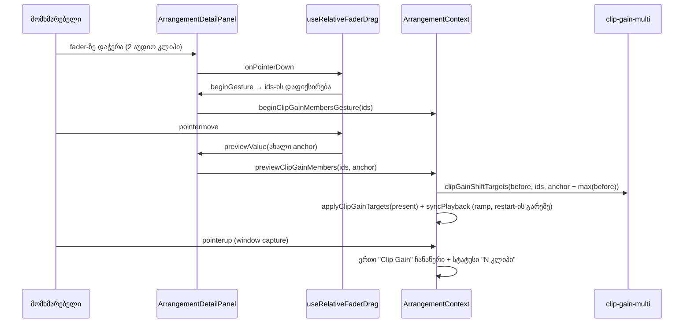

# Studio — რამდენიმე კლიპის Clip Gain ერთად

**თარიღი:** 2026-10-23
**სტატუსი:** Round 115 — C PASS (`c-round-115.json`, gate 115 `d5de68f`).
**შეცვლილი პროექტი:** Store

## კონტექსტი

T12-GAIN-VOLUME-ის მეორე ეტაპი (T12.7). პირველ ეტაპში (round 114) დეტალების პანელს დაემატა Clip Gain fader, double-click reset და Shift fine drag, მაგრამ მხოლოდ ერთ კლიპზე. ორი ან მეტი კლიპის მონიშვნისას ველი, fader და `0 dB` გათიშული იყო მიზეზით „Clip Gain ერთ აუდიო კლიპზე ისმება“.

მომხმარებლის მოთხოვნა (T12.7): რამდენიმე კლიპის მონიშვნისას Gain-მა ყველა კლიპი ერთად უნდა გადაწიოს და მათ შორის სხვაობა შეინარჩუნოს. როცა მნიშვნელობები განსხვავდება, დიაპაზონი უნდა ჩანდეს. Live 12-ის manual-ში (§8.4.7, §8.13; B-ს 2026-10-12-ის ჩანაწერი, plan.md l.636) დადასტურებულია, რომ რამდენიმე კლიპის მონიშვნისას განსხვავებული მნიშვნელობების დიაპაზონი ჩანს. სხვაობის შენარჩუნება Live-ში ჯერ **დაუდასტურებელია** — ეს CZABA-ს მოთხოვნაა.

ამავე რაუნდში გასწორდა gate-114 reviewer-ის ორი Low (GATE114-S1, GATE114-S2) და doc 098-ის სტატუსი (GATE114-S5).

## მიდგომა

**წევრობა (R1).** მონიშვნა ჩაირთვება მხოლოდ მაშინ, როცა ყველა მონიშნული კლიპი აუდიო ხაზზეა. თუ მონიშვნაში ვიდეოკლიპიც არის, ველი, fader და `0 dB` გათიშულია მიზეზით „Clip Gain მხოლოდ აუდიო კლიპებზე ისმება — ამოიღე ვიდეო მონიშვნიდან“. მხოლოდ აუდიო წევრების ჩუმად შეცვლა განზრახ არ გაკეთდა: ფარული ნაწილობრივი ეფექტი არ გვინდა.

**წმინდა ლოგიკა ცალკე მოდულში (R2).** `clip-gain-multi.ts` არ ეხება `model.ts`-ს, მხოლოდ მის კონსტანტებსა და `normalizeClipGainDb`-ს იყენებს:
- `clipGainMemberSpan` — აუდიო წევრები და მათი `minDb`/`maxDb` (`gainDb ?? 0`).
- `clipGainShiftTargets` / `shiftClipGainsDb` — ერთი საერთო delta, შეზღუდული ბლოკად: `clamp(delta, −60 − minDb, +24 − maxDb)`. ასე ზღვარზე ყველა კლიპი ერთად ჩერდება და სხვაობები ზუსტად რჩება (−6/+1 → +17/+24 ან −60/−53).
- `setClipGainsDb` — ყველა წევრს ერთი აბსოლუტური მნიშვნელობა (0 შლის `gainDb` key-ს, როგორც `setClipGainDb`).
- ცვლილების არქონისას იგივე arrangement ობიექტი ბრუნდება, ამიტომ history-ში ჩანაწერი არ ჩნდება.

**Anchor = max (R3, R4).** განსხვავებული მნიშვნელობებისას fader-ის thumb წევრების მაქსიმუმზე დგას, `aria-valuetext` კი დიაპაზონია (`−6.0 … +1.0 dB`). drag და ისრები fader-ს ახალ აბსოლუტურ მნიშვნელობას აძლევს; context delta-ს ითვლის როგორც `მნიშვნელობა − max(before)`, სადაც `before` არის pending preview-ის დაწყებამდე არსებული მდგომარეობა. ამიტომ preview არ გროვდება კუმულაციურად.

hook-ის `min` განზრახ −60 დარჩა და `CLIP_GAIN_MIN_DB + (max − min)` არ გადაეცა. ამ შემთხვევაში hook-ის მასშტაბი (`max − min`) 84-დან შემცირდებოდა, და +25 px drag 100 px-ზე +21.0-ის ნაცვლად +19.3-ს მისცემდა (MG4 და C-ის `20/w × 84` ფორმულა). ბლოკად შეზღუდვას R2 ახორციელებს context-ში.

**Context API (R11).** stage-1-ის ფუნქციები (`previewClipGainFader`, `commitClipGainFader`, `beginClipGainFaderGesture`, `blurClipGainFader`, `setClipGain`) იგივე signature-ით დარჩა. pending slot-ს (`clipGainBeforeRef`) clip id-ის ნაცვლად ახლა **member-set key** აქვს (დალაგებული id-ები; ერთი კლიპისთვის key = clip id). commit/begin/blur-ის ლოგიკა key-ზე მომუშავე შიდა ფუნქციებში გადავიდა, ერთი კლიპის ფუნქციები კი მათი wrapper-ებია. ამის გამო single path-ის ქცევა ზუსტად იგივეა (CF1–CF14 მწვანეა). ახალი set-based ფუნქციებია `previewClipGainMembers`, `setClipGainMembers`, `commitClipGainMembers`, `beginClipGainMembersGesture` და `blurClipGainMembers`. Volume/Master/Clip Gain pending მექანიზმები ერთ მექანიზმად არ გაერთიანდა (ARCH-R81 — root checkpoint-ის საკითხი).

**ველი და reset (R5, R6).** განსხვავებული მნიშვნელობებისას ველი ცარიელია, `title` დიაპაზონს აჩვენებს, `aria-describedby` კი დიაპაზონის node-ზე მიუთითებს (pending-ისას ორივეზე). Enter/blur ყველა წევრს ერთ მნიშვნელობას ანიჭებს ერთი ჩანაწერით. double-click და `0 dB` ყველა წევრს 0.0-ზე აბრუნებს; `0 dB` გათიშულია, როცა ყველა წევრი 0.0-ზეა. ერთი კლიპის `0 dB`-ის წესი უცვლელია (`gainDb === undefined`).

**სტატუსი და აუდიო (R7).** multi commit-ის შემდეგ სტატუსია `Clip Gain: 2 კლიპი — −4.0 … +3.0 dB.` (ტოლი მნიშვნელობებისას — ერთი მნიშვნელობა). ის context-ში იწერება, რადგან drag-ის commit window-ის capture `pointerup`-ში ხდება. `gainDb` `scheduleKey`-ში არ შედის, ამიტომ preview მხოლოდ clip gain node-ს ცვლის და source-ები თავიდან არ იწყება.

**GATE114-S1 (R8).** clip id-ები `beginGesture`-ის მომენტში ფიქსირდება (`clipGainDragIdsRef`). drag-ის დროს preview, commit და blur ამ id-ებს იყენებს, მაშინაც კი, თუ მონიშვნა შუა drag-ში შეიცვალა. აქტიური gesture-ის გარეშე მიმდინარე მონიშვნა გამოიყენება.

**GATE114-S2 (R9).** რიცხვითი ველი იყენებს `DETAIL_CLIP_GAIN_STEP_DB`-ს.

**Layout (R12).** დიაპაზონის node ველის გვერდით დგას, იმავე სტრიქონში. ახალი სტრიქონი არ დამატებულა. ყველაზე გრძელი ტექსტი (`−60.0 … +24.0 dB`, mono) 115.2 px-ია, ამიტომ Clip Gain ბლოკი `w-48`-დან `w-52`-მდე გაფართოვდა (ზედა ზღვარი `w-56` იყო), ველს კი `shrink-0` მიეცა.

## არქიტექტურა

## შეცვლილი ფაილები

| ფაილი | დანიშნულება |
|---|---|
| `app/lib/arrangement/clip-gain-multi.ts` (ახალი) | წევრები/span, საერთო delta ბლოკური clamp-ით, აბსოლუტური set, დიაპაზონის და სტატუსის ტექსტი |
| `app/contexts/ArrangementContext.tsx` | member-set key pending slot-ში; set-based preview/set/commit/begin/blur; multi სტატუსი commit-ზე |
| `app/components/arrangement/ArrangementDetailPanel.tsx` | R1 მიზეზი, დიაპაზონის node, anchor = max, ველი/reset/double-click multi-ზე, R8 capture, R9 step, `w-52` |
| `app/components/arrangement/StudioWorkspace.tsx` | `detailGroup`-ს დაემატა `clipIds`, `hasNonAudioClip`, `minClipGainDb`, `maxClipGainDb`; ახალი props |
| `app/lib/arrangement/__tests__/clip-gain-multi.test.tsx` (ახალი) | MG1–MG14 |
| `clip-gain-fader`, `clip-gain`, `detail-panel-reason`, `detail-panel-fit`, `pending-status` ტესტები | B-ს ნებართვით: ორი აუდიო კლიპის ნაცვლად მონიშვნა ვიდეოკლიპით, ახალი მიზეზის ტექსტი |
| `docs/implementation/2026/quarter-IV/098-studio-clip-gain-fader.md` | სტატუსი C PASS და CF1–CF14 (R10) |

## პრობლემები და გადაწყვეტები

- **Problem:** პირველ ვერსიაში `0 dB`-ის გათიშვის წესი ერთ კლიპზეც `min === 0 && max === 0` გახდა. ამან `status-announcement-ui` HE4 ჩააგდო: ამ ტესტში კლიპს აშკარა `gainDb: 0` აქვს, stage 1 კი ღილაკს მხოლოდ `gainDb === undefined`-ზე თიშავს. **Solution:** ერთ კლიპზე stage-1-ის წესი აღდგა; „ყველა 0.0“ წესი მხოლოდ multi-ზე მოქმედებს.
- **Problem:** Playwright probe-მა 1280×720-ზე აჩვენა, რომ ყველაზე გრძელმა დიაპაზონმა ველი 80 px-დან 72.8 px-მდე შეკუმშა. **Solution:** ველს `shrink-0`, ბლოკს `w-52`. ამის შემდეგ ორივე viewport-ზე `scrollWidth == clientWidth` (208) და სიმაღლე ერთი კლიპის მდგომარეობის ტოლია.
- **Problem:** ArrangementDetailContent-ის `key` იცვლება single→single, single→group და group→single გადასვლაზე, ამიტომ ამ შემთხვევებში hook drag-ს თავად აჩერებს და R8-ის capture დამატებით არაფერს ცვლის. **Solution:** MG11-ს დაემატა group→group შემთხვევა, სადაც key არ იცვლება. სწორედ ეს შემთხვევა ამტკიცებს capture-ს (მუტაცია m5 მხოლოდ მას აწითლებს).

## ტესტირება

- `clip-gain-multi.test.tsx` — 14 ტესტი (MG1–MG14): წმინდა shift/set, ჩვენება, drag, clamp, Shift fine, კლავიატურა, reset, ველი, ვიდეო მონიშვნაში, R8, playback ramp, must-not (Volume/Master, ერთი კლიპი), blur/pointercancel multi drag-ის შუაში.
- მუტაციები (ყველა წითელი): m1 დამოუკიდებელი clamp → MG1, MG5; m2 before-max-ით გამოთვლილი delta ცოცხალ gain-ებზე → MG4, MG5, MG11; m3 ვიდეო წევრებში → MG1; m4 commit ყოველ move-ზე → MG4, MG5, MG11, MG14; m5 id-ები ბოლო render-იდან → MG11 (group→group); m6 anchor = min → MG3, MG7. reviewer-ის შესწორებების მუტაციები: Enter უცვლელ mixed ველზე → MG9; ჩუმი double-click 0.0-ზე → MG8.
- სამიზნე vitest სია (18 ფაილი): 323/323 მწვანე; `npm run typecheck` და `npm run lint` — exit 0.
- Playwright sanity probe (`/studio-lab`, 1440×900 და 1280×720) — layout-ის გაზომვა და ერთი რეალური drag: −6/+1 → +11.5/+18.5 (w = 96 px, +20 px), სტატუსი „2 კლიპი“, Ctrl+Z აბრუნებს. ეს C-ის მიღება არ არის.

- **Problem (code-reviewer, Low):** Enter უცვლელ mixed ველზე (`""`) „არასწორი რიცხვის“ შეტყობინებას აჩვენებდა; double-click უკვე 0.0-ზე მყოფ ჯგუფზე „უცვლელია“ სტატუსს წერდა, მაშინ როცა ერთ კლიპზე არაფერს წერს. **Solution:** Enter-ზე „Clip Gain უცვლელია: {დიაპაზონი}.“; multi double-click 0.0-ზე ჩუმია (ღილაკი `0 dB` stage-1-ის მსგავსად სტატუსს წერს). anchor-ის წაკითხვა `clipGainMemberSpan`-ზე გადავიდა, რათა panel და R2 ერთ წესს იყენებდნენ.

## ცნობილი შეზღუდვები

- **drag-ის „მკვდარი ზონა“ ზღვართან:** ბლოკის −60-ზე შეჩერების შემდეგ hook-ის მნიშვნელობა −60-მდე გრძელდება (anchor = max), ამიტომ უკან დაბრუნებისას დაახლოებით (max − min) dB pointer-ის მოძრაობა არაფერს ცვლის. hook და `fader.ts` ამ რაუნდში frozen-ია.
- ორ სხვადასხვა mixed ჯგუფს შორის პირდაპირი გადასვლისას (ველის blur-ის გარეშე) აკრეფილი ტექსტი შეიძლება შენარჩუნდეს; ჩვეულებრივ UI-ში clip-ზე click ჯერ ველს blur-ით ინახავს.

## TODO / შემდეგი ნაბიჯები

- C: რეალური ბრაუზერის შემოწმება (MC-* მწკრივები, G-T2-MULTI export, MC-PLAY).
- T12 ეტაპი 3: Track Volume dB-ში; ეტაპი 4: waveform-ზე gain-ის ჩვენება და vertical zoom.
- ARCH-R81: სამი pending-preview მექანიზმის გაერთიანება — root checkpoint-ის საკითხი, ცალკე დავალებით.
