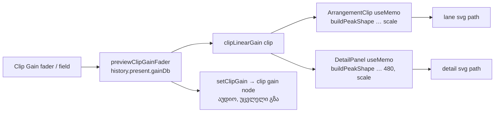

# Studio — waveform-ის სიმაღლე კლიპის Clip Gain-ს მიჰყვება

**თარიღი:** 2026-10-23
**სტატუსი:** Completed — Round 120 (T12 ეტაპი 4a, D-29z85). C PASS, გამოქვეყნებულია `0a75ba8`-ში (gate 120).
**შეცვლილი პროექტი:** Store

## კონტექსტი

T12-GAIN-VOLUME-ის მეოთხე ეტაპის პირველი ნაწილი (T12.19). Clip Gain ეტაპებში 1–2 აუდიოში უკვე მუშაობდა, მაგრამ კლიპის waveform ნებისმიერ Clip Gain-ზე ერთნაირი სიმაღლის რჩებოდა. მომხმარებელი −6 dB-იან და 0 dB-იან კლიპს ერთმანეთისგან ვერ არჩევდა. Detail panel-ის waveform-იც Clip Gain-ს არ ითვალისწინებდა.

Live 12-ის manual-ის §6.1 ამბობს, რომ Vertical Zoom waveform-ის დეტალებს აჩვენებს „clip gain-ის შეცვლის გარეშე“. აქედან **დასკვნაა** (manual-ში პირდაპირ არ წერია), რომ Clip Gain დახატულ სიმაღლეს ცვლის. სკალის ზუსტი ფორმა manual-ში აღწერილი არ არის — ეს **დაუდასტურებელია** და ABLETON-EXPERT-REVIEW-ზე მოწმდება.

## მიდგომა

- **ერთი display factor:** `buildPeakShape`-ს დაემატა სავალდებულო მეხუთე პარამეტრი `scale`. სვეტის სიმაღლე = წყაროს peak × scale, შემდეგ clamp კლიპის სიმაღლეზე (1) და ძველი 0.02 floor. Scale clamp-მდე მრავლდება, ამიტომ +3 dB-ზე მაღალი სვეტები კლიპის კიდეზე იჭრება და არ გადადის.
- **Factor = კლიპის წრფივი Clip Gain:** ორივე call site იყენებს არსებულ `clipLinearGain(clip)`-ს (`10^(dB/20)`, `gainDb`-ის არქონისას 1). Model-ში ახალი ფუნქცია არ დაემატა. ვიდეო კლიპს `gainDb` არ აქვს, ამიტომ მისი ნახატი უცვლელია.
- **რა არ შედის factor-ში:** ხაზის/ჯგუფის Volume, Master, Pan, Mute/Solo, fade-ები და envelope. T12.19 მხოლოდ Clip Gain-ს ასახელებს.
- **Raw peaks:** `normalizePeakColumns` არ გამოიყენება — ნორმალიზაცია scale-ს გააუქმებდა.
- **Live drag:** preview უკვე წერს `gainDb`-ს `history.present`-ში. `gainScale` `useMemo`-ს deps-შია, ამიტომ ნახატი fader-ის drag-ს მიჰყვება ახალი state-ის, effect-ის ან context API-ის გარეშე.
- **Detail panel ემთხვევა lane-ს:** იგივე factor და იგივე raw peaks; განსხვავდება მხოლოდ სვეტების რაოდენობა (480).
- **აუდიო უცვლელია:** context, graph, schedule, export და model არ შეცვლილა. Engine ისევ არსებული `setClipGain` გზით იღებს `clipLinearGain(clip)`-ს.
- **ალტერნატივა:** waveform-ის ნორმალიზაცია და შემდეგ gain-ის გამრავლება. უარვყავით: ჩუმი წყარო ხელოვნურად გაიზრდებოდა და ფარდობა არაპატიოსანი გახდებოდა.
- **შემდეგი ნაწილი (4b):** Waveform Vertical Zoom თავის zoom-ს იმავე `scale`-ში გაამრავლებს (`source × clipGainDisplayScale × waveformZoomScale`).

## არქიტექტურა

## შეცვლილი ფაილები

- `app/components/arrangement/ArrangementClip.tsx` — `buildPeakShape`-ის `scale` პარამეტრი და clamp, lane-ის call site `gainScale`-ით, memo deps, `clipLinearGain` import, `data-testid="arrangement-clip-waveform"` peak svg-ზე.
- `app/components/arrangement/ArrangementDetailPanel.tsx` — detail-ის call site `gainScale`-ით, deps, import.
- `app/lib/arrangement/__tests__/clip-gain-waveform.test.tsx` — ახალი ტესტები WG1–WG8.

## პრობლემები და გადაწყვეტები

- **პრობლემა:** B-ის ფორმა (`clipLinearGain(clip)` memo-ში, deps-ში `clip.gainDb`) Biome-ის `useExhaustiveDependencies`-ს არღვევდა (`clip` აკლდა, `clip.gainDb` ზედმეტი იყო). **გადაწყვეტა:** `const gainScale = clipLinearGain(clip)` memo-ს გარეთ და `gainScale` deps-ში. ქცევა იგივეა (R3).
- **პრობლემა:** არსებული სატესტო harness-ის `FakeAudioBuffer` ნულებს აბრუნებდა — ყველა სვეტი floor-ზე იყო და scale-ის ტესტი ცარიელი იქნებოდა. **გადაწყვეტა:** ახალ ტესტ ფაილს საკუთარი deterministic არანულოვანი waveform აქვს (0.15…0.75 დიაპაზონი).

## ტესტირება

- WG1: B-ის ზუსტი `path` literal-ები 0/−6/+3/−60/+24 dB-ზე, plus `NaN`/`Infinity`/`−1` fallback scale 1-ზე.
- WG2: რაუნდამდე აღებული ნახატის sha256 (`cc617f0c…`, 120 სვეტი) — scale 1 byte-for-byte იგივეა.
- WG3–WG6: lane −6 dB-ზე, live drag (release-მდე), multi drag, detail panel.
- WG7–WG8: must-not — Volume/Master/Pan/Mute/Solo/fade/envelope ნახატს არ ცვლის; playback-ში clip gain node ზუსტად `10^(dB/20)`-ს იღებს და ახალი source არ იქმნება.
- მუტაციები (თითოეული შესაბამის ტესტს წითლად აქცევს, შემდეგ აღდგა sha256-ით):
  - m1 — lane-ის memo deps-იდან gain-ის ამოღება → WG4 (drag-ის დროს ნახატი ძველი რჩება);
  - m2 — scale clamp-ის შემდეგ (`Math.min(1, max) * s`) → WG1 (+3/+24 dB სვეტები კლიპს სცდება);
  - m3 — detail call site-ზე `1` → WG6;
  - m4 — lane call site-ზე კვადრატში აყვანილი წრფივი gain → WG3.
- `npm run typecheck`, `npm run lint`, read-only Biome შეცვლილ ფაილებზე; 20 დაკავშირებული vitest ფაილი მწვანეა.

## TODO / შემდეგი ნაბიჯები

- C-ის ბრაუზერის შემოწმება (WG-SCALE, WG-LIVE, WG-AUDIO და სხვ.) round 120-ში.
- ეტაპი 4b: Waveform Vertical Zoom (T12.18, Test 7) — მხოლოდ ხედი, engine-მდე არ აღწევს.
- ABLETON-EXPERT-REVIEW: Clip Gain-ის სკალის ფორმის Ableton-თან შედარება.
