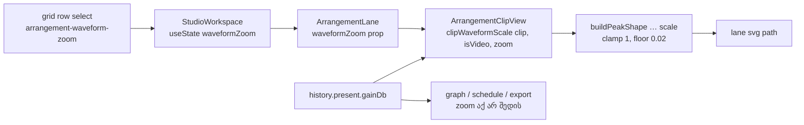

# Studio — Waveform Vertical Zoom (მხოლოდ ხედი)

**თარიღი:** 2026-10-23
**სტატუსი:** Completed — Round 121 (T12 ეტაპი 4b, D-29z86). C PASS, გამოქვეყნებულია `425a807`-ში (gate 121).
**შეცვლილი პროექტი:** Store

## კონტექსტი

T12-GAIN-VOLUME-ის მეოთხე ეტაპის მეორე ნაწილი (T12.18, T12.19, T12.26 Test 7). 4a-ს შემდეგ waveform-ის სიმაღლე Clip Gain-ს მიჰყვება, მაგრამ ჩუმი კლიპის დეტალების (transient-ები, ჩუმი ნაწილები) დასანახად მომხმარებელს Clip Gain-ის აწევა უწევდა — ანუ ხმის შეცვლა მხოლოდ სანახავად. T12.18 ამბობს: „Waveform Vertical Zoom is NOT Gain“ — ეს ორი ცალკე state-ია.

Live 12-ის manual-ის §6.1 („Layout“) **ადასტურებს**: „Waveform Vertical Zoom Level slider“ waveform-ს ადიდებს „clip gain-ის შეცვლის გარეშე“, და zoom „ყველა audio track-ზე და ახალ კლიპებზე“ ვრცელდება. Slider-ის დიაპაზონი და მდებარეობა manual-ში არ წერია (**დაუდასტურებელია**).

## მიდგომა

- **ერთი view state workspace-ში:** `StudioWorkspace`-ში `waveformZoom` (`useState(1)`). Context-ში არ შედის — ეს მხოლოდ ხედია, arrangement-ის ნაწილი არ არის, ამიტომ ვერასოდეს მიაღწევს `scheduleKey`-ს, graph-ს, meter-ებს ან export-ს. Undo/Redo-ში არ ჩაიწერება, `localStorage`-ში არ ინახება; reload-ზე `1×`-ს უბრუნდება.
- **ფორმულა (T12.19):** `displayAmplitude = peak × 10^(gainDb/20) × zoom`. სუფთა მოდული `waveform-zoom.ts`-ის `clipWaveformScale` აბრუნებს `clipLinearGain(clip) × zoom`-ს აუდიო კლიპისთვის და მხოლოდ `clipLinearGain(clip)`-ს ვიდეო კლიპისთვის. არავალიდური zoom (NaN, 0, უარყოფითი, Infinity) 1-ად ითვლება.
- **არსებული clamp და floor:** ნამრავლი `buildPeakShape`-ის არსებულ `scale` პარამეტრში შედის, ამიტომ 1.0 clamp (კლიპის სიმაღლე) და 0.02 floor ერთობლივ factor-ზე მოქმედებს. `buildPeakShape` არ შეცვლილა. `1×`-ზე ყველა ნახატი round 120-ის იდენტურია.
- **Control:** grid row-ში, `Env`-ის შემდეგ, `<select>` საფეხურებით `½× 1× 2× 4× 8×` (50–800 %). Grid-division select-ის კლასები + `appearance-none` (224 px header-ში ეტევა), `1×`-ის გარდა accent ფერი, როგორც Snap/Env-ს. ცვლილებაზე status: `Waveform Zoom 200% — მხოლოდ ხედი, ხმა არ იცვლება.`
- **Keyboard:** select-ის native ქცევა არ შეცვლილა. `isTypingTarget` focused select-ს უკვე typing-ად თვლის, ამიტომ workspace shortcut-ები (Space, ისრები, Delete) მასზე არ სრულდება.
- **რა არ იზრდება:** ვიდეო კლიპები (manual ამბობს „audio clips“) და detail panel (manual ასახელებს Arrangement-ს; panel ნამდვილ დონეს აჩვენებს).
- **CZABA-ს შეგნებული განსხვავება:** Live-ში უწყვეტი slider-ია; ჩვენთან საფეხურებიანი select. T12.18 შემცირებასაც ითხოვს, ამიტომ `½×` არსებობს.
- **ალტერნატივა:** zoom context-ში ან arrangement-ში. უარვყავით — ხედის პარამეტრი history-სა და აუდიოს გზაზე აღმოჩნდებოდა, რაც T12.19-ის „never reaches the audio engine“ წესს არღვევს.

## არქიტექტურა

## შეცვლილი ფაილები

- `app/lib/arrangement/waveform-zoom.ts` — ახალი სუფთა მოდული: დონეები, label, პროცენტი, parse, status ტექსტი, `clipWaveformScale`.
- `app/components/arrangement/ArrangementClip.tsx` — optional `waveformZoom` prop (default 1); peak memo-ს scale ახლა `clipWaveformScale`-დან მოდის.
- `app/components/arrangement/ArrangementLane.tsx` — optional `waveformZoom` prop-ის გადაცემა კლიპზე.
- `app/components/arrangement/StudioWorkspace.tsx` — view state, select grid row-ში, status, `data-waveform-zoom` grid control-ზე, prop ყველა lane-ზე.
- `app/lib/arrangement/__tests__/waveform-zoom.test.tsx` — ახალი ტესტები WZ1–WZ9.

## პრობლემები და გადაწყვეტები

- **პრობლემა:** ვიდეო კლიპის „უცვლელობის“ ტესტი უაზრო იქნებოდა, თუ ვიდეოს peaks არ აქვს (ნახატი საერთოდ არ არსებობს). **გადაწყვეტა:** ტესტი `video.client`-ის `probeVideoFile`/`decodeVideoAudio`-ს mock-ით ნამდვილ video import-ს გადის, peaks-ის გამოჩენას ელოდება და მხოლოდ შემდეგ ადარებს `1×` და `8×` ნახატს.
- **პრობლემა:** zoom-ის ცვლილება memo-ს უნდა გადაეთვალა, gain-ის ცვლილებასავით. **გადაწყვეტა:** memo-ს deps-ში ერთობლივი `peakScale`-ია; m5 მუტაციამ (deps-დან zoom-ის ამოღება) WZ2 და WZ3 გააწითლა.
- **პრობლემა:** grid row 28 px და header 224 px არ უნდა შეიცვალოს. **გადაწყვეტა:** `appearance-none`, მოკლე label-ები; transport toolbar-ს, tempo/marker/loop row-ებს არაფერი დაემატა.

## ტესტირება

- `waveform-zoom.test.tsx` — 9 ტესტი: B-ის ზუსტი literal-ები (zoom 0.5/2/4/8, −6 dB × 2, −60 dB × 8), ვიდეო და არავალიდური zoom, parse და ტექსტები (WZ1); lane-ის ნახატი 2×-ზე და დაბრუნება 1×-ზე (WZ2); Clip Gain × zoom და drag-ის preview (WZ3); ვიდეო (WZ4) და detail panel (WZ5) უცვლელია; Undo/Redo zoom-ს არ ეხება (WZ6); playback-ის დროს ახალი source და `setClipGain` არ იქმნება, პოზიცია მიდის (WZ7); ახალი კლიპი 2×-ზე იხატება (WZ8); focused select-ზე კლავიშები არაფერს არედაქტირებს (WZ9).
- მუტაციები m1–m5 — თითოეულმა შესაბამისი ტესტი გააწითლა.
- მეზობელი ტესტები (clip-gain*, detail-panel*, fades, grid-*, tempo, markers, track layout, peaks) — მწვანეა.
- ბრაუზერში Test 7-ის შემოწმება (ratio rule, export-ის და meter-ის იდენტურობა) C-ის რაუნდშია.

## TODO / შემდეგი ნაბიჯები

- C: ნამდვილი Chromium-ით WZ-T7, WZ-AUDIO, WZ-METER და დანარჩენი row-ები.
- ABLETON-EXPERT-REVIEW: slider-ის დიაპაზონი/მდებარეობა, Clip View-ში zoom, Undo-ს ქცევა — დაუდასტურებელი ნაწილები.
- Architecture checkpoint (არა ამ რაუნდში): workspace-ის view preferences-ის ერთად თავმოყრა (ARCH-CHECKPOINT-SRW14-PREFS).
