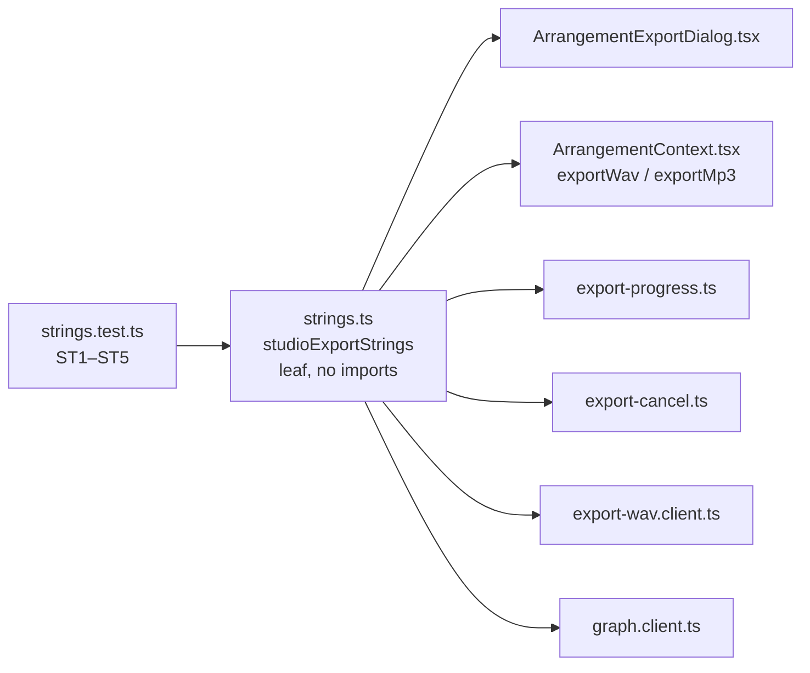

# Studio V-0.1 — Export-ის ტექსტები ინგლისურად, ერთი strings მოდულიდან

**თარიღი:** 2026-10-24
**სტატუსი:** Completed (A-ის შემოწმებები მწვანეა რაუნდ 128-ში; ბრაუზერის შემოწმება C-ის რაუნდია)
**შეცვლილი პროექტი:** Store

## კონტექსტი

VISUAL-A-ს M2 მოთხოვნით Studio-ს მთელი UI ინგლისურია და ტექსტები ერთი strings მოდულიდან მოდის; მომხმარებლის კონტენტი (ხმის სათაურები, ვიდეოს ფაილის სახელი, `source.audioNote`) არ ითარგმნება. V-0 ხუთ ეტაპად იყოფა (D-29z92). პირველი ეტაპი Export-ია: ერთი დასრულებული ფუნქცია საკუთარი ფაილებითა და ტესტების ოჯახით, რომელსაც `StudioWorkspace.tsx` არ ეხება.

## მიდგომა

- ახალი ფაილი `app/lib/arrangement/strings.ts` ექსპორტს უკეთებს ერთ ობიექტს — `studioExportStrings`. მნიშვნელობები ან ინგლისური string-ებია, ან მცირე pure formatter-ები, რომლებიც უკვე დაფორმატებულ მნიშვნელობებს იღებენ (დრო, dB, წამები).
- მოდული leaf-ია: არაფერს აიმპორტებს. ამიტომ `export-wav.client.ts` და `graph.client.ts` მას import cycle-ის გარეშე იყენებენ.
- არსებული exported კონსტანტები (`ARRANGEMENT_EXPORT_CANCELLED_MESSAGE`, `..._ENCODER_MESSAGE`, `ARRANGEMENT_WAV_WORKER_FAILED_MESSAGE`, `ARRANGEMENT_WAV_WORKER_STALLED_MESSAGE`) სახელს ინარჩუნებენ და მნიშვნელობას მოდულიდან იღებენ. stall-ის ტექსტი ახლა `ARRANGEMENT_WAV_WORKER_STALL_TIMEOUT_MS / 1000`-დან გამოითვლება (GATE103-S2). MP3 encoder-ის timeout-ის ტექსტიც `ARRANGEMENT_MP3_ENCODER_LOAD_TIMEOUT_MS / 1000`-დან მოდის; შედეგი იგივე 120 წამია.
- ქცევა არ იცვლება: ელემენტები, თანმიმდევრობა, `id`/`aria-*`, `data-testid`, კლასები, disabled-ის წესები, focus/Tab, ტაიმერები, export pipeline და ფაილის სახელები უცვლელია. JSX-ში რამდენიმე text node ერთ formatter-ის გამოძახებად გაერთიანდა; `textContent` იგივე დარჩა.
- ტესტებში ქართული literal-ი მოდულის მნიშვნელობით ან იმავე input-ით გამოძახებული formatter-ით შეიცვალა. ინგლისური literal-ები მხოლოდ `strings.test.ts`-შია (ST1–ST5), რომ არასწორი formatter თავის თავთან შედარებით ვერ გაიაროს.
- **„no file was created.“** რაუნდი 128-ის glossary-ის შესწორებით em dash-ის შემდეგ, წინადადების შუაში, პატარა ასოთი იწერება (8 key: `exportCancelled`, `exportCancelledEncoder`, `emptyProjectNoFile`, `invalidRangeNoFile`, `encoderLoadFailed`, `exportFailed`, `mp3Failed`, `encoderLoadTimeout`). `videoDecodingNoFile`-ში `No file was created.` დიდი ასოთი რჩება, რადგან იქ ახალ წინადადებას იწყებს.
- **Glossary-ის შესწორება (რაუნდი 128):** footer-ის `დახურვა` → `Done`; Modal ✕ რჩება `Close`. key-ის სახელი `closeButton` არ იცვლება: ის აღწერს, რას აკეთებს ღილაკი (dialog-ს ხურავს), და გადარქმევა 13 ფაილში 35 მიმართვას შეეხებოდა ქცევის მოგების გარეშე.
- ალტერნატივა იყო locale switch ან i18n ბიბლიოთეკა. R1 მას კრძალავს: ენა ერთია, ამიტომ plain constants საკმარისია.

## არქიტექტურა

## Georgian → English რუკა

| key | ძველი ქართული | ახალი English | სად ჩანს |
|---|---|---|---|
| formatButtonWav | WAV-ის ექსპორტი | Export WAV | footer-ის მთავარი ღილაკი |
| formatButtonMp3 | MP3-ის ექსპორტი | Export MP3 | footer-ის მთავარი ღილაკი |
| formatButtonBoth | WAV + MP3 ექსპორტი | Export WAV + MP3 | footer-ის მთავარი ღილაკი |
| formatCreatesWav | WAV შეიქმნება | WAV will be created | no-sound / Master-mute შენიშვნის ნაწილი |
| formatCreatesMp3 | MP3 შეიქმნება | MP3 will be created | იგივე |
| formatCreatesBoth | WAV და MP3 შეიქმნება | WAV and MP3 will be created | იგივე |
| formatLegend | ფორმატი | Format | ფორმატის fieldset-ის sr-only legend |
| scopeLegend | მონაკვეთი | Range | scope fieldset-ის legend |
| rangeOptionName | მონიშნული მონაკვეთი | Time selection | გამორთული range ბარათის სახელი |
| bothOptionName | WAV + MP3 · ორი ფაილი | WAV + MP3 · two files | ფორმატის ბარათი |
| videoOptionName | ვიდეო (აუდიოთი) | Video (with audio) | გამორთული ვიდეოს ბარათი |
| mp3FormatNote | LAME (ffmpeg.wasm) — encoder პირველ MP3 ექსპორტზე CDN-იდან იტვირთება (~31 MB) | LAME (ffmpeg.wasm) — the encoder loads from a CDN on the first MP3 export (~31 MB) | MP3 ბარათის შენიშვნა |
| bothFormatNote | იგივე მიქსი ორ ფაილად — ან ორივე შეიქმნება, ან არცერთი. ბრაუზერმა მეორე ფაილის ჩამოტვირთვაზე შეიძლება ნებართვა მოითხოვოს. | The same mix as two files — either both are created or neither. Your browser may ask for permission to download the second file. | WAV + MP3 ბარათის შენიშვნა |
| rangeMissingReason | მონიშნე დროის მონაკვეთი Arrangement-ში (drag კლიპზე ან სახაზავზე) | Make a time selection in the Arrangement (drag on a clip or on the ruler) | გამორთული range ბარათის მიზეზი |
| videoRenderReason | ვიდეოს რენდერი ამ ციკლში არ კეთდება — ექსპორტი მხოლოდ აუდიოა (ვიდეოს ორიგინალი ხმა შედის, თუ ჩართულია). | Video is not rendered in this version — the export is audio only (the video's original sound is included if it is on). | ვიდეოს ბარათის შენიშვნა |
| videoFadesPreviewNote | ვიდეოს fade-ები მხოლოდ პრევიუშია — ვიდეოს რენდერი არ კეთდება, ექსპორტი მხოლოდ აუდიოა. | Video fades are preview only — video is not rendered, the export is audio only. | video fade-ის შენიშვნა |
| wavNoteRangeLoop | მონიშნული მონაკვეთი წრფივად, იგივე მიქსით — loop იგნორირდება | Time selection played straight through, with the same mix — loop is ignored | WAV ბარათის შენიშვნა |
| wavNoteRange | მონიშნული მონაკვეთი, იგივე graph რაც დაკვრისას | Time selection, the same graph as playback | იგივე |
| wavNoteProjectLoop | მთელი პროექტი წრფივად 0-დან ბოლომდე, იგივე მიქსით — loop იგნორირდება | Entire project played straight through from 0 to the end, with the same mix — loop is ignored | იგივე |
| wavNoteProject | მთელი პროექტი, იგივე graph რაც დაკვრისას | Entire project, the same graph as playback | იგივე |
| videoSoundDecoding | იშიფრება — დაელოდე | Decoding — please wait | ვიდეოს ხმის სტატუსი |
| videoSoundUnreadable | ვიდეოს ხმა ვერ წაიკითხა — ექსპორტში არ შევა | The video's sound could not be read — it is not in the export | ვიდეოს ხმის სტატუსი (fallback, როცა `audioNote` არ არის) |
| videoSoundIncluded | შედის | Included | ვიდეოს ხმის სტატუსი |
| videoSoundOff | გამორთულია (M/Solo) | Off (M/Solo) | ვიდეოს ხმის სტატუსი |
| videoSoundLabel(name) | ვიდეოს ორიგინალი ხმა ({name}): | Original video sound ({name}): | ვიდეოს ხმის სია; სახელი არ ითარგმნება |
| emptyProjectNote | ექსპორტი გამორთულია: პროექტი ცარიელია — დაამატე მინიმუმ ერთი კლიპი. | Export is disabled: the project is empty — add at least one clip. | ცარიელი პროექტის შენიშვნა |
| progressAriaLabel | ექსპორტის პროგრესი | Export progress | `<progress>`-ის aria-label |
| cancelButton | გაუქმება | Cancel | რენდერის დროს ღილაკი |
| closeButton | დახურვა | Done | footer ღილაკი (**P1**; Modal ✕ რჩება `Close`) |
| busyButton | მიმდინარეობს… | Rendering… | მთავარი ღილაკი რენდერის დროს |
| progressEncoderLoad | MP3 encoder-ის ჩატვირთვა… | Loading MP3 encoder… | progress label |
| progressRendering(p) | რენდერი · p% | Rendering · p% | progress label / aria-valuetext |
| progressWavWrite(p) | WAV-ის ჩაწერა · p% | Writing WAV · p% | იგივე |
| progressMp3Encode(p) | MP3-ის შექმნა · p% | Creating MP3 · p% | იგივე |
| rangeSeconds(s) | {s} წმ | {s} s (მაგ. `4.000 s`) | range-ის სიგრძე |
| projectScope(start, end) | მთელი პროექტი · {start} — {end} | Entire project · {start} — {end} | აღწერა (`0:00`) და scope ბარათი (`00:00.000`) |
| rangeScope(label) | მონიშნული მონაკვეთი · {label} | Time selection · {label} | აღწერა და range ბარათი |
| loopRangeNote | Loop ექსპორტს არ ცვლის — იქმნება მონიშნული მონაკვეთი ({start} — {end}, {seconds}). | Loop does not change the export — the time selection is exported ({start} — {end}, {seconds}). | loop შენიშვნა |
| loopProjectNote | Loop ექსპორტს არ ცვლის — იქმნება მთელი პროექტი ({start} — {end}). | Loop does not change the export — the entire project is exported ({start} — {end}). | loop შენიშვნა |
| noSoundNote(creates, length) | პროექტში ხმოვანი კლიპი არ არის — {creates} {length} სიგრძის სიჩუმით. | There is no clip with sound in the project — {creates} with {length} of silence. | no-sound შენიშვნა |
| masterMutedNote(creates, length) | Master დადუმებულია (M) — {creates} {length} სიგრძის სიჩუმით. ჩართე Master, თუ ხმა გჭირდება. | Master is muted (M) — {creates} with {length} of silence. Unmute Master if you need sound. | Master-mute შენიშვნა |
| masterGainNote(gain) | Master: {gain} — ექსპორტში შედის. | Master: {gain} — included in the export. | Master gain შენიშვნა |
| exportCancelled | ექსპორტი გაუქმდა — ფაილი არ შეიქმნა. | Export cancelled — no file was created. | cancel-ის სტატუსი |
| exportCancelledEncoder | … MP3 encoder შემდეგ MP3 ექსპორტზე თავიდან ჩაიტვირთება. | Export cancelled — no file was created. The MP3 encoder will load again on the next MP3 export. | MP3 load/encode-ის cancel |
| wavWorkerFailed | WAV-ის ჩაწერა ვერ მოხერხდა (worker). | Writing WAV failed (worker). | შეცდომა |
| wavWorkerStalled(s) | WAV-ის ჩაწერა შეჩერდა — worker 30 წამი არ პასუხობს. | Writing WAV stalled — the worker has not responded for {s} seconds. | შეცდომა (s = 30) |
| overloadWarning | გადატვირთვა: პიკი +{peak} dBFS — {n} sample შეიზღუდა 0 dBFS-ზე. შეამცირე Master მინიმუმ {r} dB-ით და გაიმეორე ექსპორტი. | Overload: peak +{peak} dBFS — {n} sample(s) clipped to 0 dBFS. Lower Master by at least {r} dB and export again. | overload alert (1 → sample, სხვა → samples) |
| emptyProjectError | პროექტი ცარიელია — ექსპორტისთვის საჭიროა მინიმუმ ერთი კლიპი. | The project is empty — export needs at least one clip. | render-ის Error |
| masterMutedSuffix | ␠Master დადუმებულია — ფაილი სიჩუმეა. | ␠Master is muted — the file is silent. | done-ის სუფიქსი |
| emptyProjectNoFile | პროექტი ცარიელია — ფაილი არ შეიქმნა. | The project is empty — no file was created. | შეცდომა |
| videoDecodingNoFile | ვიდეოს ხმა ჯერ იშიფრება — დაელოდე და სცადე თავიდან. ფაილი არ შეიქმნა. | The video's sound is still decoding — wait and try again. No file was created. | შეცდომა |
| invalidRangeNoFile | მონაკვეთი არასწორია — ფაილი არ შეიქმნა. | The range is invalid — no file was created. | შეცდომა |
| renderingWav | რენდერი და 24-bit WAV-ის შექმნა… | Rendering and creating a 24-bit WAV… | rendering სტატუსი |
| exportedRange | მონაკვეთი {start} — {end} ({seconds}) | time selection {start} — {end} ({seconds}) | done-ის სიგრძის ნაწილი (`WAV created: time selection …`) |
| wavDone(len, suffix) | WAV შეიქმნა: {len}, 24-bit · 48 kHz · stereo.{suffix} | WAV created: {len}, 24-bit · 48 kHz · stereo.{suffix} | done |
| mp3Done(len, suffix) | MP3 შეიქმნა: {len}, 48 kHz · stereo.{suffix} | MP3 created: {len}, 48 kHz · stereo.{suffix} | done |
| bothDone(len, suffix) | WAV და MP3 შეიქმნა: {len}, WAV 24-bit · 48 kHz · stereo, MP3 48 kHz · stereo.{suffix} | WAV and MP3 created: {len}, WAV 24-bit · 48 kHz · stereo, MP3 48 kHz · stereo.{suffix} | done |
| exportFailed(reason) | ექსპორტი ვერ მოხერხდა — ფაილი არ შეიქმნა. {reason} | Export failed — no file was created. {reason} | შეცდომა |
| encoderLoading | MP3 encoder იტვირთება (ffmpeg.wasm, პირველად ~31 MB)… | Loading the MP3 encoder (ffmpeg.wasm, ~31 MB the first time)… | rendering სტატუსი |
| encoderLoadTimeout(s) | MP3 encoder 120 წამში ვერ ჩაიტვირთა — ფაილი არ შეიქმნა. შეამოწმე ინტერნეტი და სცადე თავიდან, ან აირჩიე WAV. | The MP3 encoder did not load within {s} seconds — no file was created. Check your internet connection and try again, or choose WAV. | შეცდომა (s = 120) |
| encoderLoadFailed | MP3 encoder ვერ ჩაიტვირთა (ffmpeg.wasm, unpkg CDN) — ფაილი არ შეიქმნა. შეამოწმე ინტერნეტი და სცადე თავიდან, ან აირჩიე WAV. | The MP3 encoder failed to load (ffmpeg.wasm, unpkg CDN) — no file was created. Check your internet connection and try again, or choose WAV. | შეცდომა |
| mp3Encoding | MP3-ის შექმნა… | Creating MP3… | rendering სტატუსი |
| mp3Failed(reason) | MP3-ის შექმნა ვერ მოხერხდა — ფაილი არ შეიქმნა. {reason} | Creating MP3 failed — no file was created. {reason} | შეცდომა |

უცვლელი რჩება: `Export` (სათაური), დროის ფორმატები, `WAV · 24-bit · 48 kHz · stereo`, `MP3 · 48 kHz · stereo`, ფაილის სახელები და მომხმარებლის კონტენტი. `source.audioNote` (`video.client.ts`) V-0.2-ს ეკუთვნის.

## შეცვლილი ფაილები

- `app/lib/arrangement/strings.ts` — ახალი: `studioExportStrings`.
- `app/components/arrangement/ArrangementExportDialog.tsx` — ყველა ქართული UI ტექსტი მოდულიდან.
- `app/lib/arrangement/export-progress.ts` — progress-ის 4 ტექსტი formatter-ებით.
- `app/lib/arrangement/export-cancel.ts` — 2 კონსტანტა მოდულიდან.
- `app/lib/arrangement/export-wav.client.ts` — 2 კონსტანტა მოდულიდან; stall-ის წამები timeout-იდან.
- `app/lib/arrangement/graph.client.ts` — import, overload-ის ტექსტი, ცარიელი პროექტის Error.
- `app/contexts/ArrangementContext.tsx` — import, `MASTER_MUTED_EXPORT_SUFFIX`, `exportWav`/`exportMp3`-ის ტექსტები.
- `app/lib/arrangement/__tests__/strings.test.ts` — ახალი: ST1–ST5.
- 18 ტესტი `app/lib/arrangement/__tests__/`-ში — literal → მოდულის მნიშვნელობა.
- რაუნდი 128: `strings.ts` (W0–W4-ის მნიშვნელობები), `strings.test.ts` (იგივე literal-ები), `export-dialog-hold-enter.test.tsx` (+HE8 და სათაურები), 6 ტესტში მხოლოდ სათაურები (`export-dialog-focus`, `export-dialog-focus-restore`, `export-toolbar-hold-enter`, `export-dialog-footer`, `export-cancel-ui`, `export-cancel`).

## პრობლემები და გადაწყვეტები

- **P1 — ორი ღილაკი ერთი სახელით „Close“ (C-R127-01, Medium; გადაწყდა რაუნდ 128-ში).** Problem: frozen `app/components/ui/Modal.tsx`-ის ✕ ღილაკს უკვე აქვს `aria-label="Close"`. glossary-ის footer `Close` dialog-ში მეორე ღილაკს იგივე accessible name-ით ქმნიდა. რენდერის დროს screen reader ორ „Close“-ს ისმენდა — ერთი გამორთულია, მეორე მუშაობს. 15 ტესტი, რომელიც `getByRole('button', { name })`-ით ეძებს, „Found multiple elements“ შეცდომით ვარდებოდა. Solution (B-ის გადაწყვეტილება, D-29z93): footer-ის ტექსტი → `Done`. ღილაკი მხოლოდ dialog-ს ხურავს — render-ს არ აუქმებს (ეს `Cancel`-ია) და ექსპორტს არ იწყებს; `Done` განსხვავდება `Close`-ის, `Cancel`-ისა და `Export …`-ისგან და ექსპორტის დასრულების შემდეგაც ბუნებრივად იკითხება. უარყოფილი ვარიანტები: footer-ზე `aria-label` (ხილული ტექსტი და accessible name განსხვავდებოდა — WCAG 2.5.3, label in name); Modal ✕-ის სახელის შეცვლა (frozen, საერთო auth modal-თან და store-თან, `e2e/auth-modal.spec.ts` და `e2e/accessibility.spec.ts` `button[aria-label="Close"]`-ს ეძებს — ჩაიწერა სიგნალად `ARCH-R127-MODAL-CLOSE-LABEL`); ტესტების matcher-ების შესუსტება (დუბლიკატი პროდუქტში დარჩებოდა). Ableton-ის შესახებ ამ label-ზე მტკიცება არ კეთდება. ახალი HE8 ტესტი ამოწმებს, რომ dialog-ის ყველა ღილაკს უნიკალური accessible name აქვს idle-ში და WAV render-ის დროს.
- **P2 — Edit tool-მა ბოლო space წაშალა.** Problem: ორ ადგილას (`export-progress.ts` l.3 და ორი ტესტის სათაური) ჩანაცვლების ბოლოს space დაიკარგა. Solution: Biome-მა და code-reviewer-მა იპოვეს; Edit-ით გასწორდა.
- **P3 — `0.57 * 100` floor-ით 56 ხდება.** Problem: ST2-ის progress ტესტი 57%-ს ელოდა. Solution: input 0.575-ით შეიცვალა; კოდი არ შეცვლილა.

## ტესტირება

- `npm run typecheck` — სუფთა. `npm run lint` — exit 0; შეცვლილ 26 ფაილზე read-only `npx biome check` — სუფთა.
- 33 ტესტ-ფაილი (strings, 18 granted, მეზობლები, source-reading მეზობლები): 451 passed, 15 failed. 15-ვე P1-ის შეცდომაა.
- `it`-ების რაოდენობა 18 ფაილში უცვლელია.
- მუტაციები m1–m4 ყოველი წითლდება; აღდგენა sha256-ით შემოწმდა. m3-ზე (`Closee`) P1-ის 15 ტესტი მწვანდება, რაც ადასტურებს, რომ მიზეზი მხოლოდ სახელების დამთხვევაა.
- ბრაუზერში A არ ამოწმებდა; ეს C-ის რაუნდია.
- **რაუნდი 128:** `npm run typecheck` — სუფთა; `npm run lint` — exit 0 (warning-ები არსებულია, შეცვლილ ფაილებში არცერთი); 9 შეცვლილ კოდის ფაილზე read-only `npx biome check` — სუფთა. 25 ტესტ-ფაილი (strings, 18 granted, 6 მეზობელი): 316 passed, 0 failed (315 + HE8); რაუნდ 127-ის 15 წითელი ტესტი მწვანეა. მუტაციები: m5 (`closeButton` → `Close`) — 17 წითელი (15 + HE8 + ST1); m6 (`Export WAV`) — HE8 წითელი idle-ში (`expected 2 to be 1`); m6b (`busyButton` → `Cancel`, code-reviewer-ის შენიშვნის შემდეგ) — HE8-ის საერთო უნიკალურობის `Set` შემოწმება წითელი render-ის დროს (`["Close","Cancel","Done","Cancel"]: expected 3 to be 4`); ამისთვის HE8-ში Cancel helper-ის query უნიკალურობის შემოწმების შემდეგ გადავიდა. m7 (`in this cycle` / `range ${start}`) — ST1 / ST2 წითელი. აღდგენა sha256-ით შემოწმდა.

## TODO / შემდეგი ნაბიჯები

- C: EX-KEYS, EX-COPY, EX-LAYOUT ბრაუზერში (`Done` = 1, `Close` = 1, დუბლიკატი სახელი არ არის).
- `deferred_low_polish`: C-R127-L1e (`Rendering…` encoder load/MP3 encode-ის დროსაც) და C-R127-L1f (`export-cancel.test` / `export-wav.test` კონსტანტის შედარება საკუთარ წყაროსთან).
- სიგნალი `ARCH-R127-MODAL-CLOSE-LABEL` — Modal ✕-ის label ცალკე დავალებად და owner-ით.
- V-0.2: `ArrangementContext`-ის დანარჩენი სტატუსები და `source.audioNote`.
