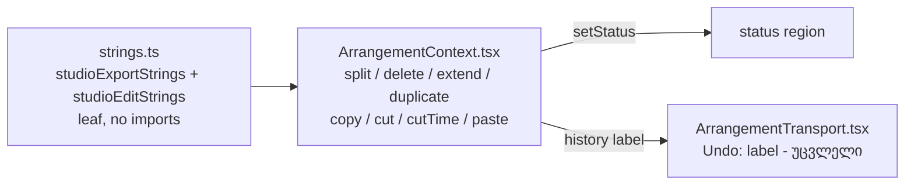

# Studio V-0.2a — რედაქტირების ბრძანებების ტექსტები ინგლისურად

**თარიღი:** 2026-10-24
**სტატუსი:** Completed (A-ის შემოწმებები მწვანეა რაუნდ 129-ში; ბრაუზერის შემოწმება C-ის რაუნდია)
**შეცვლილი პროექტი:** Store

## კონტექსტი

VISUAL-A-ს M2 მოთხოვნით Studio-ს მთელი UI ინგლისურია, ტექსტები კი ერთი strings მოდულიდან მოდის. V-0.1-მა (doc 104) Export ინგლისურად გადაიყვანა. დანარჩენი Studio ქართული დარჩა, ამიტომ V-0 დასრულებამდე ინტერფეისი შერეულ ენაზეა. V-0.2-ში `ArrangementContext.tsx`-ის დარჩენილი ქართული ხაზები და helper მოდულები შედის. მათ დაახლოებით 46 ტესტფაილი ამოწმებს. ერთი შემოწმებადი რაუნდისთვის ეს ძალიან ბევრია, ამიტომ V-0.2 სამად გაიყო (D-29z94). საბოლოო მოცულობა არ შემცირებულა:

- **V-0.2a (ეს ეტაპი):** რედაქტირების ბრძანებები `splitSelection`-დან `pasteClipboard`-მდე და 6 კონსტანტა, რომლებსაც მხოლოდ ეს ბრძანებები იყენებს.
- **V-0.2b:** playback, ბიბლიოთეკიდან დამატება/drop, loop, move/nudge და gesture-ის კონსტანტები.
- **V-0.2c:** ვიდეოს იმპორტის შეტყობინებები და helper მოდულები (`groups.ts`, `selection.ts`, `library.ts`, `video.ts`, `video.client.ts`, `tempo.ts`, `metronome.ts`, `view.ts`).

## მიდგომა

- `app/lib/arrangement/strings.ts`-ს დაემატა მეორე ობიექტი, `studioEditStrings`. ის ისევ leaf მოდულია და არაფერს აიმპორტებს. მნიშვნელობები ან plain string-ებია, ან მცირე pure formatter-ები. formatter-ი იღებს უკვე დაფორმატებულ დროს (`formatArrangementTime`), რიცხვს ან ხაზის სახელს.
- მხოლობითი/მრავლობითი ფორმას formatter-ი ირჩევს: 1-ზე მხოლობითს, სხვა რიცხვზე მრავლობითს (`overloadWarning`-ის მსგავსად). ეს ეხება E4, E16, E26, E28, E30, E33, E36a, E36b ჩანაწერებს.
- **პირობითი ტექსტი Context-ში რჩება.** `range.allTracks ? …`, paste-ის უარის ternary, `hasMaterial ? …`, loop/marker suffix-ის შეერთება და ხაზის სახელის მოძებნა იქვე დარჩა, სადაც იყო. ისინი მხოლოდ მოდულის მნიშვნელობას ან formatter-ს ირჩევენ. საკითხი „პირობითი ტექსტი formatter-ებში“ ამ რაუნდში არ წყდება; გადაწყვეტილება V-0.3-მდეა საჭირო.
- 6 კონსტანტა (`LOOP_REMOVED_MESSAGE`, `CLIPBOARD_EMPTY_MESSAGE`, `DUPLICATE_RANGE_MESSAGE`, `DUPLICATE_EMPTY_MESSAGE`, `GROUP_SPLIT_MISS_MESSAGE`, `CUT_TIME_NEEDS_RANGE_MESSAGE`) წაიშალა. მათ ნაცვლად გამოყენების ადგილებში პირდაპირ მოდულის მნიშვნელობა დგას. alias კონსტანტები gate-128-ის reviewer-მაც მოინიშნა. `LOOP_STEP_BLOCKED_MESSAGE` V-0.2b-ს ეკუთვნის და უცვლელია.
- ქცევა არ იცვლება: არცერთი პირობა, შემოწმებების თანმიმდევრობა, state-ის განახლება, selection, history push, clipboard, dependency array ან ტაიმინგი არ შეცვლილა. შეიცვალა მხოლოდ string expression-ები.
- **X1:** `studioExportStrings.invalidRangeNoFile` ახლა ასე იკითხება: `The time selection is invalid — no file was created.` (round 128-ის reviewer-ის Low (d)).
- **ხაზების სახელები ჯერ არ ითარგმნება.** `ვიდეო`, `მუსიკა`, `სტემები` და fallback `—` მოდის `studio-lab.tsx`-დან და Context-ის fallback-იდან (V-0.4/V-0.5). ამიტომ status-ში დროებით ასეთი ტექსტი ჩანს: `on the მუსიკა track`. სახელების ახლა გადატანა lane-ის სიგანეს (RV-1) და ბევრ დაუკავშირებელ ტესტს შეცვლიდა.
- ცვლილება არ ეხება `Cut` / `Cut Time` history label-ებს (უკვე ინგლისურია), `Undo: ` / `Redo: ` prefix-ს (`ArrangementTransport.tsx`, V-0.3), სიმბოლოებს `⌫`, `·`, `—`, `–` და დროის ფორმატს.

### E/X რუკა (მოკლედ)

| ჯგუფი | key-ები |
|---|---|
| Split | `splitAllTracksRefused`, `splitMissesSelection`, `historySplitClips(n)`, `splitClipsDone`, `splitRangeFailed`, `historySplitRange`, `splitRangeDone`, `splitNeedsTarget`, `splitPlayheadOutside`, `historySplit`, `splitDone(t)` |
| Delete | `deleteRangeEmpty`, `historyDeleteRange`, `historyDeleteRangeAllTracks`, `deleteRangeDone`, `onAllTracks`, `onTrack(track)`, `historyDeleteClips(n)`, `deleteClipsDone(n)`, `deleteNeedsTarget`, `historyDeleteClip`, `deleteClipDone` |
| Ctrl+Shift+L | `extendNeedsRange`, `extendDone` |
| Duplicate | `duplicateRangeRefused`, `duplicateNeedsClip`, `duplicateConflict`, `historyDuplicate(n)`, `duplicateDone` |
| Copy / Cut | `copyRangeEmpty`, `copyRangeDone`, `allTracks`, `copyNeedsTarget`, `copyClipsDone(n)`, `cutRangeEmpty`, `cutNeedsTarget`, `cutDone(n)` |
| Cut Time | `cutTimeNeedsRange`, `cutTimeNothing`, `cutTimeDone`, `cutTimeParts(n)`, `cutTimeNoSound`, `loopRemoved`, `markersRemoved(n)` |
| Paste | `pasteOverlap`, `pasteLaneKind`, `pasteMissing`, `clipboardEmpty`, `historyPaste(n)`, `pasteDone`, `pasteTrackSuffix(track)` |
| X1 | `studioExportStrings.invalidRangeNoFile` (მხოლოდ მნიშვნელობა) |

ზუსტი ინგლისური ტექსტი `current-task.md` §1.1-ის ცხრილშია და `strings.test.ts`-ის ST6/ST7 ამოწმებს მას.

### Glossary-ის დამატებები

Split, Delete clip, Delete time selection, Duplicate, Copy, Cut, Cut Time, Paste, clipboard (`ბუფერი`), gap (`სიცარიელე`), part (`ნაწილი`), playhead, time selection (`მონაკვეთი`), `on the {track} track` (`{track} ხაზზე`), `on all tracks` (`ყველა ხაზზე`).

## არქიტექტურა

## შეცვლილი ფაილები

- `app/lib/arrangement/strings.ts`: ახალი `studioEditStrings` ობიექტი და X1-ის მნიშვნელობა.
- `app/contexts/ArrangementContext.tsx`: import, 6 კონსტანტის წაშლა, string literal-ები 8 ბრძანებაში.
- `app/lib/arrangement/__tests__/strings.test.ts`: ST6–ST9 და X1-ის literal ST1-ში.
- 8 ტესტფაილი (`delete-selection-ui`, `all-lane-clipboard`, `ArrangementContext`, `markers-ui`, `status-announcement-ui`, `fader-guards`, `self-disabling-focus`, `grid-snap-position`): ქართული literal-ები მოდულის მნიშვნელობით ან formatter-ით შეიცვალა, იგივე matcher-ით.
- ეს დოკუმენტი.

## პრობლემები და გადაწყვეტები

- **პრობლემა:** რამდენიმე ტესტი ამოწმებდა ფრაგმენტს და არა მთლიან ტექსტს (`toContain('ბუფერი არ შეცვლილა')`, `not.toContain('სიცარიელე დაიხურა')`, `not.toContain('მარკერი წაიშალა')`). ქართული ფრაგმენტის დატოვების შემთხვევაში `not.toContain` ყოველთვის გაივლიდა, `toContain` კი ჩავარდებოდა. → **გადაწყვეტა:** ფრაგმენტი ინგლისურ ფრაგმენტად ითარგმნა იმავე matcher-ით: `'the clipboard did not change'`, `'the gap was closed'`, `'marker'`. `'marker'`-ის მიზეზი: ქართული ფრაგმენტი მხოლობით და მრავლობით ფორმას ერთად ფარავდა, `marker` კი `marker` და `markers` ორივეს ფარავს. სადაც მოდულის მნიშვნელობა ფრაგმენტს ზუსტად გამოხატავს, ის გამოიყენება: `not.toContain(onTrack('SFX'))`, `endsWith(markersRemoved(1))`.
- **პრობლემა:** m4 მუტაციამ (single-clip delete-ის status → `deleteClipsDone(1)`) ვერცერთი UI ტესტი ვერ გააწითლა. ერთი კლიპის წაშლის status-ს არცერთი UI ტესტი არ ამოწმებს და ასე იყო baseline-შიც (ქართულ ტექსტს grep-ით ტესტებში არცერთი დამთხვევა არ ჰქონდა). → **გადაწყვეტა:** ახალი assertion-ის დამატება ამ რაუნდის ownership-ის გარეთაა, ამიტომ ეს B-ს ეცნობა. დამატებითმა მუტაციებმა დაადასტურა, რომ ის ტექსტები, რომლებსაც UI ტესტები ამოწმებს, სწორად არის მიბმული: `onAllTracks` → `onTrack('—')` აწითლებს `delete-selection-ui`-ს, `splitDone` → `splitClipsDone({count:1})` კი `status-announcement-ui` HK2-ს.

## ტესტირება

- `npm run typecheck` და `npm run lint` (exit 0; ძველი warning-ები ამ ცვლილებას არ ეხება). 11 შეცვლილ კოდის ფაილზე read-only `npx biome check` სუფთაა.
- `npx vitest run` 19 ფაილზე: `strings`, 8 დამოკიდებული ფაილი, მეზობლები `delete-selection`, `clipboard`, `clip-gain`, `grid-snap-edit`, `model`, `gesture-guard`, `export-dialog-a11y-copy`, `export-range-ui`, `export-range`, `export-wav`. 386/386 მწვანეა.
- `it`-ების რაოდენობა უცვლელია. გამონაკლისი `strings.test.ts`-ია (5 → 9).
- მუტაციები: m1 (`deleteClipDone` ქართულად) აწითლებს ST6/ST8-ს და ST4-საც. m2 (`'გაყოფა'` history label) აწითლებს ST9-ს. m3 (`copyClipsDone` რიცხვს უგულებელყოფს) აწითლებს ST7-ს. m4 გადარჩა (იხ. ზემოთ).

## TODO / შემდეგი ნაბიჯები

- B: გადაწყვიტოს, დაემატოს თუ არა ერთი კლიპის წაშლის status-ის assertion UI ტესტში (m4-ის ხარვეზი).
- V-0.2b: playback, library add/drop, loop, move/nudge.
- V-0.2c: ვიდეოს იმპორტი და helper მოდულები.
- V-0.3-მდე: frontend-architect-ის checkpoint strings მოდულის ფორმასა და პირობით ტექსტზე.
- ხაზების სახელების თარგმნა: V-0.4/V-0.5.
