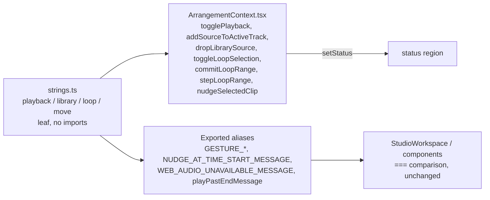

# Studio V-0.2b — playback-ის, ბიბლიოთეკის, loop-ისა და nudge-ის ტექსტები ინგლისურად

**თარიღი:** 2026-10-24
**სტატუსი:** Completed (A-ის შემოწმებები მწვანეა რაუნდ 130-ში; C round 130 — PASS, browserVerified; gate 130 — ba54297)
**შეცვლილი პროექტი:** Store

## კონტექსტი

VISUAL-A-ს M2 მოთხოვნით Studio-ს მთელი UI ინგლისურია და ტექსტები ერთი strings მოდულიდან მოდის. V-0.1-მა (doc 104) Export გადაიყვანა, V-0.2a-მ (doc 105) რედაქტირების ბრძანებები. V-0.2b მოიცავს `ArrangementContext.tsx`-ის შემდეგ ნაწილს: დაკვრის უარს (ცარიელი პროექტი, playhead პროექტის ბოლოს მიღმა), ბიბლიოთეკიდან დამატებასა და drop-ს, Ctrl+L loop-ს, loop brace-ის ნაბიჯს, კლიპის ჩაჩოჩებას (nudge) და drag-ის დროს ბრძანებების უარს. V-0 დასრულებამდე ინტერფეისი ისევ შერეულ ენაზეა (gate-128-ის Medium შენიშვნა).

## მიდგომა

- `app/lib/arrangement/strings.ts`-ს დაემატა ოთხი ობიექტი: `studioPlaybackStrings`, `studioLibraryStrings`, `studioLoopStrings`, `studioMoveStrings`. მოდული ისევ leaf-ია და არაფერს აიმპორტებს. formatter-ები უკვე დაფორმატებულ დროს (`formatArrangementTime`), `formatLoopSpan`-ის შედეგს, ხმის სათაურს ან ხაზის სახელს იღებენ.
- **Export-ირებული სახელები რჩება, მნიშვნელობა მოდულიდან მოდის.** `GESTURE_UNDO_BLOCKED_MESSAGE`, `GESTURE_EDIT_BLOCKED_MESSAGE`, `NUDGE_AT_TIME_START_MESSAGE`, `WEB_AUDIO_UNAVAILABLE_MESSAGE` და `playPastEndMessage(position, end)` იგივე სახელითა და signature-ით რჩება. მათ 7 frozen კომპონენტი და ტესტები აიმპორტებს, `StudioWorkspace` და Context კი `===`-ით ადარებენ. ამიტომ ისინი alias-ებია, მაგალითად `NUDGE_AT_TIME_START_MESSAGE = studioMoveStrings.nudgeAtTimeStart`. `playPastEndMessage` დროს თვითონ აფორმატებს და `playPastEnd({position, end})`-ს გადასცემს.
- **Private კონსტანტები alias-ებად დარჩა.** `AUDIO_ON_VIDEO_LANE_MESSAGE`, `LIBRARY_DROP_BLOCKED_MESSAGE`, `librarySourceFailedMessage` და `LOOP_STEP_BLOCKED_MESSAGE` არ წაშლილა. ისინი მოდულის მნიშვნელობაზე მიუთითებენ. ასე გამოყენების 7 ადგილი (baseline `1e453b1`: l.1263, 1381, 1389, 1454, 1459, 1469, 1710) უცვლელია და diff მცირეა.
- **პირობითი ტექსტი Context-ში რჩება.** `moved ? nearestFreeSpot : ''`, `replaced ? …`, `enabling ? …`, `state?.status === 'error' ? …` და `keyRepeat ? () => message : message` thunk-ები იქვე დარჩა. ისინი მხოლოდ მოდულის მნიშვნელობას ან formatter-ს ირჩევენ.
- ქცევა არ იცვლება: არცერთი პირობა, შემოწმებების თანმიმდევრობა, dependency array, state-ის განახლება, selection, history push, playback ან scheduling არ შეცვლილა. შეიცვალა მხოლოდ string expression-ები. სამი გამოძახება რამდენიმე ხაზად დაიყო: ორი `applyEdit` `toggleLoopSelection`-ში და `commitArrangement` `commitLoopRange`-ში. ერთი Biome-მა მოითხოვა, ორი ხაზის სიგანის გამო დაიყო. არგუმენტები და მათი რიგი იგივეა.
- **Move/Trim history label-ები (წესი (a)).** `გადატანა (${ids.length})` (ჯგუფის nudge) ქართულად რჩება. იგივე label-ს `ArrangementClip.tsx` წერს მაუსით ჯგუფის გადატანისას. ყველა move/trim label ერთად გადავა V-0.4-ში, რომ ერთ მოქმედებას ორ ენაზე ორი Undo label არ ჰქონდეს. `კლიპის ჩაჩოჩება` (P25) კი ახლა `Nudge clip`-ია, რადგან მას მხოლოდ კლავიატურის nudge წერს.
- **ხაზის როლები P4-ში.** `strings.ts`-ში ქართული ტექსტი არ უნდა იყოს (ST12), V-0.4-ის ინგლისური ხაზის სახელები კი ჯერ არ არის გადაწყვეტილი. ამიტომ P4 ხაზის როლებს პატარა ასოებით ასახელებს: `music, stems or SFX`.
- **დროებით შერეული ენა.** `studio-lab.tsx`-ში ხაზის სახელები ისევ ქართულია (V-0.4). ამიტომ status-ში ჩანს ასეთი ტექსტი: `“X” added to the მუსიკა track at …`. ჯგუფის nudge-ის label და `GROUP_MOVE_BLOCKED_MESSAGE` ჯერ ქართულია, ერთი კლიპის nudge კი უკვე ინგლისურია.
- უცვლელია: ნაგულისხმევი ხაზის სახელები (`ვიდეო`, `აუდიო`, V-0.4), `GROUP_MOVE_BLOCKED_MESSAGE` (`selection.ts`, V-0.2c), ვიდეოს იმპორტის ტექსტები (V-0.2c) და უკვე ინგლისური `Loop: {span}{ · off}.` status-ები.

### P რუკა (მოკლედ)

| ობიექტი | key-ები |
|---|---|
| `studioPlaybackStrings` | `webAudioUnavailable` (P7), `nothingToPlay` (P10), `playPastEnd({position, end})` (P9) |
| `studioLibraryStrings` | `audioOnVideoTrack` (P4), `dropBlocked` (P5), `sourceFailed(title)` (P6), `selectSoundFirst` (P11), `sourceNotLoaded(title)` (P12), `addFailed` (P13), `historyAdd(title)` (P14), `clipAdded({title, track, time, suffix})` (P15), `nearestFreeSpot` (P15a), `dropNotLoaded` (P16) |
| `studioLoopStrings` | `stepBlocked` (P8), `tooShort` (P17), `historyReplaced` / `historyCreated` (P18), `replaced(span)` / `created(span)` (P19), `needsSelection` (P20), `historyOn` / `historyOff` (P21), `on` / `off` (P22), `historyRange` (P23) |
| `studioMoveStrings` | `undoBlockedDuringDrag` (P1), `editBlockedDuringDrag` (P2), `nudgeAtTimeStart` (P3), `nudgeBlocked` (P24), `historyNudgeClip` (P25) |

ზუსტი ინგლისური ტექსტი `current-task.md` §1.1-ის ცხრილშია (რაუნდი 130). `strings.test.ts`-ის ST10/ST11 ამოწმებს მას. ქართული „…“ ბრჭყალები ინგლისური “…”-ით (U+201C / U+201D) შეიცვალა.

### Glossary-ის დამატებები

nudge (`ჩაჩოჩება`), loop range (`Loop-ის დიაპაზონი`), Loop on / Loop off, “… failed to load — details are in the library.” (`collection.ts` V-0.2c-ში ხელახლა გამოიყენებს), No room here (`აქ ადგილი არ არის`, `selection.ts`-ისა და ArrangementLane-ის ghost-ისთვის V-0.2c/V-0.4-ში), has not loaded yet (`ჯერ არ ჩატვირთულა`), nearest free spot, Add — {title}, let go first (`ჯერ ხელი აუშვი`), start of the timeline (`დროის დასაწყისი`).

## არქიტექტურა

## შეცვლილი ფაილები

- `app/lib/arrangement/strings.ts`: ოთხი ახალი ობიექტი. `studioExportStrings` და `studioEditStrings` უცვლელია.
- `app/contexts/ArrangementContext.tsx`: import, l.178–190-ის კონსტანტები და `playPastEndMessage` მოდულიდან, string literal-ები 8 callback-ში.
- `app/lib/arrangement/__tests__/strings.test.ts`: ახალი describe ST10–ST13. ST9-ის კონსტანტების ციკლი ახლა ამოწმებს, რომ ექვსივე სახელი წაშლილია (`index === -1`).
- `app/lib/arrangement/__tests__/status-announcement-ui.test.tsx`: ტექსტები მოდულიდან და ახალი `it` SA-DEL (ერთი და ორი კლიპის წაშლის status).
- `grid-snap-ui`, `grid-snap-loop-drop`, `marker-time-snap-ui`, `gesture-reentry`, `failed-source-refusal`, `collection-load-status`, `ArrangementContext.test.ts`: მოსალოდნელი ტექსტები მოდულიდან, იგივე matcher-ით. ქართული ხაზის სახელები (`მუსიკა`, `სტემები`) interpolation-ში რჩება.

## პრობლემები და გადაწყვეტები

- **პრობლემა:** ST13-ის მოსალოდნელ სიაში Context-ის ხაზები `${…}`-ს შეიცავს. ჩვეულებრივ string-ში ეს Biome-ის `noTemplateCurlyInString` warning-ს იწვევს. **გადაწყვეტა:** ორივე მხარეს `${` იცვლება `{`-ით და მერე დარდება. შედარება სხვა მხრივ ზუსტია: ხაზები, რიგი და რაოდენობა.
- **პრობლემა:** m7 მუტაციამ (`clipAdded`-იდან `{track}` ამოიღო) მხოლოდ ST11 გააწითლა, `grid-snap-loop-drop` მწვანე დარჩა. **მიზეზი:** UI ტესტი მოსალოდნელ ტექსტს იმავე formatter-ით აგებს (§2-ის წესი: „მოდულის მნიშვნელობა ან formatter“). ამიტომ template-ის ცვლილება ორივე მხარეს ერთნაირად აისახება. ტექსტის სიზუსტეს ST10/ST11 იცავს, UI ტესტი კი ამოწმებს, რომ Context სწორ formatter-ს სწორი არგუმენტებით იძახებს. ანგარიშში ეს B-ს გადაეცა.

## ტესტირება

- `npm run typecheck`: სუფთაა. `npm run lint`: შეცვლილ ფაილებზე შეცდომა არ არის. read-only `npx biome check` 11 ფაილზე სუფთაა.
- `npx vitest run`: 21 ფაილი, 413 ტესტი, ყველა მწვანე. ესენია: 9 მინიჭებული ფაილი, name-only importer-ები (`self-disabling-focus`, `pending-status`, `clip-gain-fader`, `export-mp3`) და მეზობლები (`model`, `collection`, `purchased-collection-ui`, `grid-snap-edit`, `grid-snap-clip-edges`, `marker-snap`, `delete-selection-ui`, `gesture-guard`).
- მუტაციები: m5 (ST10, ST12 და ST4 წითელი), m6 (ST13 წითელი), m7 (ST11 წითელი, `grid-snap-loop-drop` მწვანე, იხ. ზემოთ), m8 (HK1 წითელი), m4 (SA-DEL წითელი). ყოველი მუტაცია აღდგა და sha256-ით შემოწმდა.
- ბრაუზერის შემოწმება (PLAY/LIB/LOOP/NUDGE-COPY, GEO-COUNT, LAYOUT) C-ის რაუნდია.

## TODO / შემდეგი ნაბიჯები

- V-0.2c: ვიდეოს იმპორტის შეტყობინებები და helper მოდულები (`groups.ts`, `selection.ts`, `library.ts`, `video.ts`, `video.client.ts`, `tempo.ts`, `metronome.ts`, `view.ts`, `collection.ts`).
- V-0.4: move/trim history label-ები `ArrangementClip.tsx`-თან ერთად, ხაზის სახელები და drop ghost-ის ტექსტები.
- frontend-architect checkpoint V-0.2c-ის დასრულებისას: strings მოდულის ფორმა, პირობითი ტექსტი formatter-ში თუ Context-ში, Context-ის ზომა.
