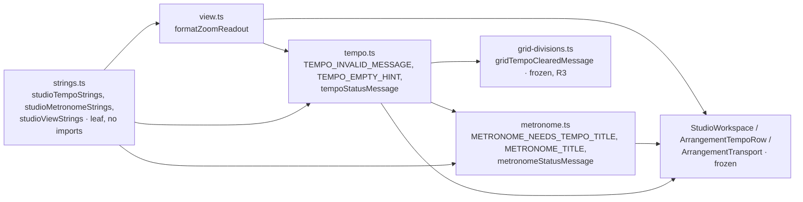

# Studio V-0.2c2 — ტემპის, მეტრონომისა და zoom-ის ტექსტები ინგლისურად

**თარიღი:** 2026-10-24
**სტატუსი:** Completed (A-ის შემოწმებები მწვანეა რაუნდ 132-ში; C round 132 — PASS, browserVerified; gate 132 — b25507e)
**შეცვლილი პროექტი:** Store

## კონტექსტი

VISUAL-A-ს M2 მოთხოვნით Studio-ს მთელი UI ინგლისურია, ტექსტები კი ერთი strings მოდულიდან მოდის. V-0.2c სამ ეტაპად დაიყო (doc 107). c1-მა ვიდეოს იმპორტი მოიცვა. ეს რაუნდი c2-ია: `tempo.ts`, `metronome.ts` და `view.ts`. ამ სამ ფაილში ქართული 9 ხაზზე იყო. tempo-ში 4 ხაზი იყო (l.11, 12, 43, 45), metronome-ში 4 (l.10, 11, 115, 117), view-ში კი 1 (l.258). c3 (`selection.ts`, `groups.ts`) შემდეგი რაუნდია.

## მიდგომა

- `app/lib/arrangement/strings.ts`-ს დაემატა სამი ობიექტი: `studioTempoStrings`, `studioMetronomeStrings` და `studioViewStrings`. არსებული შვიდი ობიექტი უცვლელია. მოდული ისევ leaf-ია და არაფერს აიმპორტებს.
- formatter-ები უკვე მზა მნიშვნელობებს იღებს. `bpm` არის `formatTempoBpm(bpm)`-ის შედეგი, რომელიც `tempo.ts` / `metronome.ts`-ში იძახება. `beatsPerBar`, `min` და `max` გამომძახებელი გადასცემს `TEMPO_BEATS_PER_BAR`, `TEMPO_BPM_MIN` და `TEMPO_BPM_MAX` მუდმივებიდან. zoom-ის რიცხვი `view.ts`-ში იმავე `Math.round(pxPerSecond * 10) / 10`-ით მრგვალდება.
- **Export-ირებული სახელები რჩება, მნიშვნელობა მოდულიდან მოდის.** `TEMPO_INVALID_MESSAGE`, `TEMPO_EMPTY_HINT`, `METRONOME_NEEDS_TEMPO_TITLE` და `METRONOME_TITLE` იგივე სახელის მუდმივებია. `tempoStatusMessage`, `metronomeStatusMessage` და `formatZoomReadout` სახელს, პარამეტრებსა და return type-ს ინარჩუნებს. importer-ები (`StudioWorkspace.tsx`, `ArrangementTempoRow.tsx`, `ArrangementTransport.tsx`, `grid-divisions.ts`) არ შეცვლილა.
- **პირობითი ტექსტი იქვე რჩება.** `bpm === null` branch-ები `tempo.ts`-სა და `metronome.ts`-ში დარჩა და მხოლოდ მოდულის მნიშვნელობას ირჩევს.
- ქცევა არ იცვლება. უცვლელია tempo-ს parsing (`TEMPO_TEXT_PATTERN`, `parseTempoBpm`), `formatTempoBpm`, საზღვრები, ტაქტების სახაზავის ნიშნები, მეტრონომის scheduling და click sample-ები, zoom-ის დამრგვალება. შეიცვალა მხოლოდ string expression-ები და import-ები.
- **Import-ის მიმართულება:** `tempo.ts`, `metronome.ts` და `view.ts` `./strings`-ს აიმპორტებს. ციკლი არ ჩნდება, რადგან `strings.ts` არაფერს აიმპორტებს. `METRONOME_TITLE` import-ის დროს ფასდება, `TEMPO_BEATS_PER_BAR`-ითა და formatter-ით, და ტესტებში `undefined` არ ჩანს.

### T/M/Z რუკა

| # | key | ინგლისური |
|---|---|---|
| T1 | `studioTempoStrings.invalid({min, max})` | `Tempo must be {min}–{max} BPM (e.g. 90 or 92.5) — not changed.` |
| T2 | `studioTempoStrings.emptyHint` | `Bars: set a BPM — grid only, audio is not stretched` |
| T3 | `studioTempoStrings.cleared` | `Tempo cleared — the bars ruler is hidden. Audio is unchanged.` |
| T4 | `studioTempoStrings.set({bpm, beatsPerBar})` | `Tempo {bpm} BPM · {beatsPerBar}/4 — bars ruler updated. Grid only: audio is not stretched.` |
| M1 | `studioMetronomeStrings.needsTempoTitle` | `Metronome — set a BPM first` |
| M2 | `studioMetronomeStrings.title(beatsPerBar)` | `Metronome — a click on every beat during playback ({beatsPerBar}/4, the first beat of each bar is louder). Master volume and Mute also apply to it. Not included in the export.` |
| M3 | `studioMetronomeStrings.off` | `Metronome is off.` |
| M4 | `studioMetronomeStrings.on({bpm, beatsPerBar})` | `Metronome is on — {bpm} BPM, {beatsPerBar}/4: a click on every beat, louder on the first beat of each bar. Not included in the export.` |
| Z1 | `studioViewStrings.zoomReadout(value)` | `{value} px/s` |

### ფაქტები, რომლებიც უნდა შენარჩუნდეს

მომხმარებლის შეზღუდვით grid tempo არ არის audio stretch. ამიტომ T2–T4-ში რჩება „grid only“, „audio is not stretched“ ან „Audio is unchanged“. M2-სა და M4-ში რჩება „Not included in the export“ და „louder on the first beat of each bar“ (M2-ში „the first beat of each bar is louder“). M2-ში რჩება აგრეთვე „Master volume and Mute also apply“. T1-ში რჩება საზღვრები 20–999 და მაგალითები 90 / 92.5. ქართულ ტექსტთან გვერდიგვერდ შედარებისას არცერთ ხაზს ფაქტი არ დაჰკლებია და არც დამატებია.

### B-ის გადაწყვეტილებები

- **R3 — GATE132-TEMPO-CLEARED-MIXED.** `gridTempoClearedMessage` (`grid-divisions.ts`) ასე აწყობს ტექსტს: `tempoStatusMessage(null)`, შემდეგ `ბადე დაბრუნდა წამებზე: ${formatGridDivision(step)}.`. `formatGridDivision` (`grid.ts`, `… წმ`) ყველა წამის დაყოფის label-ია და 11 ტესტ-ფაილში 88 ხაზზეა დაფიქსირებული. ის V-0.3-ის grid label-ების სამუშაოა. ამიტომ BPM-ის წაშლა მუსიკალური დაყოფისას დროებით ორენოვან ხაზს აჩვენებს: `Tempo cleared — the bars ruler is hidden. Audio is unchanged. ბადე დაბრუნდა წამებზე: 0.5 წმ.`. გამონაკლისი GATE128-S1-ის ქვეშ აღირიცხება. V-0.3-მა ის უნდა დახუროს და `grid.ts`-იც (`formatGridDivision`) მასში შედის.
- **R4.** `ArrangementTransport.tsx`-ის zoom slider-ის `aria-label="Zoom (px/წმ)"` V-0.3-ში რჩება, Transport-ის დანარჩენ ტექსტებთან ერთად. მისი `aria-valuetext` (`formatZoomReadout`) ამ რაუნდიდან `px/s`-ია. V-0.3-მდე label-ისა და მნიშვნელობის ერთეული განსხვავდება.
- უცვლელია აგრეთვე tempo row-ის საკუთარი ტექსტები (`ArrangementTempoRow.tsx`): BPM ველის `aria-label` `პროექტის ტემპი (BPM)`, მისი `title` და `მეტრონომი` ღილაკის label. ასევე უცვლელია `grid-divisions.ts` / `grid.ts`-ის ყველა ტექსტი. ორივე V-0.3-ში გადავა.

### წინსწრებითი წესი (GATE130-S3)

ყოველ ახალ formatter-ს UI ტესტში ერთი ხელით დაწერილი ინგლისური literal აქვს. `tempo-ui.test.tsx`-ს დაემატა T-UI1–T-UI4, `metronome-ui.test.tsx`-ს M-UI1–M-UI4, ყველა არსებულ `it`-ში. ექვს ტესტში `'40 px/წმ'` შეიცვალა ხელით დაწერილი `'40 px/s'`-ით (Z1-ის UI pin-ები). T-UI2 `for` ციკლში დარჩა (`1000` / `abc` / `999.5`). სამივე შემთხვევაში ტექსტი ერთია, ამიტომ ეს გადახვევა არ არის.

### Glossary-ის დამატებები

Tempo (`ტემპი`), BPM; Bars (`ტაქტები`), bars ruler (`ტაქტების სახაზავი`); grid only — audio is not stretched (`მხოლოდ ბადე, აუდიო არ იწელება`); Metronome (`მეტრონომი`); Not included in the export (`ექსპორტში არ შედის`); `px/s` (`px/წმ`; ერთეული `s` რაუნდ 127-ის glossary-დანაა).

## არქიტექტურა

## შეცვლილი ფაილები

- `app/lib/arrangement/strings.ts`: სამი ახალი ობიექტი (T1–T4, M1–M4, Z1).
- `app/lib/arrangement/tempo.ts`: import და ოთხი string ხაზი (l.11, 12, 43, 45).
- `app/lib/arrangement/metronome.ts`: import და ოთხი string ხაზი (l.10, 11, 115, 117).
- `app/lib/arrangement/view.ts`: import და l.258.
- `app/lib/arrangement/__tests__/strings.test.ts`: ახალი describe ST17–ST19. ფაილში 16-ის ნაცვლად 19 `it`-ია.
- `tempo.test.ts`, `metronome.test.ts`, `view.test.ts`: ქართული literal-ები მოდულის მნიშვნელობებითა და formatter-ებით შეიცვალა, იგივე matcher-ით. `toContain('92.5 BPM')` დარჩა.
- `tempo-ui.test.tsx`, `metronome-ui.test.tsx`: ხელით დაწერილი ინგლისური `expect`-ები არსებულ `it`-ებში.
- `marker-time-snap-ui`, `grid-snap-ui`, `grid-snap-edit`, `grid-snap-position` (2 ხაზი), `grid-snap-loop-drop`: `'40 px/s'`.
- `grid-musical-ui.test.tsx`, `grid-musical.test.ts`: R3-ის ორენოვანი literal.
- `docs/implementation/2026/quarter-IV/107-studio-v0-video-import-strings.md`: მხოლოდ სტატუსის ხაზი (GATE131-S6).

## პრობლემები და გადაწყვეტები

- **პრობლემა:** `metronome.ts` `METRONOME_TITLE`-ს import-ის დროს ითვლის, ამიტომ load order-ის შეცდომა `undefined` ტექსტად გამოჩნდებოდა. **გადაწყვეტა:** `strings.ts` არაფერს აიმპორტებს, ამიტომ ყოველთვის პირველი ფასდება. ST18 `METRONOME_TITLE`-ს ხელით დაწერილ ტექსტს ადარებს და მწვანეა.
- **პრობლემა:** m15 მუტაციამ (ქართული `emptyHint`) ST17-ის, ST19-ისა და T-UI4-ის გარდა ST4-იც გააწითლა. **მიზეზი:** ST4 `strings.ts`-ს მთლიანად ამოწმებს ქართულ სიმბოლოებზე. ეს მოსალოდნელი დამატებითი დაცვაა.
- **პრობლემა:** m17-მა (`px/წმ` `view.ts`-ში) `grid-snap-position`-ის SP6 არ გააწითლა. **მიზეზი:** SP6 `not.toBe('40 px/s')`-ია. ერთეულის ცვლილების შემთხვევაში ის ყოველთვის მწვანეა და მხოლოდ zoom-ის ცვლილებას ამოწმებს. იგივე ფაილის SP2 (`toBe`) წითლდება.

## ტესტირება

- `npm run typecheck`: სუფთაა. `npm run lint`: exit 0, შეცვლილ ფაილებზე diagnostic არ არის. read-only `npx biome check` 17 კოდისა და ტესტის ფაილზე სუფთაა.
- `npx vitest run`: 21 ფაილი, 364 ტესტი, ყველა მწვანე. ესენია: `strings` (19), `tempo` (10), `metronome` (11), `view` (41), `tempo-ui` (12), `metronome-ui` (10), `marker-time-snap-ui` (17), `grid-snap-ui` (20), `grid-snap-edit` (25), `grid-snap-position` (17), `grid-snap-loop-drop` (36), `grid-musical-ui` (14), `grid-musical` (12). importer-ები და მეზობლები: `tempo-window-ui` (8), `grid-triplet-ui` (10), `grid-triplet` (7), `grid` (12), `grid-snap-menu` (39), `status-announcement-ui` (33), `render-budget` (7), `video-import-status-ui` (4).
- მუტაციები:
  - m14 წითელს ხდის ST18-სა და T-UI1-ს (U2);
  - m15 წითელს ხდის ST17-ს, ST19-ს, T-UI4-ს (U8) და ST4-ს;
  - m16 წითელს ხდის ST18-სა და M-UI2-ს (UI2);
  - m17 წითელს ხდის ST18-ს, ST19-ს, `view.test`-სა და `'40 px/s'` pin-ებს `grid-snap-ui` GS1-ში, `marker-time-snap-ui` TS1-ში, `grid-snap-edit` SE2-ში, `grid-snap-position` SP2-სა და `grid-snap-loop-drop` SD1-ში;
  - m18 წითელს ხდის ST18-ს, M8-ს, M-UI3-ს (UI2) და M-UI4-ს (UI3).

  ყოველი მუტაცია აღდგა და sha256-ით შემოწმდა.
- ბრაუზერის შემოწმება (TEMPO, METRO, ZOOM, GEO-COUNT, LAYOUT) C-ის რაუნდ 132-ს ელოდება.

## TODO / შემდეგი ნაბიჯები

- V-0.2c3: `selection.ts`, `groups.ts`.
- V-0.3: GATE132-TEMPO-CLEARED-MIXED-ის დახურვა `grid.ts`-ით (`formatGridDivision`); Transport-ის `Zoom (px/წმ)` aria-label (R4); tempo row-ის ტექსტები და grid-ის სტატუსები.
- Backlog-ის glossary-ში ამ რაუნდის ტერმინების ჩაწერა B-ის საქმეა (`backlog.json` A-ს არ ეკუთვნის).
- frontend-architect checkpoint (`b-round-130-checkpoint-request.md`), round-131-ის დამატებით: უნდა დაიყოს თუ არა `strings.ts` (ახლა 10 ობიექტია) area-ების მიხედვით `lib/arrangement/strings/`-ში, იგივე export-ის სახელებით.
