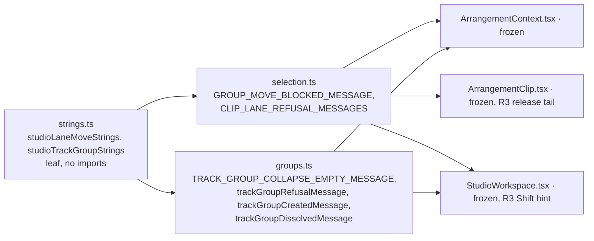

# Studio V-0.2c3 — ხაზებს შორის გადატანისა და track group-ის ტექსტები ინგლისურად

**თარიღი:** 2026-10-24
**სტატუსი:** Completed (A-ის შემოწმებები მწვანეა რაუნდ 133-ში; C round 133 — PASS, browserVerified; gate 133 — ee40ad6)
**შეცვლილი პროექტი:** Store

## კონტექსტი

VISUAL-A-ს M2 მოთხოვნით Studio-ს მთელი UI ინგლისურია, ტექსტები კი ერთი strings მოდულიდან მოდის. V-0.2c სამ ეტაპად დაიყო (doc 107). c1 ვიდეოს იმპორტი იყო, c2 ტემპი, მეტრონომი და zoom (doc 108). ეს რაუნდი c3-ია: `selection.ts` და `groups.ts`. `selection.ts`-ში ქართული 6 ხაზზე იყო (l.7, 38–42), `groups.ts`-ში 10-ზე (l.3, 222, 474–479, 490, 495). l.3 (`TRACK_GROUP_NAME_PREFIX`) ამ რაუნდში არ იცვლება (R1). c3-ით V-0.2 სრულდება.

## მიდგომა

- `app/lib/arrangement/strings.ts`-ს დაემატა ორი ობიექტი: `studioLaneMoveStrings` და `studioTrackGroupStrings`. არსებული ათი ობიექტი უცვლელია. მოდული ისევ leaf-ია და არაფერს აიმპორტებს.
- **Export-ირებული სახელები რჩება, მნიშვნელობა მოდულიდან მოდის.** `GROUP_MOVE_BLOCKED_MESSAGE` და `TRACK_GROUP_COLLAPSE_EMPTY_MESSAGE` იგივე სახელის მუდმივებია. `CLIP_LANE_REFUSAL_MESSAGES` ინარჩუნებს სახელსა და `Record<ClipLaneMoveRefusal, string>` ტიპს. ლოკალური `GROUP_TRACKS_REFUSAL_MESSAGES` და `trackGroupRefusalMessage` უცვლელია, მხოლოდ map-ის მნიშვნელობები მოდულიდან მოდის. `trackGroupCreatedMessage` და `trackGroupDissolvedMessage` სახელს, პარამეტრებსა და return type-ს ინარჩუნებს. importer-ები (`ArrangementClip.tsx`, `StudioWorkspace.tsx`, `ArrangementContext.tsx`) არ შეცვლილა.
- ქცევა არ იცვლება. უცვლელია `planClipLaneMove`, refusal-ის კოდები და მათი შემოწმების რიგი, `findClipPlacementConflict`, ჯგუფის შექმნა/დაშლა/დაკეცვა, nesting, მონიშვნის წესები და `nextTrackGroupName`. შეიცვალა მხოლოდ string expression-ები და ორი import.
- **Import-ის მიმართულება:** `selection.ts` და `groups.ts` `./strings`-ს აიმპორტებს. ციკლი არ ჩნდება, რადგან `strings.ts` არაფერს აიმპორტებს. მუდმივები import-ის დროს ფასდება და ტესტებში `undefined` არ ჩანს.

### L/G რუკა

| # | key | ინგლისური |
|---|---|---|
| L1 | `studioLaneMoveStrings.groupMoveBlocked` | `Group move stopped — a neighbouring clip or the start of the timeline.` |
| L2 | `studioLaneMoveStrings.videoClipKeepsTrack` | `A video clip does not change tracks — the group moves in time only.` |
| L3 | `studioLaneMoveStrings.audioNotOnVideoTrack` | `Audio does not move to the video track` |
| L4 | `studioLaneMoveStrings.noTrackForPart` | `There is no track for part of the group — only the time changes.` |
| L5 | `studioLaneMoveStrings.partBeforeStart` | `Part of the group would go before the start of the timeline (0) — the track does not change.` |
| L6 | `studioLaneMoveStrings.noRoom` | `No room here` |
| G1 | `studioTrackGroupStrings.foldNeedsGroup` | `To fold a group, select it first — click the group name.` |
| G2 | `studioTrackGroupStrings.groupNeedsTracks` | `To group tracks, select them first — Ctrl+click or Shift+click a track name.` |
| G3 | `studioTrackGroupStrings.trackGone` | `A selected track no longer exists — select again.` |
| G4 | `studioTrackGroupStrings.videoNotGroupable` | `The video track cannot be grouped.` |
| G5 | `studioTrackGroupStrings.mixedLevels` | `Only tracks at the same level can be grouped together — the selected tracks are in different groups.` |
| G6 | `studioTrackGroupStrings.notAdjacent` | `Only adjacent tracks can be grouped together — the selection skips a track.` |
| G7 | `studioTrackGroupStrings.ungroupNeedsGroup` | `To ungroup, select a group — click the group name.` |
| G8 | `studioTrackGroupStrings.created({name, members})` | `Group “{name}” created: {members}.` |
| G9 | `studioTrackGroupStrings.quoted(name)` | `“{name}”` |
| G10 | `studioTrackGroupStrings.ungroupedOne(names)` | `Group {names} ungrouped.` |
| G11 | `studioTrackGroupStrings.ungroupedMany(names)` | `Groups {names} ungrouped.` |

L3-სა და L6-ს ბოლოს წერტილი არ აქვს, როგორც ქართულ ტექსტს. L6-ს `ArrangementClip.tsx`-ის შედგენილი სტატუსი ` — …` ბოლოსართს უმატებს.

### ფაქტები, რომლებიც უნდა შენარჩუნდეს

- L1: ორივე მიზეზი, „a neighbouring clip“ და „the start of the timeline“.
- L2: ვიდეოკლიპი ხაზს ინარჩუნებს, ჯგუფი დროში მაინც მოძრაობს.
- L4: იცვლება მხოლოდ დრო. L5: დასაწყისი `(0)` და „the track does not change“.
- G2: ორივე modifier, `Ctrl+click` და `Shift+click`, და „a track name“.
- G1 / G7: „click the group name“. G5 / G6: მიზეზი ტირის შემდეგ.
- G8: ჯგუფის სახელი და წევრების სია. G10 / G11: მხოლობითისა და მრავლობითის განსხვავება.

ქართულ ტექსტთან გვერდიგვერდ შედარებისას არცერთ ხაზს ფაქტი არ დაჰკლებია და არც დამატებია.

### B-ის გადაწყვეტილებები (D-29z98)

- **R1 — `TRACK_GROUP_NAME_PREFIX` V-0.4-ში გადადის (GATE133-GROUP-PREFIX).** `'ჯგუფი'` ჯგუფის default სახელია და fixture-ის მონაცემად 7 ტესტ-ფაილის 180 ხაზზე გამოიყენება. ის default ხაზების სახელებისა და `library.ts`-ის label-ების კლასია, რომლებიც V-0.4-ს ეკუთვნის. ამიტომ შექმნისა და დაშლის სტატუსში ჯგუფისა და ხაზების სახელები V-0.4-მდე ქართულად რჩება, მაგალითად `Group “ჯგუფი 1” created: მუსიკა, სტემები.`.
- **R2 — `groups.ts`-ის სკანირება ზუსტად ერთ ხაზს უშვებს.** ST22 `groups.ts`-ს ამოწმებს მას შემდეგ, რაც ზუსტი ტექსტით ამოიღებს ხაზს `export const TRACK_GROUP_NAME_PREFIX = 'ჯგუფი';`. ტესტი ამოწმებს ისიც, რომ ეს ხაზი ფაილში ზუსტად ერთხელ გვხვდება, ამიტომ დაშვება ჩუმად ვერ გაფართოვდება. სხვა ნებისმიერი ქართული სიმბოლო ST22-ს აწითლებს. დაშვებას V-0.4 მოხსნის.
- **R3 — ორი შედგენილი ზედაპირი დროებით ორენოვანია:**
  - **GATE133-LANE-RELEASE-MIXED (V-0.4).** `ArrangementClip.tsx` ხაზზე უარყოფილი გაშვების სტატუსს ასე აწყობს: refusal, შემდეგ `CLIP_LANE_REFUSAL_KEPT_PLACE` (`კლიპი ბოლო თავისუფალ ადგილას დარჩა`), ხაზის სახელი და start. ბოლოსართი გაყინულ `ArrangementClip.tsx`-შია. ამ რაუნდის შემდეგ სტატუსი ასე იკითხება: `No room here — კლიპი ბოლო თავისუფალ ადგილას დარჩა: მუსიკა, start 00:01.375.`. ერთი კლიპის `გადატანა დაბლოკილია — …` სტატუსიც V-0.4-მდე ქართულია. ეს ცალკე სტატუსებია და ერთ ხაზზე არასდროს ერთიანდება.
  - **GATE133-LANE-HINT-MIXED (V-0.3).** `StudioWorkspace.tsx` ასე აჩვენებს მინიშნებას: `{laneMoveRefusal} · {CLIP_LANE_SHIFT_HINT}`. Shift-ის მინიშნება workspace chrome-ია და V-0.3-ში გადავა.
  - ხაზზე ჩაგდების ghost ტექსტი `აქ ადგილი არ არის` (`ArrangementLane.tsx`) GATE130-S1-ით უკვე აღრიცხულია (V-0.4). მან სტატუსის ინგლისური ტექსტი უნდა გამოიყენოს.
- **R5 — ბრჭყალები.** ქართული `«…»` ინგლისური curly ბრჭყალებით, `“…”`-ით შეიცვალა, როგორც `studioLibraryStrings`-სა და `studioVideoStrings`-ში. ჯგუფისა და ხაზის სახელები მომხმარებლის ან default შინაარსია და არ ითარგმნება.
- **R6 — module contract-ის დაზუსტება.** formatter-ები ჩვენებისთვის უკვე მზა მნიშვნელობებს იღებს: შეერთებულ სიას, ფორმატირებულ დროს ან დამრგვალებულ რიცხვს. ისინი თავად არ აერთებენ მასივს, არ ამრგვალებენ და დროს არ აფორმატებენ. წევრების სიას `', '`-ით `groups.ts` აერთებს. ორ ტექსტს შორის არჩევის branch (`groups.length === 1 ? … : …`) გამომძახებელში რჩება და მოდულის მნიშვნელობას ირჩევს. არგუმენტის ფიქსირებულ ტექსტში ჩასმა (`quoted(name)`, `created({name, members})`) დასაშვებია.

### წინსწრებითი წესი (GATE130-S3)

ყოველ ახალ formatter-სა და გადატანილ ტექსტს, რომელსაც UI ტესტი უკვე აღწევს, UI ტესტში ერთი ხელით დაწერილი ინგლისური literal აქვს. ახალი `it` არ დამატებულა.

- `track-groups-ui.test.tsx`: TG-UI1–TG-UI3 ქართული literal-ების ნაცვლად (TG2-ში შექმნა, TG3-ში ჩადგმული შექმნა, TG4-ში დაშლა). TG-UI4 და TG-UI5 დაემატა „TG2 after Undo“ `it`-ში, TG-UI6–TG-UI8 კი TG5-ში. TG5-ის სათაურში `with a Georgian status` შეიცვალა `with an English status`-ით.
- `track-group-collapse-ui.test.tsx`: TC-UI1 დაემატა UC2-ში.
- L1, L4, L5 და L6 ხელით დაწერილი მუდმივებია `grid-snap-ui`, `status-announcement-ui`, `grid-snap-edit` და `clip-fades-ui` ტესტებში.
- L2-ს, L3-სა და G3-ს დღეს UI ტესტი ვერ აღწევს. მათ ST20/ST21 იცავს, L3-ს კი C ბრაუზერში ამოწმებს.

### Glossary-ის დამატებები

Live 12 §18.3-ის ტერმინები: Group Tracks / Ungroup Tracks (`დაჯგუფება` / `დაშლა`, უკვე Undo label-ებია); fold (`დაკეცვა`, Live-ის „Fold/Unfold Group“); group move (`ჯგუფის გადატანა`); timeline start (`დროის დასაწყისი`); neighbouring clip (`მეზობელი კლიპი`); No room here (`აქ ადგილი არ არის`, `studioLibraryStrings.dropBlocked`-ის მოკლე ფორმა); same level (`ერთი დონე`); adjacent tracks (`მეზობელი ხაზები`).

## არქიტექტურა

ისრები import-ის დამოკიდებულებას აჩვენებს და არა თითოეული ტექსტის გზას. მაგალითად, `StudioWorkspace.tsx` `selection.ts`-დან მონიშვნის helper-ებსაც აიმპორტებს.

## შეცვლილი ფაილები

- `app/lib/arrangement/strings.ts`: ორი ახალი ობიექტი (L1–L6, G1–G11).
- `app/lib/arrangement/selection.ts`: import, `GROUP_MOVE_BLOCKED_MESSAGE`-ის მნიშვნელობა და `CLIP_LANE_REFUSAL_MESSAGES`-ის ხუთი მნიშვნელობა.
- `app/lib/arrangement/groups.ts`: import, `TRACK_GROUP_COLLAPSE_EMPTY_MESSAGE`, refusal map-ის ექვსი მნიშვნელობა, `trackGroupCreatedMessage`-ის return და `trackGroupDissolvedMessage`-ის ბრჭყალები და ორი branch. l.3 უცვლელია.
- `app/lib/arrangement/__tests__/strings.test.ts`: ახალი describe ST20–ST22. ფაილში 19-ის ნაცვლად 22 `it`-ია.
- `grid-snap-ui.test.tsx`, `status-announcement-ui.test.tsx`: L1-ის ხელით დაწერილი ინგლისური მუდმივა.
- `grid-snap-edit.test.tsx`: L5, L4 და L6 მუდმივები.
- `clip-fades-ui.test.tsx`: `OVERLAP_TEXT` → `'No room here'`. FU5 ახლა R3-ის შედგენილ ორენოვან სტატუსს ამოწმებს.
- `track-groups-ui.test.tsx`, `track-group-collapse-ui.test.tsx`: წინსწრებითი წესის literal-ები და TG5-ის სათაური.
- `docs/implementation/2026/quarter-IV/108-studio-v0-tempo-metronome-view-strings.md`: მხოლოდ სტატუსის ხაზი (GATE132-S5).

## პრობლემები და გადაწყვეტები

- **პრობლემა:** `selection.ts`-ისა და `groups.ts`-ის მუდმივები import-ის დროს ფასდება, ამიტომ load order-ის შეცდომა `undefined` ტექსტად გამოჩნდებოდა. **გადაწყვეტა:** `strings.ts` არაფერს აიმპორტებს, ამიტომ ყოველთვის პირველი ფასდება. ST20 ორივე მუდმივასა და `CLIP_LANE_REFUSAL_MESSAGES`-ის ხუთივე მნიშვნელობას ხელით დაწერილ ტექსტს ადარებს და მწვანეა.
- **პრობლემა:** m20-მა (ქართული `noRoom`) დასახელებული ტესტების გარდა ST4-იც გააწითლა. **მიზეზი:** ST4 `strings.ts`-ს მთლიანად ამოწმებს ქართულ სიმბოლოებზე. ეს მოსალოდნელი დამატებითი დაცვაა.
- **პრობლემა:** B-ის დავალებაში `track-groups-ui` l.453 TG1-ად იყო მოხსენიებული. **გადაწყვეტა:** ხაზი ტექსტით მოიძებნა. ის „TG2 Ctrl+G renders…“ `it`-შია, ამიტომ m22-მა TG2 და TG3 გააწითლა. ხაზი იგივეა, განსხვავდება მხოლოდ `it`-ის სახელი.

## ტესტირება

- `npm run typecheck`: სუფთაა. `npm run lint`: exit 0. შეცვლილ ფაილებზე diagnostic არ არის. read-only `npx biome check` 10 კოდისა და ტესტის ფაილზე სუფთაა.
- `npx vitest run`: 18 ფაილი, 349 ტესტი, ყველა მწვანე. ესენია: `strings` (22), `grid-snap-ui` (20), `status-announcement-ui` (33), `grid-snap-edit` (25), `clip-fades-ui` (16), `track-groups-ui` (14), `track-group-collapse-ui` (22). importer-ები და მეზობლები: `selection` (25), `groups` (11), `track-group-collapse` (7), `track-group-mix` (10), `track-group-mix-ui` (10), `group-volume-db` (9), `fader-touch` (7), `marker-snap` (25), `grid-snap-clip-edges` (44), `grid-snap-loop-drop` (36), `delete-selection-ui` (13).
- მუტაციები:
  - m19 (`groupMoveBlocked`-ს აკლდება „or the start of the timeline“) წითელს ხდის ST20-ს, `grid-snap-ui` GS5b-სა და `status-announcement-ui` SK3-ს;
  - m20 (`noRoom` ისევ ქართულია) წითელს ხდის ST20-ს, ST22-ს, ST4-ს, `grid-snap-edit` SE16-სა (l.599) და SE18-ს, აგრეთვე `clip-fades-ui` FU5-ს;
  - m21 (`ungroupedOne` / `ungroupedMany` შებრუნებულია) წითელს ხდის ST21-სა და TG4-ს (TG-UI3);
  - m22 (`trackGroupCreatedMessage` ძველ ქართულ შაბლონს აბრუნებს) წითელს ხდის ST21-ს, ST22-ს (ფაილის სკანირება), TG2-სა (TG-UI1) და TG3-ს (TG-UI2);
  - m23 (`foldNeedsGroup`-ს აკლდება „— click the group name“) წითელს ხდის ST20-სა და `track-group-collapse-ui` UC2-ს (TC-UI1).

  ყოველი მუტაცია აღდგა და sha256-ით შემოწმდა.
- ბრაუზერის შემოწმება (GROUP, LANE, GEO-COUNT, LAYOUT): C round 133 — PASS, browserVerified (c-round-133.json).

## TODO / შემდეგი ნაბიჯები

- V-0.3: GATE133-LANE-HINT-MIXED, ანუ `StudioWorkspace.tsx`-ის Shift-ის მინიშნებები.
- GATE133-GROUP-RENAME — ჯგუფის გადარქმევის სტატუსები (StudioWorkspace l.953/963) V-0.3d-ში, studioTrackGroupStrings-ის renamed/renameEmpty-ით და quoted()-ით.
- V-0.4: GATE133-GROUP-PREFIX (`TRACK_GROUP_NAME_PREFIX` და R2-ის დაშვების მოხსნა), GATE133-LANE-RELEASE-MIXED (`ArrangementClip.tsx`-ის ბოლოსართი და ერთი კლიპის დაბლოკვის სტატუსი), GATE130-S1 (ხაზის ghost ტექსტები), ჯგუფის header-ისა და ისტორიის label-ები.
- Backlog-ის glossary-ში ამ რაუნდის ტერმინების ჩაწერა B-ის საქმეა (`backlog.json` A-ს არ ეკუთვნის).
- frontend-architect checkpoint (`b-round-130-checkpoint-request.md`, დამატებები (e), (f)): უნდა დაიყოს თუ არა `strings.ts` (ახლა 12 ობიექტია) V-0.3-მდე.
