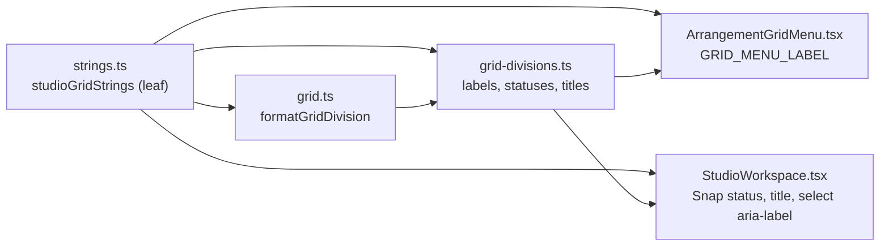

# Studio V-0.3a — ბადისა და Snap-ის ტექსტები ინგლისურად

**თარიღი:** 2026-10-24
**სტატუსი:** Completed (A-ის შემოწმებები მწვანეა რაუნდ 134-ში; C round 134 — PASS, browserVerified; gate 134 — 16533c1)
**შეცვლილი პროექტი:** Store

## კონტექსტი

VISUAL-A-ს M2 მოთხოვნით Studio-ს მთელი UI ინგლისურია, ტექსტები კი ერთი strings მოდულიდან მოდის. V-0.2 რაუნდ 133-ში დასრულდა (doc 109). V-0.3 workspace chrome-ს მოიცავს. B-ის გაზომვით მასში 11 ფაილში 108 ქართული წყაროს ხაზია, ამიტომ ის ოთხ ეტაპად დაიყო (R1). ეს რაუნდი V-0.3a-ა: ბადე (grid) და Snap. `grid.ts`-ში ქართული 1 ხაზზე იყო, `grid-divisions.ts`-ში 15-ზე, `ArrangementGridMenu.tsx`-ში 1-ზე, `StudioWorkspace.tsx`-ში კი ბადისა და Snap-ის 5 ხაზი გადავიდა.

## მიდგომა

- `app/lib/arrangement/strings.ts`-ს დაემატა ერთი ობიექტი, `studioGridStrings`. არსებული თორმეტი ობიექტი უცვლელია. მოდული ისევ leaf-ია და არაფერს აიმპორტებს.
- formatter-ები უკვე დაფორმატებულ string-ს იღებს. `String(step)`, დამრგვალებული `String(Math.round(step * 1000) / 1000)`, `formatTempoBpm(bpm)` და `tempoStatusMessage(null)` ისევ caller-ში ითვლება. `snapEnabled ? snapOnSuffix : snapOffSuffix` არჩევანი `grid-divisions.ts`-ში რჩება, Snap-ის ღილაკის title-ის ternary კი `StudioWorkspace.tsx`-ში.
- **Export-ირებული სახელები რჩება, მნიშვნელობა მოდულიდან მოდის.** `formatGridDivision`, `GRID_TRIPLET_MENU_LABEL`, `MUSICAL_GRID_DIVISIONS`, `gridDivisionEndMessage`, `gridDivisionStatusMessage`, `gridTempoClearedMessage`, `gridMusicalGroupLabel`, `gridTripletGroupLabel`, `gridTripletRefusalMessage` და `gridDivisionTitle` სახელს, signature-სა და branch-ებს ინარჩუნებს. `StudioWorkspace.tsx`-ში `SNAP_OFF_MESSAGE`, `ArrangementGridMenu.tsx`-ში კი `GRID_MENU_LABEL` იგივე სახელით რჩება.
- `MUSICAL_GRID_DIVISIONS`-ის bar ჩანაწერის `label` ახლა `studioGridStrings.barLabel`-ია. `as const` array და დანარჩენი ჩანაწერები უცვლელია. `MusicalGridDivisionId` მხოლოდ `['id']`-დან იგება, ამიტომ label-ის ტიპის გაფართოება `string`-მდე typecheck-ს არ არღვევს.
- ქცევა არ იცვლება. უცვლელია დანაყოფების სიები, id-ები, `beats`, ბიჯები და მათი რიგი, `adjacentGridDivisionId`, family-ის ლოგიკა, snapping, `gridLinesVisible`, 1/2/3/G ღილაკები, მენიუს ქცევა და focus.
- **Import-ის მიმართულება:** `grid.ts` და `grid-divisions.ts` `./strings`-ს აიმპორტებს, `StudioWorkspace.tsx` და `ArrangementGridMenu.tsx` კი `~/lib/arrangement/strings`-ს. ციკლი არ ჩნდება. `MUSICAL_GRID_DIVISIONS` და `GRID_TRIPLET_MENU_LABEL` import-ის დროს ფასდება და ტესტებში `undefined` არ ჩანს.

### GR რუკა

| # | key | ინგლისური |
|---|---|---|
| GR1 | `seconds(step)` | `{step} s` |
| GR2 | `barLabel` | `1 bar` |
| GR3 | `tripletMenuLabel` | `Triplets (3)` |
| GR4 | `narrowest(label)` | `The grid is already at its narrowest — {label} (1)` |
| GR5 | `widest(label)` | `The grid is already at its widest — {label} (2)` |
| GR6 | `snapOnSuffix` / `snapOffSuffix` | `(Snap on)` / `(Snap off)` |
| GR7 | `status({label, snap})` | `Grid: {label} {snap}` |
| GR8 | `statusMusical({label, step, bpm, snap})` | `Grid: {label} · {step} s at {bpm} BPM {snap}` |
| GR9 | `backToSeconds({tempoCleared, label})` | `{tempoCleared} Grid back to seconds: {label}.` |
| GR10 | `barsGroup(bpm)` | `Bars · {bpm} BPM` |
| GR11 | `tripletsGroup(bpm)` | `Triplets · {bpm} BPM` |
| GR12 | `tripletNeedsTempo` | `Triplets need a tempo — enter a BPM first (3)` |
| GR13 | `tripletNotOnBar` | `1 bar has no triplets — choose 1/2 or narrower (3)` |
| GR14 | `tripletNeedsBarsGrid` | `Triplets work only on the bars grid — choose 1/2 … 1/32 (3)` |
| GR15 | `titleLinesVisible(label)` | `Grid {label} · 1 — narrower, 2 — wider` |
| GR16 | `titleLinesHidden(label)` | `Grid {label} — lines are hidden at this zoom; Snap still works. Zoom in. · 1 — narrower, 2 — wider` |
| GR17 | `menuLabel` | `Grid division` (მენიუს `aria-label` და select-ის `aria-label`) |
| GR18 | `snapOnStatus(label)` | `Snap on — grid {label} (G)` |
| GR19 | `snapOnTitle` | `Snap on — clips land on the grid (G)` |
| GR20 | `snapOff` | `Snap off — free movement (G)` (`SNAP_OFF_MESSAGE` და Snap-ის ღილაკის title) |

GR9-ით იხურება **GATE132-TEMPO-CLEARED-MIXED**. ტემპის გასუფთავების სტატუსი ახლა მთლიანად ინგლისურია: `Tempo cleared — the bars ruler is hidden. Audio is unchanged. Grid back to seconds: 0.5 s.`.

### ფაქტები, რომლებიც უნდა შენარჩუნდეს

- GR4 / GR5: ბოლოს მიმართულება და ღილაკი, (1) ან (2).
- GR8: ბიჯი წამებში და ტემპი.
- GR9: ბადე წამებს დაუბრუნდა, თავისი label-ით.
- GR12–GR14: უარის თითო მიზეზი, მისი გამოსავალი და (3) ღილაკი.
- GR15 / GR16: ღილაკების ორივე მინიშნება (1 narrower, 2 wider).
- GR16: ხაზები დამალულია, Snap მაინც მუშაობს, საჭიროა zoom in.
- GR18: დანაყოფის label.
- GR19 / GR20: შედეგი კლიპზე (lands on the grid / free movement) და (G).

ქართულ ტექსტთან გვერდიგვერდ შედარებისას არცერთ ხაზს ფაქტი არ დაჰკლებია და არც დამატებია.

### B-ის გადაწყვეტილებები (D-29z99)

- **R1 — V-0.3-ის დაყოფა.** B-მა `ee40ad6`-ზე ზუსტი grep-ით გაზომა: 108 ქართული წყაროს ხაზი 11 ფაილში. სამი ფაილი, რომელიც არცერთ ეტაპში არ იყო, აღირიცხა: `ArrangementGridMenu.tsx` l.6 ამ რაუნდში შევიდა, `panels.ts` და `clip-gain-multi.ts` კი V-0.4-ში გადავიდა. ეტაპები:
  - V-0.3a, ეს რაუნდი: ბადე და Snap, 22 წყაროს ხაზი და 104 ტესტის pin 9 ფაილში;
  - V-0.3b: Transport, TempoRow, Ruler, Overview, LoopBrace, MarkerMenu;
  - V-0.3c: MarkerRow;
  - V-0.3d: `StudioWorkspace.tsx`-ის დანარჩენი ნაწილი და `waveform-zoom.ts`.

  V-0.3a ერთ რაუნდად დარჩა, რადგან ბადის ყოველი სტატუსი დანაყოფის label-ს შეიცავს. label-ისა და სტატუსის ცალ-ცალკე გადატანა ერთსა და იმავე pin-ს ორჯერ შეცვლიდა და ერთი რაუნდით დატოვებდა `Grid: 1 s` და `ბადე: 1 s` სახის შერეულ ტექსტს.
- **R2 — ბადის ზედაპირი მთლიანად გადადის, `StudioWorkspace.tsx`-ის ხაზებიანად.** მხოლოდ lib-ის გადატანა იმავე ზედაპირზე ახალ ორენოვან ტექსტებს შექმნიდა, მაგალითად `Snap ჩართულია — ბადე 1 s (G)` სტატუსს ან ქართული მენიუს label-ის გვერდით ინგლისურ `Triplets (3)` პუნქტს. ამიტომ `StudioWorkspace.tsx` დროებით ნახევრად გადატანილია, როგორც ArrangementContext იყო V-0.2a–c1-ში. დამცავი ratchet არის ST25: ფაილის ქართული ხაზები ზუსტად 33 ხაზიან ხელით დაწერილ სიას უნდა უდრიდეს.
- **R3 — `waveform-zoom.ts` V-0.3d-ს ელოდება.** მისი ერთადერთი ტექსტი იგივე წინადადებაა, რაც `StudioWorkspace.tsx`-ის waveform-zoom-ის `aria-label` / `title`. წყვილი ერთად გადავა, რომ ერთი წინადადება ორ ენაზე არასდროს არსებობდეს.
- **Checkpoint-ის შენიშვნა.** frontend-architect-ის checkpoint `strings.ts`-ის დაყოფაზე (`b-round-130-checkpoint-request.md`, დამატებები (e)/(f)/(g)) ჯერ არ ჩატარებულა. ეს რაუნდი მასზე არ არის დამოკიდებული: `ArrangementExportDialog.tsx` და `ArrangementContext.tsx` უკვე `~/lib/arrangement/strings`-დან აიმპორტებს. ამიტომ ნებისმიერმა დაყოფამ ეს გზა უნდა შეინარჩუნოს, მაგალითად `strings/index.ts`-ით. დამტკიცებული დაყოფის შემთხვევაში `studioGridStrings` დანარჩენ თორმეტ ობიექტთან ერთად მექანიკურად გადავა.

### Glossary-ის დამატებები

- ბადე = Grid;
- ბადის დანაყოფი = Grid division;
- ტრიოლები = Triplets;
- 1 ტაქტი = 1 bar (CZABA-ს label; Live-ის მენიუს სახელად დაუდასტურებელია);
- უფრო მჭიდრო / უფრო ფართო = narrower / wider (Live 12 §6.10 „narrows/widens the grid“);
- Snap ჩართულია / გამორთულია = Snap on / Snap off;
- თავისუფალი გადაადგილება = free movement;
- წმ = s (არსებული).

## არქიტექტურა

## შეცვლილი ფაილები

- `app/lib/arrangement/strings.ts`: ახალი ობიექტი `studioGridStrings` (GR1–GR20).
- `app/lib/arrangement/grid.ts`: import და `formatGridDivision`-ის body.
- `app/lib/arrangement/grid-divisions.ts`: import, bar label, `GRID_TRIPLET_MENU_LABEL` და შეტყობინებების string expression-ები.
- `app/components/arrangement/ArrangementGridMenu.tsx`: import და `GRID_MENU_LABEL`.
- `app/components/arrangement/StudioWorkspace.tsx`: import, `SNAP_OFF_MESSAGE`, Snap-ის ჩართვის სტატუსი, Snap-ის ღილაკის title და select-ის `aria-label`.
- `app/lib/arrangement/__tests__/strings.test.ts`: გაფართოებული `GEORGIAN_CODEPOINT` და ST23–ST25.
- `app/lib/arrangement/__tests__/` `grid`, `grid-musical`, `grid-triplet`, `grid-snap-ui`, `grid-snap-menu`, `grid-snap-keys`, `grid-musical-ui`, `grid-triplet-ui`, `tempo-ui`: ქართული pin-ები შეიცვალა ხელით დაწერილი ინგლისური literal-ებით, იგივე matcher-ით.
- `docs/implementation/2026/quarter-IV/109-studio-v0-lane-move-group-strings.md`: სტატუსი, ბრაუზერის შედეგი და GATE133-GROUP-RENAME-ის TODO.

## პრობლემები და გადაწყვეტები

- **Problem:** Biome-ის formatter-მა Snap-ის ღილაკის title-ის მოკლე ternary ერთ ხაზზე მოითხოვა, რაც `snapEnabled` ხაზსაც (baseline l.2269) ეხება. **Solution:** სამი ხაზი ერთად გაერთიანდა. პირობა და ორი არჩეული მნიშვნელობა იგივეა, შეიცვალა მხოლოდ ფორმატი. ანგარიშში deviation-ად აღირიცხა.
- **Problem:** `--write` აკრძალულია, ხოლო ტესტების უფრო მოკლე ინგლისური literal-ები Biome-ს სხვაგვარ wrapping-ს აძლევდა. **Solution:** read-only `npx biome check`-ის diff ხელით გადავიტანე Edit-ით, მხოლოდ შეცვლილ expect-ებზე.
- **Problem:** `GEORGIAN_CODEPOINT`-ის გაფართოებას არსებული ST3–ST22 სკანირებები შეეძლო შეეცვალა. **Solution:** ST25-ის self-check ამოწმებს U+10D0, U+1C90 და U+2D00 სიმბოლოებს. ST1–ST22 უცვლელი დარჩა და მწვანეა. `StudioWorkspace.tsx`-ის ratchet ორივე pattern-ით ერთსა და იმავე 33 ხაზს იძლევა.

## ტესტირება

- `npm run typecheck`: სუფთაა. `npm run lint`: exit 0. read-only `npx biome check` 15 კოდისა და ტესტის ფაილზე სუფთაა.
- `npx vitest run`: 23 ფაილი, 409 ტესტი, ყველა მწვანე. მიცემული ტესტები: `strings` (25), `grid` (12), `grid-musical` (12), `grid-triplet` (7), `grid-snap-ui` (20), `grid-snap-menu` (39), `grid-snap-keys` (13), `grid-musical-ui` (14), `grid-triplet-ui` (10), `tempo-ui` (12). მეზობლები: `grid-edges` (11), `grid-snap-position` (17), `grid-snap-edit` (25), `grid-snap-clip-edges` (44), `grid-snap-loop-drop` (36), `marker-snap` (25), `tempo` (10), `tempo-window-ui` (8), `metronome-ui` (10), `waveform-zoom` (9), `render-budget` (7), `self-disabling-focus` (10), `status-announcement-ui` (33).
- მუტაციები:
  - m24 (`seconds` ისევ `წმ`-ს წერს) წითელს ხდის ST24-ს, ST25-ს, ST4-ს, `grid.test`-ის „labels every division in seconds“-ს, `grid-snap-ui`-ის GS1/GS3/GS4/GS10-ს და `grid-snap-menu`-ის 10 `it`-ს;
  - m25 (`snapOnSuffix` / `snapOffSuffix` შებრუნებულია) წითელს ხდის ST24-ს, `grid-musical` GM5-სა და `grid-snap-keys` GK1/GK8/GK9-ს;
  - m26 (`titleLinesHidden`-ს აკლდება „; Snap still works“) წითელს ხდის ST24-ს, `grid-snap-ui` GS10-სა და `grid-musical` GM5-ს;
  - m27 (Snap-ის title-ის ternary შებრუნებულია) წითელს ხდის `grid-snap-ui` GS1-სა და GS3-ს;
  - m28 (select-ის `aria-label` ისევ `"ბადის დანაყოფი"`-ა) წითელს ხდის ST25-ს (ratchet, 34 ხაზი) და `grid-snap-ui` GS1-ს;
  - m29 (`backToSeconds`-ს აკლდება `: {label}`) წითელს ხდის ST24-ს, `grid-musical` GM5-სა და `grid-musical-ui` GU7-ს.

  ყოველი მუტაცია აღდგა და sha256-ით შემოწმდა.
- ბრაუზერის შემოწმება (GRID-SEC, GRID-MUSICAL, GRID-TRIPLET, GRID-HIDDEN, SNAP, MENU, GEO-COUNT, LAYOUT): C round 134 — PASS, browserVerified (c-round-134.json).

## TODO / შემდეგი ნაბიჯები

- V-0.3b: Transport, TempoRow, Ruler, Overview, LoopBrace და StudioWorkspace-ის ნავიგაციის სტატუსები. V-0.3c: MarkerRow და MarkerMenu. V-0.3d: StudioWorkspace-ის დარჩენილი 23 ხაზი და waveform-zoom.ts (R3), მათ შორის GATE133-LANE-HINT-MIXED და GATE133-GROUP-RENAME.
- Backlog-ის glossary-ში ამ რაუნდის ტერმინების ჩაწერა B-ის საქმეა (`backlog.json` A-ს არ ეკუთვნის).
- frontend-architect checkpoint `strings.ts`-ის დაყოფაზე (დამატება (g)) root-ს ელოდება.
