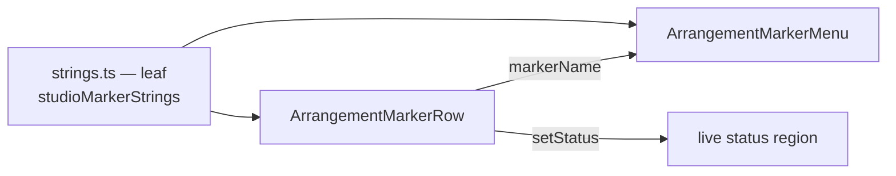

# Studio V-0.3c — მარკერების ხაზისა და მარკერის მენიუს ტექსტები ინგლისურად

**თარიღი:** 2026-10-24
**სტატუსი:** Completed (A-ის შემოწმებები მწვანეა რაუნდ 136-ში; C round 136 — PASS, browserVerified; gate 136 — 7d9fed0)
**შეცვლილი პროექტი:** Store

## კონტექსტი

VISUAL-A-ს M2 მოთხოვნით Studio-ს მთელი UI ინგლისურია, ტექსტები კი ერთი strings მოდულიდან მოდის. V-0.3b რაუნდ 135-ში დასრულდა (doc 111, C round 135 — PASS, gate 135 — `70f1e42`). ეს რაუნდი V-0.3c-ა: მარკერების ხაზი (`ArrangementMarkerRow.tsx`) და მარკერის კონტექსტური მენიუ (`ArrangementMarkerMenu.tsx`) — header-ის ღილაკების title-ები, flag-ის aria-label და title, სახელის ველი, მენიუს label და ელემენტები და მარკერის ყველა სტატუსი.

### ხელახალი გაზომვა (`70f1e42`)

- წყარო: MarkerRow-ში 16 ქართული ხაზი, MarkerMenu-ში 4 — სულ 20. MarkerRow-ში კიდევ 2 არაქართული ხაზი `«»` ბრჭყალებით (flag-ის aria-label და title). `markers.ts`-ში ქართული არ არის.
- ტესტის pin-ები: 23 ხაზი 4 ფაილში (`markers-ui` 10, `marker-edge-nav-ui` 3, `markers-move-ui` 6, `status-announcement-ui` 4). `e2e/`-ში 0.
- A-ის grep-მა იმპლემენტაციამდე იგივე სურათი აჩვენა. დამატებითი დამთხვევები სხვა სფეროებს ეკუთვნის და არ შეცვლილა: ჯგუფის header-ის title (`ArrangementGroupHeader.tsx`), envelope-ის წერტილის წაშლა (`ArrangementClipEnvelope.tsx`), ჯგუფის გადარქმევა `StudioWorkspace.tsx`-ში, `track-groups-ui`-ში და `strings.test` ST25-ში (V-0.3d).

## მიდგომა

- `app/lib/arrangement/strings.ts`-ს დაემატა **ერთი ახალი ობიექტი `studioMarkerStrings`** (R1) და მცირე ლოკალური interface `{ name, time }`-ისთვის. სხვა ობიექტები byte-ით უცვლელია, მოდული ისევ leaf-ია და არაფერს აიმპორტებს.
- formatter-ები უკვე დაფორმატებულ მნიშვნელობას იღებს. `formatArrangementTime(...)` ისევ caller-ში ითვლება, flag-ის `time` კი ისევ ლოკალური ცვლადია.
- ორ ტექსტს შორის არჩევანი caller-ში რჩება: `direction === 1 ? noneAfter : noneBefore` — იგივე პირობა და რიგი.
- ლოკალური სახელები რჩება და მნიშვნელობას მოდულიდან იღებს: `MARKER_FLAG_HINT`, `MARKER_AT_TIME_START_MESSAGE`, `MARKER_MENU_ITEMS`. `commitMarkerMove`-ის `const message` ლოკალური რჩება, ამიტომ key repeat-ის `status !== message` შემოწმება უცვლელია.
- flag-ის title-ში `\n` და მინიშნება caller-ში რჩება: `flagHeading(...)` + `\n` + `MARKER_FLAG_HINT`.
- **ქცევა არ იცვლება.** უცვლელია ყველა handler, პირობა, კლავიში (M, F2, Delete, ← →, Ctrl+← / Ctrl+→, Shift+F10, Esc, Enter), დუბლიკატის წესი, focus-ის გადაცემა, მენიუს რიგი, history label-ები, `Marker N` და class-ები.

### MK რუკა

| # | key | ინგლისური |
|---|---|---|
| MK1 | `menuRename` | `Rename (F2)` |
| MK2 | `menuPlay` | `Play from here` |
| MK3 | `menuDelete` | `Delete (Delete)` |
| MK4 | `menuLabel(name)` | `Marker “{name}”` |
| MK5 | `flagHint` | `Click: jump here · Double-click: play from here · Drag or ← →: move · F2: rename · Delete: delete · Right-click or Shift+F10: menu` |
| MK6 | `atTimeStart` | `The marker is at the start of the timeline.` |
| MK7 | `existsAtTime(name)` | `A marker already exists at this time: “{name}”` |
| MK8 | `noneAfter` | `No more markers after the playhead` |
| MK9 | `noneBefore` | `No more markers before the playhead` |
| MK10 | `notAdded` | `Marker not added` |
| MK11 | `added({ name, time })` | `Marker “{name}” added at {time}.` |
| MK12 | `renameEmpty(name)` | `The name is empty — “{name}” is kept` |
| MK13 | `renamed(name)` | `Marker name: “{name}”.` |
| MK14 | `deleted(name)` | `Marker “{name}” deleted.` |
| MK15 | `moved({ name, time })` | `Marker “{name}” moved to {time}.` |
| MK16 | `addTitle` | `Add a marker at the playhead or at the start of the time selection (M)` |
| MK17 | `previousTitle` | `Jump to the previous marker (Ctrl+←)` |
| MK18 | `nextTitle` | `Jump to the next marker (Ctrl+→)` |
| MK19 | `nameFieldLabel` | `Marker name` |
| MK20 | `flagLabel({ name, time })` | `Marker “{name}” — {time}` |
| MK21 | `flagHeading({ name, time })` | `“{name}” — {time}` |

### ფაქტები, რომლებიც უნდა შენარჩუნდეს

- MK7: **არსებული** მარკერის სახელი და ის, რომ ის ამ დროზეა.
- MK8 / MK9: ორი მიმართულება; არჩევანს caller ზუსტად ისე აკეთებს, როგორც ადრე (`წინ` → after, `უკან` → before).
- MK10 / MK11: გაუქმება და დამატება; MK11-ში სახელიც და დროც არის.
- MK12: ძველი სახელი რჩება. MK15: სახელი და ახალი დრო.
- MK16: ორივე ადგილი (playhead, დროის მონიშვნის დასაწყისი) და კლავიში M. MK17 / MK18: თითო მიმართულება და მისი კლავიში.
- MK5: ექვსივე ჟესტი და კლავიში. MK3: Delete. MK1: F2.

ქართულ ტექსტთან გვერდიგვერდ შედარებისას არცერთ ხაზს ფაქტი არ დაჰკლებია.

### B-ის გადაწყვეტილებები (D-29z101)

- **R1 — ერთი ახალი ობიექტი.** მარკერებს საკუთარი სფეროს ობიექტი არ ჰქონდა, module contract კი ერთ ობიექტს ითხოვს თითო სფეროზე. import-ის გზა (`~/lib/arrangement/strings`) იგივეა, ამიტომ მოდულის შემდგომი დაყოფა ამ გზას შეინარჩუნებს.
- **R2 — `«»` → `“”` მთელ მარკერის ზედაპირზე**, მათ შორის flag-ის ორ არაქართულ ხაზზე და `status-announcement-ui`-ის selector-ზე. ასე უკვე მუშაობს `studioLibraryStrings`, `studioVideoStrings` და `studioTrackGroupStrings.quoted`.
- **R3 — ერთი ჩანაწერი თითო control-ზე.** წინა/შემდეგის title-ები `Ctrl+←` / `Ctrl+→`-ს იყენებს, ისევე როგორც მათი aria-label და `aria-keyshortcuts`.
- **R4 — საერთო წინადადება ჯგუფის გადარქმევასთან.** MK12-ის ქართული იგივეა, რაც `StudioWorkspace.tsx`-ის ჯგუფის გადარქმევის სტატუსი. მარკერის ვერსია ახლა ინგლისურია; V-0.3d-ში ჯგუფის formatter-მა იგივე ინგლისური ფორმა უნდა გამოსცეს. ამ რაუნდში StudioWorkspace გაყინულია და ST25 ისევ 23-ზეა.

### Glossary-ის დამატებები

მარკერი = marker (Live: „locator“, §6.4 — შეგნებული განსხვავება, CZABA-ს ინგლისური aria-label-ები უკვე „marker“-ს იყენებს); სახელის შეცვლა = Rename (Live §6.4); დაკვრა აქედან = Play from here; გადასვლა = jump (Live §6.4); გადათრევა = drag; მარჯვენა ღილაკი = right-click; მენიუ = menu; დროის დასაწყისი = start of the timeline (იგივე, რაც `nudgeAtTimeStart`); მონიშვნის დასაწყისი = start of the time selection (Live §6.4); სახელი ცარიელია = The name is empty.

## არქიტექტურა

ორივე კომპონენტი `~/lib/arrangement/strings`-ს აიმპორტებს. `strings.ts` არაფერს აიმპორტებს, ამიტომ ციკლი არ ჩნდება.

## შეცვლილი ფაილები

- `app/lib/arrangement/strings.ts` — ახალი `studioMarkerStrings` (MK1–MK21) და ლოკალური `StudioMarkerTimeText` interface.
- `app/components/arrangement/ArrangementMarkerMenu.tsx` — import, სამი ელემენტის label და მენიუს aria-label.
- `app/components/arrangement/ArrangementMarkerRow.tsx` — import, `MARKER_FLAG_HINT` / `MARKER_AT_TIME_START_MESSAGE`, სტატუსები, header-ის title-ები, flag-ის aria-label / title და სახელის ველის aria-label.
- `app/lib/arrangement/__tests__/strings.test.ts` — `studioMarkerStrings`-ის import და ახალი `describe('V-0.3c marker strings')` ST28–ST30-ით.
- `app/lib/arrangement/__tests__/markers-ui.test.tsx`, `marker-edge-nav-ui.test.tsx`, `markers-move-ui.test.tsx`, `status-announcement-ui.test.tsx` — 23 ქართული pin ხელით დაწერილ ინგლისურ literal-ად შეიცვალა, იმავე matcher-ით. fixture-ის ქართული სახელები (`აქ შედის მუსიკა`, `რეკლამა` …) მომხმარებლის მონაცემია და ახალ literal-ებში უცვლელად დარჩა.
- ახალი `app/lib/arrangement/__tests__/marker-strings-ui.test.tsx` — MS1–MS3, რეალურ `StudioWorkspace`-ზე jsdom-ში.
- `docs/implementation/2026/quarter-IV/111-studio-v0-transport-navigation-strings.md` — სტატუსი და ბრაუზერის შედეგი (GATE135-DOC111-STATUS).

## პრობლემები და გადაწყვეტები

- **პრობლემა:** MS1-ში სახელის ველი არ გაიხსნა — playhead 0-ზე იყო, სადაც fixture-ს უკვე აქვს მარკერი `Start`, და M სწორად დუბლიკატზე უარს ამბობდა. **გადაწყვეტა:** ტესტი M-მდე playhead-ს 3 წამზე აყენებს. პროდუქტის ქცევა არ შეცვლილა.
- **პრობლემა:** negative pin-ები (`not.toContain(...)`) ტექსტის შეცვლის შემდეგ შეიძლება ჩუმად აღარ „იკბინებოდეს“. **გადაწყვეტა:** m40 და m41 მუტაციებმა დაამტკიცა, რომ `already exists` და `No more markers` pin-ები ისევ წითლდება.

## ტესტირება

- `strings.test.ts`: 27 → 30 `it`. ST28 — plain string-ების ზუსტი რუკა და key-ების სია; ST29 — ყოველი formatter-ის ზუსტი ინგლისური და formatter key-ების სია; ST30 — ქართული codepoint-ისა და `«»`-ის არარსებობა ობიექტში და ორივე კომპონენტის წყაროში (კომენტარების გარეშე).
- `marker-strings-ui.test.tsx`: 3 `it`. MS1 — header-ის title-ები და უცვლელი aria-label-ები, flag-ის aria-label / title (`Hit` 0.5 წმ-ზე), სახელის ველი; MS2 — დამატება, Esc, გადარქმევა, ცარიელი სახელი, გადატანა, უარი 0-ზე და წაშლა live status-ში; MS3 — მარჯვენა click და Shift+F10, მენიუს label და ელემენტების რიგი.
- სხვა `it`-ების რაოდენობა უცვლელია: `markers-ui` 22, `marker-edge-nav-ui` 11 (მათ შორის ერთი `it.each`), `markers-move-ui` 18, `status-announcement-ui` 33.
- `npx vitest run` 16 ფაილზე (6 granted/new და 10 მეზობელი): 274/274 მწვანეა. `npm run typecheck` მწვანეა, `npm run lint` exit 0-ით სრულდება, scoped `npx biome check` 9 ფაილზე სუფთაა.
- მუტაციები (ყოველი აღდგა და sha256-ით შემოწმდა):
  - m38 (`existsAtTime` სახელს კარგავს) წითელს ხდის ST29-ს, `markers-ui` MU4-ს, `markers-move-ui` MV6-სა და `status-announcement-ui` SK11-ს;
  - m39 (`direction === 1`-ის არჩევანი შებრუნებულია) წითელს ხდის `markers-ui` MU6-ს, `marker-edge-nav-ui` EN4-სა და `status-announcement-ui` SK6 / SK10-ს;
  - m40 (დამატების სტატუსი `existsAtTime`-ად იქცა) წითელს ხდის `markers-ui` MU1-სა და MS2-ს;
  - m41 (`stepMarker` წარმატებისასაც წერს `noneAfter`-ს) წითელს ხდის `marker-edge-nav-ui` EN5-სა და `status-announcement-ui` SK10-ს;
  - m42 (`flagLabel` ისევ `«»`-ს იყენებს) წითელს ხდის `status-announcement-ui` SK11-ს, MS1-ს, ST29-სა და ST30-ს;
  - m43 (მენიუში `menuPlay` და `menuDelete` შებრუნებულია) წითელს ხდის `markers-move-ui` MV9-სა და MS3-ს;
  - m44 (`MARKER_FLAG_HINT` ისევ ქართულია) წითელს ხდის ST30-სა და MS1-ს.
- ბრაუზერის შემოწმება (MARKER-HEADER, MARKER-ADD, MARKER-EDIT, MARKER-MOVE, MARKER-NAV, MARKER-MENU, GEO-COUNT, LAYOUT): C round 136 — PASS, browserVerified (c-round-136.json).

## TODO / შემდეგი ნაბიჯები

- V-0.3d: StudioWorkspace-ის დარჩენილი 23 ხაზი (ჯგუფის გადარქმევა MK12-ის ფორმით, R4) და `waveform-zoom.ts`.
- Backlog-ის glossary-ში ამ რაუნდის ტერმინების ჩაწერა B-ის საქმეა (`backlog.json` A-ს არ ეკუთვნის).
- frontend-architect checkpoint `strings.ts`-ის დაყოფაზე root-ს ელოდება (რეკომენდაცია: V-0.3d-ის შემდეგ).
