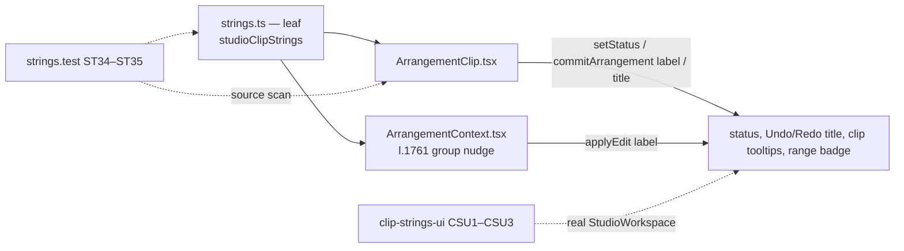

# Studio V-0.4a — კლიპის gesture-ების ტექსტები (move, trim, fade, lane move) ინგლისურად

**თარიღი:** 2026-10-24
**სტატუსი:** Completed (A-ის შემოწმებები მწვანეა რაუნდ 138-ში; C round 138 — PASS, browserVerified; gate 138 — 1d4df51)
**შეცვლილი პროექტი:** Store

## კონტექსტი

VISUAL-A-ს M2 მოთხოვნით Studio-ს მთელი UI ინგლისურია, ტექსტები კი ერთი strings მოდულიდან მოდის. V-0.3 რაუნდ 137-ში დასრულდა (doc 113, gate 137 — `7e6202b`). B-მა `7e6202b`-ზე V-0.4-ის ზედაპირი გაზომა (~120 ქართული წყაროს ხაზი და რამდენიმე ასეული pin) და D-29z103-ით ზედაპირების მიხედვით დაყო. ეს რაუნდი V-0.4a-ა: `ArrangementClip.tsx`-ის ყველა ქართული ტექსტი (25 ხაზი) და `ArrangementContext.tsx`-ის l.1761 — კლავიატურით ჯგუფის nudge-ის history label (`გადატანა (n)`), რომელიც move/trim label-ების იმავე ნაკრებს ეკუთვნის (D-29z95).

ცვლილება ხურავს GATE133-LANE-RELEASE-MIXED-ს (lane-ზე უარის სტატუსი ნახევრად ქართული იყო) და C round 137-ის შენიშვნას (`Undo: გადატანა ხაზზე — სტემები` ინგლისურ `Undo: Rename Group`-ის გვერდით).

## მიდგომა

- **ერთი ახალი ობიექტი `studioClipStrings` (R2)** `studioWorkspaceStrings`-ის შემდეგ, 20 key-ით (CL1–CL20). არსებული ობიექტები და key-ები byte-identical-ია, მოდული ისევ leaf-ია (import არ აქვს).
- **formatter-ები უკვე დაფორმატებულ მნიშვნელობებს იღებს.** `toFixed(3)` და `formatArrangementTime` caller-ში რჩება. `groupMovedRight/Left` named object-ს იღებს (`label`, `count`, `distance`; ლოკალური, არა-exported interface).
- **no-change წინადადება ერთი formatter-ია:** `historyUnchanged(label)`. V-0.4c-ში `ArrangementClipEnvelope.tsx` იმავეს გამოიყენებს `'Envelope'`-ით (R2 forward constraint), მეორე ასლის გარეშე.
- **branch-ები caller-ში რჩება (R3):** ჯგუფის მიმართულება ირჩევს `groupMovedRight`-ს ან `groupMovedLeft`-ს (ternary ფუნქციას ირჩევს, გამოძახება ერთია); trim-ის სახე ირჩევს `trimStartLabel`-ს ან `trimEndLabel`-ს; დაკეცილი ხაზის header-ის title caller-ში იკრიბება `moveTitle(title)` + `\n` + `CLIP_FOLDED_TITLE_LINE`.
- **ლოკალური სახელები რჩება:** `CLIP_FOLDED_TITLE_LINE`, `VIDEO_FADE_HANDLE_TITLES`, `CLIP_LANE_REFUSAL_KEPT_PLACE` მნიშვნელობას მოდულიდან იღებს. `CLIP_FADE_LABELS`, `VIDEO_FADE_LABELS` და `CLIP_FADE_HANDLE_TITLES` უკვე ინგლისური იყო და უცვლელია.
- **ქცევა არ იცვლება:** handler-ები, პირობები, ზღვრები, snap-ის წესები, კლავიშები, სტატუსების რიგი, commit-ის გადაწყვეტილებები, `data-testid`-ები, class-ები, fade handle-ების პოზიცია, header-ის glyph-ები (`▶`, `⠿`) და დროის ფორმატები.
- **შეგნებული შერეული მდგომარეობა ერთი რაუნდით (R5):** კლიპის badge ამბობს `2.000 s`, lane overlay კი ჯერ `… წმ · ყველა ხაზი`-ს (V-0.4b). Envelope, group header, meter/Master (V-0.4c), default track სახელები (V-0.4d), detail panel (V-0.4e), library და dock (V-0.5) მომდევნო ეტაპებშია.

### CL რუკა (მოკლედ)

| # | key | ინგლისური |
|---|---|---|
| CL1 | `foldedTitleLine` | `The track is folded — unfold it to make a time selection` |
| CL2–3 | `videoFadeInTitle` / `videoFadeOutTitle` | `Video Fade In/Out — picture only, the sound does not change · drag · double-click = 0` |
| CL4 | `keptLastFreeSpot` | `the clip stayed in its last free spot` |
| CL5–6 | `fadePreview` / `fadeCommitted` | `{label}: {seconds} s` / `{label}: {seconds} s.` |
| CL7–9 | `moveBlocked` / `trimStartBlocked` / `trimEndBlocked` | `Move blocked — …` / `Trim stopped: …` |
| CL10 | `historyUnchanged` | `{label}: nothing changed — the Undo history is unchanged.` |
| CL11–13 | `historyMoveClips` / `historyMoveToTrack` / `historyMoveClip` | `Move ({count})` / `Move to track — {name}` / `Move clip` |
| CL14–15 | `trimStartLabel` / `trimEndLabel` | `Trim — left edge` / `Trim — right edge` |
| CL16–17 | `groupMovedRight` / `groupMovedLeft` | `{label}: {count} clips moved {distance} to the right/left.` |
| CL18–20 | `moveTitle` / `rangeBodyTitle` / `seconds` | `{title} — drag to move` / `drag = time selection · click = playhead` / `{value} s` |

## არქიტექტურა

## შეცვლილი ფაილები

- `app/lib/arrangement/strings.ts` — ახალი `studioClipStrings` ობიექტი (CL1–CL20).
- `app/components/arrangement/ArrangementClip.tsx` — import და §1.1-ის 25 ხაზი მოდულის მნიშვნელობებზე.
- `app/contexts/ArrangementContext.tsx` — import-ში `studioClipStrings` და l.1761.
- `app/lib/arrangement/__tests__/strings.test.ts` — import, `CONTEXT_REMAINING_GEORGIAN_LINES`-იდან l.721-ის ჩანაწერის წაშლა (ST13 ახლა 3 ხაზს ელოდება), ST33-ის გადარქმევა (gate-137 finding 3), ახალი ST34–ST35.
- 17 pin ფაილი (`grid-snap-ui`, `clip-fades-ui`, `marker-snap`, `grid-snap-edit`, `grid-snap-position`, `gesture-reentry`, `fader-guards`, `clip-envelope-ui`, `marker-edge-nav-ui`, `marker-time-snap-ui`, `markers-ui`, `track-layout`, `grid-snap-clip-edges`, `video-fades-ui`, `gesture-guard`, `track-groups-ui`, `track-group-collapse-ui`) — 102 pin ხაზი ხელით დაწერილ ინგლისურზე, იმავე matcher-ებითა და selector-ის ოპერატორებით; fixture-ის track სახელები უცვლელია.
- ახალი `app/lib/arrangement/__tests__/clip-strings-ui.test.tsx` — CSU1 (range badge და body title), CSU2 (ჯგუფის გადატანა მარცხნივ), CSU3 (ArrowRight-ით ჯგუფის nudge).
- `docs/implementation/2026/quarter-IV/113-studio-v0-workspace-strings.md` — სტატუსი Completed (C round 137 PASS, gate 137), selector-ის მითითება l.331-ზე (gate-137 findings 3 და 4).

## პრობლემები და გადაწყვეტები

- **პრობლემა:** ინგლისური ტექსტი ქართულზე ფართოა Biome-ის ხაზის სიგრძის გამოთვლაში, ამიტომ სამმა pin-მა (`grid-snap-clip-edges` l.748 და l.759, `video-fades-ui` l.316) wrap მოითხოვა. **გადაწყვეტა:** იგივე statement-ი ხელით გადაიტანა Biome-ის სტილით; matcher და ტექსტი უცვლელია.
- **პრობლემა:** l.728-ის ჯგუფის სტატუსი ერთი statement-ის ფარგლებში უნდა დარჩენილიყო, branch კი caller-ში. **გადაწყვეტა:** ternary ირჩევს formatter-ს (`groupMovedRight` ან `groupMovedLeft`) და გამოძახება ერთია; ახალი ლოკალური ცვლადი არ დამატებულა.
- **პრობლემა:** მუტაცია m60 (trim edge-ების title-ების გაცვლა) `gesture-reentry`-ს ვერ აწითლებს — ეს ტესტი left-edge selector-ს მხოლოდ "რომელიმე trim handle"-ის საპოვნელად იყენებს, ხოლო გაცვლის შემდეგ ორივე title არსებობს. **გადაწყვეტა:** pin-ის წესი ახალ `it`-ს ან assertion-ს არ უშვებს; მუტაცია მაინც მოკლულია `grid-snap-edit`-ით (7 წითელი) და `track-layout`-ით (1 წითელი). B-ს ეცნობა.

## ტესტირება

- `npm run typecheck` exit 0, `npm run lint` exit 0; read-only `npx biome check` შეცვლილ კოდისა და ტესტის ფაილებზე 0 diagnostic.
- `npx vitest run` 25 ფაილზე (strings, 17 pin, clip-strings-ui და 6 მეზობელი): 527/527 მწვანეა. `strings.test` 33 → 35 `it`, `clip-strings-ui` 3. 17 pin ფაილის `it`-ების რაოდენობა უცვლელია.
- მუტაციები m53–m60: თითოეულმა მოკლა მინიმუმ ერთი დასახელებული ტესტი; ფაილები backup-იდან აღდგა და sha256-ით შემოწმდა. m60-ის `gesture-reentry` გამონაკლისი ზემოთაა აღწერილი.
- სრული suite, `npm run verify`, build და e2e root-ის gate-ზეა. ბრაუზერის შემოწმება: C round 138 — PASS (browserVerified, 1440×900 და 1280×720).

## TODO / შემდეგი ნაბიჯები

- V-0.4b: `ArrangementLane.tsx` (lane overlay `ყველა ხაზი`, aria-label StudioWorkspace-ის track-header selector-თან ერთად, ST33-ის allowance → 0), gate-137 finding 1 (`selectedClipDetail`).
- V-0.4c: `ArrangementClipEnvelope.tsx` l.25 → `studioClipStrings.historyUnchanged('Envelope')`.
- frontend-architect checkpoint `strings.ts`-ის დაყოფაზე root-ს ელოდება (`b-round-136-checkpoint-request.md`).
