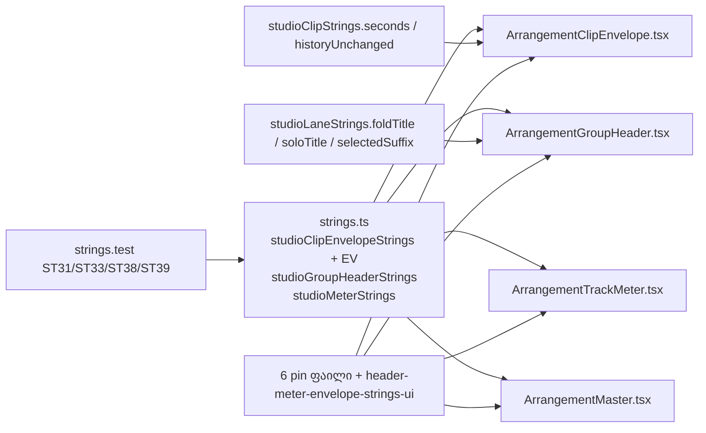

# Studio V-0.4c — clip envelope editor-ის, ჯგუფის header-ის, track meter-ისა და Master Peak-ის ტექსტები ინგლისურად

**თარიღი:** 2026-10-24
**სტატუსი:** Completed (A-ის შემოწმებები მწვანეა რაუნდ 140-ში; C round 140 — PASS, browserVerified; gate 140 — 6ebbf3e)
**შეცვლილი პროექტი:** Store

## კონტექსტი

VISUAL-A-ს M2 მოთხოვნით Studio-ს მთელი UI ინგლისურია, ტექსტები კი ერთი strings მოდულიდან მოდის. V-0.4b რაუნდ 139-ში დასრულდა (doc 115, gate 139 — `3f2c187`). B-მა `3f2c187`-ზე გაზომა ქართული წყაროს ხაზები: `ArrangementClipEnvelope.tsx` — 10, `ArrangementGroupHeader.tsx` — 10, `ArrangementTrackMeter.tsx` — 2, `ArrangementMaster.tsx` — 2. D-29z105-ით ეს რაუნდი V-0.4c-ა: Envelope-ის წერტილების Undo label-ები, სტატუსები და title-ები, ჯგუფის header-ის ღილაკები (სახელი, fold, Mute, Solo, Volume), track meter-ის over title და sr-only ტექსტი, Master Peak-ის label.

## მიდგომა

- **ობიექტები (R1):** Envelope editor-ის ტექსტები არსებულ `studioClipEnvelopeStrings`-ს დაემატა (ერთი feature — ერთი ობიექტი; 4 ძველი key byte-identical-ია). ორი ახალი ობიექტი `studioLaneStrings`-ის შემდეგ: `studioGroupHeaderStrings` და `studioMeterStrings`. მოდული ისევ leaf-ია (import არ აქვს).
- **ხელახალი გამოყენება ასლის ნაცვლად (R2):** fold-ის title — `studioLaneStrings.foldTitle` + ` (U)`; ჯგუფის Solo title — `studioLaneStrings.soloTitle`; `, selected` — `studioLaneStrings.selectedSuffix`; „ცვლილება არ მოხდა“ — `studioClipStrings.historyUnchanged('Envelope')`; დროის ერთეული — `studioClipStrings.seconds(t.toFixed(3))` (caller აფორმატებს, formatter-ს უკვე `6.000 s` მიეწოდება).
- **branch-ები caller-ში რჩება (R3):** დაკეცილი ჯგუფის `1 clip` / `{n} clips`, selected სუფიქსი, meter-ის over/normal title, Master-ის over/normal label, Envelope-ის preview (ბოლო `.`-ის გარეშე) და commit (ბოლო `.`-ით).
- **ტერმინები (R4):** CZABA უკვე ამბობს „point“ (`toggleOnTitle`), ამიტომ „point“ რჩება; Live 12 მას breakpoint-ს უწოდებს (§26.6.1) — შეგნებული განსხვავება. `ჯგუფი` როლის სიტყვად — `group`; დაჯგუფება/დაშლა — `Group Tracks` / `Ungroup Tracks` (არსებული Undo label-ები); `გადატვირთვა` — glossary-ს `Overload`, dash-ის შემდეგ პატარა ასოთი.
- **ლოკალური სახელები რჩება:** `ENVELOPE_ADD_LABEL`, `ENVELOPE_MOVE_LABEL`, `ENVELOPE_REMOVE_LABEL`, `ENVELOPE_NO_CHANGE`, `TRACK_GROUP_NAME_TITLE`, `TRACK_GROUP_FOLD_TITLE`, `trackGroupNameLabel`, `trackMeterTitle`, `masterPeakLabel` — სახელი და signature უცვლელია, მნიშვნელობა მოდულიდან მოდის.
- **ქცევა არ იცვლება:** handler-ები, პირობები, ზღვრები, კლავიშები, history, Mute/Solo/Volume/fold ლოგიკა, meter-ის latch/reset, `data-testid`-ები, class-ები, glyph-ები (`▸`, `▾`, `▣`, `M`, `S`), dB/dBFS ფორმატები და `toFixed(3)`.
- **შეგნებული შერეული მდგომარეობა ერთი რაუნდით (R5):** default ჯგუფის სახელი `ჯგუფი N` და default track სახელები (V-0.4d) ინგლისურ წინადადებებში რჩება; detail panel (V-0.4e); library, dock და route (V-0.5).

### რუკა (მოკლედ)

| # | key | ინგლისური |
|---|---|---|
| EV1–3 | `addPointLabel` / `movePointLabel` / `deletePointLabel` | `Envelope: add point` / `Envelope: move point` / `Envelope: delete point` |
| EV4 | `studioClipStrings.historyUnchanged('Envelope')` (reuse) | `Envelope: nothing changed — the Undo history is unchanged.` |
| EV5 | `pointTitle` | `Envelope: {time} · {gain} — drag · double-click = delete` |
| EV6–9 | `pointAdded` / `pointPreview` / `pointCommitted` / `pointDeleted` | `Envelope: point added — {time} · {gain}.` / `Envelope: {time} · {gain}` / `…{gain}.` / `Envelope: point deleted — {time}.` |
| EV10 | `editorTitle` | `Envelope — double-click = add point` |
| GH1–2 | `nameTitle` / `foldTitle` + ` (U)` (reuse) | `F2: Rename · Ctrl+G: Group Tracks · Ctrl+Shift+G: Ungroup Tracks` / `Fold / unfold (U)` |
| GH3–6 | `nameLabel` / `foldedOneClip` / `foldedClips` / `selectedSuffix` (reuse) | `{name} — group` / `, folded, 1 clip` / `, folded, {count} clips` / `, selected` |
| GH7–8 | `foldLabel` / `nameInputLabel` | `Fold or unfold group — {name}` / `Group name — {name}` |
| GH9–12 | `muteLabel` / `soloLabel` / `soloTitle` (reuse) / `volumeLabel` | `Mute — {name} (group)` / `Solo — {name} (group, Ctrl/Cmd+click = add to solo)` / `Solo (Ctrl/Cmd+click = add to solo)` / `Volume — {name} (group)` |
| MT1–3 | `trackPeakTitle` / `trackPeakOverTitle` / `trackOverAnnouncement` | `{name} · Peak {peak} dBFS` / `… — went above 0 dBFS. Click Master Peak to clear` / `{name}: the level went above 0 dBFS` |
| MT4–5 | `masterPeakLabel` / `masterPeakOverLabel` | `Master Peak {peak} dBFS — click to clear` / `Master Peak {peak} dBFS — overload (Clip). Click to clear` |

## არქიტექტურა

## შეცვლილი ფაილები

- `app/lib/arrangement/strings.ts` — `studioClipEnvelopeStrings`-ს 9 key დაემატა; ახალი `studioGroupHeaderStrings` და `studioMeterStrings`; ორი ლოკალური ტიპი (`{ time, gain }`, `{ name, peak }`).
- `app/components/arrangement/ArrangementClipEnvelope.tsx` — strings import და EV ხაზები.
- `app/components/arrangement/ArrangementGroupHeader.tsx` — strings import და GH ხაზები (`trackGroupNameLabel`-ის ტანის ჩათვლით).
- `app/components/arrangement/ArrangementTrackMeter.tsx` — strings import, `trackMeterTitle`-ის ტანი და sr-only ტექსტი.
- `app/components/arrangement/ArrangementMaster.tsx` — strings import და `masterPeakLabel`-ის ტანი.
- `app/lib/arrangement/__tests__/strings.test.ts` — import; ST31 (Envelope key-ები, plain მნიშვნელობები და formatter sample-ები); ST33-ის Envelope loop-ი ახლა მხოლოდ string-ებს ამოწმებს; ახალი ST38–ST39.
- 6 pin ფაილი: `clip-envelope-ui`, `track-group-mix-ui`, `track-groups-ui`, `track-group-collapse-ui`, `track-meter-ui`, `meter-ui` — მხოლოდ ჩამოთვლილი ხაზები, ხელით დაწერილი ინგლისური literal-ებით, იგივე matcher-ებით.
- ახალი `app/lib/arrangement/__tests__/header-meter-envelope-strings-ui.test.tsx` — HM1–HM6 რეალურ `StudioWorkspace`-ზე jsdom-ში.
- `docs/implementation/2026/quarter-IV/113-studio-v0-workspace-strings.md` — l.21-ს round 138-ის მდგომარეობის შენიშვნა დაემატა.
- `docs/implementation/2026/quarter-IV/115-studio-v0-lane-strings.md` — სტატუსი Completed (C round 139 PASS, gate 139).

## პრობლემები და გადაწყვეტები

- **პრობლემა:** B-ის pin სიაში არ იყო `track-group-mix-ui` l.405, რომელიც ჯგუფის Solo-ს `title`-ს ზუსტად ამოწმებს. **გადაწყვეტა:** R6-ით ტექსტი და მისი matcher ერთ რაუნდში იცვლება — l.405 ინგლისურ literal-ზე გადავიდა იგივე `toBe`-თი, ახალი `it`-ის გარეშე. B-ს ეცნობა.
- **პრობლემა:** ST33-ის loop-ი `studioClipEnvelopeStrings`-ის ყველა მნიშვნელობაზე `toMatch`-ს იძახებდა; ახალ formatter-ებზე ეს TypeError-ია. **გადაწყვეტა:** loop-ი formatter-ებს გამოტოვებს (იგივე `typeof value === 'string'` შემოწმება, რაც იმავე ტესტში `ws`-ისთვისაა); formatter-ების output-ებს ST39 ამოწმებს.
- **პრობლემა:** `track-group-collapse-ui`-ის UC4-ის პირველი aria-label დამოკლდა და Biome-მა ის ერთ ხაზზე მოითხოვა. **გადაწყვეტა:** ჩამოთვლილი pin ერთ ხაზზე გადავიდა (formatter-ის მოთხოვნა, matcher იგივეა).
- **პრობლემა:** ერთკლიპიანი დაკეცილი ჯგუფი (`1 clip`) არსებული fixture-ებით არ მიიღებოდა. **გადაწყვეტა:** HM4-ის საკუთარ fixture-ში SFX ხაზს კლიპი არ აქვს, ამიტომ `სტემები` + `SFX` ჯგუფი ზუსტად ერთ კლიპს შეიცავს.

## ტესტირება

- `npm run typecheck` exit 0, `npm run lint` exit 0; read-only `npx biome check` 13 შეცვლილ კოდისა და ტესტის ფაილზე: 0 diagnostic.
- `npx vitest run` 17 ფაილზე (strings, 6 pin, header-meter-envelope-strings-ui და 9 მეზობელი): 244/244 მწვანეა. `strings.test` 37 → 39 `it`, ახალ ფაილში 6. pin ფაილების `it`-ების რაოდენობა უცვლელია.
- მუტაციები m69–m76: თითოეულმა დასახელებული ტესტები გააწითლა; ფაილები backup-იდან აღდგა და sha256-ით შემოწმდა.
- სრული suite, `npm run verify`, build და e2e root-ის gate-ზეა. C round 140 — PASS (browserVerified).

## TODO / შემდეგი ნაბიჯები

- V-0.4d: default track სახელები და `TRACK_GROUP_NAME_PREFIX` (`ჯგუფი N`) fixture-ების sweep-ით.
- V-0.4e: detail panel. V-0.5: library, VideoDock, route.
- frontend-architect checkpoint `strings.ts`-ის დაყოფაზე root-ს ელოდება (`b-round-136-checkpoint-request.md`).
