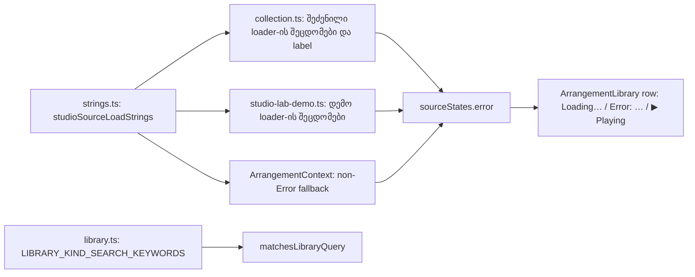

# Studio V-0.5a — წყაროს ჩატვირთვის შეცდომები, ბიბლიოთეკის row-ის სტატუსი, დემო collection-ის label-ები და ძებნის kind keyword-ები ინგლისურად

**თარიღი:** 2026-10-24
**სტატუსი:** Completed (C round 146 — PASS, browserVerified; gate 146, 3328e75)
**შეცვლილი პროექტი:** Store

## კონტექსტი

V-0.5 არის V-0-ის ბოლო ეტაპი. მისი მიზანია, რომ `/studio-lab`-ში დარჩენილი ქართული UI ტექსტი ინგლისურად გადავიდეს. ბიბლიოთეკის row აჩვენებს `შეცდომა: ${error}`-ს, ხოლო `error`-ის ტექსტი სამი წყაროდან მოდის: `collection.ts`, `studio-lab-demo.ts` და ArrangementContext-ის fallback. თუ მხოლოდ ერთ მხარეს გადავიყვანდით, ერთ row-ზე ორი ენა გამოჩნდებოდა (GATE128-S1-ის წესი). ამიტომ B-მ (D-29z110, R1) V-0.5 სამ ეტაპად დაყო. V-0.5a ერთად ცვლის წყაროს ჩატვირთვის ყველა შეცდომას და row-ის სტატუსის ბლოკს.

ამავე რაუნდში გასწორდა **C-R142-02** (Low, `deferred_low_polish`): ძებნა `stems` stem წყაროებს ვერ პოულობდა. რაუნდი `library.ts`-ს ფლობს და გასწორება იაფია (2026-10-23-ის წესი).

## მიდგომა

- **R4:** `strings.ts`-ს ბოლო export-ად დაემატა `studioSourceLoadStrings` (13 key). ის ერთი წყაროა `collection.ts`-ისთვის, `studio-lab-demo.ts`-ისთვის, Context-ის fallback-ისთვის და row-ის სტატუსისთვის. `strings.ts` leaf მოდულად რჩება (import არ აქვს).
- დემო collection-ის label-ები და notice `studio-lab-demo.ts`-ში ინგლისურ literal-ებად დარჩა. ეს მონაცემებია, ისევე როგორც default track-ის სახელები `studio-lab.tsx`-ში.
- **R3:** დემო ხმების სათაურები (`ღამის პულსი`, `პულსი`, `ბასი`, `პადი`, `მელოდია`, `სრული მიქსი`, `… — საჯარო preview`) ხმის სახელებია და არ შეცვლილა. `Synthetic demo · ღამის პულსი` არის მომხმარებლის content ინგლისურ copy-ში.
- **R2 (LIB-SEARCH-KEYWORDS):** ძებნა display label-ებს აღარ იყენებს. `library.ts`-ში დაემატა `LIBRARY_KIND_SEARCH_KEYWORDS` (`music`, `stem`/`stems`, `sfx`), და `matchesLibraryQuery` haystack-ში ამ keyword-ებს სვამს. `LIBRARY_KIND_LABELS` და `LIBRARY_FOLDER_LABELS` byte-ით უცვლელია. ST48 ამოწმებს, რომ label-ის მომავალმა ცვლილებამ ძებნა ჩუმად არ გატეხოს.
- ქართული სინონიმები (`მუსიკა`, `სტემები`) ძებნას არ დაემატა: არავის მოუთხოვია, V-0 Studio-ს მხოლოდ ინგლისურს ხდის და module contract (ST44) ამ წყაროებში ქართულს კრძალავს. სიგნალი `LIB-SEARCH-GEORGIAN-SYNONYMS` (info) Saba-სთვის ჩაიწერა და არ არის დაგეგმილი.
- **R2b:** `sfx` Music preview-ებსაც პოულობს collection label-ის (`CZABA public previews + synthetic SFX`) გამო. ეს განზრახ არის: collection label საძიებოა (LIB-03) და ის მართლაც SFX-ს შეიცავს.
- **R5 (layout):** RV-1 V-0 text-width გამონაკლისი მხოლოდ ბიბლიოთეკის სვეტში მოქმედებს (C-ის LAYOUT-LIB (i)–(vi)). class, testid და element არ შეცვლილა.
- ალტერნატივა იყო, რომ თითოეულ loader-ს საკუთარი ინგლისური literal ჰქონოდა. უარვყავით: ერთნაირი შეტყობინება ორ ფაილში ორჯერ დაიწერებოდა და ერთ-ერთი ადვილად აირეოდა.

## სტრინგების რუკა (glossary)

| ძველი (ქართული) | ახალი (English) | key / ადგილი |
|---|---|---|
| ფაილი ვერ ჩაიტვირთა (ქსელი) | File failed to load (network) | `networkFailed` |
| ფაილი ვერ ჩაიტვირთა (N) | File failed to load (N) | `httpFailed(status)` |
| ფაილი ვერ გაიშიფრა | File could not be decoded | `decodeFailed` |
| უცნობი წყარო | Unknown source | `unknownSource` |
| უცნობი დემო წყარო | Unknown demo source | `unknownDemoSource` |
| შეძენილ კოლექციას productId არ აქვს | The purchased collection has no productId | `purchasedNoProductId` |
| შეძენილ კოლექციას სტემები არ აქვს | The purchased collection has no stems | `purchasedNoStems` |
| შეძენილ კოლექციაში სტემის id მეორდება | A stem id repeats in the purchased collection | `purchasedDuplicateStemId` |
| X · შეძენილი სტემები | X · purchased stems | `purchasedCollectionLabel(productTitle)` |
| ჩატვირთვა ვერ მოხერხდა | Loading failed | `loadFailedFallback` |
| იტვირთება… | Loading… | `rowLoading` |
| შეცდომა: X | Error: X | `rowError(message)` |
| ▶ ისმის | ▶ Playing | `rowPreviewing` |
| დემო კოლექცია · CZABA-ს საჯარო preview + სინთეზური ხმები | Demo collection · CZABA public previews + synthetic sounds | DM1 `DEMO_COLLECTION_LABEL` |
| CZABA საჯარო preview + სინთეზური SFX | CZABA public previews + synthetic SFX | DM2 `PUBLIC_PREVIEW_COLLECTION_LABEL` |
| სინთეზური დემო · ღამის პულსი | Synthetic demo · ღამის პულსი | DM3 `SYNTHETIC_COLLECTION_LABEL` |
| სტემები სინთეზური დემოა — არა CZABA-ს კატალოგის სტემები და არა მიქსიდან ამოღებული ნაწილები. | The stems are a synthetic demo — not CZABA catalogue stems and not parts extracted from a mix. | DM4 `notice` |

## არქიტექტურა

## შეცვლილი ფაილები

- `app/lib/arrangement/strings.ts` — ახალი ბოლო export `studioSourceLoadStrings`.
- `app/lib/arrangement/library.ts` — `LIBRARY_KIND_SEARCH_KEYWORDS` და `matchesLibraryQuery`-ის haystack.
- `app/lib/arrangement/collection.ts` — 9 შეცდომა/label მოდულიდან; სტატუსის შეტყობინებები (V-0.5b) უცვლელია.
- `app/data/studio-lab-demo.ts` — DM1–DM5; ხმების სათაურები უცვლელია.
- `app/contexts/ArrangementContext.tsx` — მხოლოდ CX1 (fallback და import-ის ერთი სახელი).
- `app/components/arrangement/ArrangementLibrary.tsx` — მხოლოდ LR1 (row-ის სამი გამოსახულება და ერთი import).
- `app/lib/arrangement/__tests__/strings.test.ts` — ST13 ledger `[]`, `toHaveLength(0)`, ახალი ST45–ST48.
- `app/lib/arrangement/__tests__/library.test.ts` — LIB-KW.
- 6 pin ფაილი (`collection`, `failed-source-refusal`, `status-announcement-ui`, `studio-lab-demo`, `purchased-collection-ui`, `collection-load-status`) — მხოლოდ დასახელებული ხაზები.
- ახალი `app/lib/arrangement/__tests__/library-row-strings-ui.test.tsx` — LRS1–LRS2 (round 146: LRS3).
- `docs/implementation/2026/quarter-IV/118-studio-v0-detail-library-strings.md` — სტატუსი Completed და round 144-ის შედეგი.
- Round 146: `app/components/arrangement/ArrangementLibrary.tsx` — მხოლოდ PM1 (`▶ Playing` marker ცალკე ხაზად, ახალი testid `arrangement-library-option-previewing`).
- Round 146: `app/lib/arrangement/__tests__/library-row-strings-ui.test.tsx` — ახალი LRS3.
- Round 146: `app/data/__tests__/studio-lab-demo.test.ts` — ახალი DL-VAL და ოთხ `it`-ის სათაურში `Georgian` → `English`.
- Round 146: `app/lib/arrangement/__tests__/collection.test.ts` — PC2-ში სამი `toThrow(Error)` ზუსტი შეტყობინებით.

## პრობლემები და გადაწყვეტები

- **Problem:** Biome-მა ორი შეცვლილი ხაზი გადაიტანა: CX1 (100 სიმბოლოზე გრძელი) და `matchesLibraryQuery`-ის haystack-ის მასივი. ამის გარდა `▶ Playing`-ის span JSX-ში სამ ხაზად დაიწერა. **Solution:** ხელით გადატანილია Edit-ით, `--write`-ის გარეშე. შინაარსი §1-ის ზუსტი შესაბამისია.
- **Problem:** m91 (`networkFailed` → `(net)`) `failed-source-refusal`-სა და `status-announcement-ui`-ს არ აწითლებს, თუმცა §3.5 ამას ელოდა. ორივე ფაილის fake loader თავად აგდებს ხელით დაწერილ `LOADER_ERROR` literal-ს და `networkFailed`-ს არ კითხულობს. **Solution:** pin-ები ზუსტ ინგლისურად შეიცვალა (§3.3), ტესტის სტრუქტურა კი არა, რადგან ეს grant-ის მიღმაა. შეუსაბამობა B-ს გადაეცა. m91-ს მაინც კლავს ST45, `collection.test` PC6/PC10 და `studio-lab-demo.test` DL1/DL2. B-მ (D-29z111) დაადასტურა, რომ ეს spec-ის შეცდომა იყო: fixture-ები ხელით დაწერილი რჩება (GATE132-S4) და დავალება არ დაინიშნა.
- **Problem (C-R145-01 / ABL-B-1, Low):** library preview-ის დროს `▶ Playing` (42 px) meta row-ის მესამე შვილი იყო და 126 px option-ში არ ეტეოდა. სიის კიდეზე ის იჭრებოდა და იკითხებოდა როგორც `▶ Play`, ანუ row საკუთარ მდგომარეობას არასწორად აჩვენებდა. round 145-ის გრძელმა ინგლისურმა ტექსტმა ეს უფრო გააუარესა. **Solution (round 146, PM1):** marker meta row-იდან გამოვიდა და `role="option"` ღილაკის ბოლო შვილი გახდა, `whitespace-nowrap text-xs text-brand` class-ით. ის მხოლოდ preview-ის დროს რენდერდება და `flex-col` ღილაკში ცალკე ხაზად ჩნდება. meta row-ის class და ორი შვილი byte-ით უცვლელია, ამიტომ `ready` და `error` მდგომარეობებში ახალი node არ ჩნდება. meta row-ზე `flex-wrap` უარყოფილია B-ის რეალური Chromium probe-ის გამო (`b-round-145/out/flexprobe.json`): wrap-ისას `Error: …` span ცალკე ხაზზე გადადის (x 47 → 8, y 0 → 16) და `error` მდგომარეობის layout იცვლება. LRS3 ამ სტრუქტურას ამოწმებს (m97 და m98 მას აწითლებს). რეალური ხილვადობის მტკიცებულება C-ის ბრაუზერის row-ია.
- **Problem:** ST48-ში `as const` type assertion იქნებოდა (პროექტის წესი კრძალავს). **Solution:** გამოიყენება ტიპიზებული `readonly WorkspaceSourceKind[]` მასივი.

## ტესტირება

- `npm run typecheck` და `npm run lint` exit 0. read-only `npx biome check` 15 შეცვლილ კოდის ფაილზე: 0 diagnostic.
- `npx vitest run` 14 ფაილზე: 251/251 მწვანე (`tmp/studio-real-loop/a-round-145/vitest.json`). `strings.test` 44 → 48 `it`, `library.test` +1, ახალ ფაილში 2. სხვა ფაილებში `it`-ების რაოდენობა უცვლელია.
- მუტაციები m91–m96: თითოეული აღდგა და sha256-ით შემოწმდა. m92–m96 ყველა დასახელებულ ტესტს აწითლებს, m91 — ყველას, გარდა ზემოთ ახსნილი ორი ფაილისა.
- C round 145 (რეალური Chromium, `browserVerified` = `realVerified` = true): FAIL. PASS: T145-TARGETED, SOURCE-SCOPE, AN-REVIEW, LIB-ROW-TEXT, LIB-LABELS, LIB-SEARCH, LAYOUT-REST, G145-3, PX-NET, REG-HYD. FAIL: LAYOUT-LIB (vi), ანუ C-R145-01 (`▶ Playing` იჭრება როგორც `▶ Play`; LAYOUT-LIB (i)–(v) შესრულდა). BLOCKED (backend cloud-ში არ არის): PURCHASED-LABEL და G145-3-ის fake-Bearer 403.
- Round 146 (A): typecheck და lint exit 0, read-only Biome 4 ფაილზე 0 diagnostic, vitest 10 ფაილზე 128/128 (`tmp/studio-real-loop/a-round-146/vitest.json`; `library-row-strings-ui` 2 → 3, `studio-lab-demo` 12 → 13). მუტაციები m97/m98 აწითლებს LRS3-ს, m99 — DL-VAL-ს, m100 — PC2-სა და ST45-ს. C round 146: PASS (`browserVerified` = `realVerified` = true).
- სრული suite, `npm run verify`, build და e2e root-ის gate-ზეა.

## TODO / შემდეგი ნაბიჯები

- V-0.5b: `ArrangementLibrary.tsx`-ის დარჩენილი 16 ხაზი (`All` Live §4.2-ის მიხედვით, fold/unfold §4.5-ის მიხედვით, ძებნის copy), `ArrangementLibraryPreview.tsx` (8) და `collection.ts`-ის სტატუსის შეტყობინებები (10).
- V-0.5c: video dock, route meta title, `lang="en"`, საბოლოო RV-4 grep და RV-1-ის ხელახალი capture.
- `PURCHASED-LABEL` ბრაუზერში ვერ შემოწმდება backend-ის გარეშე; ამჟამად მხოლოდ unit მტკიცებულება აქვს.
