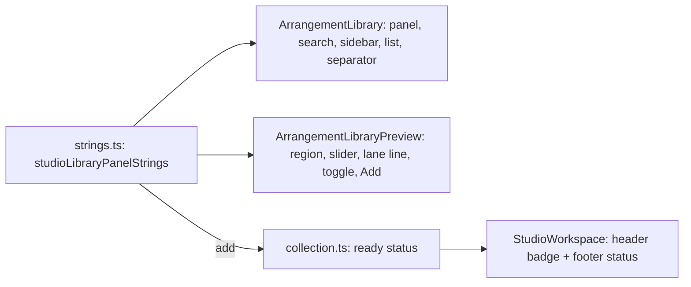

# Studio V-0.5b — ბიბლიოთეკის panel-ი, preview და collection-ის სტატუსები ინგლისურად

**თარიღი:** 2026-10-24
**სტატუსი:** Completed (C round 147 — PASS, browserVerified; gate 147, 34ce551)
**შეცვლილი პროექტი:** Store

## კონტექსტი

V-0.5 არის V-0-ის ბოლო ეტაპი: `/studio-lab`-ში დარჩენილი ქართული UI ტექსტი ინგლისურად გადადის. V-0.5a-მ (round 145–146, [119](119-studio-v0-library-source-strings.md)) წყაროს ჩატვირთვის შეცდომები და row-ის სტატუსი გადაიყვანა. 3328e75-ზე `ArrangementLibrary.tsx`-ში ქართული 16 ხაზი დარჩა, `ArrangementLibraryPreview.tsx`-ში 8 და `collection.ts`-ის სტატუსებში 10. სულ 34 ხაზი გამოდის (B-ის გაზომვა, D-29z112).

**რატომ ერთ რაუნდში.** `ready` სტატუსი preview-ის `＋ დამატება` ღილაკს ასახელებს, `empty` და `failed` კი ბიბლიოთეკას. თუ preview-ს სტატუსებისგან ცალკე გადავიყვანდით (ან პირიქით), სტატუსის წინადადება სხვა ენის control-ს დაასახელებდა (GATE128-S1-ის წესი). ტესტების pin-ები 9 ფაილშია, ST47-ის ledger-ის ჩათვლით.

## მიდგომა

- `strings.ts`-ს ბოლო export-ად დაემატა `studioLibraryPanelStrings`: 22 key, მხოლოდ plain string, formatter-ის გარეშე. `strings.ts` leaf მოდულად რჩება (import არ აქვს). ამიტომ `collection.ts`-ს მისი module-level გამოყენება circular import-ის გარეშე შეუძლია.
- ორივე კომპონენტში მხოლოდ ტექსტის literal-ი შეიცვალა მოდულის key-ით, თითო import-ის ხაზთან ერთად. class, testid, პირობა, handler, glyph (`▶ ◀ × ▾ ▸`), `· playhead` და `'—'` fallback-ები byte-ით უცვლელია. `LIBRARY_EMPTY_MESSAGE`-ის სახელი დარჩა და ახლა `studioLibraryPanelStrings.noResults`-ს უდრის.
- `collection.ts`-ში `ready` ღილაკის საკუთარ კონსტანტას (`studioLibraryPanelStrings.add`) interpolation-ით იყენებს. ასე ღილაკის ტექსტი და მისი მომხსენიებელი წინადადება ერთმანეთს ვერ დაშორდება. `failed(count)` ინგლისურ მრავლობითს `count === 1`-ით ირჩევს, `strings.ts`-ის არსებული precedent-ის მიხედვით. `heading`, `fileStem`, fetch, guard-ები და round 145-ის `studioSourceLoadStrings`-ის გამოყენებები უცვლელია.
- ალტერნატივა იყო კომპონენტებში ინგლისური literal-ების პირდაპირ ჩაწერა. უარვყავით: `＋ Add` ორ ფაილში ორჯერ დაიწერებოდა და `ready` სტატუსი ღილაკს დაშორდებოდა. სტრინგების მოდულის გაყოფის საკითხი (23-ე `studio*Strings` ობიექტი) root-ის არქიტექტურულ checkpoint-ზე რჩება V-0.5-ის ბოლოს. ამ რაუნდში refactor არ გაკეთებულა.

## სტრინგების რუკა (glossary)

| ძველი (ქართული) | ახალი (English) | key / ადგილი |
|---|---|---|
| ბიბლიოთეკა | Library | `library` — `aside` aria-label, `<h2>` |
| ბიბლიოთეკის გახსნა | Expand library | `expand` — rail ღილაკის aria-label და title |
| ბიბლიოთეკის დაკეცვა | Collapse library | `collapse` — aria-label და title |
| ძიება: სახელი, ტიპი, კოლექცია… | Search: name, type, collection… (U+2026) | `searchPlaceholder` |
| ბიბლიოთეკაში ძიება | Search the library | `searchLabel` |
| ძიების გასუფთავება | Clear search | `clearSearch` |
| ფილტრი: X | Filter: X | `filterPrefix` (ბოლოში ერთი space) |
| ბიბლიოთეკის ხე | Library sidebar | `sidebarLabel` — `nav` |
| ყველა ფაილი | All | `all` |
| X — დაკეცვა / X — გაშლა | X — Fold / X — Unfold | `fold` / `unfold` — collection-ის ისარი |
| ხმები | Sounds | `listLabel` — listbox |
| ხმა ვერ მოიძებნა… | No sounds found. | `noResults` |
| ბიბლიოთეკის სიგანე | Library width | `widthLabel` — separator |
| პრევიუ | Preview | `previewLabel` — section |
| აირჩიე ხმა სიიდან | Select a sound in the list | `previewEmpty` |
| პრევიუს ტალღა — click = მოსმენა ამ ადგილიდან · ← → 1 წმ · Home/End · Space = ▶/■ | Preview waveform — click = play from here · ← → 1 s · Home/End · Space = ▶/■ | `previewWaveLabel` — slider |
| აქტიური ხაზი: | Active track: | `activeTrack` — title და ხილული ტექსტი |
| (აუდიო აქ არ ემატება) | (audio is not added here) | `videoTrackNote` (თავში ერთი space) |
| ▶ მოუსმინე / ■ შეჩერება | ▶ Preview / ■ Stop | `previewPlay` / `previewStop` |
| ＋ დამატება | ＋ Add (U+FF0B) | `add` |
| დემო კოლექცია — ავტორიზაცია არ სჭირდება | Demo collection — no sign-in required | `collection.ts` demo `badge` |
| დემო / შეძენილი კოლექცია იტვირთება… | Loading the demo / purchased collection… | `loading` |
| … მზადაა. აირჩიე ხაზი და დაამატე ხმა (Enter ან ＋ დამატება). | Demo / Purchased collection ready. Choose a track and add a sound (Enter or ＋ Add). | `ready` |
| … წყარო არ არის — ბიბლიოთეკა ცარიელია. | The demo / purchased collection has no sounds — the library is empty. | `empty` |
| … N წყარო ვერ ჩაიტვირთა — დეტალები ბიბლიოთეკაშია. | 1 sound / N sounds in the demo / purchased collection failed to load — details are in the library. | `failed(count)` |
| შეძენილი კოლექცია | Purchased collection | purchased `badge` |

Glossary-ის გადაწყვეტილებები (D-29z112): `წყარო` მომხმარებლის სტატუსებში → **sound**, ანუ ის სიტყვა, რომელსაც panel-ი თავად იყენებს („Sounds“, „No sounds found.“). `ხაზი` → **track**.

## Ableton-ის წყარო

წყარო: Live 12 Reference Manual, თავი 4 „Working with the Browser“ (https://www.ableton.com/en/live-manual/12/working-with-the-browser/). B-ის capture: `b-round-144/live/working-with-the-browser.{html,txt}`, 2026-10-24.

| ქცევა | სექცია | იქ დადასტურებული | CZABA-ს გადაწყვეტილება | შესაბამისობა |
|---|---|---|---|---|
| „All“ ჩანაწერი ყველა item-ით | §4.2 Search Bar | „select the All label … Esc to clear the search field and show all items in the All label again“ | `All`; Esc ძებნის ველში query-ს ასუფთავებს (არსებული ქცევა) | დადასტურებული |
| ჯგუფის fold/unfold ისრით | §4.5 Collections, §4.4.3 | „can be unfolded“; „fold and unfold the groups by clicking on the arrow“ | ისრის სახელი `<label> — Fold/Unfold`; ქცევა უცვლელია | დადასტურებული |
| Sidebar / content pane | §4, §4.1 | „The browser's sidebar contains …“; „The content pane displays the items“ | `Library sidebar`; listbox რჩება `Sounds` (Live-ის „content pane“ მომხმარებლის label არ არის) | დადასტურებული (sidebar) |
| Preview არე და toggle | §4, §4.9 Previewing Files | „The Preview tab … plays back the sound when the Preview toggle is activated“ | `region` `Preview`, ღილაკი `▶ Preview` / `■ Stop`. Live-ში toggle icon-ია, CZABA-ში წარწერიანი ღილაკი | შეგნებული განსხვავება |
| Browser-ის ჩვენება/დამალვა | capture-ში არ არის | დაუდასტურებელი | `Expand / Collapse library` (glossary d29z102/d29z107); Live-თან parity-ს არ ვამტკიცებთ | დაუდასტურებელი |
| Collection-ის სტატუსები და badge | — | — | CZABA-ს საკუთარი copy | არ ეხება |

## არქიტექტურა

## შეცვლილი ფაილები

- `app/lib/arrangement/strings.ts` — ახალი ბოლო export `studioLibraryPanelStrings`.
- `app/components/arrangement/ArrangementLibrary.tsx` — 16 ტექსტი და import (`<h2>`-ის შიგთავსი და filter-ის prefix ცალკე ხაზზეა, Biome-ის ფორმატით).
- `app/components/arrangement/ArrangementLibraryPreview.tsx` — 8 ტექსტი და import (Biome-ის მიერ ორი ხაზის გადატანა).
- `app/lib/arrangement/collection.ts` — demo/purchased სტატუსები და import.
- `app/lib/arrangement/__tests__/strings.test.ts` — ST47 (ledger-ები `[]`, Preview path ორივე loop-ში, Library/collection zero-Georgian loop-ში) და ახალი ST49.
- `app/lib/arrangement/__tests__/library-row-strings-ui.test.tsx` — LRS4, LRS5 და Latin-only fixture `readyRowCollection`.
- pin-ები: `collection.test.ts` (PC9 + `failed(1)`), `collection-load-status.test.tsx`, `purchased-collection-ui.test.tsx`, `library-preview.test.tsx`, `held-enter-add.test.tsx`, `render-budget.test.tsx`, `fader-guards.test.tsx`, `grid-snap-keys.test.tsx` — მხოლოდ ქართული მოლოდინები ინგლისურად.
- `docs/implementation/2026/quarter-IV/119-studio-v0-library-source-strings.md` — სტატუსი Completed და round 146-ის C შედეგი.

## პრობლემები და გადაწყვეტები

- **პრობლემა:** ST47-ის ორი ledger ცარიელი ხდება. თუ ცალკე `toEqual`-ს წავშლიდით, კონსტანტები გამოუყენებელი დარჩებოდა. → **გადაწყვეტა:** კონსტანტები `[]`-ად და მათი `expect`-ები დარჩა, ფაილები კი zero-Georgian loop-შიც დაემატა.
- **პრობლემა:** LRS5-ს სჭირდება ორი მდგომარეობა: ერთი ჩავარდნილი ხმა და ყველა მზად. → **გადაწყვეტა:** `mountRows`-ს მიეცა არჩევითი collection პარამეტრი, ხოლო ტესტის ფაილში დაემატა Latin-only fixture (ST47 ამ ფაილშიც კრძალავს ქართულს).
- **პრობლემა:** `purchased-collection-ui.test.tsx`-ის l.297–298 (`not.toContain('დემო')`, `not.toContain('ავტორიზაცია არ სჭირდება')`) ამ ცვლილების შემდეგ ყოველთვის გაივლის. → **გადაწყვეტა:** ეს ხაზები grant-ში არ შედიოდა და არ შეცვლილა. B-ს გადაეცა სიგნალად.

## ტესტირება

- Baseline 3328e75-ზე: 17 ფაილი, 278/278.
- ცვლილების შემდეგ: typecheck და lint exit 0, read-only Biome 14 ფაილზე 0 diagnostic, vitest 17 ფაილზე 281/281 (`tmp/studio-real-loop/a-round-147/vitest.json`). `strings` 48 → 49, `library-row-strings-ui` 3 → 5 (LRS5 ერთი `it`-ია ორი mount-ით), `collection` 14 → 14 (`failed(1)` PC9-შია).
- მუტაციები m101–m106: თითოეულმა დასახელებული ტესტები გააწითლა, აღდგა Edit-ით და sha256-ით შემოწმდა.
- სრული suite, `npm run verify`, build და e2e root-ის gate-ზეა. C round 147: PASS (browserVerified = realVerified = true).

## TODO / შემდეგი ნაბიჯები

- C round 147: რეალური Chromium-ით COPY-LIB, COPY-PREVIEW, COPY-STATUS, NO-GEORGIAN, LAYOUT-LIB.
- V-0.5c: `ArrangementVideoDock.tsx` (`ვიდეოს პრევიუ` და სხვა), `studio-lab.tsx`-ის meta title, `lang="en"`.
