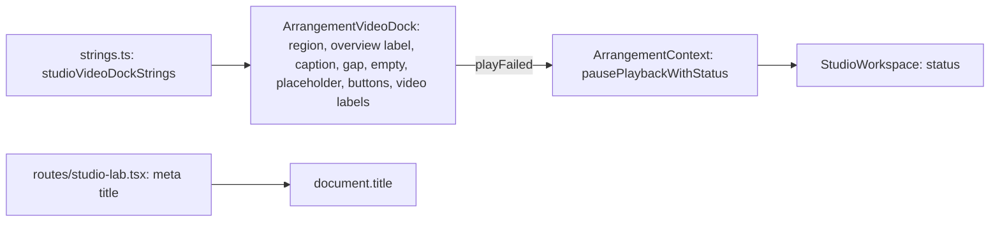

# Studio V-0.5c — ვიდეოს dock-ი და Studio Lab-ის გვერდის სათაური ინგლისურად, RV-4-ის საბოლოო sweep

**თარიღი:** 2026-10-24
**სტატუსი:** Completed (C round 148 — PASS, browserVerified; gate 148, b292ff4)
**შეცვლილი პროექტი:** Store

## კონტექსტი

V-0.5c არის V-0-ის ბოლო ეტაპი (D-29z110 R1, D-29z113). V-0.5a-მ ([119](119-studio-v0-library-source-strings.md)) და V-0.5b-მ ([120](120-studio-v0-library-panel-strings.md)) ბიბლიოთეკა და collection-ის სტატუსები გადაიყვანა. 34ce551-ზე `/studio-lab`-ის სამუშაო სივრცის კოდში ქართული UI ტექსტი მხოლოდ ორ ადგილას დარჩა (B-ის გაზომვა, ST47-ის comment-stripping წესით):

- `ArrangementVideoDock.tsx` — 18 ხაზი (17 განსხვავებული სტრიქონი): region-ის სახელი, overview-ის label, caption, gap-ის ტექსტი, ცარიელი dock, გაფართოებული ვიდეოს placeholder, ღილაკების aria-label/title, `<video>`-ების aria-label და დაკვრის შეცდომის სტატუსი.
- `routes/studio-lab.tsx` — 1 ხაზი: გვერდის meta title.

`data/studio-lab-demo.ts`-ის 9 ხაზი მომხმარებლის კონტენტია (ხმების სათაურები) და რჩება (D-29z92).

ამავე რაუნდში დაიხურა სამი იაფი სიგნალი: GATE147-S1 (doc 120-ის სტატუსი), GATE147-S4 (`purchased-collection-ui.test.tsx`-ის ქართული negative assertion-ები, რომლებიც ვეღარ ჩავარდებოდა) და gate-141 #2 (SSR ტესტი `console.error`-ს mock-ავდა, მაგრამ არ ამოწმებდა).

## მიდგომა

- `strings.ts`-ს ბოლო export-ად დაემატა `studioVideoDockStrings`: 17 key, მხოლოდ plain string. `strings.ts` leaf მოდულად რჩება.
- `ArrangementVideoDock.tsx`-ში მხოლოდ 18 ტექსტი შეიცვალა მოდულის key-ით და დაემატა ერთი import. class, testid, data-attribute, handler, პირობა, glyph-ები (`⤢ ⠿ ✕`) და უკვე ინგლისური სიტყვა `Arrangement` byte-ით უცვლელია. `VIDEO_PLAY_FAILED_MESSAGE` და `VIDEO_RETURN_LABEL` სახელები დარჩა და ახლა მოდულის key-ებს უდრის. Biome-ს ხაზების გადატანა არ დასჭირდა.
- `studio-lab.tsx`-ში მხოლოდ l.8-ის title შეიცვალა.
- ალტერნატივა იყო literal-ების პირდაპირ კომპონენტში ჩაწერა. უარვყავით: V-0-ის წინა ეტაპების 23 `studio*Strings` ობიექტი ერთ მოდულშია და ST-ტესტები სწორედ ამ მოდულს ამოწმებს. 24-ე `studio*Strings` ობიექტის საკითხი (გაყოფა, `studioVideoStrings` / `studioVideoDockStrings` მსგავსი სახელები) root-ის არქიტექტურულ checkpoint-ზე რჩება. ამ რაუნდში refactor არ გაკეთებულა.

## სტრინგების რუკა (glossary)

| ძველი (ქართული) | ახალი (English) | key / ადგილი |
|---|---|---|
| ვიდეო (region) | Video | `dockLabel` — `section` aria-label |
| · მთლიანი პროექტი | · Overview (U+00B7) | `overviewNote` — `Arrangement · Overview` |
| ვიდეო (caption fallback) | Video | `captionFallback` |
| · ხმა ვიდეოხაზიდან (M/S/Volume) | · sound from the video track (M/S/Volume) | `captionSoundNote` |
| ვიდეო არ არის · | No video · (ბოლოში space არ არის) | `gapPrefix` — `{' '}` და დროის `` რჩება |
| ვიდეო ჯერ არ დაგიმატებია | No video added yet | `empty` |
| ვიდეო გაფართოებულია | Video expanded | `placeholderExpanded` |
| დაბრუნება | Return | `placeholderReturn` — ღილაკის ხილული ტექსტი |
| ვიდეოს პატარა ხედზე დაბრუნება | Return the video to the compact view | `returnLabel` (`VIDEO_RETURN_LABEL`) |
| ვიდეოს გაფართოება | Expand video | `expandLabel` — aria-label და title |
| ვიდეოს გადატანა (ისრებით 16 px) | Move the video (arrow keys: 16 px) | `dragLabel` |
| ვიდეოს გადატანა | Move the video | `dragTitle` |
| გაფართოებული ვიდეოს დახურვა | Close the expanded video | `closeLabel` |
| დახურვა (Esc) | Close (Esc) | `closeTitle` |
| ვიდეოს პრევიუ | Video preview | `previewLabel` — აქტიური `<video>` |
| ვიდეოს პრევიუ (მომზადება) | Video preview (standby) | `standbyLabel` — standby `<video>` |
| ვიდეოს დაკვრა ვერ მოხერხდა — სცადე MP4 (H.264) ან WebM. | Video playback failed — try MP4 (H.264) or WebM. (U+2014) | `playFailed` (`VIDEO_PLAY_FAILED_MESSAGE`) |
| Studio Lab — დემო სამუშაო სივრცე \| CZABA | Studio Lab — Demo workspace \| CZABA | `studio-lab.tsx` meta title |

Glossary-ის გადაწყვეტილებები (D-29z113 R3):

- **Overview** — Live 12-ის ტერმინი მთლიანი arrangement-ის ზოლისთვის (§6.1).
- **compact view** — არსებული ტერმინი (D-29z102 R4); `studioVideoStrings.returnedCompact` უკვე იყენებს.
- `playFailed` იმეორებს `studioVideoStrings.probeFailed`-ის ბოლოს („— try MP4 (H.264) or WebM.“).
- **label-in-name (WCAG 2.5.3):** ღილაკის ხილული ტექსტი `Return` მისი accessible name-ის დასაწყისია.
- `dockLabel` და `captionFallback` ორივე `Video`-ა, მაგრამ ცალკე key-ებია: ერთი region-ის სახელია, მეორე წყაროს არქონის fallback.

## `lang` ატრიბუტი

`app/root.tsx:44`-ზე `<html lang="en">` უკვე არსებობს. `root.tsx` global forbidden ფაილია, ამიტომ კოდის ცვლილება არ ყოფილა. ეს C-ის TITLE-LANG შემოწმებაა (`document.documentElement.lang === 'en'`).

## RV-4-ის საბოლოო sweep (ST51)

ST51 აღარ ეყრდნობა ხელით დაწერილ ფაილების სიას. ის `readdirSync`/`statSync`-ით რეკურსიულად გადის:

- `app/components/arrangement/**` — `.ts`/`.tsx`, `__tests__` საქაღალდის გარეშე;
- `app/lib/arrangement/**` — `.ts`/`.tsx`, `__tests__` საქაღალდის გარეშე.

სახელით ემატება `app/contexts/ArrangementContext.tsx`, `app/routes/studio-lab.tsx` და `app/data/studio-lab-demo.ts`. თითო ფაილზე გამოიყენება არსებული `normalisedGeorgianLines` (კომენტარების მოშორება, trim, `${` → `{`). `studio-lab-demo.ts` უნდა უდრიდეს `DEMO_REMAINING_GEORGIAN_LINES`-ს, ყველა სხვა ფაილი `[]`-ს. შეცდომის შეტყობინება ფაილის სახელს შეიცავს. Guard: walk-ში მინიმუმ 60 ფაილია, რომ ტესტი ცარიელ სიაზე ვერ გაიაროს. ახალი ფაილი ავტომატურად მოხვდება (m113-ით დამტკიცდა).

**რა არ შედის და რატომ:**

- `__tests__` — ფიქსტურებში ქართული ხაზის სახელები (`ვიდეო`, `მუსიკა`) მონაცემია, UI არა. ახალი UI ტესტის ფაილები ST47-ის zero-Georgian loop-შია ჩამატებული.
- `components/loading/*Loader.tsx` და `contexts/StudioContext.tsx` — ქართული მხოლოდ `//` კომენტარებშია, ეს ფაილები Studio-workspace-ის UI არ არის, ხოლო `StudioContext.tsx` global forbidden-ია.
- `root.tsx` და Store-ის header/footer — global forbidden; ბრაუზერის მთლიანი გვერდის სკანი C-ის NO-GEORGIAN row-ია.

## Ableton-ის წყარო

წყარო: Live 12 Reference Manual. B-ის capture 2026-10-24 (`tmp/studio-real-loop/b-round-147/live/*.txt`):

- თავი 6 „Arrangement View“ — https://www.ableton.com/en/live-manual/12/arrangement-view/
- თავი 28 „Working with Video“ — https://www.ableton.com/en/live-manual/12/working-with-video/

| ქცევა | სექცია | იქ დადასტურებული | CZABA-ს გადაწყვეტილება | შესაბამისობა |
|---|---|---|---|---|
| მთლიანი arrangement-ის ზოლი | §6.1 Layout | „The Overview displays the Arrangement's entire layout of clips from start to end“ | label `Arrangement · Overview` | დადასტურებული (ტერმინი) |
| ვიდეოს ფანჯარა | §28.2.2 The Video Window | ცალკე floating window, View menu-ის toggle, full screen | კომპაქტური dock + გვერდის შიგნით გაფართოებული panel (`Expand video` / `Return` / ✕ / Esc); მხოლოდ copy შეიცვალა | შეგნებული განსხვავება |
| ვიდეოს gap | §28.2.2.1 Movies with Partial Tracks | „During gaps in video, Live's Video Window will display a black screen“ | `No video · <time>` მუქ ფონზე; ქცევა უცვლელია | შეგნებული განსხვავება |
| ვიდეოს ხმა | §28.1, §28.2.1 | ვიდეო clip-ები „are treated just like audio clips“ | caption: `sound from the video track (M/S/Volume)` | დადასტურებული |
| დაკვრის შეცდომა, ცარიელი dock, გვერდის სათაური | — | — | CZABA-ს საკუთარი copy | არ ეხება |

## არქიტექტურა

## შეცვლილი ფაილები

- `app/lib/arrangement/strings.ts` — ახალი ბოლო export `studioVideoDockStrings`.
- `app/components/arrangement/ArrangementVideoDock.tsx` — 18 ტექსტი და import.
- `app/routes/studio-lab.tsx` — meta title.
- `app/lib/arrangement/__tests__/strings.test.ts` — ST40 (ქართული ხაზები `[]` + ახალი title), ST47 (dock, route და ახალი UI ტესტი ორივე loop-ში), ახალი ST50 და ST51.
- `app/lib/arrangement/__tests__/video-dock-strings-ui.test.tsx` — ახალი: VDS1–VDS3.
- `app/lib/arrangement/__tests__/floating-video.test.tsx` — `EXPAND_LABEL`, `RETURN_LABEL` და placeholder-ის ტექსტი.
- `app/lib/arrangement/__tests__/render-budget.test.tsx` — სამი gap-ის მოლოდინი `No video ·`.
- `app/lib/arrangement/__tests__/default-track-names-ssr.test.tsx` — DS1/DS2-ის ბოლოს `expect(consoleErrorSpy).not.toHaveBeenCalled()`.
- `app/lib/arrangement/__tests__/purchased-collection-ui.test.tsx` — l.298–299 (დავალებაში l.297–298) ინგლისური negative assertion-ები (`Demo collection`, `no sign-in required`).
- `docs/implementation/2026/quarter-IV/120-studio-v0-library-panel-strings.md` — სტატუსი Completed და C round 147-ის შედეგი.

## პრობლემები და გადაწყვეტები

- **პრობლემა:** ST47 ახალ UI ტესტის ფაილსაც ამოწმებს zero-Georgian-ზე, `floating-video`-ს ფიქსტურა კი ქართულ ხაზის სახელებს იყენებს. → **გადაწყვეტა:** ახალ ფაილში ლოკალური Latin-only ფიქსტურაა (`Video`, `Music`) და `«»` არ არის.
- **პრობლემა:** ST51-ის walk აბსოლუტურ path-ებს აბრუნებს, `normalisedGeorgianLines` კი `__dirname`-თან შედარებით path-ს იღებს. → **გადაწყვეტა:** helper-ის signature არ შეცვლილა; walk-ის შედეგი `relative(__dirname, …)`-ით გადაეცემა, და ეს relative path შეცდომის შეტყობინებაშიც ჩანს.
- **პრობლემა:** VDS3-ს სჭირდება რეალური `startSlotPlayback`-ის გზა jsdom-ში. → **გადაწყვეტა:** ტესტის ფაილში mock-ირებულია `probeVideoFile` და `decodeVideoAudio` (`no-audio`), `readyState` getter აბრუნებს 4-ს, `play` უარყოფს `NotAllowedError`-ით, rAF ხელით ტრიალდება. Import → `togglePlayback` → frame-ები → სტატუსი ზუსტად `playFailed`-ია და transport გაჩერებულია. Non-granted ფაილი არ შეცვლილა. შენიშვნა (code-reviewer, Low): ტესტი რეალურ დროზეა დამოკიდებული (start hold ≈ 50 ms, `waitFor`-ის 1000 ms ბიუჯეტში) და იმაზე, რომ stopped-sync effect-ი `video.src`-ს `togglePlayback`-მდე აყენებს. თუ ნაბიჯების რიგი შეიცვლება, jsdom `seeked`-ს არ ისვრის და ტესტი 1500 ms-იან seek timeout-ზე ჩავარდება.

## ტესტირება

- Start: HEAD 34ce551, `git status` ცარიელი, frozen list (957) OK, 9 start hash და copy OK. SSR baseline probe: `console.error` 0-ჯერ გამოიძახა.
- Baseline 34ce551-ზე: 12 ფაილი, 210/210 (`tmp/studio-real-loop/a-round-148/vitest-baseline.json`).
- ცვლილების შემდეგ: typecheck და lint exit 0, read-only Biome 9 code/test ფაილზე 0 diagnostic, vitest 13 ფაილზე 215/215 (`a-round-148/vitest.json`). `strings` 49 → 51, `video-dock-strings-ui` ახალი (3), დანარჩენი 11 ფაილის `it`-ების რაოდენობა უცვლელია. ახალი ფაილი დამატებით 3-ჯერ გაეშვა, სამივე ჯერ 3/3.
- მუტაციები m107–m113: m107 → ST50, VDS1; m108 → floating-video (7), VDS1, VDS2; m109 → ST47, ST51, render-budget (2); m110 → VDS3; m111 → ST40, ST47, ST51; m112 → DS1, DS2; m113 (`zz-rv4-probe.ts`) → მხოლოდ ST51. ყოველი აღდგა Edit-ით და sha256-ით შემოწმდა; probe ფაილი წაიშალა.
- სრული suite, `npm run verify`, build და e2e root-ის gate-ზეა. C round 148 — PASS (browserVerified), gate 148 — b292ff4.

## TODO / შემდეგი ნაბიჯები

- C round 148 — PASS: COPY-DOCK, PLAY-FAIL, VIDEO-SYNC, TITLE-LANG, NO-GEORGIAN, LAYOUT-DOCK, LAYOUT-REST, RV1-RECAPTURE (tmp/studio-real-loop/c-round-148.md).
- C PASS-ისა და gate 148-ის შემდეგ V-0 დასრულებულია; root-ის არქიტექტურული checkpoint (strings-ის გაყოფა, საერთო Georgian-scan helper, ტესტის pin-ები, მსგავსი ობიექტის სახელები).
- Low-ები `deferred_low_polish`-ში: GATE147-S2 (`All2`), GATE147-S3, GATE147-S5.
