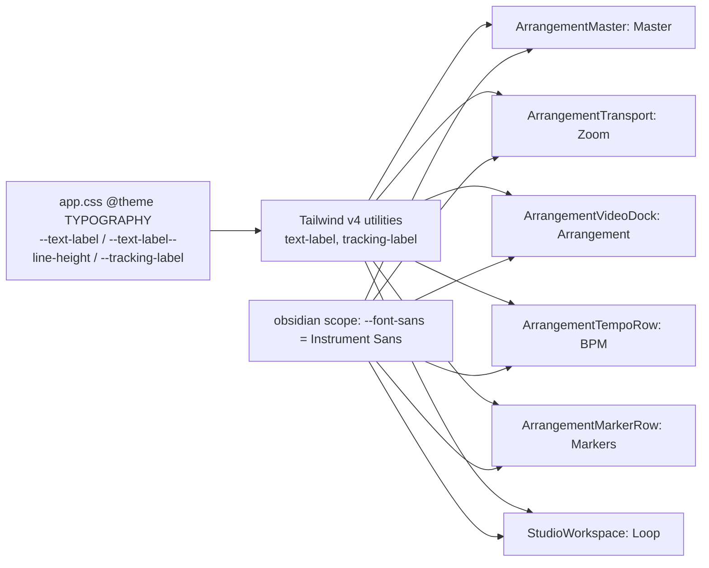

# Studio V-2b-1 — სექციების ლათინური ეტიკეტების ტიპოგრაფია (11 px, 500, 0.14em, UPPERCASE)

**თარიღი:** 2026-10-25
**სტატუსი:** Completed (C round 153 PASS, gate 153 published 037e25f)
**შეცვლილი პროექტი:** Store

## კონტექსტი

V-2a (ფონტების ჩატვირთვა, UI sans და mono ციფრები) დაიხურა C round 152-ის PASS-ით და gate 152-ით (`ff2fd6c`). V-2b არის ტიპოგრაფიის შემდეგი ნაწილი, მომხმარებლის მიერ დამტკიცებული `docs/technical/studio-real-workspace/visual-direction-a.md`-ის § „ტიპოგრაფია“-ს მიხედვით. ცხრილის რიგი „ეტიკეტები“ ითხოვს: UI sans, weight 500, 11 px, `letter-spacing: 0.14em`, ლათინური UPPERCASE (MASTER, ARRANGEMENT და სხვ.). გადაწყვეტილება: **D-29z118** (`docs/technical/studio-real-workspace/plan.md`).

B-ის გადაწყვეტილებები (D-29z118):

- **R1 — V-2b იყოფა, მოცულობა არ მცირდება.** V-2b-1 (ეს რაუნდი) — ეტიკეტების ტიპოგრაფია. V-2b-2 (შემდეგი რაუნდი) — weight-ის როლები სპეციფიკაციის ცხრილიდან (UI sans 400/500, mono 300/400) და დარჩენილი ციფრები mono-ში (C-R151-SIG-SANS-TIMECODES: ბიბლიოთეკის ხანგრძლივობები, playhead timecode-ები, zoom readout, ruler-ის ეტიკეტები, რაოდენობები). V-2b-DISPLAY მომხმარებლის პასუხს ელოდება.
- **R2 — Display serif → `awaiting_user`.** სპეციფიკაციის display-როლებში (პანელების სათაურები, ტრეკების სახელები, ბიბლიოთეკის ჩანაწერები, მონიშნული clip-ის სახელი) არცერთი ტექსტი არ არის ≥ 16 px. serif-ის გამოყენება ზომის ცვლილებას მოითხოვს, ზომის ცვლილება კი layout-ის ცვლილებაა, რომელიც მომხმარებელს არ დაუმტკიცებია. Cormorant არ იტვირთება (TH7 კვლავ ამოწმებს, რომ ის არ არის).
- **R3 — რა არის ეტიკეტი.** სტატიკური ლათინური სიტყვა, რომელიც Studio-ს სექციას ან რიგს ასახელებს. ზუსტად ექვსია (ქვემოთ). ეტიკეტი არ არის: ღილაკები, პანელების სათაურები (display-როლი, R2), detail panel-ის ველების სახელები (Track, Start, Length, Source offset), აღწერითი ტექსტი (Original sound, No video added yet) და მომხმარებლის კონტენტი.
- **R4 — Token-ები და არა arbitrary მნიშვნელობები.**
- **R5 — ტექსტის კონტენტი უცვლელია.** UPPERCASE მოდის CSS `uppercase`-დან (`text-transform`); DOM-ის `textContent` უცვლელია.

## მიდგომა

### ექვსი ეტიკეტი

| # | ეტიკეტი | კომპონენტი | ცვლილება |
|---|---|---|---|
| L1 | Master | `ArrangementMaster.tsx` | არსებულ span-ზე `text-xs` → `text-label`, დაემატა `uppercase tracking-label`; `font-medium`, `text-muted`, `aria-hidden` რჩება |
| L2 | Zoom | `ArrangementTransport.tsx` | `<label>`-ის შიგნით შიშველი ტექსტი შეიფუთა span-ში; `<label>`, input და readout უცვლელია |
| L3 | Arrangement | `ArrangementVideoDock.tsx` | ტექსტი შეიფუთა span-ში; „· Overview“-მდე ზუსტად ერთი space რჩება (`{' '}`), ამიტომ გარე span-ის `textContent` ისევ `Arrangement · Overview`-ია |
| L4 | BPM | `ArrangementTempoRow.tsx` | ``-ს დაემატა ეტიკეტის კლასები |
| L5 | Markers | `ArrangementMarkerRow.tsx` | იგივე |
| L6 | Loop | `StudioWorkspace.tsx` | loop strip-ის fallback ტექსტი (როცა loop არ არის) span-ში; loop-ის დროების branch უცვლელია |

ყველა ეტიკეტი იყენებს ერთსა და იმავე კლასების ნაკრებს: `text-label font-medium uppercase tracking-label`. ფერი არ შეცვლილა — ეტიკეტები მშობლის `text-muted`-ს იღებენ (L1-ს საკუთარი `text-muted` აქვს).

### `@theme` token-ები vs arbitrary მნიშვნელობები

Tailwind-ს 11 px-ისა და 0.14em-ის default არ აქვს (`text-xs` = 12 px, `tracking-widest` = 0.1em). ორი ვარიანტი იყო:

- **Arbitrary მნიშვნელობები** (`text-[11px] tracking-[0.14em]`) — ექვს ადგილას განმეორებული hardcoded მნიშვნელობა. `TAILWIND_FIRST.md` hardcoded arbitrary მნიშვნელობებს კრძალავს.
- **`@theme` token-ები (არჩეული)** — `app.css`-ის TYPOGRAPHY სექციაში, `--font-serif`-ის შემდეგ, სამი ხაზი: `--text-label` (0.6875rem = 11 px), `--text-label--line-height` (1rem = 16 px) და `--tracking-label` (0.14em). Tailwind v4 მათგან ქმნის `text-label` (font-size + line-height) და `tracking-label` utility-ებს. ეს ზომისა და spacing-ის token-ებია, არა ფერის; Store-ის გვერდები მათ არ იყენებს. Obsidian-ის ბლოკი უცვლელია (TH2-ის „ზუსტად 21 declaration“ ძალაშია). `DESIGN_TOKENS.md` font-size token-ებზე არაფერს ამბობს, ამიტომ token-ები უფრო ახლოსაა წესთან.

### მომხმარებლისთვის ხილული გადაწყვეტილება (შეიძლება ვეტოს დაედოს `feature-status.md`-ში)

ახალი სტილი ეტიკეტებს აფართოებს (0.14em letter-spacing 11 px-ზე = 1.54 px თითო ასოზე, UPPERCASE უფრო ფართოა), ამიტომ იმავე რიგის მეზობლები ჰორიზონტალურად იწევს **მაქსიმუმ 26 px-ით** — V-2a-ს ≤ ~9 px-ზე მეტით. B-ის სიმულაცია (`b-round-152/out/labelsim-*.json`, 1440 S0): Master fieldset dx −14.2 / dw +14.3; Follow და Zoom-ის ეტიკეტი dx −10.1; Arrangement dw +26 და „· Overview“ / video caption dx +26 (caption dw −26); BPM dw +1.6 და BPM input / 4/4 / Metronome dx +1.6; Markers dw +18.8 და marker `+` / `◀` / `▶` dx +18.8; Loop dw +9.2. ვერტიკალური გადაადგილება 0, ახალი clip 0.

## არქიტექტურა

## შეცვლილი ფაილები

- `app/styles/app.css` — `@theme` TYPOGRAPHY-ში 3 ახალი token.
- `app/components/arrangement/ArrangementMaster.tsx` — L1.
- `app/components/arrangement/ArrangementTransport.tsx` — L2.
- `app/components/arrangement/ArrangementVideoDock.tsx` — L3.
- `app/components/arrangement/ArrangementTempoRow.tsx` — L4.
- `app/components/arrangement/ArrangementMarkerRow.tsx` — L5.
- `app/components/arrangement/StudioWorkspace.tsx` — L6.
- `app/lib/arrangement/__tests__/studio-theme-obsidian.test.tsx` — ახალი TH9.
- `docs/implementation/2026/quarter-IV/123-studio-v2a-typography-fonts.md` — სტატუსი Completed (C round 152 PASS, gate 152).
- `docs/implementation/2026/quarter-IV/124-studio-v2b1-label-typography.md` — ეს დოკუმენტი.

## პრობლემები და გადაწყვეტები

- **პრობლემა:** L3-ზე „Arrangement“-ის span-ში შეფუთვისას JSX-ის ხაზის გადატანა space-ს წაშლიდა და `textContent` გახდებოდა `Arrangement· Overview` (VDS1 წითლდება).
  **გადაწყვეტა:** span-ის შემდეგ ცხადი `{' '}`; მუტაცია m136 ადასტურებს, რომ space-ის მოხსნა VDS1-სა და TH9 (c)-ს აწითლებს.
- **პრობლემა:** obsidian-ის ბლოკის declaration-ებიც brace depth 1-ზეა, ამიტომ მხოლოდ depth-ის შემოწმება არ ამტკიცებს, რომ token `@theme`-შია.
  **გადაწყვეტა:** TH9 (b) პოულობს `@theme {` ბლოკის საზღვრებს და ამოწმებს, რომ თითო declaration ზუსტად ერთხელ გვხვდება ამ საზღვრებში და depth 1-ზე.
- **პრობლემა:** `app.css` Biome-ის `includes`-ში არ შედის (`app/**/*.ts`, `app/**/*.tsx`), ამიტომ scoped `biome check` 8 ფაილიდან 7-ს ამოწმებს.
  **გადაწყვეტა:** CSS-ის ცვლილება მხოლოდ 3 ხაზია და TH9 (b) ამოწმებს მის ზუსტ ტექსტს; Tailwind-ის მიერ გენერირებული `.text-label` (font-size + line-height) და `.tracking-label` dev server-ის CSS-ში გადამოწმდა.

## ტესტირება

- **TH9** (`studio-theme-obsidian.test.tsx`):
  - (a) `renderToString(<StudioLabRoute />)`-ში ზუსტად 6 tag-ს აქვს `tracking-label`; თითოეულს აქვს `text-label`, `font-medium`, `uppercase`, `tracking-label`; ტექსტები DOM-ის რიგით: `Master`, `Zoom`, `Arrangement`, `BPM`, `Markers`, `Loop`. S0-ში loop არ არის, ამიტომ L6 SSR-შიც ჩანს. `text-[11px]` და `tracking-[0.14em]` SSR-ში 0-ჯერ გვხვდება.
  - (b) `app.css`-ში F1-ის სამივე declaration ზუსტად ერთხელაა, `@theme` ბლოკის შიგნით, depth 1-ზე. code-reviewer-ის შენიშვნების შემდეგ დაემატა: brace-matching loop შეზღუდულია ფაილის სიგრძით (`themeDepth` უნდა გახდეს 0), და თითო property-ის სახელი (`--text-label:`, `--text-label--line-height:`, `--tracking-label:`) ფაილში ზუსტად ერთხელ გვხვდება — ასე სხვა ბლოკში (მაგ. obsidian-ში) override ვერ გაიპარება.
  - (c) dock-ის caption span-ის SSR ტექსტი ისევ `Arrangement · Overview`-ია.
- 7 სამიზნე vitest ფაილი: baseline 88/88, ცვლილების შემდეგ 89/89 (TH9-ის ჩათვლით).
- მუტაციები m134 (Markers-იდან `uppercase`-ის მოხსნა), m135 (`--tracking-label: 0.1em`), m136 (L3-ზე space-ის მოხსნა) — შედეგები: `tmp/studio-real-loop/a-round-153.md` და `a-round-153/mutations/`.
- `npm run typecheck`, `npm run lint` და scoped `biome check` — სუფთა (lint-ის არსებული warning-ები ამ რაუნდს არ ეხება).
- სრული suite, `npm run verify`, build და e2e root-ის gate-ზეა. ბრაუზერის row-ებს (LABEL-STYLE, RV-1-LABELS, NO-CLIP, FONTS-SCOPED, TOKENS-SCOPED, FUNC-SMOKE, G153-3, PX-NET / REG-HYD) C round 153 ამოწმებს.

## TODO / შემდეგი ნაბიჯები

- C round 153: რეალურ Chromium-ში ორივე viewport-ზე — computed style (11px / 16px / 500 / 1.54px / uppercase / Instrument Sans), d6 bbox chain round 152-ის reference-თან, clip-ის არარსებობა.
- **V-2b-2:** weight-ის როლები (UI sans 400/500, mono 300/400; `font-semibold`/`font-bold` და peak over-state-ის `font-medium`) და დარჩენილი sans ციფრები mono-ში (C-R151-SIG-SANS-TIMECODES).
- **V-2b-DISPLAY (`awaiting_user`):** display serif-ის ვარიანტები Saba-სთვის — (a) Studio-ში serif არ არის; (b) ამ როლებისთვის 16 px-ის დამტკიცება; (c) serif მხოლოდ Export dialog-ის სათაურზე; (d) ≥ 16 px წესის შერბილება. პასუხამდე Cormorant არ იტვირთება.
- მომხმარებლის შესაძლო ვეტო: ეტიკეტების გაფართოება (მეზობლების ჰორიზონტალური გადაადგილება ≤ 26 px) და გლობალური `@theme` ზომის/spacing-ის token-ები.
