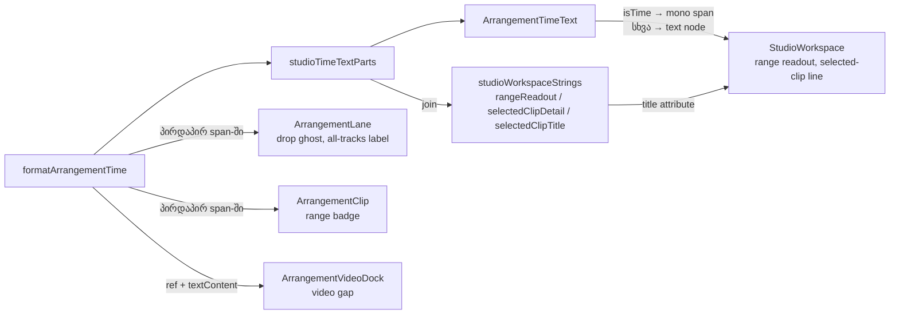

# Studio V-2b-3a — workspace-ის წინადადებებში ჩასმული timecode-ები mono-ში

**თარიღი:** 2026-10-25
**სტატუსი:** Completed (C round 156 PASS, gate 156 cbcd3d9)
**შეცვლილი პროექტი:** Store

## კონტექსტი

V-2b-2 დაიხურა C round 155-ის PASS-ით და gate 155-ით (`4c07d5f`). დამტკიცებული `docs/technical/studio-real-workspace/visual-direction-a.md`-ის § „ტიპოგრაფია“-ს ციფრების რიგი ამბობს: IBM Plex Mono 300/400, `tabular-nums` — timecode, BPM, dB, საიდან/სადამდე. V-2a/V-2b-2-ის შემდეგ ცალკე ხაზზე მდგომი timecode-ები უკვე mono-ში იყო, მაგრამ **წინადადების შიგნით** ჩასმული timecode-ები ისევ sans-ში რჩებოდა.

B-ის source sweep-მა (D-29z121) იპოვა 10 render site 6 კომპონენტში. ერთი შემოწმებადი ეტაპისთვის V-2b-3 ორად გაიყო (R1), სრული მოცულობის შენარჩუნებით:

- **V-2b-3a (ეს რაუნდი):** workspace-ის ყველა ზედაპირი — 6 site.
- **V-2b-3b (შემდეგი რაუნდი):** Export dialog-ი და css2 URL-ის შემცირება.

## მიდგომა

### რა ხდება mono (R2)

მხოლოდ `formatArrangementTime`-ით ფორმატირებული მნიშვნელობები (`MM:SS.mmm`) და მხოლოდ მაშინ, როცა ისინი **ხილული ტექსტია**. მომხმარებელს შეუძლია ამ წესს veto დაადოს `feature-status.md`-ში.

### რა რჩება sans და რატომ

- **წამებში მოცემული მნიშვნელობები** („2.000 s“, `studioClipStrings.seconds`) — ეს ხანგრძლივობაა წამებში, არა timecode, და spec-ის საიდან/სადამდე სიაში არ არის. იგივე წესი, რაც round 151-ის pan readout-ზე.
- **`title` / `aria-label` / `aria-valuetext` attribute-ები** — attribute-ში span ვერ ჩაჯდება, ამიტომ ისინი უბრალო string-ად რჩება (მაგ. selected-clip-ის `title`).
- **`aria-live` status-ის შეტყობინებები** („Copy: …“, „Move to track — …“) — ეს შეტყობინებებია, არა readout. დაახლოებით 30 formatter-ის template-ად გადაკეთება spec-თან შეუსაბამოდ დიდი სამუშაო იქნებოდა.
- **Export-ის `noSoundNote` / `masterMutedNote`** — V-2b-3b-ში ჩაიწერება როგორც „sans რჩება, vetoable“.
- უკვე mono site-ები უცვლელია: loop-ის დროები, Detail panel-ის start/length/offset, transport, project end, library-ის რიგები და preview.

### Part templating (R3)

`strings.ts`-ში დაემატა ცალკე exported ობიექტი `studioTimeTextParts` ორი builder-ით — `rangeReadout` და `selectedClipDetail`. თითოეული აბრუნებს `StudioTimeTextPart`-ების მასივს: ნაწილს აქვს სტაბილური და უნიკალური `id`, `text` და `isTime` flag-ი.

არსებული `studioWorkspaceStrings.rangeReadout`, `selectedClipDetail` და `selectedClipTitle` ახლა ამავე ნაწილების შეერთებით მიიღება. ასე ტექსტის ერთადერთი წყარო ერთი რჩება, ხოლო `title` attribute-ისა და ხილული ხაზის ტექსტი byte-ით ერთნაირია. `studioWorkspaceStrings`-ს ზუსტად 7 key დარჩა — ცალკე ობიექტი იმიტომ ავირჩიეთ, რომ არსებული exhaustive key-ების ტესტი არ შეცვლილიყო.

ალტერნატივა იყო თითოეულ კომპონენტში template-ის ხელით აწყობა. უარვყავით: ტექსტი ორ ადგილას გაიყოფოდა და `title`-სა და ხილულ ტექსტს შორის შეუსაბამობის რისკი გაჩნდებოდა.

### ერთი mono კლასი (R4)

ყოველი ახალი span-ი ზუსტად `font-mono font-normal tabular-nums` კლასს ატარებს. სამი site (drop ghost, lane-ის range label, clip badge) `font-medium` container-შია. `font-normal`-ის გარეშე ისინი Plex Mono 500-ით დაირენდერდებოდა (C-R154-01-ის გაკვეთილი).

### ტექსტი byte-ით იგივეა (R5)

Separator-ები sans text node-ებში რჩება: footer-ში em dash `—`, lane label-სა და clip badge-ში en dash `–`. მხოლოდ timecode-ები გადავიდა span-ებში.

## არქიტექტურა

`ArrangementTimeText` საკუთარ DOM ელემენტს არ ქმნის — აბრუნებს fragment-ს, ამიტომ forwardRef და `className` prop აქ არ ეხება. მას არ აქვს state, ფერი ან ლიტერალური ტექსტი. Lane-ის, Clip-ის და VideoDock-ის site-ებზე მხოლოდ ერთი `formatArrangementTime` გამოძახება იყო, ამიტომ იქ span პირდაპირ ჩაჯდა parts builder-ის გარეშე.

## შეცვლილი ფაილები

- `app/lib/arrangement/strings.ts` — `StudioTimeTextPart`, `studioTimeTextParts` და ნაწილებიდან მიღებული არსებული formatter-ები.
- `app/components/arrangement/ArrangementTimeText.tsx` (ახალი) — ნაწილების render-ი.
- `app/components/arrangement/StudioWorkspace.tsx` — range readout და selected-clip ხაზი `ArrangementTimeText`-ით.
- `app/components/arrangement/ArrangementLane.tsx` — library drop ghost-ისა და all-tracks lane label-ის timecode-ები.
- `app/components/arrangement/ArrangementClip.tsx` — clip range badge-ის ორი timecode.
- `app/components/arrangement/ArrangementVideoDock.tsx` — video gap-ის დროის span-ი (ref და imperative განახლება უცვლელია).
- `app/lib/arrangement/__tests__/strings.test.ts` — ახალი describe (ST-TP1–3).
- `app/lib/arrangement/__tests__/studio-theme-obsidian.test.tsx` — TH11.
- `app/lib/arrangement/__tests__/workspace-strings-ui.test.tsx` — WSU3–WSU5.
- `app/lib/arrangement/__tests__/clip-strings-ui.test.tsx` — CSU1-ის mono span-ების დამატებითი შემოწმება.
- `docs/implementation/2026/quarter-IV/125-studio-v2b2-weights-numerals.md` — სტატუსი Completed.

## პრობლემები და გადაწყვეტები

- **პრობლემა:** JSX-ში span-ებს შორის whitespace-ი ადვილად იკარგება ან ორმაგდება, ტექსტი კი byte-ით უნდა დარჩეს. **გადაწყვეტა:** separator-ები ცალკე `{' '}`-ებით დარჩა, ხოლო არსებული `textContent`-ის ტესტები (CSU1, `delete-selection-ui`, `all-lane-clipboard`, LSU6) უცვლელად მწვანეა.
- **პრობლემა:** `font-medium` container-ში ჩასმული mono span-ი Plex Mono 500-ს მიიღებდა. **გადაწყვეტა:** ყველა span-ზე `font-normal`, ხოლო TH11 ზუსტ კლასს ფაილების მიხედვით ითვლის.
- **პრობლემა:** video gap-ის დრო playback-ის დროს imperative `textContent`-ით ახლდება. **გადაწყვეტა:** span-ს მხოლოდ კლასი დაემატა, `ref` იგივე დარჩა, ამიტომ `textContent`-ის ჩაწერა იმავე ელემენტში ხდება და კლასი ინარჩუნდება.
- **პრობლემა (code-reviewer, Medium):** ST-TP1-ის „შეერთებული ნაწილები = `studioWorkspaceStrings`“ შედარება S1-ის შემდეგ კოდს თავის თავს ადარებდა, რადგან ორივე მხარე ნაწილებიდან მიიღება. **გადაწყვეტა:** ST-TP1-ს დაემატა ლიტერალური სტრიქონები ორივე range-ისა და ორივე clip-ის sample-ისთვის. m145-ის ხელახალმა გაშვებამ ST-TP1 წითლად აჩვენა.

## ტესტირება

- **Baseline:** 34 ფაილი, 569/569.
- **ცვლილების შემდეგ:** იგივე 34 ფაილი, 576/576. ახალი ტესტებია ST-TP1–3, TH11 და WSU3–5; CSU1-ს დაემატა შემოწმება.
- `npm run typecheck` — 0 შეცდომა. `npm run lint` — 0 შეცდომა, 218 warning, რაც round 155-ის ტოლია. Biome scoped check 10 ფაილზე — სუფთაა.
- **Mutations** — თითოეული აღდგენილია და sha256 შემოწმებულია:
  - **m143:** `ArrangementTimeText`-ში `font-normal`-ის მოხსნა → TH11, WSU3 და WSU4 წითელია.
  - **m144:** W1-ში ძველი string-ის render-ი → TH11 და WSU3-ის mono count წითელია, WSU3-ის ტექსტის prefix-ი მწვანე რჩება. ეს ადასტურებს, რომ ტესტი span-ებს ამოწმებს და არა მხოლოდ ტექსტს.
  - **m145:** `' — '` → `' - '` → ST31, ST-TP1, ST-TP2, WSU3, `all-lane-clipboard` და `detail-panel` წითელია.
  - **m146:** K1-ში `range.end`-ის span-ის მოხსნა → CSU1-ის mono count და TH11 წითელია, CSU1-ის `textContent` მწვანე რჩება.
- ბრაუზერის შემოწმება (computed font, CDP platform font, layout fit) C round 156-ის საქმეა.

## TODO / შემდეგი ნაბიჯები

- **V-2b-3b:** Export-ის `ModalDescription`, project/range scope-ის ვარიანტები და loop-ის შენიშვნები `studioTimeTextParts` / `ArrangementTimeText`-ით. ამასვე მოჰყვება css2 URL-ის შემცირება `studio-lab.tsx`-ში (Instrument Sans 700 და Plex Mono 500 ამოდის, 600 რჩება) და TH7, FONT-FAIL-ის ხელახალი გაშვება და font inventory.
- **B-R155-EXPORT-ZERO (Low, `deferred_low_polish`):** Export `ModalDescription` იყენებს `'0:00'`-ს, project option კი — `'00:00.000'`-ს. ტექსტი ორივე ეტაპში byte-ით იგივე რჩება.
- **B-სთვის (code-reviewer, Low):** drop ghost-ისა და video gap-ის span-ებს DOM-ის დონეზე class-ის ტესტი არ აქვს, მათ მხოლოდ TH11-ის source count იცავს. ასევე mono glyph-ები უფრო განიერია, ამიტომ ვიწრო clip-ზე badge შეიძლება უფრო ადრე მოიჭრას. ორივეს ბრაუზერში C ამოწმებს (MONO-STYLE, LAYOUT-FIT).
