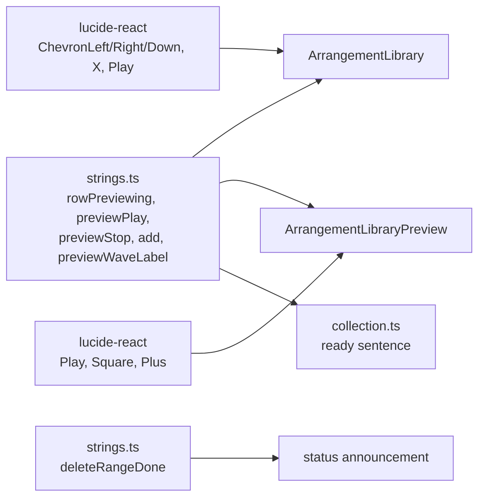

# Studio V-3c-1 — Library-ის glyph-ები lucide icon-ებად (◀ ▶ × ▾ ▸, ▶ Preview / ■ Stop / ＋ Add / ▶ Playing)

**თარიღი:** 2026-10-25
**სტატუსი:** Completed (C round 161 PASS; published f08c7ce)
**შეცვლილი პროექტი:** Store

## კონტექსტი

VISUAL-A-OBSIDIAN-ის V-3 ეტაპი Studio-ს ტექსტურ glyph-ებს lucide icon-ებით ცვლის (`visual-direction-a.md` § „იკონები“). V-3b-მ (round 160, `aeba543`) transport დაასრულა. V-3c ფაილების მფლობელის მიხედვით ხუთ ეტაპად იყოფა (D-29z126); პირველი ეტაპი Library-ია, რადგან იქ glyph-ების ყველაზე დიდი ნაწილია (5 ადგილი `ArrangementLibrary.tsx`-ში, 3 — `ArrangementLibraryPreview.tsx`-ში) და surface recipe-ს (checkpoint-ის Q4) არ ეხება.

მთავარი პირობა: icon ძველი glyph-ის ადგილს იკავებს და ელემენტი არ გადაადგილდება (±1 px).

## მიდგომა

### R1 — ზომის წესი R2'' (V-3c-ის ყველა ეტაპისთვის)

| glyph-ის ტექსტის ზომა | Icon | `strokeWidth` (1 px ხაზი = 24 / ზომა) |
|---|---|---|
| 12 px (`text-xs`) | `size-2.5` (10 px) | 2.4 |
| 14 px და 16 px | `size-3` (12 px) | 2 |
| ⌫ (მხოლოდ V-3b) | `size-5` (20 px) | 1.2 |

- icon + label host-ებში gap ძველი space-ის ტოლია: 14 px-ზე `gap-0.75` (3 px), 12 px-ზე `gap-0.5` (2 px).
- ფიქსირებული ზომის ღილაკებში icon ცენტრდება `flex items-center justify-center`-ით.
- spec-ის 16 px / 1.5 ვარიანტი ღიად რჩება Q-V3-ICON-SIZE (a)-ში.

B-ის გაზომვები `/studio-lab`-ზე, `aeba543`-ზე (1440 და 1280 იდენტურია):

| ადგილი | Font | Glyph advance | Space-ის შემდეგ | Box |
|---|---|---|---|---|
| ◀ collapse | 16 px | 12.31 | — | ფიქსირებული 28×28 |
| ▶ expand (rail) | 16 px | 12.31 | — | ფიქსირებული 32×32 |
| × search clear | 16 px | 9.00 | — | ფიქსირებული 24×24, absolute |
| ▾/▸ collection fold | 12 px | 6.03 | — | 16 px სიგანე, row-ის სიმაღლე |
| ▶ Preview / ■ Stop | 14 px | 10.78 / 13.23 | 3.016 | `flex-1` (128×34) |
| ＋ Add | 14 px | 14.00 | 3.00 | `flex-1` (128×34) |
| ▶ Playing (row marker) | 12 px | 9.23 | 2.016 | block, 16 px line |

B-ის probe-მა svg-ის ჩასმისას ყველა library ელემენტზე ოთხივე მდგომარეობაში 0.000 px გადაწევა აჩვენა.

### R2 — icon-ების შესაბამისობა

| ადგილი | Glyph | Icon | წყარო |
|---|---|---|---|
| Library collapse | ◀ | `ChevronLeft` | spec |
| Library expand (rail) | ▶ | `ChevronRight` | B-ის გადაწყვეტილება: collapse-ის სარკე; `Play` აუდიოს მიანიშნებდა |
| Search clear | × | `X` | B-ის გადაწყვეტილება |
| Collection fold | ▾ / ▸ | `ChevronDown` / `ChevronRight` | B-ის გადაწყვეტილება; V-3c-2-ის lane/group fold-ის შეზღუდვაც |
| Preview toggle, idle | ▶ | `Play` | spec („მოსმენა“) |
| Preview toggle, playing | ■ | `Square` | B-ის გადაწყვეტილება: Stop და არა Pause — preview 0-დან იწყება თავიდან |
| Add | ＋ | `Plus` | B-ის გადაწყვეტილება |
| Row marker „Playing“ | ▶ | `Play` | spec |

### R3 — წინადადების glyph-ის წესი (SG)

- სტრიქონში icon ვერ ჩაჯდება.
- glyph, რომელიც წინადადებაში control-ს ან მოქმედებას ასახელებს, სიტყვად იქცევა: `Space = ▶/■` → `Space = play/stop`.
- დეკორატიული წინა glyph იშლება: `⌫ Deleted …` → `Deleted …` (screen reader glyph-ს გეომეტრიული სახელით კითხულობს).
- კლავიშების აღნიშვნა (← → ↔ ↕) რჩება — ისინი კლავიშებს ან ჟესტებს ასახელებს.
- „Esc or ✕“-ის ორი წინადადება V-3c-3-ს ეკუთვნის, dock-ის ✕ ღილაკთან ერთად.

### R4 — ამ რაუნდის სტრიქონები (`strings.ts`, ზუსტად 6)

| Key | ადრე | შემდეგ |
|---|---|---|
| `studioEditStrings.deleteRangeDone` | `⌫ Deleted … ; the gap remains.` | `Deleted … ; the gap remains.` |
| `studioSourceLoadStrings.rowPreviewing` | `▶ Playing` | `Playing` |
| `studioLibraryPanelStrings.previewWaveLabel` | `… · Space = ▶/■` | `… · Space = play/stop` |
| `previewPlay` | `▶ Preview` | `Preview` |
| `previewStop` | `■ Stop` | `Stop` |
| `add` | `＋ Add` | `Add` |

`collection.ts` `add`-ს ორივე „ready“ წინადადებაში ჩასვამს, ამიტომ ისინი `… (Enter or Add).` ხდება `collection.ts`-ის შეცვლის გარეშე.

### R5 — accessibility-ის შენიშვნები (ჩაწერილია, არ შეცვლილა)

- Preview toggle-ის accessible name `Preview` / `Stop` ხდება, region-ის შიგნით, რომლის სახელიც ასევე `Preview`-ია. role-ები განსხვავდება, ამიტომ მისაღებია.
- Add-ის სახელი `Add` ხდება.
- ორივე polish pass-ის სიგნალია და არა finding.

### V-3c-ის დაყოფა (D-29z126)

| ეტაპი | ფაილები | შინაარსი |
|---|---|---|
| **V-3c-1 (round 161)** | `ArrangementLibrary.tsx`, `ArrangementLibraryPreview.tsx` + 6 სტრიქონი | ეს დოკუმენტი |
| V-3c-2 | `ArrangementLane.tsx`, `ArrangementGroupHeader.tsx`, `ArrangementClip.tsx` | lane fold და ＋, video import/empty hint, GroupHeader fold (CSS `before:content`) და ▣, clip-ის ▶ / ⠿ |
| V-3c-3 | VideoDock, MarkerRow, DetailPanel, GridMenu, StudioWorkspace | ⤢ → `Maximize2`, ⠿, ✕, „Esc or ✕“, marker ◀ / ▶, detail expand/collapse, grid ✓, `← CZABA` |
| V-3c-4 | თითო კომპონენტი | ღილაკების surface: border → fill, 8 px radius (checkpoint Q4 ან B-ის fallback c) |
| V-3c-5 | obsidian token, ვიწრო `app.css` grant | პანელის 10 px radius |

### კლასი და children — ადრე და შემდეგ

| ელემენტი | ადრე | შემდეგ |
|---|---|---|
| Expand (rail) | `h-8 w-8 rounded-sm …`, ტექსტი `▶` | წინ `flex items-center justify-center`, `ChevronRight` (`size-3`, stroke 2) |
| Collapse | `h-7 w-7 rounded-sm …`, ტექსტი `◀` | წინ `flex items-center justify-center`, `ChevronLeft` (`size-3`, stroke 2) |
| Search clear | `absolute … h-6 w-6 …`, ტექსტი `×` | წინ `flex items-center justify-center`, `X` (`size-3`, stroke 2) |
| Collection fold | `w-4 shrink-0 …`, `▾` / `▸` | წინ `flex items-center justify-center`, `ChevronDown` / `ChevronRight` (`size-2.5`, stroke 2.4) |
| Row marker | `whitespace-nowrap text-xs text-brand`, `▶ Playing` | `flex items-center gap-0.5 whitespace-nowrap text-xs text-brand`, `Play` (`size-2.5`, stroke 2.4) + `Playing` |
| Preview toggle | `flex-1 rounded-sm border …`, `▶ Preview` / `■ Stop` | `flex flex-1 items-center justify-center gap-0.75 rounded-sm border …`, `Play` / `Square` (`size-3`, stroke 2) + `` label |
| Add | `flex-1 rounded-sm border border-brand …`, `＋ Add` | `flex flex-1 items-center justify-center gap-0.75 rounded-sm border border-brand …`, `Plus` (`size-3`, stroke 2) + `Add` |

Biome-მა კლასების თანმიმდევრობა არ შეცვალა. ზედაპირები (`rounded-sm`, border, hover), სიგანეები, `title`/`aria-*`, handler-ები, `onKeyDown` guard-ები, ref-ები, focus handoff, tree/list/option markup და waveform slider უცვლელია.

## არქიტექტურა

## შეცვლილი ფაილები

- `app/components/arrangement/ArrangementLibrary.tsx` — lucide import; expand, collapse, search clear, collection fold და row marker-ის children და flex კლასები.
- `app/components/arrangement/ArrangementLibraryPreview.tsx` — lucide import; Preview toggle და Add-ის icon + label და gap.
- `app/lib/arrangement/strings.ts` — R4-ის 6 მნიშვნელობა.
- `app/lib/arrangement/__tests__/strings.test.ts` — მოსალოდნელი მნიშვნელობები, `lp.add`-ის assertion და ახალი LG1.
- `app/lib/arrangement/__tests__/library-row-strings-ui.test.tsx` — ტექსტები, LRS3-ის className, ready status და ახალი LI1–LI3.
- `app/lib/arrangement/__tests__/library-preview.test.tsx` — `Preview` / `Stop` / `Add`.
- `app/lib/arrangement/__tests__/held-enter-add.test.tsx` — `Add`-ის სახელი და HA5-ის სათაური.
- `app/lib/arrangement/__tests__/collection.test.ts` — `(Enter or Add)` წინადადებები.
- `app/lib/arrangement/__tests__/collection-load-status.test.tsx` — `(Enter or Add)`.
- `app/lib/arrangement/__tests__/purchased-collection-ui.test.tsx` — `(Enter or Add)`.
- `docs/implementation/2026/quarter-IV/129-studio-v3b-transport-icons.md` — სტატუსი Completed.
- `docs/implementation/2026/quarter-IV/130-studio-v3c1-library-icons.md` (ახალი) — ეს დოკუმენტი.

## პრობლემები და გადაწყვეტები

- **პრობლემა:** `collection.test.ts`-ის PC9 ტესტის ბოლო ხაზი `demo.ready`-ში `＋`-ს ამოწმებდა; B-ის N5 მხოლოდ ორ მოსალოდნელ წინადადებას ასახელებდა. **გადაწყვეტა:** ეს assertion 1:1 შეიცვალა — `demo.ready` შეიცავს `(Enter or Add)`-ს. assertion-ების რაოდენობა უცვლელია.
- **პრობლემა:** LRS5-ის `readyStatus`-ში `addText`-ის შემოწმება `＋`-ის გაქრობის შემდეგ ძალიან სუსტი იქნებოდა (`Add` ბევრ ტექსტს ემთხვევა). **გადაწყვეტა:** task-ის მიხედვით `(Enter or Add)` ფრაზა მოწმდება.
- **პრობლემა:** `previewWaveLabel`-ის ახალი მნიშვნელობა Biome-ის ხაზის ლიმიტს გადასცდა. **გადაწყვეტა:** Biome-ის ფორმატით ორ ხაზზე გადატანა `strings.ts`-ში და ტესტის მოლოდინში; მნიშვნელობა უცვლელია.
- **პრობლემა:** lucide-react `aria-hidden="true"`-ს თავად ამატებს (V-3b-ის m160), ამიტომ „aria-hidden-ის მოხსნა“ equivalent mutant-ია. **გადაწყვეტა:** ასეთი mutant არ გამოყენებულა; prop კოდში ცხადი განზრახვისთვის რჩება.

## ტესტირება

- **Baseline:** B-ის 18 ფაილი, 330/330.
- **ცვლილების შემდეგ:** იგივე 18 ფაილი, 334/334 (ახალი LI1, LI2, LI3, LG1):
  - **LI1** — collapse, search clear (ტექსტის შეყვანის შემდეგ) და collection fold: ზუსტად ერთი `aria-hidden="true"` svg, `lucide-chevron-left` / `lucide-x` / `lucide-chevron-down`, fold-ის დაჭერის შემდეგ `lucide-chevron-right`; `size-*`, `shrink-0`, `stroke-width`; `textContent` `''`; კლასში `flex`, `items-center`, `justify-center`.
  - **LI2** — toggle: `lucide-play` + `Preview`, preview-ის დროს `lucide-square` + `Stop`; Add: `lucide-plus` + `Add`; `size-3`, stroke 2, `gap-0.75`, `gap-1`-ის გარეშე, toggle-სა და Add-ზე `justify-center` (code-reviewer-ის Low შენიშვნით დამატებული); row marker: `lucide-play`, `size-2.5`, stroke 2.4, `gap-0.5`, ტექსტი `Playing`.
  - **LI3** — rail-ის expand: `lucide-chevron-right`, `size-3`; `arrangement-library`-ის ტექსტში `▶◀×▾▸■＋` არ არის expanded, previewing და collapsed მდგომარეობაში.
  - **LG1** — 6 სტრიქონში არცერთი `▶◀×▾▸■＋⌫`; `previewWaveLabel` მთავრდება `Space = play/stop`-ით; `deleteRangeDone` ზუსტი ტექსტი.
- `npm run typecheck` — 0 შეცდომა. `npm run lint` — 0 შეცდომა (218 წინასწარ არსებული warning). Biome scoped check 10 ფაილზე — სუფთაა.
- **Tailwind generation:** dev server-ის `app.css?direct`-ში არის `.gap-0\.75`, `.gap-0\.5`, `.size-2\.5`, `.size-3`, `.items-center`, `.justify-center`, `.flex`.
- **Mutations** (Edit → ტესტი → Edit-ით აღდგენა → sha256 = post-edit hash):
  - **m162:** collapse/expand-ზე `ChevronLeft` ↔ `ChevronRight` → LI1 და LI3 წითელია.
  - **m163:** playing toggle-ის icon `Square` → `Pause` → LI2 წითელია.
  - **m164:** row marker-ის icon `size-2.5` → `size-3` → LI2 წითელია.
  - **m165:** Preview toggle-დან `gap-0.75`-ის მოხსნა → LI2 წითელია.
  - **m166:** `rowPreviewing` → `▶ Playing` → LG1, LI2, LI3, LRS3 და ST45 წითელია.
- jsdom layout-ს არ ზომავს: box-ების ±1 px, rendered icon-ის ზომა, computed `stroke`, ცენტრირება და accessible name-ები C round 161-ის ბრაუზერის რიგებია (ICON-V3C1, RV1-V3C1, LIB-STATES-BOX, FUNC-SMOKE-LIB, READY-STATUS).

## TODO / შემდეგი ნაბიჯები

- **V-3c-2..5:** Lane / GroupHeader / Clip glyph-ები; VideoDock / MarkerRow / DetailPanel / GridMenu / StudioWorkspace; ღილაკების surface-ები; პანელის 10 px radius.
- **Q-V3-ICON-SIZE:** მომხმარებლის პასუხი — (a) ყველგან 16 px / 1.5 — ჯერ ღიაა.
- **M1, M3, M4:** V-3-ის შემდეგ, დამტკიცებული მოცულობით.
- **Polish pass:** frozen ტესტების `it` სათაურები ჯერ კიდევ glyph-ებს ახსენებს (◀ ▶ ×), თუმცა glyph ტექსტს არ ამოწმებს — `floating-video`, `library-focus-handoff`, `library-video-return-focus`. ასევე `held-enter-add`-ის HA6 სათაური („the ＋ guard“).
- **R5:** Preview toggle-ისა და Add-ის მოკლე accessible name-ები — polish pass-ის სიგნალი.
