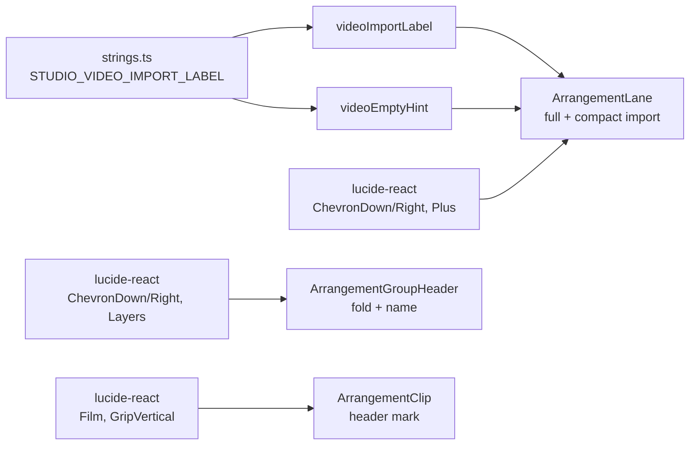

# Studio V-3c-2 — Lane-ის, group header-ისა და clip-ის glyph-ები lucide icon-ებად (▾ ▸ fold, ＋ Your own video, ▣ group, ▶ / ⠿ clip marks)

**თარიღი:** 2026-10-25
**სტატუსი:** Completed (C round 162 PASS; published 9a83018)
**შეცვლილი პროექტი:** Store

## კონტექსტი

Visual direction A-ს § „იკონები“ ითხოვს, რომ Studio-ს ტექსტური glyph-ები lucide icon-ებით შეიცვალოს ისე, რომ icon ძველი სიმბოლოს box-ს ემთხვეოდეს და ელემენტი არ გადაადგილდეს. V-3c-1-მა (doc 130) Library გადაიყვანა. V-3c-2 (D-29z127) მოიცავს track lane-ის header-ს, group header-სა და clip-ის header-ს.

ამ რაუნდში ორი deferred Low იხურება იმ კოდში, რომელიც რაუნდს უკვე ეკუთვნის:

- **C-R154-02:** group-ის ▣ (U+25A3) Instrument Sans-ში არ არის და DejaVu Sans-ზე გადადის. ახლა ის svg-ია.
- **GATE139-EMPTY-VIDEO-FORMATTER:** `videoEmptyHint` import label-ს literal-ად იმეორებდა. ახლა ის იმავე constant-ს interpolate-ს აკეთებს.

ორივე დაიხურება, თუ C round 162 PASS-ს მისცემს.

## მიდგომა

### R1 — ზომის წესი R2''' (R2'' + box-ის შემნახველი gap)

- Icon-ის ზომა და stroke R2''-ისაა: 12 px ტექსტთან `size-2.5` + `strokeWidth` 2.4; 14–16 px ტექსტთან `size-3` + `strokeWidth` 2.
- **Gap-ის წესი:** content-sized host-ში icon-ის ზომა + gap = ძველი glyph-ის advance + ძველი gap/space, ±0.5 px სიზუსტით, უახლოესი 0.25-ბიჯიანი spacing token-ით. V-3c-1-ში ძველი space ამ წესს შემთხვევით აკმაყოფილებდა.
- Fixed box-ები ცენტრირებას `flex items-center justify-center`-ით ინარჩუნებს.

**Glyph-ების გაზომვა** (B, `b-round-161/v3c2-probe.cjs`, რეალური Chromium `/studio-lab`-ზე, `f08c7ce`, 1440-ზეც და 1280-ზეც ერთნაირი):

| ადგილი | ფონტი | Glyph advance | Gap / space | Box |
|---|---|---|---|---|
| Lane fold ▾/▸ | 14 px | 7.03 | — | fixed 20×20 |
| Video import, compact ＋ | 12 px | 12.00 | — | fixed 20×20 |
| Video import, სრული `＋ Your own video` | 12 px | 12.00 | space 2.00 | content-sized 107×22 |
| Group fold (CSS `::before` ▾/▸) | 14 px | 7.03 | — | fixed 24×24 |
| Group mark ▣ | 12 px | 11.34 | `gap-1` 4 px | span 11.34×16 |
| Clip mark ▶ (video) | 12 px | 9.23 | `gap-1` 4 px | span 9.23×16 |
| Clip mark ⠿ (audio) | 12 px | 8.80 | `gap-1` 4 px | span 8.80×16 |

**წესის გამოყენება:**

| ადგილი | Icon / stroke | Host-ის gap | ძველი glyph + gap → icon + gap |
|---|---|---|---|
| სრული import | `size-2.5` / 2.4 | `gap-1` (ახალი; ღილაკი `flex items-center` ხდება) | 12 + 2 = 14 → 10 + 4 = 14 |
| Group mark | `size-2.5` / 2.4 | `gap-1` → `gap-1.25` | 11.34 + 4 = 15.34 → 10 + 5 = 15 |
| Clip marks | `size-2.5` / 2.4 | `gap-1` → `gap-0.75` | 9.23 / 8.80 + 4 → 10 + 3 = 13 |

**B-ის საბოლოო probe** (`b-round-161/v3c2-probe-final.cjs`): S0, S0-folded, S1 და S1-group-collapsed, ორივე viewport-ზე — max edge delta 0.344 px. `data-testid`/`aria-label`-ით მოძებნილი ყველა ელემენტი, clip box, track header და group header — 0.000 px. მხოლოდ შიდა ტექსტის span-ები მოძრაობს: clip title +0.20 (audio) / −0.23 (video), group name −0.34.

### R2 — icon-ების შესაბამისობა

| ადგილი | Glyph | Icon | წყარო |
|---|---|---|---|
| Lane fold | ▾ / ▸ | `ChevronDown` / `ChevronRight` | V-3c-1-ის R2 (collection fold) |
| Group fold | ▾ / ▸ (CSS) | `ChevronDown` / `ChevronRight` | იგივე |
| Video import, compact და სრული | ＋ | `Plus` | V-3c-1-ის R2 (Add) |
| Group mark | ▣ | `Layers` | B-ის გადაწყვეტილება: group track-ების დასტაა. ალტერნატივები Saba-სთვის: `SquareSquare`, `Group`. |
| Clip mark, video | ▶ | `Film` | B-ის გადაწყვეტილება: clip-ის სახეობას აღნიშნავს და control არ არის; `Play` დაკვრას მიანიშნებდა. |
| Clip mark, audio | ⠿ | `GripVertical` | B-ის გადაწყვეტილება: იგივე 2×3 წერტილი; clip header move handle-ია (`cursor-grab`). |

### R3 — group fold: სტრუქტურული ცვლილება

- `cn(...)`-დან ამოღებულია `before:content-['▸']` / `before:content-['▾']` წყვილი; `cn(` დარჩენილ ერთ სტრიქონს ახვევს.
- self-closing `<button />` ახლა children-ს იღებს: `collapsed` → `ChevronRight`, სხვა შემთხვევაში `ChevronDown` (`size-3 shrink-0`, stroke 2, `aria-hidden`).
- **`data-fold-glyph` წაიშალა.** აპლიკაციის კოდი მას არ კითხულობდა, მხოლოდ UC1 ტესტი. მდგომარეობა `aria-expanded`-ით ჩანს, ისევე როგორც lane-ისა და collection-ის fold-ზე.
- Group-ის Mute/Solo `before:content-['M'/'S']` ასოები უცვლელია.

### R4 — სტრიქონები (`strings.ts`)

- ახალი, არა-exported constant `STUDIO_VIDEO_IMPORT_LABEL = 'Your own video'`.
- `studioLaneStrings.videoImportLabel`: `'＋ Your own video'` → constant.
- `studioLaneStrings.videoEmptyHint`: `'use “＋ Your own video” or drop a file here'` → template string იმავე constant-ით, შედეგი `use “Your own video” or drop a file here`.
- `videoImportTitle` (`'Your own video'`) literal-ად რჩება; `expandText`/`collapseText` V-3c-3-ს ეკუთვნის.
- **შედეგი:** compact ღილაკის accessible name ახლა `Your own video`-ია, მისი `title`-ის ტოლი.

### R5 — accessibility (ჩაწერილია, არ შეცვლილა)

- სრული import ღილაკის სახელი `Your own video`-ია; icon დამალულია.
- Lane fold-ის, group fold-ისა და group name-ის `aria-label`-ები byte-identical-ია.

### კლასი და children — ადრე და შემდეგ

| ადგილი | ადრე | შემდეგ |
|---|---|---|
| Lane fold | children `▸`/`▾`; კლასი უცვლელი | `ChevronRight`/`ChevronDown`, `size-3 shrink-0`, stroke 2 |
| Compact import | children `＋` | `Plus`, `size-2.5 shrink-0`, stroke 2.4 |
| სრული import | `shrink-0 rounded-sm border …`, children label | `flex shrink-0 items-center gap-1 rounded-sm border …`, children `Plus` + `` label |
| Group fold | `cn('…', collapsed ? "before:content-['▸']" : "before:content-['▾']")`, `data-fold-glyph`, self-closing | `cn('…')`, `data-fold-glyph`-ის გარეშე, children chevron |
| Group name | `… items-center gap-1 truncate …`, `▣` | `… items-center gap-1.25 truncate …`, `Layers` `size-2.5 shrink-0 text-muted`, stroke 2.4 |
| Clip header | `… items-center gap-1 truncate …`, `▶/⠿` | `… items-center gap-0.75 truncate …`, `Film`/`GripVertical` `size-2.5 shrink-0`, stroke 2.4 |

Biome-მა class token-ები არ გადაალაგა; ზემოთ მოცემული სტრიქონები საბოლოოა. ყველაფერი სხვა — surface-ები, ფერები, border-ები, hover-ები, handler-ები, ref-ები, gesture-ები და memo — უცვლელია.

## არქიტექტურა

## შეცვლილი ფაილები

- `app/components/arrangement/ArrangementLane.tsx` — lucide import; lane fold, compact და სრული import ღილაკის children; სრული import-ის კლასს `flex items-center gap-1` დაემატა.
- `app/components/arrangement/ArrangementGroupHeader.tsx` — lucide import; group fold-ის R3 ცვლილება; group mark `Layers` და name ღილაკის `gap-1.25`.
- `app/components/arrangement/ArrangementClip.tsx` — lucide import; clip header-ის mark და `gap-0.75`.
- `app/lib/arrangement/strings.ts` — R4: constant და 2 მნიშვნელობა.
- `app/lib/arrangement/__tests__/strings.test.ts` — ST36-ის 2 მოსალოდნელი მნიშვნელობა და ახალი LG2.
- `app/lib/arrangement/__tests__/track-layout.test.tsx` — fold-ის svg/`textContent` და import ღილაკის სახელები.
- `app/lib/arrangement/__tests__/lane-strings-ui.test.tsx` — LSU1, LSU3; ახალი LV1 და LC1-ის video ნაწილი.
- `app/lib/arrangement/__tests__/track-group-collapse-ui.test.tsx` — UC1-ის fold assertion-ები, `'group:Group 1'` და ახალი LGH1.
- `app/lib/arrangement/__tests__/track-groups-ui.test.tsx` — `'group:Group 1'` (3 ხაზი).
- `app/lib/arrangement/__tests__/clip-strings-ui.test.tsx` — ახალი LC1-ის audio ნაწილი.
- `docs/implementation/2026/quarter-IV/130-studio-v3c1-library-icons.md` — სტატუსი Completed.
- `docs/implementation/2026/quarter-IV/131-studio-v3c2-lane-group-clip-icons.md` (ახალი) — ეს დოკუმენტი.

## პრობლემები და გადაწყვეტები

- **პრობლემა:** `clip-strings-ui`-ის fixture-ს video source არ აქვს, ამიტომ video clip-ს ვერ არენდერებს. **გადაწყვეტა:** task-ის მიხედვით LC1-ის video ნაწილი `lane-strings-ui`-შია (არსებული `importVideo` + `videoClipElement`); audio ნაწილი `clip-strings-ui`-შია.
- **პრობლემა:** LV1-ის პირველ ვერსიაში ვამოწმებდი, რომ compact ღილაკი სრულისგან სხვა DOM element-ია. React ერთი და იმავე ტიპის ელემენტს ternary-ის ერთსა და იმავე პოზიციაზე ხელახლა იყენებს, ამიტომ ეს assertion მცდარი იყო. **გადაწყვეტა:** identity-ის ნაცვლად მოწმდება compact ღილაკის fixed-box კლასები (`flex h-5 w-5 items-center justify-center`) და `title`.
- **პრობლემა:** `track-groups-ui`-ის `selectedRows` helper (l.245) და frozen `group-volume-db` / `track-group-mix-ui` `.replace('▣', '')`-ს იძახებს. **გადაწყვეტა:** ეს no-op ხდება და მწვანე რჩება; ფაილები/ხაზები grant-ში არ შედის და უცვლელია (TODO).
- **პრობლემა:** UC1-ში `fold.dataset.foldGlyph` glyph-ს ასახელებდა, რომელიც აღარ რენდერდება. **გადაწყვეტა:** 1:1 ჩანაცვლება lucide კლასით და `data-fold-glyph`-ის არარსებობის შემოწმებით.

## ტესტირება

- **Baseline:** B-ის 19 ფაილი, 353/353.
- **ცვლილების შემდეგ:** იგივე 19 ფაილი, 358/358 (ახალი LV1, LC1 audio, LC1 video, LGH1, LG2):
  - **LV1** — ყველა lane fold-ში ერთი `aria-hidden` svg `lucide-chevron-down`, `size-3`, stroke 2, `textContent` `''`; fold-ის დაჭერის შემდეგ `lucide-chevron-right`. სრული import: `lucide-plus` (`size-2.5`, 2.4), შემდეგ `Your own video`; კლასში `flex`, `items-center`, `gap-1`, `gap-0.5`-ის გარეშე. Video lane-ის fold-ის შემდეგ compact: ერთი `lucide-plus`, `textContent` `''`. Track header-ების ტექსტში `▶◀×▾▸■＋⌫▣⠿` არ არის.
  - **LC1** — audio clip header-ის პირველი შვილი `lucide-grip-vertical`, video-სი `lucide-film`; `size-2.5`, stroke 2.4, `aria-hidden`; header-ის კლასში `gap-0.75` და არა `gap-1`; `[data-clip-id]`-ის ტექსტში `▶`/`⠿` არ არის.
  - **LGH1** — group fold: `lucide-chevron-down` → დაჭერის შემდეგ `lucide-chevron-right`, `before:content-[…]` კლასის გარეშე; group name: `lucide-layers` (`size-2.5`, `text-muted`, 2.4) name span-ის წინ, კლასში `gap-1.25`, `textContent` ზუსტად `Group 1`; group header-ში glyph ტექსტი არ არის — expanded და collapsed.
  - **LG2** — `videoImportLabel === 'Your own video'`, `videoEmptyHint` იმავე label-ით აიგება, არცერთში glyph არ არის.
- **Pointer event svg-იდან** (code-reviewer-ის Low შენიშვნით დამატებული): LV1-ში lane fold-ის დაჭერა chevron svg-ზე ხდება, LGH1-ში group fold-ისაც; LC1-ის audio ნაწილში `pointerDown` `GripVertical` svg-ზე იწყება და clip 2 s-დან 4 s-ზე გადადის. ასე მოწმდება, რომ svg target-ი handler-ებს არ არღვევს.
- `expect(` რაოდენობა: არცერთ grant-ის ტესტ ფაილში არ შემცირებულა (`a-round-162/expect-counts-*.txt`).
- `npm run typecheck` — 0 შეცდომა. `npm run lint` — 0 შეცდომა (წინასწარ არსებული warning-ები). Biome scoped check 10 კოდისა და ტესტის ფაილზე — სუფთაა.
- **Tailwind generation:** dev server-ის `app.css?direct`-ში არის `.gap-1\.25` (ახალი), `.gap-0\.75`, `.gap-1`, `.size-2\.5`, `.size-3`, `.items-center`, `.flex`.
- **Mutations** (Edit → ტესტი → Edit-ით აღდგენა → sha256 = post-edit hash):
  - **m167:** lane fold-ზე `ChevronDown` ↔ `ChevronRight` → LV1 და track-layout-ის fold ტესტი წითელია.
  - **m168:** expanded group fold-ზე `before:content-['▾']` დაბრუნდა → LGH1 წითელია.
  - **m169:** clip header `gap-0.75` → `gap-1` → LC1-ის ორივე ნაწილი წითელია.
  - **m170:** group mark `size-2.5` → `size-3` → LGH1 წითელია.
  - **m171:** constant-ის მნიშვნელობა `'＋ Your own video'` → LG2, ST36, LV1, LSU1, LSU3 წითელია.
  - **m172:** video clip mark `Film` → `Play` → LC1-ის video ნაწილი წითელია.
- jsdom layout-ს არ ზომავს: box-ების ±1 px, icon-ის rendered ზომა, computed `stroke`, ცენტრირება, accessible name-ები, file chooser, clip-ის გადატანა icon-იდან და DejaVu fallback-ის არარსებობა C round 162-ის ბრაუზერის რიგებია (ICON-V3C2, RV1-V3C2, LANE-STATES-BOX, FUNC-SMOKE-LANE).

## TODO / შემდეგი ნაბიჯები

- **V-3c-3..5:** VideoDock / MarkerRow / DetailPanel / GridMenu / ← CZABA; ღილაკების surface-ები; პანელის radius.
- **Q-V3-ICON-SIZE:** მომხმარებლის პასუხი ჯერ ღიაა; ახლა R2'''-ის gap-ის წესითაც.
- **Polish pass:** მოძველებული `.replace('▣', '')` no-op-ები frozen `group-volume-db` l.322-ში, `track-group-mix-ui` l.262/l.417-ში `track-groups-ui`-ის `selectedRows` helper-ში (l.245) და `track-group-collapse-ui`-ის helper-ში (l.246). ასევე მოძველებული ახსნა doc 070-ში (l.16, l.71: `before:content` / `data-fold-glyph`) და doc 115-ში (l.28, l.32: `＋` სტრიქონები).
- **M1, M3, M4:** V-3-ის შემდეგ, დამტკიცებული მოცულობით.
