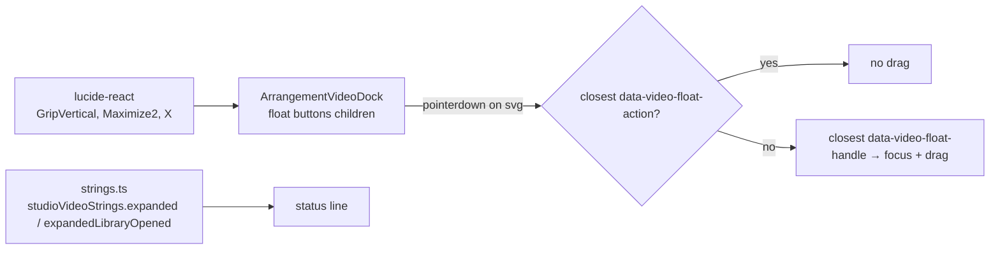

# Studio V-3c-3a — Video dock-ის glyph-ები lucide icon-ებად (⠿ GripVertical, ⤢ Maximize2, ✕ X) და „Esc or Close“ სტრიქონები

**თარიღი:** 2026-10-25
**სტატუსი:** Completed (C round 163 PASS; published 0e4287f)
**შეცვლილი პროექტი:** Store

## კონტექსტი

VISUAL-A-OBSIDIAN-ის V-3c ეტაპი Studio-ს ტექსტურ glyph-ებს lucide icon-ებით ცვლის (`visual-direction-a.md` § „იკონები“: ⤢ → `Maximize2`, „icon ძველი სიმბოლოს box-ს ემთხვევა, ელემენტი არ ინაცვლებს“). V-3c-1-მა (library) და V-3c-2-მა (lane, group, clip) ეს უკვე გააკეთეს. V-3c-3-ის inventory-ში 5 კომპონენტი, `strings.ts`, დაახლოებით 6 ტესტ ფაილი და 2 დოკუმენტია, ანუ დაახლოებით 13 grant. B-მ ის ორად გაყო (D-29z128):

- **V-3c-3a (round 163, ეს დოკუმენტი):** video dock-ის სამი float ღილაკი და ორი status სტრიქონი. ცალკე იმიტომ გავიდა, რომ gesture-ისა და focus-ის რისკი მხოლოდ dock-ს აქვს: float drag, pointerdown-ზე focus handle-ზე და action ღილაკებიდან drag-ის აკრძალვა.
- **V-3c-3b (round 164):** marker row ◀ ▶, detail `Expand ▸` / `Collapse ▾`, grid menu ✓ და `← CZABA` back link.

## მიდგომა

### R1 — ზომა (R2'', უცვლელი)

Float ღილაკებს `text-xs` (12 px) აქვთ, ამიტომ თითო icon არის `size-2.5` და `strokeWidth={2.4}`. ღილაკის box ფიქსირებულია (`h-6 w-6`), ამიტომ gap-ის წესი აქ არ მოქმედებს. `VIDEO_FLOAT_BUTTON_CLASS` byte-ით უცვლელია: `text-xs` რჩება, თუმცა ტექსტს აღარ ზომავს (REVIEW-R162-STATIC-CN-DEAD-TEXT, polish pass-ისთვის). 24 px ღილაკში 10 px icon-ის საკითხი Q-V3-ICON-SIZE-შია ჩაწერილი Saba-სთვის.

### R2 — icon-ების შესაბამისობა

| ადგილი | Glyph | Icon | წყარო |
|---|---|---|---|
| Float drag handle | ⠿ | `GripVertical` | B-ის გადაწყვეტილება (spec-ში არ არის); round 162-ის audio clip grip-ის მსგავსად |
| Expand და return | ⤢ | `Maximize2` ორივე მდგომარეობაში | Spec. მდგომარეობა `aria-label`/`title`-ში რჩება. ალტერნატივა Saba-სთვის: return-ზე `Minimize2` |
| Close | ✕ | `X` | B-ის გადაწყვეტილება; V-3c-1-ის search clear-ის მსგავსად |

### R3 — სტრიქონის glyph-ის წესი (SG)

წინადადებაში control-ის აღმნიშვნელი glyph სიტყვად იქცევა. Close ღილაკის `title` არის `Close (Esc)`, ამიტომ სიტყვა „Close“-ია:

- `studioVideoStrings.expanded` — `… Esc or Close brings it back.`
- `studioVideoStrings.expandedLibraryOpened` — `… Esc or Close brings it back.`

`strings.ts`-ის სხვა byte-ები, მათ შორის `studioDetailStrings.expandText`/`collapseText` (V-3c-3b) და `studioVideoDockStrings`-ის ყველა label/title, უცვლელია.

### R4 — accessibility (ჩაწერილია, არ შეცვლილა)

სამივე ღილაკის `aria-label` და `title` byte-ით უცვლელია. Icon-ები `aria-hidden`-ია, ამიტომ accessible name-ები რჩება: `Move the video (arrow keys: 16 px)`, `Expand video` / `Return the video to the compact view` და `Close the expanded video`.

### B-ის probe (§0.1, `b-round-162/out/v3c3a-probe.json`)

| ადგილი (`data-testid`) | ჩანს | Font | Glyph box | ღილაკის box |
|---|---|---|---|---|
| `arrangement-video-drag` ⠿ | მხოლოდ D2 | 12 px | 8.80×15 | 24×24 |
| `arrangement-video-expand` ⤢ | D0, D1, D2 | 12 px | 10.00×15 | 24×24 |
| `arrangement-video-close` ✕ | მხოლოდ D2 | 12 px | 10.06×15 | 24×24 |

10×10 svg-ით ჩანაცვლებისას გვერდის ყველა element-ის მაქსიმალური delta 0.000 px იყო, svg-ები ზუსტად ცენტრშია, ხოლო `elementFromPoint` svg-ის ცენტრში svg-ს აბრუნებს, ღილაკის შიგნით.

### Pointer target-ის ლოგიკა

`handleFloatPointerDown` action ღილაკებს `event.target.closest('[data-video-float-action]')`-ით გამორიცხავს, handle-ს კი `closest('[data-video-float-handle]')`-ით პოულობს. `SVGElement` `Element`-ია, ამიტომ svg-იდან დაწყებული event `closest`-ით თავის ღილაკამდე ადის. `pointer-events-none` საჭირო არ არის და handler-ები უცვლელია. LVD2 და m177 ამას ამოწმებს.

### კლასი და children — ადრე და შემდეგ

- Drag handle: children `⠿` → `GripVertical` (`size-2.5 shrink-0`, stroke 2.4, `aria-hidden`); კლასი `cn(VIDEO_FLOAT_BUTTON_CLASS, 'cursor-grab')` უცვლელია.
- Expand/return: children `⤢` → `Maximize2` (იგივე props); კლასი `cn(VIDEO_FLOAT_BUTTON_CLASS, 'cursor-pointer')` უცვლელია.
- Close: children `✕` → `X` (იგივე props); კლასი უცვლელია.

## არქიტექტურა

## შეცვლილი ფაილები

- `app/components/arrangement/ArrangementVideoDock.tsx` — lucide import და სამი ღილაკის children (D0–D3).
- `app/lib/arrangement/strings.ts` — R3-ის 2 მნიშვნელობა.
- `app/lib/arrangement/__tests__/strings.test.ts` — ST14-ის 2 მოსალოდნელი მნიშვნელობა და ახალი LG3.
- `app/lib/arrangement/__tests__/floating-video.test.tsx` — `EXPANDED_TEXT` / `LIBRARY_OPENED_TEXT` და ახალი LVD2.
- `app/lib/arrangement/__tests__/video-dock-strings-ui.test.tsx` — ახალი LVD1.
- `docs/implementation/2026/quarter-IV/131-studio-v3c2-lane-group-clip-icons.md` — სტატუსი Completed.
- `docs/implementation/2026/quarter-IV/132-studio-v3c3a-video-dock-icons.md` (ახალი) — ეს დოკუმენტი.

## პრობლემები და გადაწყვეტები

- **პრობლემა:** jsdom-ში არსებული „does not start a drag from ⤢ or ✕“ ტესტი pointerdown-ს ღილაკზე აგზავნის და svg target-ს არ ამოწმებს. ამ ტესტით guard, რომელიც `event.target`-ს პირდაპირ კითხულობს, ვერ დაიჭირებოდა. **გადაწყვეტა:** LVD2 pointerdown-სა და click-ს თითოეული ღილაკის svg-ზე აგზავნის; m177 (`closest` → `hasAttribute`) LVD2-ს აწითლებს, ძველი ტესტი კი მწვანე რჩება.
- **პრობლემა:** m173/m174-ში მხოლოდ import-ის შეცვლა ReferenceError-ს გამოიწვევდა და lock-ის ნაცვლად crash-ს შეამოწმებდა. **გადაწყვეტა:** mutation import-საც და JSX-საც ცვლის.

## ტესტირება

- **Baseline:** B-ის 8 ფაილი, 197/197.
- **ცვლილების შემდეგ:** იგივე 8 ფაილი, 200/200 (ახალი LVD1, LVD2, LG3):
  - **LVD1** — compact-ში `arrangement-video-expand`-ში ერთი `svg.lucide-maximize-2` (`aria-hidden`, `size-2.5`, `shrink-0`, stroke 2.4), ღილაკის `textContent` `''`. Expand-ის შემდეგ drag-ში `lucide-grip-vertical`, expand-ში `lucide-maximize-2`, close-ში `lucide-x`, თითოეული იგივე props-ით და ცარიელი `textContent`-ით. სამი accessible name და title VDS2-ს ემთხვევა. Dock `section`-ის ტექსტში `⠿⤢✕` არ არის, არც compact-ში და არც expanded-ში.
  - **LVD2** — expanded მდგომარეობაში pointerdown close-ისა და expand-ის svg-ზე (60 px pointermove-ით) gesture-ს არ იწყებს და box არ ინაცვლებს. Drag-ის svg-ზე gesture იწყება და focus, რომელიც მანამდე handle-ზე არ იყო, drag **ღილაკზე** გადადის (precondition code-reviewer-ის Low შენიშვნით დაემატა); box pointer-ის delta-თი ინაცვლებს (+60/+20) და viewport-ზე clamp-დება. Close-ის svg-ზე click ვიდეოს compact-ში აბრუნებს.
  - **LG3** — ორივე სტრიქონი R3-ის ზუსტ მნიშვნელობას უდრის, `Esc or Close brings it back.`-ით მთავრდება და `/[▶◀×▾▸■＋⌫▣⠿⤢✕✓]/u`-ს არ ემთხვევა.
- `expect(` რაოდენობა: strings 527 → 531, floating-video 168 → 181, video-dock-strings-ui 27 → 44; არცერთი არ შემცირებულა.
- `npm run typecheck` — 0 შეცდომა. `npm run lint` — 0 შეცდომა (წინასწარ არსებული warning-ები). 5 კოდისა და ტესტის ფაილზე scoped Biome check სუფთაა.
- **Mutations** (Edit → ტესტი → Edit-ით აღდგენა → sha256 = post-edit hash):
  - **m173:** expand-ის `Maximize2` → `Minimize2`: LVD1 წითელია.
  - **m174:** drag-ის `GripVertical` → `GripHorizontal`: LVD1 წითელია.
  - **m175:** close-ის `size-2.5` → `size-3`: LVD1 წითელია.
  - **m176:** `expanded`-ში დაბრუნდა `Esc or ✕`: LG3, ST14 და floating-video-ს 4 სტრიქონის ტესტი წითელია.
  - **m177:** guard-ში `closest(...)` → `hasAttribute(...)`: LVD2 წითელია, ღილაკზე target-იანი არსებული ტესტი მწვანე რჩება.
- jsdom layout-ს არ ზომავს. Box-ების ±1 px, icon-ის rendered ზომა, computed `stroke`, ცენტრირება, CDP accessible name-ები, ნამდვილი drag/close/Esc და ვიდეოს playback C round 163-ის ბრაუზერის რიგებია (ICON-V3C3A, RV1-V3C3A, DOCK-STATES-BOX, FUNC-SMOKE-DOCK).

## TODO / შემდეგი ნაბიჯები

- **V-3c-3b (round 164):** marker row ◀ ▶, detail `Expand ▸` / `Collapse ▾`, grid menu ✓ და `← CZABA` (inventory: `backlog.json` `v3c3a_plan_d29z128.v3c3b_inventory`).
- **V-3c-4/5:** ღილაკების surface-ები და პანელის radius.
- **Q-V3-ICON-SIZE:** 24 px ღილაკში 10 px icon; მომხმარებლის პასუხი ღიაა.
- **`Minimize2` ალტერნატივა** return მდგომარეობისთვის, Saba-ს veto-სთვის.
- **REVIEW-R162-STATIC-CN-DEAD-TEXT:** float ღილაკებზე `text-xs` ტექსტს აღარ ზომავს; polish pass.
- **M1, M3, M4:** V-3-ის შემდეგ, დამტკიცებული მოცულობით.
