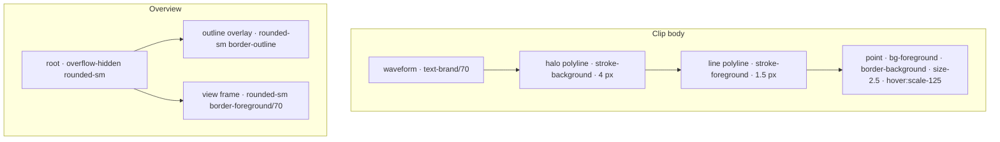

# Studio SABA-B-1 / SABA-B-2 — clip envelope-ის ხილვადობა და Arrangement Overview-ის კუთხეები

**თარიღი:** 2026-10-25
**სტატუსი:** Completed (C round 164 PASS; published 7952439)
**შეცვლილი პროექტი:** Store

## კონტექსტი

Saba-მ VISUAL-A-OBSIDIAN-ის ვიზუალური ეტაპების შემდეგ ორი რეგრესია შენიშნა (`user-review/img/`):

- **SABA-B-1 (Medium)** — `saba-2026-10-25-envelope-handle.png`. Obsidian თემაში clip volume envelope-ის line და breakpoint handle (პატარა კვადრატი) brass clip body-ზე თითქმის ქრება. Saba ვერ პოულობდა „ღილაკს, რომელიც ხმას აკონტროლებს“.
- **SABA-B-2 (Low, ახლავე სასწორებელი)** — `saba-2026-10-25-overview-corners.png`. „ARRANGEMENT · Overview“ box-ის ქვედა კუთხეებში ჩანს ცარიელი ჭრილები (notch).

### B-ის რეპროდუქცია (round 163 planning, `0e4287f`, რეალური Chromium, 1440×900 და 1280×720)

**SABA-B-1:**
- line stroke (`text-accent` → rgb(201,164,106)), point fill (`bg-accent`) და waveform (`text-brand/70`) სამივე brass ფერისაა; selected clip-ის header-იც `bg-brand`-ია.
- DPR 2-ზე line core vs ±5 device px-ის ყველაზე მუქი pixel: **min 1.74**, median 7.42. waveform-ის გადაკვეთაზე line ქრება.
- DPR 1-ზე სვეტების 75 % 3:1-ზე დაბალია.
- handle centre vs საკუთარი border: **1.88:1**; centre vs ზედა/ქვედა pixel-ები: 1.58–1.74:1.
- hover-ის სტილი არ არსებობდა.
- selected, normal და muted lane-ის მდგომარეობები ერთნაირ რიცხვებს იძლევა. 0 dB-ზე point ნახევრად selected clip-ის brass header-ზე ხვდება — ეს არის Saba-ს screenshot-ის შემთხვევა.
- DOM-ის სიმულაცია (4 px background halo + 1.5 px foreground line): line core vs halo **min 15.62** ორივე viewport-ზე; foreground handle + background border: **15.62**.

**SABA-B-2:**
- Overview root `overflow-hidden rounded-sm` (6 px) არის, outline overlay-იც `rounded-sm`.
- View frame (`arrangement-overview-frame`) იყო `rounded-xs` (2 px), `inset-y-0`, ნათელი `border-foreground/70`-ით.
- როცა frame root-ის გვერდს ეხება (ცარიელი პროექტი: `left 0%`, `width 100%`, ან view სულ მარჯვნივ), მისი თითქმის კვადრატული კუთხე root-ის 6 px clip-ით იჭრება. ნათელი border კუთხემდე წყდება და მის გარეთ მუქი outline-ის რკალი ცალკე ჩანს — ეს არის notch.
- Parent dock section-ს radius, border ან overflow არ მონაწილეობს.
- notch metric (tl/tr/bl/br, ცარიელი პროექტი): baseline **3 / 13 / 3 / 15**, `rounded-sm` სიმულაცია **1 / 0 / 1 / 0**.

## მიდგომა

### R1 — envelope line: ორფეროვანი (two-tone) line

ერთი ფერი ორ ადგილს ვერ აკმაყოფილებს: foreground brass waveform-ზე დაახლოებით 3.3:1-ია, brass header-ზე კი 1.8:1; მუქი line კი მუქ body-ზე იკარგება. ამიტომ line არის **background ფერის halo (4 px) და მის ზემოთ foreground line (1.5 px)** — იგივე იდეა, რაც round 150-ის Overview playhead-ის `ring-1 ring-background`. ასეთი line სწორი რჩება DUX-R-5-ის შემდეგაც, როცა waveform-ები ნეიტრალური გახდება. მხოლოდ token-ები: `stroke-background` და `stroke-foreground`; `stroke=` attribute აღარ არის.

### R2 — envelope handle

- `bg-accent` + `border-foreground` → `bg-foreground` + `border-background`.
- ზომა `size-2` → `size-2.5` (8 → 10 px), რომ Saba-მ იპოვოს. handle absolute რჩება და არსებული translate-ით ცენტრდება, ამიტომ სხვა არაფერი ინაცვლებს.
- hover: `hover:scale-125`, ფერის ცვლილების გარეშე, რადგან DUX-R-5 accent-ს selection-ის, playhead-ის, primary ღილაკისა და focus-ისთვის იტოვებს. transition არ დამატებულა.
- `z-30`, `cursor-move`, `rounded-xs`, `title`, handler-ები, `data-*` და inline `style` უცვლელია.

### R3 — Overview frame-ის radius

`arrangement-overview-frame`: `rounded-xs` → `rounded-sm`, ანუ root-ისა და outline overlay-ის radius. Box-ის ზომა და პოზიცია არ იცვლება, ამიტომ ±1 px-ის წესი კონსტრუქციით სრულდება.

### R4 — Ableton

Ableton-თან შესაბამისობა **არ არის მტკიცებული**. ეს არის CZABA-ს ხილვადობისა და contrast-ის ფიქსი (WCAG 2.2 1.4.11, UI component ≥ 3:1). Live 12 manual-ის „Automation and Editing Envelopes“ ამ რაუნდში არ გადამოწმებულა.

### განხილული ალტერნატივები

- **ერთი ფერის line (foreground ან background)** — უარყოფილია, ზემოთ აღწერილი ორი ადგილიდან ერთზე 3:1-ს ვერ აღწევს.
- **5 px halo** — B-ის sampler-ით უარესი შედეგი მისცა (core ერთ device row-ზე ვიწროა), ამიტომ 4 px შეირჩა.
- **Hover-ზე accent ფერი** — უარყოფილია DUX-R-5-ის ერთი ფერის წესის გამო.

## არქიტექტურა

რიგი ქვემოდან ზემოთ: waveform → halo → line → point. ორივე polyline-ს ერთი და იგივე `points` აქვს.

## კლასები და markup — ადრე / შემდეგ

| ადგილი | ადრე | შემდეგ |
|---|---|---|
| Line `svg` | `… overflow-visible text-accent` | `… overflow-visible` (`text-accent` წაიშალა) |
| Line `polyline` | ერთი: `stroke="currentColor"`, `strokeWidth={1.5}` | ორი, იგივე `points`-ით: (1) `className="stroke-background"`, `strokeWidth={4}`; (2) `className="stroke-foreground"`, `strokeWidth={1.5}`; ორივე `fill="none"`, `vectorEffect="non-scaling-stroke"` |
| Envelope point | `size-2 … border-foreground bg-accent` | `size-2.5 … border-background bg-foreground hover:scale-125` |
| Overview frame | `… inset-y-0 rounded-xs …` | `… inset-y-0 rounded-sm …` |

Env **ღილაკი** (`StudioWorkspace.tsx`, `text-accent`) უცვლელია.

## შეცვლილი ფაილები

- `app/components/arrangement/ArrangementClipEnvelope.tsx` — two-tone line და ახალი point კლასი (E1–E3).
- `app/components/arrangement/ArrangementOverview.tsx` — frame-ის radius (O1).
- `app/lib/arrangement/__tests__/clip-envelope-ui.test.tsx` — ახალი EV1 ტესტი.
- `app/lib/arrangement/__tests__/studio-theme-obsidian.test.tsx` — ახალი OV1 ტესტი.
- `docs/implementation/2026/quarter-IV/132-studio-v3c3a-video-dock-icons.md` — სტატუსი Completed (gate 163-ის review Low 2).
- `docs/implementation/2026/quarter-IV/133-studio-saba-b1-b2-envelope-overview.md` — ეს დოკუმენტი.

## პრობლემები და გადაწყვეტები

- **პრობლემა:** SVG ელემენტზე `className` არის `SVGAnimatedString`, ამიტომ `className.includes` ტესტში არასწორად მუშაობს. → **გადაწყვეტა:** EV1 polyline-ისა და svg-ის კლასს `getAttribute('class')`-ით კითხულობს, point-ის კლასებს `classList.contains`-ით.
- **პრობლემა:** არსებული ტესტები (EU5, EU7, AL1) `svg polyline`-ს `querySelector`-ით კითხულობენ — ახლა ორი polyline-ია. → **გადაწყვეტა:** პირველი (halo) polyline-ის `points` ზუსტად ემთხვევა line-ისას, ამიტომ ეს ტესტები ვალიდური რჩება; EV1 კი ცალკე იცავს, რომ ორივე polyline არსებობს და ტოლია.
- **პრობლემა:** Biome formatter-მა EV1-ის token-ების გრძელი სია ერთ ხაზზე ვერ დატოვა. → **გადაწყვეტა:** სია formatter-ის სტილით რამდენიმე ხაზად დაიყო.

## ტესტირება

- **Baseline (`0e4287f`):** 6 targeted ფაილი — 92/92.
- **ცვლილების შემდეგ:** იგივე 6 ფაილი — 94/94 (EV1 და OV1 ახალი, მწვანე).
- **EV1:** Env ჩართულ და გამორთულ მდგომარეობაში line `svg`-ს ზუსტად 2 polyline აქვს ტოლი `points`-ით; halo = `stroke-background` / 4, line = `stroke-foreground` / 1.5, `stroke` attribute არცერთზე; svg-ზე `text-accent` არ არის; ყველა point-ს აქვს `size-2.5`, `bg-foreground`, `border-background`, `hover:scale-125`, `z-30` და არ აქვს `bg-accent`, `size-2`, `border-foreground`.
- **OV1:** SSR-ში `arrangement-overview` და `arrangement-overview-frame` ორივე `rounded-sm`-ია, frame-ზე `rounded-xs` არ არის; outline overlay-ის markup `ArrangementOverview.tsx`-ში ზუსტად ერთხელ გვხვდება.
- **`expect(`-ის რაოდენობა:** clip-envelope-ui 136 → 153, studio-theme-obsidian 72 → 76.
- **Mutation-ები:**
  - m178 (line `stroke-foreground` → `stroke-accent`) — EV1 წითელი.
  - m179 (halo polyline წაშლილი) — EV1 წითელი, EU5/EU7/AL1 მწვანე (ანუ EV1 ახალ დაცვას ამატებს).
  - m180 (point `bg-foreground` → `bg-accent`) — EV1 წითელი.
  - m181 (frame `rounded-sm` → `rounded-xs`) — OV1 წითელი.
- `npm run typecheck`, `npm run lint` და შეცვლილ 4 ფაილზე `npx biome check` — გაიარა.
- **ბრაუზერის შემოწმება** (contrast-ის pixel metric, notch metric, envelope-ის ფუნქცია და რეალური audio) — C-ის round 164-ის საქმეა; A-მ ის არ გაუშვა.

## TODO / შემდეგი ნაბიჯები

- DUX-R-5-ის ეტაპზე (clip body ნეიტრალური) envelope-ის contrast თავიდან გაიზომოს.
- V-3c-3b (marker row, detail, grid menu, back link glyph-ები) — შემდეგ რაუნდებში.
- V-3c-5: panel-ის radius-ის ნებისმიერი ცვლილებისას Overview-ის root, outline overlay და frame ერთად უნდა შეიცვალოს (OV1-ის lock).
