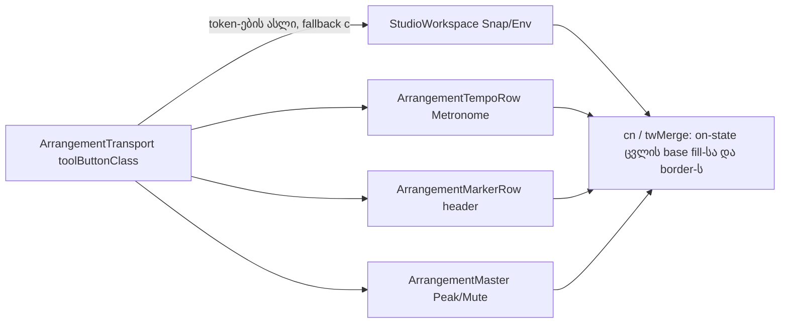

# Studio V-3c-4a — toolbar ღილაკების surface: border → 5 % fill, 8 px radius (Snap, Env, Metronome, marker header, Master)

**თარიღი:** 2026-10-25
**სტატუსი:** Completed (C round 167 PASS; published 1fef377)
**შეცვლილი პროექტი:** Store

## კონტექსტი

VISUAL-A-OBSIDIAN-ის `visual-direction-a.md` § „ღილაკები და ზედაპირები“ ამბობს: ღილაკის border ქრება და ხდება `foreground` fill — 5 % მოსვენებულ მდგომარეობაში, 8 % hover-ზე, 12 % active-ზე. 1 px border რჩება, ოღონდ გამჭვირვალე, ამიტომ ზომა არ იცვლება. ღილაკებსა და ველებს 8 px radius აქვთ; motion არის `background-color, color 180ms cubic-bezier(.2,.8,.2,1)`, reduced motion-ზე გამორთული.

Transport-ის 12 ღილაკმა ეს უკვე მიიღო (V-3a, `ArrangementTransport.tsx`-ის `toolButtonClass`). V-3c-4 იგივე ზედაპირს transport-ის გარეთ არსებულ კომპონენტებს აძლევს. 11 კომპონენტი ერთ რაუნდში ~12 grant-ის ლიმიტს სცდება, ამიტომ B-მ (D-29z132) V-3c-4 owner-ების მიხედვით გაყო:

- **V-3c-4a (ეს დოკუმენტი, round 167):** `StudioWorkspace`-ის Snap/Env და ორი select, `ArrangementTempoRow`-ის Metronome და BPM ველი, `ArrangementMarkerRow`-ის header ღილაკები და სახელის ველი, `ArrangementMaster`-ის Peak და Mute.
- **V-3c-4b:** Lane და Group header-ის Mute/Solo, Lane-ის video-import ღილაკები.
- **V-3c-4c:** Detail panel, Library preview და search, Export dialog, video-dock float ღილაკები.

ზუსტი ხაზების ინვენტარი: `backlog.json` → VISUAL-A-OBSIDIAN `v3c4a_plan_d29z132.v3c4_inventory`.

## მიდგომა

### R1 — surface token-ების ნაკრები

Transport-ის `toolButtonClass`-იდან მხოლოდ ზედაპირის token-ები კოპირდება:

- **SURF:** `border-transparent bg-foreground/5 enabled:hover:bg-foreground/8 enabled:active:bg-foreground/12`
- **MOTION:** `motion-safe:transition-[background-color,color]! motion-safe:duration-180! motion-safe:ease-[cubic-bezier(0.2,0.8,0.2,1)]! motion-reduce:transition-none!`
- **RADIUS:** `rounded-sm` → `rounded-md` (ამ პროექტში `--radius-md` = 8 px).

`inline-flex`, `h-8`, `px-2.5`, `text-sm`, `text-foreground` და `disabled:opacity-40` **არ** კოპირდება. თითო ღილაკი ინარჩუნებს საკუთარ ზომას, padding-ს, ტექსტის ზომასა და ფერს, `hover:text-*`-ს, focus ring-ს და disabled cue-ს. `!` სუფიქსები რჩება, სანამ ROOT-GLOBAL-TRANSITION-RULE (checkpoint Q2) ღიაა (round 159-ის პრეცედენტი). ოთხი MOTION token ერთადერთი arbitrary `[...]` მნიშვნელობაა.

**ალტერნატივა, რომელიც არ ავირჩიეთ:** საერთო constant ან `ToolButton` კომპონენტი. frontend-architect-ის checkpoint (Q1) ჯერ უპასუხოა, ამიტომ B-მ გამოიყენა fallback (c): class-ის ასლი თითო კომპონენტში რჩება და ტესტები მას აფიქსირებს.

### R2 — on-state სტრიქონები

On-state სტრიქონი byte-ით უცვლელია და `cn`/twMerge-ით მაინც იმარჯვებს: მისი border-ის ფერი ცვლის `border-transparent`-ს, fill კი `bg-foreground/5`-ს. hover/active-მა on-fill რომ არ შეცვალოს, თითო on-state-ს იმავე ფერის hover/active fill ემატება:

| ღილაკი | დამატებული token-ები |
|---|---|
| Snap, Env, Metronome on | `enabled:hover:bg-accent/20 enabled:active:bg-accent/20` |
| Master Mute on | `enabled:hover:bg-accent enabled:active:bg-accent` |
| Master Peak over | `enabled:hover:bg-destructive/15 enabled:active:bg-destructive/15` — **ცალკე** `cn` არგუმენტად, რომ `'border-destructive bg-destructive/15 text-destructive'` byte-ით უცვლელი დარჩეს (TH10 მას ითვლის) |

Master-ის off/clear სტრიქონებიდან `border-outline` (და Peak-ზე `hover:border-outline-hover`) ამოვიდა; დარჩა `text-muted hover:text-foreground`.

### R3 — ველები ინარჩუნებენ border-ს

Spec border-ს მხოლოდ **ღილაკებზე** აშორებს; radius ღილაკებსა და ველებს ეხება. ოთხი ველი მხოლოდ `rounded-sm` → `rounded-md`-ს იღებს: BPM input (`border-outline-strong`, V-1b/TH5), grid-division select, waveform-zoom select (on-state `border-accent bg-accent/20` უცვლელია) და marker-ის სახელის input (`border-brand`).

### R4 — 16 px ღილაკები pill/წრე ხდება

16 px სიმაღლის marker `+`, ◀, ▶ და Metronome-ზე 8 px radius ბოლოებს სრულად ამრგვალებს; 16×16 `+` წრე ხდება. ეს spec-ის პირდაპირი წაკითხვაა, ზომა არ იცვლება. C იღებს 4× crop-ებს, რომ Saba-მ veto შეძლოს. 20 px Master და 24 px Snap/Env ღილაკებს 8 px კუთხეები აქვთ.

### R5 — ამ ნაწილში არ შედის

Demo badge span, exit link-ის `rounded-sm`, marker flag-ის label chip (V-3c-4c ინვენტარში კითხვად) და row divider-ები.

### Token-ები ადრე და შემდეგ

| ადგილი | ადრე (330f1f3) | შემდეგ |
|---|---|---|
| Snap / Env base | `rounded-sm border border-outline` | `rounded-md border border-transparent` + SURF fill + MOTION |
| Snap / Env on | `border-accent bg-accent/20 text-accent hover:text-accent` | იგივე + `enabled:hover:bg-accent/20 enabled:active:bg-accent/20` |
| grid / waveform-zoom select | `rounded-sm` | `rounded-md` |
| Metronome base | `rounded-sm border border-outline` (+ disabled cue) | `rounded-md border border-transparent` + SURF fill + MOTION (disabled cue უცვლელი) |
| Metronome on | `border-accent bg-accent/20 text-accent hover:text-accent` | იგივე + accent hover/active |
| BPM input | `rounded-sm` | `rounded-md` |
| `MARKER_HEADER_BUTTON_CLASS` | `rounded-sm border border-outline` | `rounded-md border border-transparent` + SURF fill + MOTION; `MARKER_STEP_BUTTON_CLASS`-ის ფორმულა უცვლელია |
| marker name input | `rounded-sm` | `rounded-md` |
| Master Peak base / clear | `rounded-sm border` / `border-outline text-muted hover:border-outline-hover hover:text-foreground` | `rounded-md border border-transparent` + SURF fill + MOTION / `text-muted hover:text-foreground` |
| Master Peak over | `border-destructive bg-destructive/15 text-destructive` | იგივე (byte-ით) + ცალკე destructive hover/active არგუმენტი |
| Master Mute base / off / on | `rounded-sm border` / `border-outline text-muted hover:text-foreground` / `border-accent bg-accent text-background` | `rounded-md border border-transparent` + SURF fill + MOTION / `text-muted hover:text-foreground` / + `enabled:hover:bg-accent enabled:active:bg-accent` |

### B-ის browser probe (დაგეგმვის მონაცემი, `b-round-166/v3c4a-probe.cjs`)

| გაზომვა | შედეგი (1440 და 1280 ერთნაირი) |
|---|---|
| Layout: ყველა `button, a, input, select, [data-testid], [role]` box | max 0.000 px, 0 დამატებული, 0 დაკარგული |
| Radius | 6 px → 8 px |
| Off-state ტექსტის contrast | 6.68 → 5.98 |
| Off-state hover | 12.35 |
| On-state (accent `bg-accent/20`-ზე) | 5.48, უცვლელი |
| Master Mute on | 8.32, უცვლელი |
| Disabled Metronome | 2.59 → 2.52 (disabled, გამონაკლისი) |
| ველები | border-ის ფერი და contrast უცვლელია (15.62, 14.78, 14.78) |

ეს B-ის probe-ია; ბრაუზერის მიღება (SURF, BOX, CONTRAST, RV1, FUNC-SMOKE) C-ის round 167-ის საქმეა.

## არქიტექტურა

## შეცვლილი ფაილები

- `app/components/arrangement/StudioWorkspace.tsx` — Snap და Env ღილაკების surface, ორი select-ის radius.
- `app/components/arrangement/ArrangementTempoRow.tsx` — Metronome-ის surface, BPM ველის radius.
- `app/components/arrangement/ArrangementMarkerRow.tsx` — `MARKER_HEADER_BUTTON_CLASS` და სახელის ველის radius.
- `app/components/arrangement/ArrangementMaster.tsx` — Master Peak და Master Mute.
- `app/lib/arrangement/__tests__/transport-surface-ui.test.tsx` — TS8.
- `app/lib/arrangement/__tests__/metronome-ui.test.tsx` — UI11.
- `app/lib/arrangement/__tests__/marker-strings-ui.test.tsx` — MS5.
- `app/lib/arrangement/__tests__/header-meter-envelope-strings-ui.test.tsx` — HM7.
- `docs/implementation/2026/quarter-IV/135-studio-v3c3b-marker-detail-grid-exit-icons.md` — სტატუსი Completed.

## პრობლემები და გადაწყვეტები

- **პრობლემა:** hover-ზე `enabled:hover:bg-foreground/8` on-state-ის fill-ს გადაფარავდა. **გადაწყვეტა:** on-state-ს იმავე ფერის `enabled:hover:`/`enabled:active:` fill ემატება; twMerge ერთ variant-ის bg კონფლიქტში ბოლოს იტოვებს, ამიტომ foreground hover fill on-state-ში ქრება (TS8, UI11, HM7 ამას ამოწმებს).
- **პრობლემა:** Peak over სტრიქონს TH10 byte-ით ითვლის. **გადაწყვეტა:** destructive hover/active ცალკე `over && …` არგუმენტად დაემატა.
- **პრობლემა:** Snap და Env base სტრიქონები იდენტურია. **გადაწყვეტა:** რედაქტირება მომდევნო on-state ხაზთან ერთად, რომ თითო ადგილი ცალსახად შეიცვალოს.

## ტესტირება

- 12 targeted vitest ფაილი: baseline 176/176, ცვლილების შემდეგ 180/180 (TS8, UI11, MS5, HM7 ახალი).
- `npm run typecheck` და `npm run lint` — exit 0; read-only `npx biome check` 8 ფაილზე — სუფთა.
- `expect(` რაოდენობა: transport-surface-ui 67 → 74, metronome-ui 72 → 83, marker-strings-ui 40 → 48, header-meter-envelope-strings-ui 17 → 24 (HM7-ის აკრძალული token-ები ერთ loop-შია, ამიტომ ტექსტური რაოდენობა მცირეა, ვიდრე შემოწმებების რაოდენობა).
- code-reviewer (8/10, Critical არ არის): HM7, TS8 და UI11-ს დაემატა on/over მდგომარეობაში foreground hover/active fill-ის არარსებობის, `hover:text-accent`-ის და Metronome-ის სრული disabled cue-ს შემოწმება.
- Mutation-ები (ყველა მოკლულია და აღდგენილია sha256-ით):
  - m192 Snap base `border-transparent` → `border-outline` → TS8 წითელი;
  - m193 Env on-string `enabled:hover:bg-accent/20`-ის გარეშე → TS8 წითელი;
  - m194 Metronome base `rounded-md` → `rounded-sm` → UI11 წითელი;
  - m195 `MARKER_HEADER_BUTTON_CLASS`-ში `inline-flex` → MS4 და MS5 წითელი;
  - m196 Peak-ის მესამე `cn` არგუმენტი ამოღებული → HM7 წითელი;
  - m197 Master Mute on-string `enabled:hover:bg-accent`-ის გარეშე → TS8 წითელი;
  - m198 BPM input `rounded-md` → `rounded-sm` → UI11 წითელი.
- ბრაუზერის შემოწმება, სრული suite, build და verify — C-ისა და root gate-ის საქმე.

## TODO / შემდეგი ნაბიჯები

- ~~C round 167-ის ბრაუზერის მტკიცებულება; შემდეგ სტატუსი → Completed.~~ შესრულდა (C round 167 PASS; published 1fef377).
- V-3c-4b (Lane/Group Mute/Solo, video-import) და V-3c-4c (Detail, Library, Export dialog, video-dock).
- V-3c-5 (panel radius).
- DUX-R-5 (ერთი ფერის წესი).
- M1/M3/M4 დარჩენილი ეტაპები.
- Checkpoint Q1 (საერთო recipe) — ამ ეტაპზე fallback (c); პასუხის მოსვლისას V-3c-4b/4c-ის გეგმა იცვლება. Q2 (გლობალური transition წესი) ღიაა, ამიტომ `!` სუფიქსები რჩება.
- Saba-ს veto-ს შესაძლებლობა: R1–R4 (`feature-status.md`).
