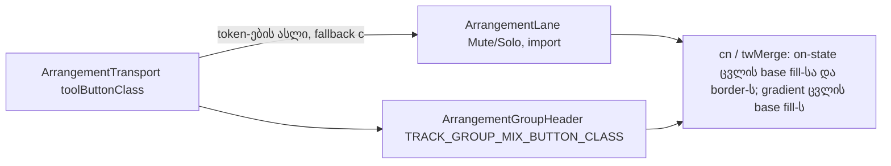

# Studio V-3c-4b — Lane და Group header ღილაკების surface: border → 5 % fill, 8 px radius; video-import Export-ის სახით

**თარიღი:** 2026-10-25
**სტატუსი:** Completed (C round 168 PASS; published e50498f)
**შეცვლილი პროექტი:** Store

## კონტექსტი

VISUAL-A-OBSIDIAN-ის `visual-direction-a.md` § „ღილაკები და ზედაპირები“ ამბობს: ღილაკის `border-outline` border ქრება და ხდება `foreground` fill — 5 % მოსვენებულ მდგომარეობაში, 8 % hover-ზე, 12 % active-ზე. 1 px border რჩება, ოღონდ გამჭვირვალე, ამიტომ ზომა არ იცვლება. მთავარი მოქმედება (Export) ინარჩუნებს `brand` border-სა და `brand` ტექსტს. ღილაკებსა და ველებს 8 px radius აქვთ; motion არის `background-color, color 180ms cubic-bezier(.2,.8,.2,1)`, reduced motion-ზე გამორთული.

V-3c-4a-მ (doc 136, round 167) ეს toolbar-ს მისცა. V-3c-4b (B-ის გადაწყვეტილება D-29z133) იგივეს აკეთებს Lane-ისა და Group-ის header-ში: Mute/Solo, video-import ღილაკები, უჩარჩოო header ღილაკები და group-ის სახელის ველი. V-3c-4c (Detail, Library, Export dialog, video-dock) შემდეგ ეტაპზეა.

## მიდგომა

### R1 — token-ების ნაკრები (V-3c-4a-ის მსგავსად)

Transport-ის `toolButtonClass`-იდან მხოლოდ ზედაპირის token-ები კოპირდება:

- **SURF:** `border-transparent bg-foreground/5 enabled:hover:bg-foreground/8 enabled:active:bg-foreground/12`
- **MOTION:** `motion-safe:transition-[background-color,color]! motion-safe:duration-180! motion-safe:ease-[cubic-bezier(0.2,0.8,0.2,1)]! motion-reduce:transition-none!`
- **RADIUS:** `rounded-sm` → `rounded-md` (8 px).

თითო ღილაკი ინარჩუნებს საკუთარ ზომას, padding-ს, ტექსტის ზომასა და ფერს, `hover:text-*`-ს, `font-medium`-ს, `before:content-*`-ს და focus ring-ს. ოთხი MOTION token ერთადერთი arbitrary `[...]` მნიშვნელობაა. საერთო constant ან კომპონენტი არ შეიქმნა (checkpoint Q1 fallback (c)); ასლი თითო ფაილშია და ტესტები აფიქსირებს.

### R2 — on-state სტრიქონები

On-state სტრიქონები byte-ით უცვლელია, ბოლოში ემატება იმავე ფერის hover/active fill, რომ hover-მა on-fill არ შეცვალოს:

- Lane Mute on და group Mute on: `+ enabled:hover:bg-accent enabled:active:bg-accent`.
- Lane Solo on და group Solo on: `+ enabled:hover:bg-brand enabled:active:bg-brand`.

ამის ფასი: on-state ღილაკი hover-ზე ვიზუალურად არ იცვლება (Saba-ს კითხვა **Q-R167-ON-HOVER**).

### R3 — ველი ინარჩუნებს border-ს

Group-ის სახელის input მხოლოდ `rounded-sm` → `rounded-md`-ს იღებს; `border-brand` რჩება.

### R6 — video-import ღილაკები Export-ის სახით

ორივე import ღილაკი (compact და full): `rounded-md`, `border border-brand text-brand` რჩება, `hover:bg-brand/10` იცვლება `bg-foreground/5 enabled:hover:bg-foreground/8 enabled:active:bg-foreground/12`-ით, ემატება MOTION. `border-transparent` **არ** ემატება — სტრიქონი სტატიკურია (არა `cn`), და ორი border ფერი ერთად CSS-ის რიგზე იქნებოდა დამოკიდებული. `font-medium` არ ემატება. `hover:bg-brand/10` ამოვიდა, რადგან `enabled:hover:bg-foreground/8`-თან ერთად მაინც ვერ იმოქმედებდა.

**ალტერნატივა, რომელიც არ ავირჩიეთ:** „მხოლოდ radius + motion“. მაშინ fill-ის გარეშე brand outline UI-ში მეორე primary სტილი იქნებოდა; Export-ის სახე უკვე დამტკიცებულია spec-ში და C-მ round 158–159-ში შეამოწმა.

### R7 — უჩარჩოო ღილაკები: მხოლოდ radius

Lane fold, lane name, lane pan reset, group fold და group name border-ს არ ატარებს, ამიტომ fill არ ემატება. 8 px radius ჩანს focus ring-სა და მონიშნული სახელის fill-ზე (20 px სიმაღლის სახელი და 16 px pan reset უფრო მომრგვალებულია — V-3c-4a-ის R4 პრეცედენტი; C იღებს 4× crop-ებს Saba-ს veto-სთვის).

### R8 — group-ის mixed Solo სტრიქონი byte-ით უცვლელია

**twMerge-ის ფაქტი** (დაყენებული `tailwind-merge` 3.4.0-ით node-ში შემოწმებული): `twMerge('bg-foreground/5', 'bg-gradient-to-r')` აბრუნებს `bg-gradient-to-r`-ს — base `bg-foreground/5` ქრება, `enabled:hover:bg-foreground/8` და `enabled:active:bg-foreground/12` რჩება (სხვა variant). ამიტომ mixed მდგომარეობას მოსვენებულ ფაზაში 5 % fill არ აქვს და `1fef377`-ის იდენტურია; hover/press-ზე მარჯვენა ნახევარი 8 % / 12 % fill-ს აჩვენებს. mixed სტრიქონზე `bg-foreground/5`-ის დამატება უარყოფილია (UM4 ამ სტრიქონს ეყრდნობა, სხვაობა კი 1.13:1-ია).

### R5' — ამ ნაწილში არ შედის

Lane move/trim ghost-ები და მათი label chip-ები (`pointer-events-none` overlay, TH10 ერთ მათგანს ითვლის), group overview ბლოკები, volume/pan range input-ები, row divider-ები და header-ის `border-l-4` stripe.

### Token-ები ადრე და შემდეგ

| ადგილი | ადრე (1fef377) | შემდეგ |
|---|---|---|
| Lane Mute/Solo base | `rounded-sm border` | `rounded-md border border-transparent bg-foreground/5` + MOTION + `enabled:hover:bg-foreground/8 enabled:active:bg-foreground/12` |
| Lane Mute/Solo off | `border-outline text-muted hover:text-foreground` | `text-muted hover:text-foreground` |
| Lane Mute on | `border-accent bg-accent text-background` | იგივე + `enabled:hover:bg-accent enabled:active:bg-accent` |
| Lane Solo on | `border-brand bg-brand text-brand-foreground` | იგივე + `enabled:hover:bg-brand enabled:active:bg-brand` |
| Video import (compact, full) | `rounded-sm border border-brand … text-brand hover:bg-brand/10` | `rounded-md border border-brand bg-foreground/5 … text-brand` + MOTION + foreground hover/active |
| Lane fold / name / pan reset | `rounded-sm` | `rounded-md` |
| `TRACK_GROUP_MIX_BUTTON_CLASS` | `rounded-sm border text-xs font-medium leading-none` | `rounded-md border text-xs font-medium leading-none` + SURF + MOTION |
| Group Mute/Solo off | `border-outline text-muted hover:text-foreground` | `text-muted hover:text-foreground` |
| Group Mute on / Solo on | როგორც Lane | როგორც Lane (R2) |
| Group Solo mixed | `border-brand bg-gradient-to-r from-brand from-50% to-transparent to-50% text-foreground` | byte-ით უცვლელი (R8) |
| Group fold / name / rename input | `rounded-sm` | `rounded-md` |

### B-ის browser probe (დაგეგმვის მონაცემი, `b-round-167/v3c4b-probe.cjs`)

| გაზომვა | შედეგი (1440 და 1280 ერთნაირი) |
|---|---|
| Layout: ყველა `button, a, input, select, [data-testid], [role]` box | max 0.000 px, 0 დამატებული, 0 დაკარგული, S0–S4 |
| Radius | 6 px → 8 px |
| Lane Mute/Solo off | 6.68 → 5.98; hover 12.35 |
| Group Mute/Solo off | 6.30 → 5.57; hover 11.46 |
| Lane/Group Mute და Solo on | 8.32, უცვლელი |
| Group Solo mixed | მოსვენებით უცვლელი (13.94); hover 11.46 |
| Video import (brand ტექსტი 5 % fill-ზე) | 7.88 → 7.05; hover 6.58 |
| უჩარჩოო ღილაკები | მხოლოდ radius; ფერები და contrast უცვლელი |
| Group rename ველი | მხოლოდ radius; `border-brand` უცვლელი; 15.62 |
| Fill საკუთარ ზედაპირთან (WCAG 1.4.11, ცნობისთვის) | 1.12 (lane) / 1.13 (group) |

ეს B-ის probe-ია; ბრაუზერის მიღება (SURF, BOX, CONTRAST, RV1, FUNC-SMOKE) C-ის round 168-ის საქმეა.

## არქიტექტურა

## შეცვლილი ფაილები

- `app/components/arrangement/ArrangementLane.tsx` — Lane Mute/Solo surface, ორი video-import ღილაკი, fold/name/pan reset radius.
- `app/components/arrangement/ArrangementGroupHeader.tsx` — `TRACK_GROUP_MIX_BUTTON_CLASS`, group Mute/Solo off/on, fold/name/rename radius.
- `app/lib/arrangement/__tests__/lane-strings-ui.test.tsx` — LSU7.
- `app/lib/arrangement/__tests__/track-group-mix-ui.test.tsx` — UM11.
- `app/lib/arrangement/__tests__/studio-theme-obsidian.test.tsx` — TH10-ის ერთი `after` მნიშვნელობა (`rounded-sm` → `rounded-md`).
- `docs/implementation/2026/quarter-IV/136-studio-v3c4a-toolbar-button-surfaces.md` — სტატუსი Completed.

## პრობლემები და გადაწყვეტები

- **პრობლემა:** TH10 group-ის mix class-ის substring-ს ითვლის. **გადაწყვეტა:** SURF და MOTION `leading-none`-ის შემდეგ ჩაჯდა, ამიტომ `rounded-md border text-xs font-medium leading-none` უწყვეტი დარჩა; TH10-ში შეიცვალა მხოლოდ ერთი `after` მნიშვნელობა.
- **პრობლემა:** mixed Solo-ზე gradient base fill-ს შლის. **გადაწყვეტა:** ეს მიღებულია (R8); UM11 ამოწმებს, რომ mixed-ში `bg-foreground/5` არ არის, ხოლო hover/active fill რჩება.
- **პრობლემა:** import ღილაკები სტატიკური სტრიქონებია. **გადაწყვეტა:** `border-transparent` არ დაემატა, რომ `border-brand`-თან CSS-ის რიგის კონფლიქტი არ გაჩენილიყო.

## ტესტირება

- 12 targeted vitest ფაილი: baseline 249/249, ცვლილების შემდეგ 251/251 (LSU7, UM11 ახალი).
- `npm run typecheck` და `npm run lint` — exit 0; read-only `npx biome check` 5 ფაილზე — სუფთა.
- `expect(` რაოდენობა: lane-strings-ui 45 → 64, track-group-mix-ui 131 → 155, studio-theme-obsidian 76 → 76.
- code-reviewer (9/10, Critical/High/Medium არ არის): on-state-ის გამორიცხვის სიებს დაემატა `enabled:active:bg-foreground/12`, UM11-ს — off მდგომარეობაში `aria-pressed="false"` და mixed Solo-ს სრული სტრიქონის `toContain`.
- Mutation-ები (ყველა მოკლულია და აღდგენილია sha256-ით):
  - m199 Lane Mute off-ს დაუბრუნდა `border-outline` → LSU7 წითელი;
  - m200 Lane Solo on-ს მოაშორდა `enabled:hover:bg-brand` → LSU7 წითელი;
  - m201 full import ღილაკს დაუბრუნდა `hover:bg-brand/10` → LSU7 წითელი;
  - m202 Lane fold `rounded-md` → `rounded-sm` → LSU7 წითელი;
  - m203 `TRACK_GROUP_MIX_BUTTON_CLASS` `rounded-md` → `rounded-sm` → UM11 და TH10 წითელი (ხელახლა გაეშვა helper-ის title parser-ის გასწორების შემდეგ; პირველ გაშვებაშიც ორივე წითელი იყო);
  - m204 mixed Solo-ს მოაშორდა `bg-gradient-to-r` → UM11 წითელი;
  - m205 group rename input `rounded-md` → `rounded-sm` → UM11 წითელი.
- ბრაუზერის შემოწმება, სრული suite, build და verify — C-ისა და root gate-ის საქმე.

## ცნობილი trade-off-ები

- Fill-ის კონტრასტი საკუთარ ზედაპირთან 1.12–1.13:1 (WCAG 1.4.11) — spec-ის შეგნებული გადაწყვეტილება, V-3c-4a-ის მსგავსად.
- Q-R167-ON-HOVER: on-state ღილაკები hover-ზე არ იცვლება.

## TODO / შემდეგი ნაბიჯები

- ~~C round 168-ის ბრაუზერის მტკიცებულება; შემდეგ სტატუსი → Completed.~~
- V-3c-4c (Detail panel, Library preview და search, Export dialog, video-dock float ღილაკები).
- V-3c-5 (panel radius).
- DUX-R-5 (ერთი ფერის წესი).
- M1/M3/M4 დარჩენილი ეტაპები.
- Checkpoint Q1 (საერთო recipe) — fallback (c) გრძელდება; Q2 (`!` სუფიქსები) ღიაა.
