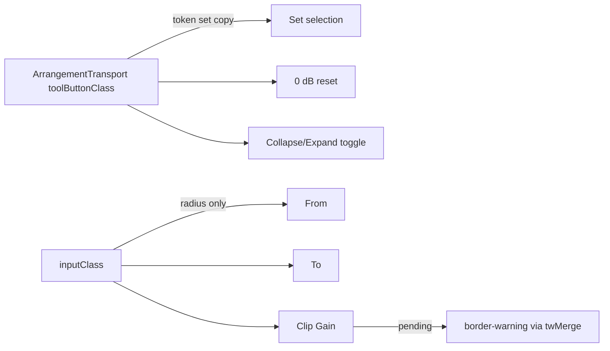

# Studio V-3c-4c-2 — Clip details panel-ის ღილაკების surface: Set selection, 0 dB და Collapse/Expand → 5 % fill, 8 px radius; From/To და Clip Gain ველები → მხოლოდ 8 px radius

**თარიღი:** 2026-10-25
**სტატუსი:** Completed (C round 170 PASS; published fe6ea99)
**შეცვლილი პროექტი:** Store

## კონტექსტი

VISUAL-A-OBSIDIAN-ის spec (`docs/technical/studio-real-workspace/visual-direction-a.md`, § „ღილაკები და ზედაპირები“) ღილაკებზე `border-outline` ჩარჩოს `foreground` fill-ით ცვლის: 5 % მოსვენებისას, 8 % hover-ზე, 12 % active-ზე. 1 px border რჩება, მაგრამ გამჭვირვალე ხდება, ამიტომ ზომა არ იცვლება. ღილაკები და ველები 8 px radius-ს იღებენ, motion არის `background-color, color 180ms cubic-bezier(.2,.8,.2,1)` და reduced motion-ის დროს გამორთულია.

V-3c-4a/4b/4c-1-მა ეს უკვე გააკეთა transport-ზე, toolbar-ზე, lane/group header-ებზე და Library-ზე. ეს რაუნდი (B-ის გადაწყვეტილება D-29z135) იმავეს აკეთებს `ArrangementDetailPanel`-ში (Clip details panel).

## მიდგომა

- **R1 — token set** კოპირებულია transport-ის `toolButtonClass`-იდან:
  - **SURF:** `border-transparent bg-foreground/5 enabled:hover:bg-foreground/8 enabled:active:bg-foreground/12`
  - **MOTION:** `motion-safe:transition-[background-color,color]! motion-safe:duration-180! motion-safe:ease-[cubic-bezier(0.2,0.8,0.2,1)]! motion-reduce:transition-none!`
  - **RADIUS:** `rounded-sm` (6 px) → `rounded-md` (8 px).
  - ყოველი ღილაკი ინარჩუნებს საკუთარ ზომას, padding-ს, ტექსტის ფერს, hover-ის ტექსტს (`hover:text-brand`), focus ring-ს და disabled cue-ს (`disabled:text-dim`). `disabled:opacity-40` არ დაემატა. ოთხი MOTION token ერთადერთი arbitrary `[...]` მნიშვნელობაა.
- **R13 — სამი outline ღილაკი** SURF ღილაკი ხდება; თითოეულს ერთი border ფერი რჩება (`border-outline` → `border-transparent`):
  - Set selection (`arrangement-detail-apply`);
  - 0 dB reset (`arrangement-detail-clip-gain-reset`), `font-mono` რჩება;
  - header toggle (`arrangement-detail-toggle`), `inline-flex items-center gap-0.5 pl-2 pr-1` რჩება. toggle-ს `disabled` მდგომარეობა არ აქვს, ამიტომ `enabled:` fill-ები ყოველთვის მოქმედებს.
- **R3 — ველები ინარჩუნებენ border-ს.** `inputClass` (From, To, Clip Gain) იცვლის მხოლოდ radius-ს. `border-outline-strong` რჩება; pending მდგომარეობაში twMerge მას ისევ `border-warning`-ით ცვლის.
- **R14 — ამ ეტაპში არ შედის:** video/waveform-ის framed box და group-reason-ის framed box (V-3c-5), Clip Gain fader (range input), resize handle (`role=separator`), panel-ის `border-t` და header-ის `border-b` (divider-ები).
- **ალტერნატივა:** საერთო constant ან component ფაილებს შორის. უარყოფილია — checkpoint-ის პასუხამდე fallback (c) მოქმედებს: class-ის ასლები თითო component-შია და ტესტებით არის დაბლოკილი.

## არქიტექტურა

### Token-ები ადრე და შემდეგ

| ადგილი | ადრე | შემდეგ |
|---|---|---|
| Set selection, 0 dB, toggle | `rounded-sm border border-outline` | `rounded-md border border-transparent bg-foreground/5` + hover/active fill + MOTION |
| From, To, Clip Gain | `rounded-sm border border-outline-strong` | `rounded-md border border-outline-strong` |

## შეცვლილი ფაილები

- `app/components/arrangement/ArrangementDetailPanel.tsx` — S1–S3 (სამი ღილაკის class string) და F1 (`inputClass` radius). ტექსტი, aria, handler-ები, ზომა, gap და padding უცვლელია.
- `app/lib/arrangement/__tests__/detail-panel-strings-ui.test.tsx` — ახალი describe ფაილის ბოლოს: DSU1 და DFR1; helper-ები describe-ის შიგნითაა, unmount `afterEach`-შია.
- `docs/implementation/2026/quarter-IV/138-studio-v3c4c1-library-button-surfaces.md` — სტატუსი → Completed, C round 169-ის TODO გადახაზულია.
- ეს დოკუმენტი.

## პრობლემები და გადაწყვეტები

- **Problem:** pending Clip Gain-ის `cn(inputClass, …, 'border-warning …')` და PM1/PM2/F4/TH5 ტესტები `border-outline-strong`-ზეა მიბმული. → **Solution:** R3 — ველზე იცვლება მხოლოდ radius, border token არ ეხება; ეს ტესტები უცვლელად მწვანეა.
- **Problem:** DPS5 ამოწმებს toggle-ის `pl-2 pr-1`-ს და `px-2`-ის არარსებობას. → **Solution:** padding-ის token-ები არ შეცვლილა; DSU1 იგივეს ორივე მდგომარეობაში (Collapse/Expand) ამოწმებს.

### B-ის ბრაუზერის probe (§0.1, `b-round-169/v3c4c2-probe.cjs`, 1440 და 1280)

| საზომი | შედეგი |
|---|---|
| Layout (ყველა control box) | max 0.000 px, D0–D2 სამივე მდგომარეობაში |
| Radius | 6 px → 8 px ექვსივე ადგილზე |
| Set selection (enabled), toggle | border → transparent; fill rgb(22,20,18) → rgb(33,31,28); კონტრასტი 14.78 → 13.24; hover 6.58 |
| Set selection (D0), 0 dB (disabled) | კონტრასტი 5.38 → 4.82 (`text-dim` 5 % fill-ზე); hover არ ცვლის |
| From, To, Clip Gain | მხოლოდ radius; border rgb(115,107,96) რჩება; კონტრასტი 15.62 (enabled), 5.69 (disabled) |
| Transition | `background-color, color 0.18s` |
| Fill vs surface (WCAG 1.4.11) | 1.12 — spec-ის ცნობილი trade-off |

### ცნობილი trade-off-ები

- WCAG 1.4.11: fill-ის კონტრასტი საკუთარ ზედაპირთან 1.12:1 — spec-ის გადაწყვეტილება (GATE167-WCAG-1411-FILL).
- Disabled კონტრასტი 5.38 → 4.82, ისევ ≥ 4.5.
- 1280-ზე Set selection ღილაკი flex column-ში იკუმშება (18 / 23 px სიმაღლე) — წინასწარ არსებული ქცევაა, ამ ეტაპამდეც და შემდეგაც იგივე; deferred Low `B-R169-1280-SET-SELECTION-SQUASH`. აქ არ გასწორდა, რადგან ეტაპის მიღება 0 px-ია.

## ტესტირება

- **Baseline (`352dc91`):** B-ის 11 targeted ფაილი — 183/183.
- **ცვლილების შემდეგ:** იგივე 11 ფაილი — 185/185 (DSU1 და DFR1 დამატებით). `detail-panel-strings-ui`-ში `expect(` 48 → 60.
- **DSU1:** Set selection, 0 dB (`music-1` მონიშნულია, panel ღიაა) და toggle (Collapse და Expand) — შეიცავს SURF/MOTION/RADIUS token-ებს, `hover:text-brand`, `text-foreground`, `focus-visible:ring-brand`; არ შეიცავს `border-outline`, `rounded-sm`, `disabled:opacity-40`. Set selection და 0 dB — `disabled:text-dim`; 0 dB — `font-mono`; toggle — `pl-2 pr-1 gap-0.5` და არა `px-2`.
- **DFR1:** From, To, Clip Gain — `rounded-md` და `border-outline-strong`, არა `rounded-sm`/`border-outline`; pending Clip Gain (`3`) — `rounded-md` და `border-warning`, არა `border-outline-strong`/`rounded-sm`.
- **Mutation-ები** (თითოეული აღდგა და sha256 შემოწმდა):

| Mutation | ცვლილება | წითელი |
|---|---|---|
| m213 | Set selection-ზე `border-outline` | DSU1 |
| m214 | 0 dB-ზე `hover:text-brand` ამოღებული | DSU1 |
| m215 | toggle `rounded-md` → `rounded-sm` | DSU1 |
| m216 | toggle-ზე `enabled:hover:bg-foreground/8` ამოღებული | DSU1 |
| m217 | `inputClass` `rounded-md` → `rounded-sm` | DFR1 |
| m218 | `inputClass` `border-outline-strong` → `border-outline` | DFR1, TH5 |

- `npm run typecheck`, `npm run lint` (exit 0) და `npx biome check` ორ code/test ფაილზე — სუფთა.
- ბრაუზერის მიღება (SURF, BOX, CONTRAST, RV1, FUNC-SMOKE) — C round 170.

## TODO / შემდეგი ნაბიჯები

- ~~C round 170-ის ბრაუზერის მტკიცებულება; შემდეგ სტატუსი → Completed.~~
- V-3c-4c-3 (`ArrangementExportDialog` და `ArrangementVideoDock`; `ArrangementMarkerRow`-ის flag chip-ის ღია კითხვა).
- V-3c-5 (panel radius, ამ ფაილის video/waveform და group-reason framed box-ების ჩათვლით).
- DUX-R-5 (ერთი ფერის წესი).
- M1/M3/M4 დარჩენილი ეტაპები.
- Checkpoint Q1 (საერთო recipe) — fallback (c) გრძელდება.
