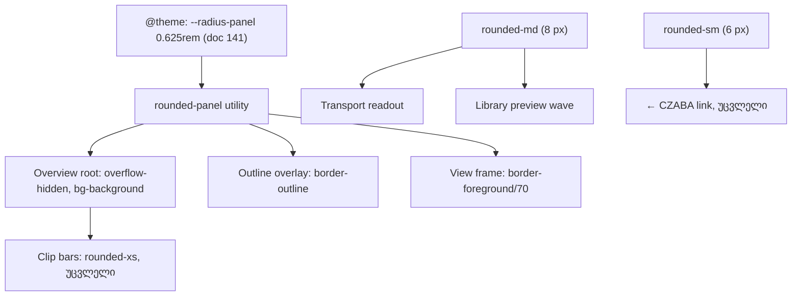

# Studio V-3c-5b — Overview-ს 10 px radius (root, outline overlay და view frame ერთად) და ორი დარჩენილი 6 px control 8 px-ზე; არაფერი გადაადგილდება

**თარიღი:** 2026-10-25
**სტატუსი:** Completed (C round 173 PASS, გამოქვეყნდა `02c08fd`)
**შეცვლილი პროექტი:** Store

## კონტექსტი

VISUAL-A-ის სპეციფიკაცია (`visual-direction-a.md`, „ღილაკები და ზედაპირები“) ადგენს: ღილაკები და ველები 8 px, panel-ები 10 px, layout-ზე გავლენის გარეშე. V-3c-5a-მ (doc 141) შემოიტანა `--radius-panel` token (`rounded-panel`) და გადაიყვანა Detail panel-ის box-ები, video dock-ის frame-ები და Grid/Marker menu-ები. ღიად დარჩა Arrangement-ის Overview (64 px რუკა clip bar-ებით) და ორი 6 px control: Transport-ის დროის readout და Library preview-ის waveform. V-3c-5b ამ ნაწილს ასრულებს და ამით V-3c-5 და V-3c დასრულებულია (C-ის მტკიცებულების შემდეგ).

## მიდგომა

გადაწყვეტილებები (D-29z138; ყველა მომხმარებლისთვის vetoable `feature-status.md`-ში):

- **R25 — Overview არის panel.** root, outline overlay და view frame სამივე ერთად `rounded-sm` → `rounded-panel`. OV1 მათ ერთად კეტავს SABA-B-2-ის გამო: 6 px frame 10 px `overflow-hidden` root-ში x = 0-ზე და მარჯვენა ბოლოში კუთხის notch-ს ხელახლა გახსნიდა. Overview-ს clip bar-ები რჩება `rounded-xs` (timeline object-ები, R24).
- **R25-ის ცნობილი შედეგი (vetoable, gate-173 finding 1):** 10 px `overflow-hidden` კუთხე x = 0-ზე და extent-ის ბოლოში Overview-ს clip bar-ს ~2 px-ს, playhead-ს კი ზემოთ და ქვემოთ ~4 px-ს აჭრის (6 px-ზე ~0.3 და ~1.5 px იყო). კოდი არ იცვლება.
- **Capsule-ის trade-off.** CSS radius-ს ამცირებს, როცა ის box-ში ვერ ეტევა. 20 px-ზე ვიწრო frame ამიტომ ვერტიკალური capsule ხდება (HEAD-ის 6 px იგივეს აკეთებდა 12 px-ზე ქვემოთ). ეს მიღებულია და vetoable-ად ჩაწერილი; C ამას 4× crop-ებით აფიქსირებს. **არ გაკეთდა:** frame-ზე `min-w` ან `overviewFrame`-ის (`view.ts`) შეცვლა — ორივე ხილულ დიაპაზონს არასწორად აჩვენებდა და frame-ს გადაადგილებდა.
- **R26 — Transport readout** (position და project end) ველის მსგავსი display-ია: `rounded-sm` → `rounded-md` (8 px). ალტერნატივა, ჩაწერილი: 6 px chip-ად დატოვება (როგორც R20 badge-სა და flag-ზე).
- **R27 — Library preview waveform** (`role="slider"`, 32 px, borderless, focusable seek bar) control-ია: `cn()`-ის base string-ში `rounded-sm` → `rounded-md`. P1-ისა და Overview-სგან განსხვავებით ის bordered framed box არ არის, ამიტომ panel არ არის.
- **R28 — `← CZABA` ბმული რჩება 6 px.** borderless text link-ია; მისი `rounded-sm` მხოლოდ focus ring-ს აფორმებს. `StudioWorkspace.tsx` არ შეცვლილა.
- **R29 — twMerge-ის წესი** (gate-172 finding 2): `tailwind-merge`-მა `rounded-panel` არ იცის, ამიტომ `cn()`-ში სხვა `rounded-*`-თან ერთად ორივე კლასი გადარჩებოდა. R25-ის საიტები plain `className` string-ებია; clip bar-ები `cn()`-ით გადის, მაგრამ `rounded-xs`-ს ინარჩუნებს; R27 იყენებს სტანდარტულ `rounded-md`-ს.

### B-ის probe `3810816`-ზე (read-only, რეალური Chromium `/studio-lab`-ზე)

| მდგომარეობა | 1440×900 | 1280×720 |
|---|---|---|
| Overview root-ის box | x 300, y 118, 956 × 64, radius 6px | x 300, y 156, 796 × 64, radius 6px |
| Parent (radius-ისა და border-ის გარეშე) | 956 × 90 | 796 × 90 |
| ცარიელი პროექტი (extent 10 s), max zoom 320 px/s: frame-ის სიგანე | 274.25 | 188.55 |
| `demo-middle-east` `music`-ზე 1 s-ზე (extent 101.352 s), max zoom: frame-ის სიგანე | 27.05 | 18.59 |
| იგივე, Overview-ს მარჯვენა ბოლოზე click-ის შემდეგ: frame x + w vs root right | 1267.52 vs 1256 (11.5 px გარეთ, root clip-ავს) | 1103.28 vs 1096 (7.3 px გარეთ) |

**Frame-ის overflow-ის დაკვირვება (B-R172-OV-FRAME-OVERFLOW, info):** view შეიძლება extent-ს მიღმა გადავიდეს, ამიტომ მარჯვენა ბოლოში frame root-ს სცდება და root-ის `overflow-hidden` მას ჭრის. ეს ძველი ქცევაა და ამ რაუნდში არ შეცვლილა.

## არქიტექტურა

## შეცვლილი ფაილები

- `app/components/arrangement/ArrangementOverview.tsx` — root, outline overlay და view frame: radius token (O1–O3).
- `app/components/arrangement/ArrangementTransport.tsx` — readout container-ის radius token (S1).
- `app/components/arrangement/ArrangementLibraryPreview.tsx` — preview wave-ის `cn()` base string-ის radius token (S2).
- `app/lib/arrangement/__tests__/studio-theme-obsidian.test.tsx` — მხოლოდ OV1 ბლოკი: `rounded-panel` და `rounded-sm`-ის გამორიცხვა root-სა და frame-ზე, overlay-ის ზუსტი string.
- `app/lib/arrangement/__tests__/panel-radius-ui.test.tsx` — PNR2-ის მოსალოდნელი count-ები და საიტები (ცხრა საიტი), ახალი PNR4 და PNR5.
- `docs/implementation/2026/quarter-IV/141-studio-v3c5a-panel-radius.md` — სტატუსი Completed.
- ეს დოკუმენტი.

## პრობლემები და გადაწყვეტები

- **პრობლემა:** test file-ის `@remix-run/react` `Link` mock `data-testid`-ს არ გადასცემს, ამიტომ `arrangement-exit` jsdom-ში testid-ით ვერ მოიძებნა. → **გადაწყვეტა:** PNR5 ბმულს `header a[href="/"]`-ით პოულობს; mock არ შეცვლილა. ბრაუზერში testid-ს C ამოწმებს.
- **პრობლემა:** workspace-ში preview mount-ისთანავე ready ხდება (წყარო ავტომატურად მონიშნულია და ტესტის `loadSource` მაშინვე სრულდება), ამიტომ „not ready“ მდგომარეობა არ ჩანდა. → **გადაწყვეტა:** PNR5 მეორე mount-ს აკეთებს collection-ით, რომლის `loadSource` pending რჩება; wave ამ დროს `aria-disabled="true"` და `cursor-not-allowed`-ია.
- **პრობლემა:** capsule-ის ფორმა ვიწრო frame-ზე. → **გადაწყვეტა:** მიღებული trade-off (R25), `min-w` გარეშე; C-ის 4× crop-ები Saba-სთვის.

## ტესტირება

- **Baseline** (`3810816`, 25 ფაილი `b-round-172-r173-vitest-base.txt`-დან): 423/423.
- **ცვლილების შემდეგ:** იგივე 25 ფაილი — 425/425 (+PNR4, +PNR5).
- `expect(` count-ები: `studio-theme-obsidian` 76 → 78, `panel-radius-ui` 25 → 37.
- **Mutations m235–m240** (`tmp/studio-real-loop/a-round-173/mutations/`): O1/O2/O3 უკან `rounded-sm`-ზე → OV1, PNR2, PNR4 წითელი; clip bar `rounded-panel`-ზე → PNR2, PNR4; S1 → PNR5; S2 → PNR5. ყოველი აღდგა და sha256 შემოწმდა.
- `npm run typecheck` სუფთა; `npm run lint` — 0 error (არსებული warning-ები); scoped `npx biome check` შეცვლილ code/test ფაილებზე — სუფთა.
- ბრაუზერის მიღება (RADIUS, OV-CORNERS, NARROW-FRAME, BOX, RV1, FUNC-SMOKE) — C round 173.

## TODO / შემდეგი ნაბიჯები

- ~~C round 173-ის ბრაუზერის მტკიცებულება; შემდეგ სტატუსი → Completed.~~
- DUX-R-5 (ერთი ფერის წესი; SABA-B-1-ის contrast-ის ხელახალი შემოწმება).
- M1/M3/M4 დარჩენილი ეტაპები.
- ROOT-RECON-GRID-HARNESS (საერთო სატესტო დამხმარე, ცალკე test-only დავალება).
- Q-V3C5-MODAL-RADIUS — Export dialog-ის panel radius დაცულ `Modal.tsx`-შია; Saba/root-ის გადაწყვეტილება.
- Architecture checkpoint-ის მოთხოვნა (`b-round-170-checkpoint-request.md`; V-3c-ის საზღვარზე B წერს განახლებულს).
- Safari-ში ვიდეოს rounded კუთხეზე clip-ის შემოწმება (gate-172 finding 3) — Tech Lead-ის manual check, cloud მხოლოდ Chromium-ია.
