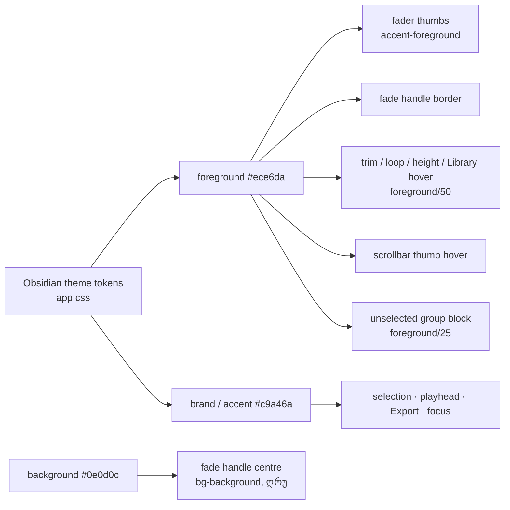

# Studio DUX-R-5b-1 — ერთი ფერის წესი, ნაწილი 2, ეტაპი 1: control-ები და affordance-ები ნეიტრალურია (fader thumb-ები, fade handle-ები, trim / loop-edge / track-height hover, scrollbar thumb, Library resize hover, collapsed group-ის clip block-ები); selection, playhead, primary და focus ინარჩუნებს brass-ს; არაფერი გადაადგილდება

**თარიღი:** 2026-10-25
**სტატუსი:** Completed (C round 175 PASS, გამოქვეყნდა `c53eefc`)
**შეცვლილი პროექტი:** Store

## კონტექსტი

Saba-მ 2026-10-25-ს დაამტკიცა DUX-R-5 („ერთი ფერის წესი“): content ნეიტრალურია, accent (Obsidian-ში brass) მხოლოდ selection-ის, playhead-ის, primary ღილაკისა და focus-ისთვისაა. D6-ის კონტრასტის ზღვრები (≥ 3:1, WCAG 1.4.11) ძალაში რჩება. DUX-R-5a (round 174, doc 143) waveform-ებსა და Overview-ს შეეხო. design-ux-review-ის F-9 დაკვირვება („ერთი და იგივე ფერი waveform-ზე, selected clip-ის ჩარჩოზე, Export-ზე, Play-ზე, **fader thumb-ებზე** და focus ring-ზე“) ჯერ ბოლომდე არ იყო გამოსწორებული.

B-ის inventory-მ (`0a4a41e`) focus ring-ების გარდა ≈75 brass site იპოვა. ისინი სამ ეტაპად იყოფა, მოცულობის შემცირების გარეშე:

- **5b-1 (ეს დოკუმენტი):** რასაც მომხმარებელი იჭერს ან hover-ს უკეთებს — control-ები და affordance-ები.
- **5b-2:** on-state toggle-ები (Mute/Solo, Loop, Metronome, Snap, Env, Waveform Zoom, Follow, Delete-with-range, ჩართული loop brace, Library preview toggle).
- **5b-3:** label-ები, ghost-ები, Export dialog.

DUX-R-5 „მზადაა“ მხოლოდ 5b-3-ის C PASS-ის შემდეგ.

## მიდგომა

### R34 — სად გადის brass/ნეიტრალურის ზღვარი

brass რჩება **ობიექტის მონიშვნაზე** (clip, track, group, marker, Library node ან row, marquee, Export-ის არჩეული option), **playhead-ებზე**, **primary action-ზე** (Export) და **focus-ზე**. Mode toggle, on-state, affordance, label და warning selection არ არის — ისინი ნეიტრალური ხდება.

### დაცული brass (K1–K6 round 174-დან, დამატებით K7–K12)

- **K7 selection:** collapsed group-ის მონიშნული block `border-brand bg-brand/60`; მონიშნული lane/group row `bg-brand/20`; active-track marker `border-l-brand`, `bg-brand/5` და „Active“ badge; მონიშნული marker; Library-ის active node და selected row; marquee; Export-ის არჩეული format/scope ბარათი და მისი radio `accent-brand`.
- **K8 playhead-ები:** Ruler და StudioWorkspace `bg-accent`.
- **K9 primary:** Transport-ის Export ღილაკი `border-brand text-brand` (იერარქია M1-ს ეკუთვნის).
- **K10 focus:** Library search `focus:border-brand`, Library resize `focus-visible:bg-brand`, GroupHeader-ის rename ველი `border-brand`.
- **K11:** Library preview-ს დაკრული ნაწილი `fill-brand` (K5).
- **K12:** envelope (K6) — უცვლელი.
- **DUX-R-5-ის ფარგლებს გარეთ (არა ჩუმად):** `app/components/studio/*` — ისინი `[data-studio-theme="obsidian"]`-ის გარეთაა და მხოლოდ დაცული `studio.$productId.tsx`-ით მიიღწევა (SRW-21, `deferred_user`).

### ფერის გაანგარიშება (sRGB WCAG, Obsidian token-ები)

| Site | იყო | გახდა | კონტრასტი | შენიშვნა |
|---|---|---|---|---|
| Fader thumb-ები (6 `type="range"`) | `accent-brand` #c9a46a | `accent-foreground` #ece6da | surface-თან 14.78, elevated-თან 13.94 | Chromium thumb-ს და შევსებულ track-ს `accent-color`-ით ხატავს; jsdom ამას ვერ ხედავს, C პიქსელებს ზომავს. |
| Fade handle | `border-foreground bg-brand` (სავსე brass) | `border-foreground bg-background` (ღრუ) | border vs `bg-elevated` body 13.94; ცენტრი vs selected `bg-brand` header 8.32 | envelope point-ისგან (`bg-foreground border-background`, სავსე ღია, K6) უნდა განსხვავდებოდეს. Env mode-ში fade handle-ები დამალულია. |
| Trim edge-ები, loop-brace edge-ები, track-height handle-ის hover | `hover:bg-accent/60` (3.52) | `hover:bg-foreground/50` | elevated-ზე 4.40, muted-bg-ზე 4.30, background-ზე 4.53 | `/40` უარყოფილია: 3.25–3.32 3:1-თან ძალიან ახლოა. |
| Track-height handle drag-ის დროს | `bg-accent/60` | `bg-foreground/50` | იგივე | hover-ის იგივე token. |
| Scrollbar thumb hover/active | `bg-brand` (dim → brand ნაბიჯი 1.46) | `bg-foreground` | rest `bg-dim` → hover ნაბიჯი 2.75; `bg-surface` track-თან 14.78 | `bg-muted` უარყოფილია: `dim`-დან ნაბიჯი მხოლოდ 1.24. |
| Library resize handle hover | `hover:bg-brand/40` (2.29) | `hover:bg-foreground/50` | surface-ზე 4.49, `bg-outline` rest-თან 3.91 | `focus-visible:bg-brand` focus-ია (K10) და რჩება. |
| Collapsed group-ის clip block (unselected) | `bg-brand/25` (1.57) | `bg-foreground/25` | ≈1.98 background-ზე; selected `bg-brand/60` block 3.65, 1.84× უფრო ღია | ეს content-ია (F-9-ის კატეგორია, რომელიც 5a-მ გამოტოვა). selected block რჩება (K7). `bg-muted/60` უარყოფილია: selected-თან მხოლოდ 1.14. |

C-ის brass ტესტი: `R − B ≥ 45`. ამ რაუნდის ყველა token ნეიტრალურია (R − B ≤ 21).

### სრული 5b site-ების ცხრილი

| ეტაპი | Site-ები |
|---|---|
| **5b-1 (ეს რაუნდი)** | 6 fader thumb (DetailPanel clip gain, Master Volume, Lane Pan, Lane Volume, GroupHeader Volume, Transport Zoom); Clip fade handle; Clip trim edge × 2; LoopBrace edge × 2; Lane track-height hover + drag; scrollbar thumb hover + active; Library resize hover; GroupHeader-ის unselected block. დამატებით gate-174-ის suggestion 1: Clip-ის ორი `cn()` გამოძახება, რომელშიც მხოლოდ ფიქსირებული string-ებია, ჩვეულებრივ `className`-ად იქცა (იგივე token-ები, იგივე რიგით). |
| **5b-2** | Lane Mute / Solo; GroupHeader Mute / Solo on / mixed; Master Mute; Transport Delete-with-range, Loop, Follow on / paused; TempoRow Metronome; StudioWorkspace Snap, Env, Waveform Zoom (non-default); LoopBrace enabled; LibraryPreview toggle; Library previewing label. Q-R167-ON-HOVER `awaiting_user`-ია, ამიტომ on-state hover-ის R2 წესი (hover ნაბიჯის გარეშე) რჩება. |
| **5b-3** | Lane drop hint, drop ring, library ghost, lane-move ghost; StudioWorkspace demo badge, delete hint, selection count, lane-move refusal; GridMenu check-ები; ExportDialog empty note, progress, overload warning; DetailPanel group count; Library filter label. |

### B-ის finding B-R174-ACCENT-EQ-BRAND (Low; დაგეგმილია)

Obsidian-ში `--color-accent` = `--color-brand` = `#c9a46a`. ამიტომ ყველა site, რომელიც ორ მდგომარეობას `brand`-ითა და `accent`-ით განასხვავებს, დღეს ერთნაირად გამოიყურება: valid vs blocked ghost, video vs audio drop hint, Solo on vs Mute on, Follow on vs paused. ტექსტი ან M/S ასო მაინც განასხვავებს, ამიტომ Low-ია. 5b-2/5b-3 ამ ხაზებს ფლობს და განსხვავებულ სამიზნეებს მისცემს; ეს რაუნდი მათ არ ეხება.

## არქიტექტურა

ახალი CSS, `style=`, arbitrary value ან hex არ დამატებულა; `app/styles/` უცვლელია. ზომები, layout, `data-*`, aria და handler-ები უცვლელია.

## შეცვლილი ფაილები

- `app/components/arrangement/ArrangementDetailPanel.tsx` — clip gain fader-ის thumb.
- `app/components/arrangement/ArrangementMaster.tsx` — Master Volume thumb.
- `app/components/arrangement/ArrangementLane.tsx` — Pan და Volume thumb; track-height handle-ის hover და drag fill.
- `app/components/arrangement/ArrangementGroupHeader.tsx` — group Volume thumb; unselected collapsed block (Biome-მა ternary სამ ხაზად გადაიტანა — მხოლოდ formatting).
- `app/components/arrangement/ArrangementTransport.tsx` — Zoom thumb.
- `app/components/arrangement/ArrangementClip.tsx` — ღრუ fade handle; trim edge-ების hover; ორი ფიქსირებული `cn()` → ჩვეულებრივი `className`.
- `app/components/arrangement/ArrangementLoopBrace.tsx` — loop edge-ების hover.
- `app/components/arrangement/ArrangementLibrary.tsx` — resize handle-ის hover.
- `app/components/arrangement/studio-scrollbar.ts` — thumb hover/active.
- `app/lib/arrangement/__tests__/track-layout.test.tsx` — unfolded handle-ის class-ის lock და folded შემოწმება ახალ token-ზე.
- `app/lib/arrangement/__tests__/affordance-colour-ui.test.tsx` — ახალი: DXA1–DXA7.
- `docs/implementation/2026/quarter-IV/143-studio-dux-r5a-content-colour.md` — სტატუსი Completed, TODO-ების განახლება.

## პრობლემები და გადაწყვეტები

- **Problem:** B-ის DXA7 ითხოვს `hover:bg-accent/60`-ის 0 შემთხვევას 9-ვე granted ფაილში, მაგრამ `ArrangementDetailPanel.tsx`-ის Clip details-ის height separator (`arrangement-detail-separator`) იგივე token-ს ატარებს და §1-ის სიაში არ არის. → **Solution:** A ამ ხაზს არ შეეხო (§1-ის გარეთაა). DXA7-ში ის მონიშნულ მუდმივად (`DETAIL_SEPARATOR_ACCENT_GAP_R175`) ზუსტად 1-ზეა დაფიქსირებული, დანარჩენ 8 ფაილში — 0. finding: **A-R175-DETAIL-SEP-ACCENT**, B-ს გადაწყვეტილებას ელოდება (შემოთავაზება: `hover:bg-foreground/50`, background-ზე 4.53).
- **Problem:** `bg-foreground/25` `bg-brand/25`-ზე 5 სიმბოლოთი გრძელია და GroupHeader-ის ternary Biome-ის ხაზის სიგრძეს გადააჭარბა. → **Solution:** Biome-ის ფორმატით სამ ხაზად დაიყო; token-ები და ლოგიკა უცვლელია.
- **Problem:** envelope point მხოლოდ იმ clip-ზე რენდერდება, რომელსაც envelope აქვს; ხოლო group-ის აკეცვა დამალული ხაზების clip-ებს selection-იდან განზრახ იღებს (StudioWorkspace-ის `setTrackGroupsCollapsed`, არსებული ქცევა). → **Solution:** ტესტის audio clip-ს ორი envelope point მიეცა, ხოლო clip-ის მონიშვნა აკეცვის შემდეგ ხდება.

## ტესტირება

- 13 base ფაილი ცვლილებამდე: **199/199**.
- ცვლილების შემდეგ 13 base + `affordance-colour-ui.test.tsx`: **206/206** (51 suite).
- DXA1 — 6 range-ის `accent-foreground`, `accent-brand`-ის არქონა, `focus-visible:ring-brand`.
- DXA2 — audio და video clip-ის 4 fade handle ღრუა; Env mode-ში envelope point `bg-foreground border-background` (K6) და fade handle-ები არ რენდერდება.
- DXA3/DXA4 — trim და loop edge-ების `hover:bg-foreground/50`, accent-ის გარეშე (loop ჩართული და გამორთული).
- DXA5 — track-height handle-ის hover; jsdom-ში drag იწყება: drag-ის დროს `bg-foreground/50`, pointerup-ის შემდეგ — აღარ.
- DXA6 — scrollbar class, Library resize (hover + K10 focus), collapsed group-ის block-ები (unselected ნეიტრალური, selected K7).
- DXA7 — source lock-ები, დაცული site-ები და 5b-2/5b-3-ის უცვლელი site-ები.
- Mutation-ები m248–m257 (`tmp/studio-real-loop/a-round-175/mutations/`): 10-ვე წითლდება მოთხოვნილ ტესტებზე; თითოეული დაბრუნდა და sha-ით შემოწმდა.
- `npm run typecheck`, `npm run lint`, scoped `npx biome check`. ბრაუზერის მიღება (CC-AFFORD, NO-BRASS-AFFORD, CONTRAST-DUX5B1, HANDLE-DISTINCT, ENV-VIS, RV1, FUNC-SMOKE) — C round 175.

## TODO / შემდეგი ნაბიჯები

- ~~C round 175-ის ბრაუზერის მტკიცებულება; შემდეგ სტატუსი → Completed.~~
- A-R175-DETAIL-SEP-ACCENT — B-ის გადაწყვეტილება (5b-1 fix-up ან 5b-2). — Round 176 (doc 145).
- ~~CONTRAST-DUX5B1-ში thumb vs unfilled track < 3:1-ის შემთხვევაში — წინასწარ განსაზღვრული fix-up: 6 thumb → `accent-muted`.~~
- DUX-R-5b-2 — on-state toggle-ები განსხვავებული ნეიტრალური სამიზნეებით (B-R174-ACCENT-EQ-BRAND-ის ჩათვლით). — 5b-2a Round 176 (doc 145), 5b-2b შემდეგ.
- DUX-R-5b-3 — label-ები, ghost-ები, Export dialog.
- R34-ის, ღრუ fade handle-ის, თეთრი thumb-ების, `foreground/50` hover-ის, თეთრი scrollbar thumb-ის და ნეიტრალური group block-ების Saba-ს veto-ს შესაძლებლობა `feature-status.md`-ში.
- ROOT-RECON-GRID-HARNESS — `affordance-colour-ui.test.tsx`-იც იმეორებს fake Web Audio / ResizeObserver harness-ს; საერთო სატესტო დამხმარე ცალკე test-only დავალებაა.
