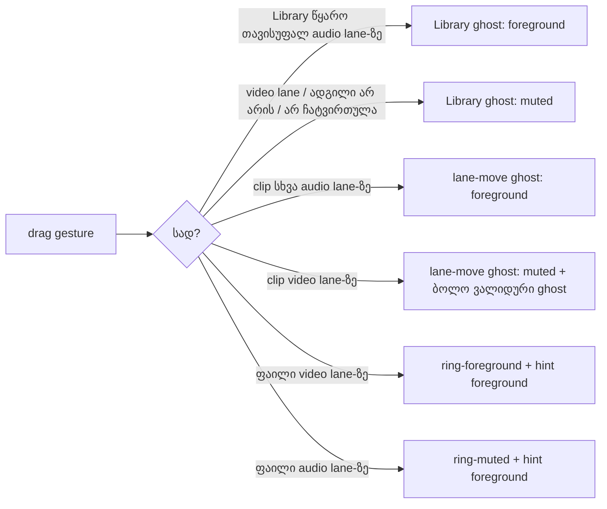

# Studio DUX-R-5b-3b — ერთი ფერის წესი, ნაწილი 3, ეტაპი 3b: Lane-ის drop ring, drop hint, Library და lane-move ghost-ები და R35 import / Add ღილაკები ნეიტრალური ხდება; DUX-R-5-ის stage exit

**თარიღი:** 2026-10-26
**სტატუსი:** Completed
**შეცვლილი პროექტი:** Store

## კონტექსტი

- Saba-ს გადაწყვეტილება (`user-review/design-ux-decisions.md`, 2026-10-25): **DUX-R-5 დამტკიცებულია** — brass (Obsidian-ის accent) რჩება მხოლოდ selection-ზე, playhead-ებზე, primary action-ზე და focus-ზე.
- **R34** (round 175, veto შესაძლებელია): drag feedback affordance-ია, ამიტომ ნეიტრალური ხდება. **R35** (round 176): import და Add action-ებია, მაგრამ primary action არ არის.
- Obsidian-ში `accent` იგივე ფერია, რაც `brand` (#c9a46a; B-R174-ACCENT-EQ-BRAND). ამიტომ დღემდე ვალიდური და დაბლოკილი drag feedback ერთნაირად გამოიყურებოდა; მათ მხოლოდ ტექსტი და `data-blocked` განასხვავებდა.
- 5b-1 (doc 144), 5b-2a (doc 145), 5b-2b (doc 146) და 5b-3a ([doc 147](147-studio-dux-r5b3a-label-status-colour.md)) უკვე დასრულდა. ეს რაუნდი DUX-R-5-ის ბოლო ნაწილია (B-ის გადაწყვეტილება D-29z145).

## მიდგომა

ცვლილება მხოლოდ class token-ებშია. არცერთი `data-*` მნიშვნელობა, ტექსტი, handler, პირობა, layout ან ზომა არ შეცვლილა; focus ring-ები (`focus-visible:ring-brand`, K10) და აქტიური track-ის tint (`bg-brand/5`, K7) ადგილზეა.

| ID | ადგილი | იყო | გახდა |
|---|---|---|---|
| G1 | `ArrangementLane.tsx`, Library ghost — blocked / refused / not ready | `border-accent bg-accent/20 text-accent` | `border-muted bg-muted/20 text-muted` |
| G2 | Library ghost — valid | `border-brand bg-brand/15 text-brand` | `border-foreground bg-foreground/15 text-foreground` |
| G3 | lane-move ghost — blocked | `border-accent bg-accent/20 text-accent` | `border-muted bg-muted/20 text-muted` |
| G4 | lane-move ghost — valid | `border-brand bg-brand/20 text-brand` | `border-foreground bg-foreground/20 text-foreground` |
| R1 | file-drag ring (video lane = valid, audio lane = refused) | `ring-brand` / `ring-accent` | `ring-foreground` / `ring-muted` |
| H1 | file-drag hint `
` | `text-brand` / `text-accent` (`cn()` პირობით) | ორივე შემთხვევაში `text-foreground`; პირობა წაიშალა და `cn()` ჩვეულებრივ `className`-ად იქცა (gate-174 S1 წესი) |
| I1 | compact video import (folded / tight header) | `border-brand … text-brand` | `border-outline-strong … text-foreground` |
| I2 | სრული video import ("Your own video") | `border-brand … text-brand` | `border-outline-strong … text-foreground` |
| I3 | `ArrangementLibraryPreview.tsx`, Preview "Add" | `border-brand … text-brand` | `border-outline-strong … text-foreground` (`disabled:opacity-40` რჩება) |

### Vetoable გადაწყვეტილებები (B, `backlog.json`)

- **R35:** import და Add ინარჩუნებენ ხილულ border-ს, რადგან ორივე test lock გამორიცხავს `border-transparent`-ს — ამიტომ Preview toggle-ის recipe არ გამოდგება. `outline-strong` იგივე border-ია, რაც W2 badge-ზე გაიზომა.
- **Ghost-ები და ring:** 5b-2a-ის (Mute/Solo) lightness step — valid = `foreground`, blocked = `muted`. `warning` (#d9a35b) და `destructive` (#d2776a) არ გამოიყენება, რადგან R−B ≥ 45 brass scan-ს ვერ გადიან.
- **Hint:** უარის შემთხვევაში ტექსტი ერთადერთი შეტყობინებაა, ამიტომ `foreground`-ია (W5 refusal-ის პრეცედენტი).

### Contrast (B-ის გამოთვლა, `b-round-179/out/contrast.txt`)

| წყვილი | Contrast |
|---|---|
| Valid border/ring vs lane `background` | 15.62 |
| Valid border/ring vs აქტიური lane (`brand/5`) | 14.70 |
| Blocked border/ring vs `background` | 7.06 |
| Blocked border/ring vs აქტიური lane | 6.65 |
| Valid vs blocked | 2.21 |
| Valid ghost border vs fill | 10.97 |
| Blocked ghost border vs fill | 5.24 |
| Ghost label (`background/80`-ზე) | 14.87 / 6.76 |
| Import border vs header `surface` | 3.50 |
| `outline-strong` vs `elevated` | 3.30 |
| `outline-strong` vs `background` | 3.70 |
| Import / Add ტექსტი | 13.29 |

ეს რიცხვები B-ის გამოთვლაა; ბრაუზერში გაზომვა C-ის CONTRAST-DRAG row-ია.

## არქიტექტურა

### K-mapping (INVENTORY-EXIT)

DUX-R-5-ის დასრულების შემდეგ `app/components/arrangement/**`-ში ყოველი non-focus `brand|accent` token მხოლოდ შემდეგ როლებზე უნდა დარჩეს:

| K | როლი |
|---|---|
| K7 | მონიშნული ობიექტი ან აქტიური track (clip ring/border, აქტიური lane tint `bg-brand/5`, header-ის `border-l-brand`, active badge, Library-ის მონიშნული row, marker, marquee, Export dialog-ის არჩეული ბარათები) |
| K8 | playhead-ის ხაზი და handle (Ruler, StudioWorkspace, Overview, DetailPanel) |
| K9 | primary action — Transport-ის Export და Export dialog-ის Export ღილაკი |
| K10 | focus და edit ველი (`focus:border-brand`, rename / name ველები) |
| K11 | Preview-ს დაკრული ნაწილი (`fill-brand`) |
| K12 | envelope (SABA-B-1, უცვლელი) |

ამ რაუნდის §1-ის ადგილებზე brand/accent token აღარ რჩება (DXG6 source count-ები). სრული grep და `file:line → K` სია C-ის INVENTORY-EXIT row-ია.

## შეცვლილი ფაილები

- `app/components/arrangement/ArrangementLane.tsx`: G1–G4, R1, H1, I1, I2.
- `app/components/arrangement/ArrangementLibraryPreview.tsx`: I3.
- `app/lib/arrangement/__tests__/affordance-colour-ui.test.tsx`: TODO წაიშალა; `LATER_STAGE_BRASS_SITES` → `RETIRED_BRASS_SITES`, Lane-ის ძველი blocked recipe-ის count 2 → 0.
- `app/lib/arrangement/__tests__/lane-strings-ui.test.tsx`: import ღილაკის includes → `border-outline-strong`, `text-foreground`; excludes-ს დაემატა `border-brand`, `text-brand`.
- `app/lib/arrangement/__tests__/library-row-strings-ui.test.tsx`: Add-ის includes → `border-outline-strong`, `text-foreground`; excludes-ს დაემატა `border-brand`, `text-brand`.
- `app/lib/arrangement/__tests__/drag-feedback-colour-ui.test.tsx` (ახალი): DXG1–DXG7.
- `docs/implementation/2026/quarter-IV/147-studio-dux-r5b3a-label-status-colour.md`: სტატუსი Completed, round-179-ის შენიშვნები, ბმული ამ doc-ზე.
- ეს doc.

## პრობლემები და გადაწყვეტები

- **Problem:** clip-ის video lane-ზე გადატანისას (refused) Lane ერთდროულად აჩვენებს ორ lane-move ghost-ს: დაბლოკილს video lane-ზე და ბოლო ვალიდურ ადგილს წინა audio lane-ზე (`keptGhosts`). „ზუსტად ერთი ghost“-ის lookup ამიტომ ვარდებოდა.
  **Solution:** ტესტი ghost-ს `data-testid`-ითა და `data-blocked` მნიშვნელობით პოულობს და თითო მდგომარეობაზე ზუსტად ერთს ითხოვს. ქცევა არ შეცვლილა.
- **Problem:** file drag-ის ტესტში აუდიო lane აქტიური track-ია, ამიტომ მის body-ზე `bg-brand/5` (K7) ჩანს და „არცერთი brand token“ შემოწმება ცრუ წითელს იძლეოდა.
  **Solution:** lane body-ზე brand/accent-ის არარსებობა მხოლოდ `ring-*` token-ებზე მოწმდება; K7 tint ამ რაუნდის scope-ში არ შედის და უცვლელია.
- **Problem:** `RETIRED_BRASS_SITES`-ის შეტყობინება მოკლე გახდა და Biome-მა ერთ ხაზად გაერთიანება მოითხოვა.
  **Solution:** formatter-ის reflow ხელით გასწორდა (იგივე token-ები).
- **Problem:** §4.1-ის ორი მოლოდინი mutation-ის შედეგს არ ემთხვევა (დეტალები ტესტირებაში). ორივე შემთხვევაში ტესტი უფრო მკაცრია და არცერთი ტესტი არ შესუსტებულა.
  **Solution:** შედეგები უცვლელად ჩაიწერა A-ის ანგარიშში B-ისთვის.
- **Problem:** code-reviewer-მა (9/10, Medium+ არცერთი) ახალ ტესტში Low-ები იპოვა: წყაროების ჩატვირთვის ციკლი ჩუმად მთავრდებოდა, ძველი valid recipe-ები source lock-ში არ იყო, brass filter `accent-foreground`-ს დაიჭერდა და Preview / Add hardcoded სტრიქონებით იძებნებოდა.
  **Solution:** ოთხივე გასწორდა ახალ ტესტში (labelled `Error`, DXG6-ში სამი ძველი recipe count 0-ით, ნეიტრალური token-ების სია, `studioLibraryPanelStrings`). ტესტები და mutation-ები ხელახლა გაეშვა, შედეგი უცვლელია.

## ტესტირება

- Edit-ებამდე: B-ის 13 base ფაილი, **242/242**.
- Edit-ების შემდეგ: 13 base ფაილი **242/242** (იგივე რაოდენობა) + `drag-feedback-colour-ui.test.tsx` **7/7**.
- `npm run typecheck` (exit 0), `npm run lint` (exit 0, მხოლოდ არსებული warning-ები, შეცვლილ ფაილებში 0) და 6 code/test ფაილზე `npx biome check` (0 error).
- Mutation-ები m291–m298 (`tmp/studio-real-loop/a-round-180/mutations/`): თითოეული დაბრუნდა და sha-ით შემოწმდა. 13 base ფაილიდან წითლდება მხოლოდ მოსალოდნელი lock-ები.
  - m291 → DXG1, DXG6, DXG7; m292 → DXG2, DXG6, DXG7; m293 → DXG3, DXG6; m295 → DXG4; m297 → DXG5, DXG6, LSU7; m298 → DXG5, LPS1.
  - **m294** (`ring-muted` → `ring-accent`): DXG4, DXG6 და **DXG7-ც** წითელია. DXG7 refused ring-ზე `ring-muted`-ს ითხოვს, ამიტომ მკაცრია, ვიდრე §4.1-ის მოლოდინი.
  - **m296** (compact import `border-outline-strong` → `border-brand`): DXG5, DXG6 და **LSU7-იც** წითელია. LSU7 `importIncludes`-ს compact ღილაკზეც იყენებს (start tree-ზე l.540), ამიტომ compact-ის ფერი უკვე იყო lock-ში.
- ბრაუზერის row-ები (CC-DRAG, CC-R35, NO-BRASS-DRAG, CONTRAST-DRAG, BEHAVIOUR-DRAG, INVENTORY-EXIT, ENV-VIS, RV1, G180-3, FUNC-SMOKE) C-ს ეკუთვნის, round 180.
- Ableton-ის შესაბამისობა drag feedback-ისა და import/Add-ის ფერზე **დაუდასტურებელია** (წყარო ამ რაუნდისთვის არ შემოწმებულა); ეს CZABA-ს შეგნებული R34/R35 გადაწყვეტილებაა.

## TODO / შემდეგი ნაბიჯები

- ~~C round 180-ის ბრაუზერის მტკიცებულება; შემდეგ სტატუსი → Completed.~~ შესრულდა: C round 180 PASS (published `59d4bab`), სტატუსი Completed.
- **DUX-R-5 დასრულებულია C PASS-ის შემდეგ** (5a, 5b-1, 5b-2a, 5b-2b, 5b-3a და 5b-3b, INVENTORY-EXIT 0 unmapped).
- B-R174-ACCENT-EQ-BRAND C PASS-ის შემდეგ იხურება.
- DUX-R-5-ის საზღვარზე B-ის ახალი შეზღუდული frontend-architect მოთხოვნა root-ისთვის (საერთო workspace mount/fakes harness, token-assertion helper; ROOT-RECON-GRID-HARNESS).
- Saba-ს veto-ს შესაძლებლობა: ნეიტრალური drag feedback (foreground / muted) და `outline-strong` border import/Add-ზე.
