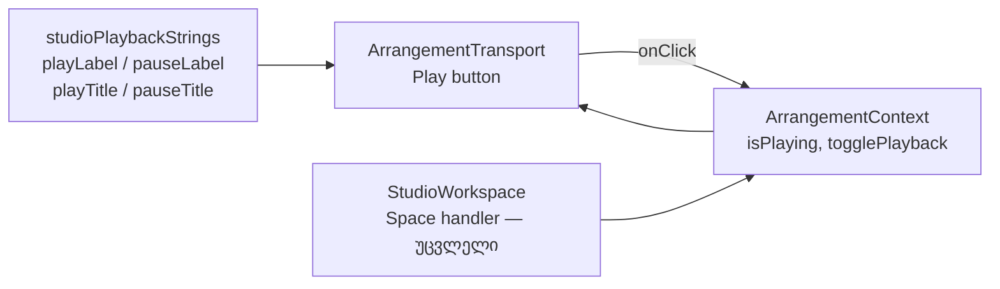

# Studio M1 — Transport-ის Play ღილაკი მრგვალი და მხოლოდ icon-იანი ხდება

**თარიღი:** 2026-10-26
**სტატუსი:** Completed
**შეცვლილი პროექტი:** Store

## კონტექსტი

- VISUAL-A-OBSIDIAN-ის რიგში DUX-R-5-ის შემდეგ M1 მოდის (`visual-direction-a.md` §M, დამტკიცებულია 2026-10-21): Play ღილაკზე ტექსტ „Play“-ს ნაცვლად მხოლოდ icon-ია და ღილაკი მრგვალია. შედეგი: ღილაკი ვიწროვდება და მეზობლები მარცხნივ იწევს.
- `design-ux-decisions.md` M1-ს DUX-R-5-ის შემდეგ აყენებს. B-ის გადაწყვეტილება: D-29z146 (`backlog.json` → VISUAL-A-OBSIDIAN `m1_plan_d29z146`).
- მანამდე ღილაკი 96 px სიგანის იყო (`w-24`). მასში იყო icon და `Play` / `Pause` label, ხოლო `aria-label` პირდაპირ literal იყო.

## მიდგომა

- **P1:** Play-ის დამატებითი class-ები ახლა ასეთია: `w-8 justify-center rounded-full px-0 bg-foreground text-background` + იგივე hover / active fill (`foreground/92`, `foreground/88`). `w-24` და `font-medium` მოიხსნა. tailwind-merge (`cn`) base-ის `rounded-md`-ს, `px-2.5`-სა და `bg-foreground/5`-ს ანაცვლებს. ამის საფუძველია GATE167-TWMERGE-DEPENDENCY. base-ის border, motion, focus ring და disabled token-ები უცვლელია.
- **P2:** `Play` / `Pause` წაიშალა. ერთშვილიანი fragment-ებიც მოიხსნა. lucide `Play` / `Pause` icon უცვლელია: `size-4`, `strokeWidth 1.5`, `aria-hidden`.
- **P3 / S1:** `aria-label` და ახალი `title` მოდის `studioPlaybackStrings`-დან: `playLabel` / `pauseLabel` (`Play` / `Pause`) და `playTitle` / `pauseTitle` (`Play (Space)` / `Pause (Space)`).
- **R38 (tooltip):** ხილული label-ის გარეშე `title` ინახავს მოქმედებასა და shortcut-ს. იგივე პატერნი უკვე აქვს Back to start-ს (`Back to start (0)`). Space დღესაც რთავს და აჩერებს playback-ს (`StudioWorkspace.tsx`, ხელშეუხებელი).
- **R39 (accessible name):** სახელი ზუსტად `Play` / `Pause` რჩება და title-ის ტექსტი არ ხდება. screen reader-ები და ყველა არსებული suite იმავე სახელს ხედავს.
- **R40 (ზომა):** 32×32, რიგის არსებული `h-8` სიმაღლის ტოლი. icon 16 px რჩება.
- **უარყოფილი ალტერნატივა:** ახალი სატესტო ფაილი ან ახალი fakes harness. არსებული lock-ები (TS1, TS2, ST10) საკმარისია, ხოლო ახალი harness ზუსტად ის ღირებულებაა, რომელსაც architecture checkpoint-ის მოთხოვნა ასახელებს.
- Transport-ის სხვა ღილაკები, readout-ები, handler-ები, `data-*`, რიგი, gap-ები და `app/styles/` უცვლელია. ახალი token არ დამატებულა.

## არქიტექტურა

### B-ის layout-ის პროგნოზი (simulation, არა მტკიცებულება)

წყარო: `tmp/studio-real-loop/b-round-180/out/transport-probe.json`.

| Viewport | Play box ადრე → შემდეგ | Back to start … Loop (10 შვილი) | მარჯვენა ჯგუფი (Follow…Export) | Transport რიგის სიმაღლე / ხაზები | შემდეგი რიგის y |
|---|---|---|---|---|---|
| 1440×900 | (12, 43) 96×32 → 32×32 | x −64, y/w/h უცვლელი | x 925.8, უცვლელი | 49 / 2, უცვლელი | 84, უცვლელი |
| 1280×720 | (12, 43) 96×32 → 32×32 | x −64, y/w/h უცვლელი | x 765.8 (y 81), უცვლელი | 87 / 3, უცვლელი | 122, უცვლელი |

## შეცვლილი ფაილები

- `app/components/arrangement/ArrangementTransport.tsx`: Play ღილაკის class-ები, მხოლოდ icon-იანი შიგთავსი, `aria-label` და `title` strings-იდან.
- `app/lib/arrangement/strings.ts`: `studioPlaybackStrings`-ს დაემატა 4 ჩანაწერი.
- `app/lib/arrangement/__tests__/strings.test.ts`: ST10-ის `EXPECTED_V02B_PLAIN_STRINGS.studioPlaybackStrings`-ს დაემატა იგივე 4 მნიშვნელობა.
- `app/lib/arrangement/__tests__/transport-surface-ui.test.tsx`: TS1-ში Play-ზე `rounded-full` (და არა `rounded-md`), დანარჩენ 11-ზე `rounded-md`. TS2-ში `present` / `absent` სიები, ცარიელი `textContent` და `title`-ის შემოწმება.
- `docs/implementation/2026/quarter-IV/147-studio-dux-r5b3a-label-status-colour.md`: მოძველებული TODO მონიშნულია შესრულებულად.
- `docs/implementation/2026/quarter-IV/148-studio-dux-r5b3b-drag-feedback-colour.md`: სტატუსი Completed, TODO შესრულებულია (C round 180 PASS, `59d4bab`).
- ეს doc.

## პრობლემები და გადაწყვეტები

- **Problem:** ხილული label-ის მოხსნის შემდეგ მოქმედება და shortcut ჩანს მხოლოდ icon-ით. → **Solution:** `title` = `Play (Space)` / `Pause (Space)` (R38), სახელი უცვლელი (R39).
- **Problem:** base-ის `rounded-md` / `px-2.5` Play-ზეც რჩება? → **Solution:** `cn` (tailwind-merge) ამ კონფლიქტს წყვეტს. TS2 `rounded-md`-ს, `px-2.5`-სა და `w-24`-ს `absent` სიაში ამოწმებს, TS1 კი სხვა 11 ღილაკზე `rounded-md`-ს ინარჩუნებს.

## ტესტირება

- 15-ფაილიანი base (`b-round-180-r181-vitest-base.txt`): ცვლილებამდე 229/229, ცვლილების შემდეგ 229/229, 0 failed.
- `npm run typecheck` exit 0. `npm run lint` exit 0 (repo-wide warning-ები ძველია). `npx biome check` 4 code/test ფაილზე სუფთაა.
- Mutation-ები m299–m303: `tmp/studio-real-loop/a-round-181/mutations/`. თითოეული დაბრუნდა და sha-ით შემოწმდა. შედეგები `a-round-181.md`-შია.
- ბრაუზერის row-ები (CC-M1, LAYOUT-M1, RV1-M1, CONTRAST-M1, FOCUS-M1, NO-BRASS-M1, BEHAVIOUR-M1, A11Y-M1, G181-3, PX-NET / REG-HYD) C-ს ეკუთვნის, round 181.

### Ableton-ის წყარო

| ქცევა | წყარო | იქ დადასტურებული | CZABA-ს გადაწყვეტილება | შესაბამისობა |
|---|---|---|---|---|
| Play და Space | Live 12 manual, თავი 6 „Arrangement View“, §6.3 „Transport and Playback“ (https://www.ableton.com/en/live-manual/12/arrangement-view/, B-მ წაიკითხა 2026-10-26) | ტექსტით: Control Bar-ს აქვს Play და ცალკე Stop. Space რთავს და აჩერებს playback-ს. | CZABA ინარჩუნებს ერთ Play/Pause toggle-ს. ეს შეგნებული, უკვე არსებული განსხვავებაა. | toggle: შეგნებული განსხვავება; Space: დადასტურებული |
| მხოლოდ icon-იანი, მრგვალი ღილაკი | იგივე §6.3, ფიგურა „The Play and Stop Buttons in the Control Bar“ (B-ს არ უნახავს) | დაუდასტურებელი. „მხოლოდ icon“ ფიგურიდან გამოტანილი დასკვნაა, სიმრგვალეზე ტექსტი არაფერს ამბობს. | მომხმარებლის მიერ დამტკიცებული CZABA M1 (Apple და pro-DAW ნორმა). Ableton-ის ქცევად არ ცხადდება. | დაუდასტურებელი |

## TODO / შემდეგი ნაბიჯები

- ~~C round 181-ის ბრაუზერის მტკიცებულება; შემდეგ სტატუსი → Completed.~~ შესრულდა: C round 181 PASS, გამოქვეყნდა `f1782f8`.
- ~~C-ის BEHAVIOUR-M1: focused Play-ზე Space / Enter ზუსტად ერთხელ უნდა გადართოს, HEAD-ის მსგავსად. თუ HEAD-იც ორჯერ რთავს, ეს უკვე არსებული finding-ია.~~ შესრულდა: focused Play-ზე Space და Enter თითოეული ზუსტად ერთხელ რთავს, HEAD-ის მსგავსად.
- შემდეგი: M3 (round 182), შემდეგ REGRESSION round.
