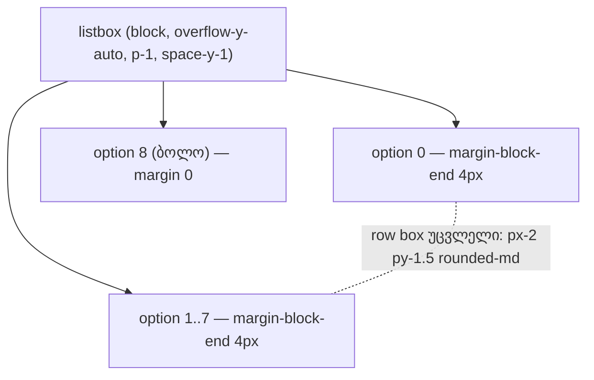

# Studio M3 — ბიბლიოთეკის ჩანაწერებს შორის 4 px სივრცე

**თარიღი:** 2026-10-26
**სტატუსი:** Completed
**შეცვლილი პროექტი:** Store

## კონტექსტი

- VISUAL-A-OBSIDIAN-ის რიგში M1-ის შემდეგ M3 მოდის (`visual-direction-a.md` §M, დამტკიცებულია 2026-10-21, `approved_moves.M3`): „ბიბლიოთეკის ჩანაწერებს შორის სივრცე +4 px. მიზეზი: serif სახელს მეტი ჰაერი სჭირდება. შედეგი: სიაში ნაკლები ჩანაწერი ჩანს.“ B-ის გადაწყვეტილება: D-29z147 (`backlog.json` → VISUAL-A-OBSIDIAN `m3_plan_d29z147`).
- **მიზეზი აღარ მოქმედებს, დამტკიცება კი მოქმედებს.** Saba-მ serif display role მოგვიანებით უარყო (V-2b-DISPLAY `decided_user`: Studio-ში serif არ არის). M3 ცალკე ხაზზე იყო დამტკიცებული, ამიტომ B მას როგორც დაწერილია ისე გეგმავს და `feature-status.md`-ში vetoable სიაში სვამს. Veto-ს შემთხვევაში ერთი class ბრუნდება.
- მანამდე listbox-ის class იყო `min-h-0 min-w-0 flex-1 overflow-y-auto p-1` (+ `STUDIO_SCROLLBAR_CLASS`), ხოლო option ღილაკები (`px-2 py-1.5 rounded-md`) ერთმანეთს 0 px-ით ეკვროდა.

## მიდგომა

- **L1:** listbox-ის class გახდა `min-h-0 min-w-0 flex-1 space-y-1 overflow-y-auto p-1`. `space-y-1` ყველა option-ს, ბოლოს გარდა, `margin-block-end` 4 px-ს აძლევს (Tailwind 4, `--spacing-1` = 0.25rem). სხვა არაფერი შეცვლილა.
- **R41 — gap და არა padding.** „ჩანაწერებს შორის სივრცე“ ნიშნავს სივრცეს row-ების მართკუთხედებს შორის. row-ის შიგნით padding-ის დამატება hover და selected მართკუთხედს 4 px-ით გაზრდიდა. gap ამ highlight box-ებს უცვლელად ტოვებს.
- **R42 — gap hit target არ არის.** 4 px gap-ში დაწყებული click ან drag listbox-ზე ხვდება და არაფერს აკეთებს. ეს რეალური gap-ის მოსალოდნელი ფასია, info დონეზე.
- **R43 — ბოლო row-ს margin არ აქვს.** ბოლო row-ის შემდეგ ერთადერთ სივრცედ სიის არსებული `p-1` bottom padding რჩება.
- **უარყოფილი ალტერნატივა:** `flex flex-col gap-1`. ამ `overflow-y-auto` სიაში flex item-ები scroll-ის ნაცვლად შეიძლება შეიკუმშოს, ამიტომ listbox block container რჩება.
- option ღილაკის class, padding, radius, hover / selected fill, შვილები და handler-ები, tree nav, search ბლოკი, preview panel, `studio-scrollbar.ts` და `app/styles/` უცვლელია. ახალი token არ დამატებულა.

## არქიტექტურა

### B-ის layout-ის პროგნოზი (simulation, არა მტკიცებულება)

წყარო: `tmp/studio-real-loop/b-round-181/out/library-probe.json` (სუფთა `f1782f8` tree, demo ბიბლიოთეკა, 9 row).

| Viewport | Listbox rect (უცვლელი) | Option-ების სიმაღლე (უცვლელი) | პირველი option-ის y | Option *n*-ის y | Gap-ები | scrollHeight | სრულად ხილული |
|---|---|---|---|---|---|---|---|
| 1440×900 | (144, 233) 144×431 | 66.5, 66.5, 47.3, 47.3, 80.3 ×5 | 237, უცვლელი | HEAD y + 4·n | 0 → 4 (8 gap) | 637 → 669 | 6 → 6 |
| 1280×720 | (144, 271) 144×213 | იგივე | 275, უცვლელი | HEAD y + 4·n | 0 → 4 | 637 → 669 | 3 → 3 |

listbox-ის გარეთ ცვლილება 0 px-ია. სიის ბოლომდე scroll-ისას ბოლო row-ის ქვედა კიდე სიის ქვედა კიდიდან დაახლოებით 4.3 px-ით მაღლაა (`p-1`). scrollbar-ის thumb მოკლდება, რადგან scrollHeight იზრდება, მაგრამ listbox-ის rect-ში რჩება.

## შეცვლილი ფაილები

- `app/components/arrangement/ArrangementLibrary.tsx`: listbox-ის class-ს დაემატა `space-y-1` (L1).
- `app/lib/arrangement/__tests__/library-row-strings-ui.test.tsx`: ახალი ტესტი LGS1 `library button surfaces (V-3c-4c-1)` ბლოკში და `studioLibraryPanelStrings`-ის import.
- `docs/implementation/2026/quarter-IV/149-studio-m1-round-icon-play.md`: სტატუსი Completed, TODO-ები შესრულებულად მონიშნულია (C round 181 PASS, `f1782f8`).
- ეს doc.

## პრობლემები და გადაწყვეტები

- **Problem:** jsdom-ს layout არ აქვს, 4 px-ის გაზომვა unit ტესტში შეუძლებელია. → **Solution:** LGS1 მხოლოდ token-ებს ამოწმებს (listbox-ზე `space-y-1`, `p-1`, `overflow-y-auto`; არც `flex`, `flex-col`, `gap-1` და არც სხვა `space-y-*`; row-ზე `px-2`, `py-1.5`, `rounded-md` და prefix-ის გარეშე margin token-ის, `/^-?m[tbyl]?-/`, არქონა; option-ები listbox-ის პირდაპირი და ერთადერთი შვილებია, რადგან `space-y-*` მხოლოდ პირდაპირ შვილებზე მოქმედებს). პიქსელური gap C-ის ბრაუზერის row-ია (GAP-M3).
- **Problem:** ახალი fakes harness-ის ღირებულება (architecture checkpoint-ის მოთხოვნა). → **Solution:** ახალი სატესტო ფაილი არ შექმნილა; LGS1 არსებულ `mountRows` / `libraryRow` / class-token helper-ებს იყენებს.

## ტესტირება

- 17-ფაილიანი base (`b-round-181-r182-vitest-base.txt`): ცვლილებამდე 328/328. ცვლილების შემდეგ შედეგი `tmp/studio-real-loop/a-round-182.md`-შია (მოსალოდნელი 329/329).
- **LGS1:** (a) listbox-ის token-ები; (b) მინიმუმ 2 option, ყველა listbox-ის პირდაპირი შვილია და სხვა შვილი არ არის, თითოეულზე `px-2`, `py-1.5`, `rounded-md` და prefix-ის გარეშე `/^-?m[tbyl]?-/` token-ის არქონა; (c) row-ის არჩევის შემდეგ (`aria-selected="true"`) (a) და (b) ისევ მოქმედებს. ფერის class-ის selector არ გამოიყენება.
- **Mutation-ები m304–m307** (`tmp/studio-real-loop/a-round-182/mutations/`): m304 `space-y-1`-ის მოხსნა, m305 `space-y-1` → `space-y-2`, m306 option-ზე `mb-1`, m307 option-ზე `py-1.5` → `py-2.5`. თითოეულმა LGS1 უნდა გააწითლოს, დანარჩენი 16 ფაილი მწვანე რჩება; m306 და m307 მხოლოდ (b) assertion-ით.
- ბრაუზერის row-ები (GAP-M3, LAYOUT-M3, RV1-M3, SCROLL-M3, STATE-M3, BEHAVIOUR-M3, M1-NEIGHBOUR, G182-3, PX-NET / REG-HYD) C-ს ეკუთვნის, round 182.

### Ableton-ის წყარო

| ქცევა | წყარო | იქ დადასტურებული | CZABA-ს გადაწყვეტილება | შესაბამისობა |
|---|---|---|---|---|
| browser / library row-ებს შორის სივრცე | არ გამოყენებულა. ეს ვიზუალური სიმჭიდროვის ცვლილებაა ქცევის გარეშე; B-ს Live 12 manual ან ვიდეო არ უნახავს. | არაფერი. Live-ის browser row-ების სივრცეზე claim არ კეთდება. | მომხმარებლის მიერ დამტკიცებული CZABA-ს ვიზუალური ნაბიჯი (M3, 2026-10-21). serif მიზეზი მოგვიანებით მოიხსნა; ნაბიჯი რჩება და vetoable-ია. | არ ეხება |
| ბიბლიოთეკის keyboard და selection ქცევა | ამ რაუნდით უცვლელია. | — | უცვლელი. | მხოლოდ რეგრესიის შემოწმება (BEHAVIOUR-M3 / SCROLL-M3) |

## TODO / შემდეგი ნაბიჯები

- ~~C round 182-ის ბრაუზერის მტკიცებულება (GAP-M3, LAYOUT-M3, RV1-M3, SCROLL-M3, STATE-M3, BEHAVIOUR-M3); შემდეგ სტატუსი → Completed.~~ შესრულდა: C round 182 PASS, გამოქვეყნდა `f22290f`.
- Saba-ს შეუძლია M3-ის veto; ამ შემთხვევაში შემდეგი რაუნდი `space-y-1`-ს აბრუნებს.
- შემდეგი: M4 (round 183), შემდეგ REGRESSION round.
