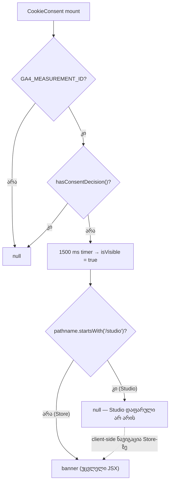

# Studio M4 — cookie banner Studio-ს აღარ ფარავს

**თარიღი:** 2026-10-26
**სტატუსი:** Completed
**შეცვლილი პროექტი:** Store

## კონტექსტი

- VISUAL-A-OBSIDIAN-ის რიგში M3-ის შემდეგ M4 მოდის (`visual-direction-a.md` §M, დამტკიცებულია 2026-10-21, `approved_moves.M4`): „`/studio-lab`-ზე cookie banner ქვედა პანელს აღარ ფარავს. მიზეზი: მუშაობაში ხელს უშლის. შედეგი: Store-ის ქცევა, ცალკე ფაილი.“ B-ის გადაწყვეტილება: D-29z148 (`backlog.json` → VISUAL-A-OBSIDIAN `m4_plan_d29z148`). M4 ბოლო დამტკიცებული M-ია; M5 `awaiting_user`-ია.
- **B-ის HEAD probe** (`tmp/studio-real-loop/b-round-182/out/banner-head.json`): სუფთა `f22290f` ასლი :5175-ზე, `VITE_GA4_MEASUREMENT_ID=G-B183PROBE`-ით. ჩატვირთვიდან 1.5 s-ის შემდეგ banner `/studio-lab`-ზე `position: fixed`-ია, **(0, 832) 1440×68** (1440×900) და **(0, 652) 1280×68** (1280×720). ის ფარავს Studio-ს status line-ს („Demo collection ready. Choose a track…“, `aria-live`) და keyboard-shortcut hint bar-ს. `/`-ზე rect იგივეა.
- საერთო :5173 სერვერზე banner არასდროს ჩანს: cloud-ში `.env` არ არის, `GA4_MEASUREMENT_ID` ცარიელია და `CookieConsent` ადრე ბრუნდება. ამიტომ C-ს GA env-იანი საკუთარი სერვერები სჭირდება.
- `app/root.tsx` გლობალურად აკრძალულია და byte-identical რჩება. route-ის შემოწმება კომპონენტის შიგნით ხდება.

## მიდგომა

- **L1:** `CookieConsent.tsx`-ს დაემატა `useLocation` import `@remix-run/react`-დან (Biome-ის import order).
- **L2:** `CookieConsent()`-ის დასაწყისში, ნებისმიერ `return`-მდე: `const { pathname } = useLocation();` და `const isStudioRoute = pathname.startsWith('/studio');`. hook-ები უპირობოა და რიგი უცვლელია.
- **L3:** `if (!isVisible) return null;` → `if (!isVisible || isStudioRoute) return null;`.
- Store route-ებზე ყველაფერი უცვლელია: JSX, ყველა class string, inline `style`, 1500 ms timer, `handleAccept` / `handleDecline`, `fbq` გამოძახებები, ქართული header კომენტარი და `GA4_MEASUREMENT_ID` / `hasConsentDecision` early exit-ები. ფაილის არსებული ხარვეზები (მაგ. inline rgba gradient) M4-ის ფარგლებს გარეთაა და შეგნებულად არ შეცვლილა.
- **R44 — დამალვა და არა გადატანა.** `/studio*`-ზე banner არაფერს არენდერებს. VISUAL-A Studio-ში layout-ის გადაადგილებას კრძალავს. ნებისმიერი fixed overlay Studio-ს რაღაც ზედაპირს ფარავს: ქვედა ზოლი status line-სა და hint-ს, კუთხის ბარათი lane-ებს ან detail panel-ს, ზედა ზოლი transport-ს.
- **R45 — Studio-ში ჩამნაცვლებელი consent UI ამ რაუნდში არ არის.** M4 გადაწყვეტილებამდე tracking-ის მდგომარეობას არ ცვლის. ნებისმიერ click-მდე Studio-ში ვიზიტი ისეთივეა, როგორიც ყველა Store გვერდზე: `root.tsx` gtag-ს consent default `denied`-ით ტვირთავს `analytics_storage`, `ad_storage`, `ad_user_data` და `ad_personalization`-ისთვის (GDPR: default-denied), ხოლო Facebook Pixel-ზე ჯერ `fbq('consent', 'revoke')` სრულდება. Consent Mode-მა შეიძლება cookieless ping-ები გაგზავნოს, მაგრამ analytics cookie-ები ან identifier-ები არ ინახება. კითხვა შემდეგ Store გვერდზე ჩნდება: timer გრძელდება, `isVisible` true ხდება და banner მაშინვე ჩანს, როგორც კი route `/studio*` აღარ არის. Studio-ში consent-ის საკუთარი შესასვლელი ახალი ქცევა იქნებოდა და Saba-ს დამტკიცებას საჭიროებს.
- **R46 — predicate არის `pathname.startsWith('/studio')`.** ის `root.tsx`-ის `isStudioPage`-ის იდენტურია, ამიტომ `/studio-lab` და `/studio/:productId` ერთნაირად იქცევა.
- ახალი prop, context ან export არ დამატებულა. `root.tsx`, `analytics.ts`, `components/common/index.ts`, Studio კომპონენტები და `app/styles/` უცვლელია.

## არქიტექტურა

## შეცვლილი ფაილები

- `app/components/common/CookieConsent.tsx`: L1–L3 (`useLocation`, `isStudioRoute`, early return).
- `app/components/common/__tests__/CookieConsent.test.tsx`: ახალი ტესტის ფაილი, CC1–CC5.
- `docs/implementation/2026/quarter-IV/150-studio-m3-library-row-spacing.md`: სტატუსი Completed, TODO შესრულებულად მონიშნულია (C round 182 PASS, `f22290f`), შემდეგი ნაბიჯი განახლდა.
- ეს doc.

## პრობლემები და გადაწყვეტები

- **Problem:** `vi.mock` factory-ები hoist-დება `const` გამოცხადებების ზემოთ, ამიტომ მართვადი mock-ები TDZ-ში მოხვდებოდა. → **Solution:** `vi.hoisted`-ით შექმნილი `analyticsMock` / `locationMock` ობიექტები. `useLocation` და `hasConsentDecision` მათ ყოველ render-ზე კითხულობს.
- **Problem:** პროექტში `@testing-library/jest-dom` არ არის. → **Solution:** სიცარიელე მოწმდება `container.innerHTML === ''`-ით, ხოლო არსებობა `getByRole(...)`-ით (`not.toBeNull()`).
- **Problem:** jsdom-ს layout არ აქვს, ამიტომ banner-ის rect და Store-ის ვიზუალური უცვლელობა unit ტესტში ვერ გაიზომება. → **Solution:** CC1 banner root-ის ზუსტ class string-ს ბლოკავს (C-ის Store screenshot-ის ჩამნაცვლებელი lock). პიქსელები და rect-ები C-ის ბრაუზერის row-ებია (BANNER-STORE-M4, BANNER-STUDIO-M4).

## ტესტირება

- **CC1:** `/` — 1500 ms-მდე არაფერი ჩანს; შემდეგ Accept და Decline ჩანს, root class = `fixed bottom-0 left-0 right-0 z-50 p-4 animate-slide-up`.
- **CC2:** `/studio-lab` — 1500 ms-ზე და 5000 ms-ზე `container` ცარიელია.
- **CC3:** `/studio/middle-east` — 1500 ms-ზე არაფერი ჩანს.
- **CC4:** `/studio-lab`, 1500 ms, ცარიელი; შემდეგ rerender `/products`-ით — banner ჩანს **დამატებითი timer advance-ის გარეშე** (R45), consent გამოძახება არ ყოფილა.
- **CC4b** (code-reviewer-ის რჩევით დამატებული): `/`-ზე ხილული banner, შემდეგ rerender `/studio-lab`-ით — `container` ცარიელია, consent გამოძახება არ ყოფილა.
- **CC5:** `/`-ზე Accept → `setAnalyticsConsent(true)` ერთხელ, banner ქრება; Decline → `false` ერთხელ; `hasConsentDecision` true → `/`-ზე არაფერი ჩანს.
- ტესტები role-ით ან ტექსტით ეძებს; ფერის class-ის selector არ გამოიყენება (გარდა CC1-ის root class lock-ისა).
- **Mutation-ები m308–m311** (`tmp/studio-real-loop/a-round-183/mutations/`): m308 `|| isStudioRoute`-ის მოხსნა; m309 `startsWith('/studio')` → `=== '/studio-lab'`; m310 `isStudioRoute` → `!isStudioRoute`; m311 root class `bottom-0` → `top-0`. შედეგები და red/green სიმრავლეები `tmp/studio-real-loop/a-round-183.md`-შია.
- ბრაუზერის row-ები (BANNER-STUDIO-M4, BANNER-STORE-M4, NAV-M4, STUDIO-RV-M4, M3-NEIGHBOUR, G183-3, PX-NET / REG-HYD) C-ს ეკუთვნის, round 183.

### Ableton-ის წყარო

| ქცევა | წყარო | იქ დადასტურებული | CZABA-ს გადაწყვეტილება | შესაბამისობა |
|---|---|---|---|---|
| cookie consent banner workspace-ის შიგნით | **არ არის.** Ableton Live desktop აპლიკაციაა და ვებ cookie banner არ აქვს. | არაფერი. | მომხმარებლის მიერ დამტკიცებული CZABA-ს ნაბიჯი (M4, 2026-10-21), R44–R46. | არ ეხება (C: BANNER-STUDIO-M4) |

## TODO / შემდეგი ნაბიჯები

- ~~C round 183-ის ბრაუზერის მტკიცებულება (BANNER-STUDIO-M4, BANNER-STORE-M4, NAV-M4, STUDIO-RV-M4); შემდეგ სტატუსი → Completed.~~ შესრულდა: C round 183 PASS, გამოქვეყნდა `423fbc4`.
- Saba-ს შეუძლია R44/R45-ის veto. Studio-ში consent-ის საკუთარი შესასვლელი ახალი ქცევაა და მისი დამტკიცების გარეშე არ კეთდება.
- შემდეგი: ROOT-RECON-GRID-HARNESS (round 184), შემდეგ REGRESSION round.
