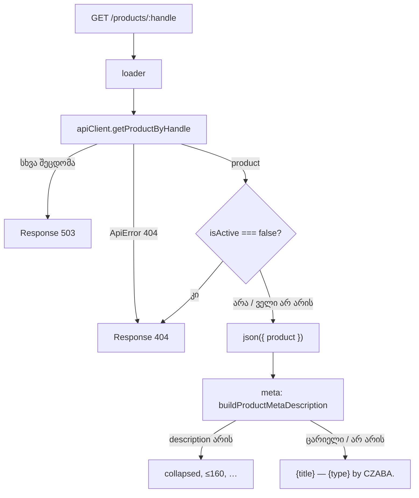

# Store — პროდუქტის გვერდისა და მთავარი გვერდის სამი ბაგი (STORE-1a)

**თარიღი:** 2026-10-26
**სტატუსი:** Completed
**შეცვლილი პროექტი:** Store

## კონტექსტი

- **წყარო:** Store redesign-ის STORE-1 („bugs and quick wins“, `docs/technical/store-redesign/store-redesign-spec.md`). B-ის გადაწყვეტილებით (D-29z151) STORE-1 ოთხ მცირე რაუნდად დაიყო: 1a–1d. ეს დოკუმენტი მხოლოდ 1a-ს ეხება.
- **C-R185-02 (Low):** `/products/archived-rain` პროდუქტი mock-ში `isActive: false`-ია. სიებში (`_index.tsx`, `store.tsx`) ის აღარ ჩანს, მაგრამ პირდაპირი URL მაინც ხსნიდა გვერდს „TOTAL PRICE $0.00 USD“-ით და მოქმედი Add to Cart / Buy Now ღილაკებით. მიზეზი: `products.$handle.tsx`-ის loader `isActive`-ს არ ამოწმებდა.
- **C-R185-01 (Low):** მთავარ გვერდზე SpecialOffers სექციის Gift Cards ბარათი ფონურ სურათს `images.unsplash.com`-დან ტვირთავდა, აკრძალული remote host-იდან. repo-ში უკვე იყო `public/images/gift-card.png` (1024×1024, CZABA-ს gift card), რომელსაც არცერთი კომპონენტი არ იყენებდა.
- **Meta template:** პროდუქტის გვერდის `description`, `og:description` და `twitter:description` ყველა პროდუქტზე ერთ შაბლონურ ტექსტს აჩვენებდა („Professional … pack … Studio-quality audio with complete creative freedom“). ის `product.description`-ს არ იყენებდა და მონაცემებით დაუდასტურებელ მტკიცებებს შეიცავდა.

## მიდგომა

- **K1 — inactive პროდუქტი = 404 (R52).** loader-ში `getProductByHandle`-ის წარმატების შემდეგ, თუ `product.isActive === false`, იგივე `Response('Product not found', { status: 404 })` იგდება, რასაც API-ის 404 იძლევა. შემოწმება `try`-ის გარეთაა, ამიტომ `catch` ამ 404-ს 503-ად ვერ გადააქცევს. უარს მხოლოდ მკაცრი `false` იღებს: `true` ან ველის არქონა გვერდს ძველებურად ხსნის. API 404 → 404 და სხვა შეცდომა → 503 უცვლელია.
  - **ალტერნატივა, რომელიც უარყოფილია:** ცალკე „unavailable“ გვერდი. სიები პროდუქტს უკვე მალავს, ხოლო მყიდველს წვდომა `/account/downloads`-ითა და Studio route-ით რჩება, ამიტომ 404 ყველაზე მცირე და გულწრფელი ქცევაა. რეალური backend-ის პასუხი inactive handle-ზე უცნობია და BACKEND-ONLY-EVIDENCE-ში რჩება.
- **K2 — meta description მონაცემებიდან (R54).** route ფაილის შიგნით არის module-local helper `buildProductMetaDescription`, რომლის export არ ხდება. ის `product.description`-ში whitespace-ს აერთიანებს და კიდეებს აჭრის. თუ ტექსტი 160 სიმბოლოზე გრძელია, ჭრის ბოლო space-თან, რომლის index ≤ 159-ია, და უმატებს `…`-ს. ასე დარჩენილი ტექსტი ≤ 159 სიმბოლოა და შედეგი ≤ 160. space-ის არქონისას ჭრის ზუსტად 159 სიმბოლოზე. „character 159“ ასე, index-ად, წავიკითხეთ: ის hard-cut-ის 159-ს ემთხვევა და მთლიან სიტყვას ტყუილად არ აგდებს. ეს B-ს შეუძლია შეცვალოს (code-reviewer-ის შენიშვნა). ცარიელი ან არარსებული description-ისას გამოიყენება ფაქტობრივი fallback: „{title} — {Music | Presets | Sound Effects} by CZABA.“ იგივე სტრიქონი სამივე description tag-ში მიდის. title, image, `og:type`, `product:*` და not-found branch უცვლელია.
- **K3 — ადგილობრივი gift card სურათი (R53).** Gift Cards ბარათის ``-ში `src` გახდა `/images/gift-card.png`. დაემატა `loading="lazy"` და `decoding="async"`, რადგან სექცია fold-ის ქვემოთაა და PNG 1.1 MB-ია. SpecialOffers Saba-ს keep-list-შია, ამიტომ ტექსტი, ბმული, კლასები, overlay და მეორე ბარათი byte-identical დარჩა. სექციის restyle STORE-2-ის საქმეა.

## არქიტექტურა

## შეცვლილი ფაილები

- `app/routes/products.$handle.tsx`: loader-ში inactive პროდუქტის 404 (K1) და meta description helper (K2).
- `app/components/home/SpecialOffersSection.tsx`: Gift Cards ბარათის ერთი `` ელემენტი (K3).
- `app/lib/__tests__/product-handle-route.test.tsx` (ახალი): loader-ისა და meta-ს რეგრესიული ტესტები (L1–L3, M1–M5).
- `docs/implementation/2026/quarter-IV/153-store-1a-product-page-bugs.md` (ახალი): ეს დოკუმენტი.

## პრობლემები და გადაწყვეტები

- **პრობლემა:** loader-ის `catch` ყველა არა-`ApiError(404)` შეცდომას 503-ად აქცევს. inactive შემოწმება `try`-ის შიგნით 404-ს 503-ად გადააქცევდა.
  **გადაწყვეტა:** `product` გამოცხადდა `try`-ის წინ, ხოლო შემოწმება და `json` მის შემდეგ შესრულდა. ეს mutation-ით დამოწმდა: შემოწმება `try`-ში გადატანისას L1 წითლდება.
- **პრობლემა:** `meta(...)`-ის ტესტში type assertion აკრძალულია.
  **გადაწყვეტა:** ტესტი აგებს სრულ `MetaArgs<typeof loader>` ობიექტს (`data`, `params`, `location`, `matches`), ხოლო descriptor-ებს კითხულობს `in`-narrowing-ით.
- **პრობლემა:** ტესტის „start copy“-ზე გაშვება repo-ში ფაილის შექმნის გარეშე.
  **გადაწყვეტა:** loop-ის საქაღალდეში ცალკე vitest config, რომელიც `~/routes/products.$handle`-ს alias-ით start copy-ზე ან scratch mutant-ზე მიმართავს. repo-ში დამატებითი ფაილი არ შექმნილა.
- **პრობლემა:** პროდუქტის `description` backend-ზე ცარიელი, მხოლოდ whitespace ან runtime-ში `null` შეიძლება იყოს.
  **გადაწყვეტა:** `?? ''` და whitespace-ის გაერთიანების შემდეგ ცარიელი ტექსტი fallback-ზე გადადის (M3, `null`-ის შემთხვევის ჩათვლით).
- **პრობლემა:** code-reviewer-მა აღმოაჩინა, რომ პირველ ვერსიაში space index 159-ზე არ ჩანდა (`slice(0, 159)`-ის შემდეგ `lastIndexOf`), ხოლო M2 `indexOf`-ის mutant-ს ვერ იჭერდა.
  **გადაწყვეტა:** `collapsed.lastIndexOf(' ', 159)`. დაემატა ზღვრული შემთხვევები (space 158, 159 და 160 index-ზე, 161 სიმბოლო), M2-ში კი შემოწმება, რომ შემდეგი სიტყვა ლიმიტს სცდება.

## ტესტირება

- `npx vitest run` სამ ფაილზე (`product-handle-route`, `product-presentation`, `product-utils`): 3 ფაილი, 53 ტესტი PASS. ახალ ფაილში 12 ტესტია.
- **წითელი გაშვება start copy-ზე:** 12-დან 8 წითელია: L1, M1, M2 (ოთხივე შემთხვევა), M3 და M5. L2, L3 და M4 ძველი ქცევის შენარჩუნებას ამოწმებს, ამიტომ თითოეული one-line mutant-ით წითლდება: `!product.isActive`, `404→400`, `503→500`, შემოწმება `try`-ში, whitespace-ის გაერთიანების მოხსნა, word-cut-ის მოხსნა, `indexOf` `lastIndexOf`-ის ნაცვლად, ზღვარი 158 და 160, `og:type` და `og:image` fallback. 11-ვე mutant ერთ ან ორ ტესტს აწითლებს.
- `npm run typecheck` და `npm run lint` exit 0. Biome check სამ code ფაილზე: 0 error.
- **SSR mock-ით (:5199) და dev server-ით (:5173):** `/products/archived-rain` → 404, mock-მა კი 200 დააბრუნა, ანუ უარი store-მა თქვა. `/products/middle-east` და `/products/door-slams` → 200. სამი პროდუქტის description tag-ები fixture-ის `description`-ს ემთხვევა. `/`-ზე `images.unsplash.com` 0-ჯერ გვხვდება.
- **Playwright Chromium, 1440×900:** Gift Cards `img`: `currentSrc` = `/images/gift-card.png`, `complete`, `naturalWidth` 1024. remote request-ები მხოლოდ Google Fonts-ისაა. pageerror 0. hydration-ის შემდეგ meta იგივეა.
- C-ის დამოუკიდებელმა ბრაუზერის შემოწმებამ (რაუნდი 186) PASS აჩვენა (`c-round-186.md`, browserVerified), root-მა კი ცვლილება `cc207d6` commit-ით გამოაქვეყნა.

## TODO / შემდეგი ნაბიჯები

- **STORE-1b:** AudioPlayer-ის progress/volume fill (`var(--color-primary)` → `var(--color-brand)`) და `AudioPreviewButton`-ის SSR/CSR განსხვავება.
- **STORE-1c:** D15 header, ორმაგი h1 და footer-ის „Czaba Music“.
- **STORE-1d:** D10 entrance loader: მაქსიმუმ 1.2 s, გამოტოვებადი, სესიაში ერთხელ, `prefers-reduced-motion`-ზე გამორთული.
- რეალური backend-ის პასუხი inactive handle-ზე: BACKEND-ONLY-EVIDENCE.
- `ArtistBioSection.tsx`-ში ჯერ კიდევ არის unsplash URL, მაგრამ მას არცერთი route არ იყენებს (info, ამ რაუნდში არ შეცვლილა).
