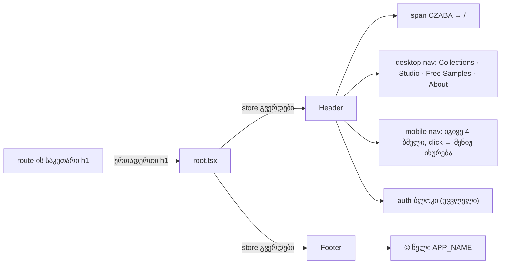

# Store — D15 header, ერთი h1 გვერდზე, უბრალო wordmark და footer-ის სახელი (STORE-1c)

**თარიღი:** 2026-10-26
**სტატუსი:** Completed
**შეცვლილი პროექტი:** Store

## კონტექსტი

Store redesign-ის STORE-1 ეტაპის მესამე ნაწილი (spec-ის STORE-1 სტრიქონი და `direction-decision.md`, მიმართულება A). დასაწყისში (`cb24362`) store-ის header-ს ოთხი პრობლემა ჰქონდა:

- **ნავიგაცია D15-ს არ ემთხვეოდა.** header-ში იყო Store, Gift Cards, Free Samples, About, Hire Us და „Studio Lab“ „Demo“ badge-ით. დამტკიცებული რიგია: Collections · Studio · Free Samples · About, შემდეგ Sign in და კალათა.
- **ორი h1 ყველა store გვერდზე.** თითო route-ს საკუთარი h1 აქვს, header-ის wordmark კი მეორე h1 იყო. SSR-ში `/`, `/store`, `/products/middle-east` და `/about` თითოეულზე 2 `<h1` დაითვალა.
- **gradient wordmark.** wordmark `.text-glow`-ს იყენებდა (`--gradient-text` clip, `-webkit-text-fill-color: transparent`).
- **footer-ში სხვა სახელი.** copyright ხაზი „Czaba Music“-ს წერდა, ფაილში კი `APP_NAME = 'CZABA'` უკვე არსებობდა.

## მიდგომა

ცვლილება მინიმალურია: ოთხი არსებული ფაილი იცვლება და ემატება ორი ახალი (ტესტი და ეს დოკუმენტი). header-ის ავტორიზაციის ბლოკი (skeleton, user menu, Sign In, account links, Logout), კალათა, `CommandPalette` და toggle ღილაკი byte-identical დარჩა.

- **Desktop და mobile ნავიგაცია:** ორივე სიაში ზუსტად ოთხი ბმულია ერთი რიგით და ერთი href-ით: Collections → `/store`, Studio → `/studio-lab`, Free Samples → `/free-downloads`, About → `/about`. არსებული `getNavLinkClass` / `getMobLinkClass`, `prefetch="intent"` და mobile-ის `onClick` მენიუს დახურვა შენარჩუნდა. Studio ბმულს `whitespace-nowrap` მოეხსნა, რადგან ის ერთი სიტყვაა.
- **Wordmark:** h1 შეიცვალა `span`-ით (`block text-2xl font-extrabold tracking-tighter text-foreground`). `block` ინარჩუნებს header-ის სიმაღლეს, `text-foreground` არსებული token-ია. `.text-glow` `app.css`-ში არ შეცვლილა (`app/styles/**` frozen-ია).
- **Footer:** copyright ხაზი იყენებს `APP_NAME`-ს. Footer-ის layout და ბმულები (მათ შორის Gift Cards და Hire Us) უცვლელია.
- **e2e:** `navigation.spec.ts`-ის `navLinks` მასივი ახალ ოთხ ბმულზე გადავიდა. სხვა ხაზი არ შეცვლილა.

### გადაწყვეტილებები (Saba-ს შეუძლია უარყოს)

- **R56: „Collections“ მიდის `/store`-ზე.** `/collections` route არ არსებობს, ხოლო სეზონური ან დანომრილი კოლექციები (D14) მოგვიანებით ბიზნეს-გადაწყვეტილებაა. უარყოფილი ალტერნატივები: ახალი `/collections` route (სტრუქტურას იგონებს) და „Store“ სახელის დატოვება (დამტკიცებულ D15-ს უგულებელყოფს).
- **R57: Gift Cards და Hire Us მხოლოდ header-იდან ქრება.** Footer უკვე შეიცავს ორივე ბმულს, ამიტომ „footer-ში გადატანა“ footer-ის ცვლილებას არ საჭიროებს. მათი route-ები, CommandPalette-ის ძებნის ჩანაწერი და SpecialOffers-ის „Browse Gift Cards“ ბმული რჩება. არც ერთი გვერდი Saba-ს keep-list-ში არ არის. **Free Samples keep-list-შია** და ორივე header სიაში რჩება.
- **R58: footer იყენებს `APP_NAME`-ს („CZABA“).** `ableton-export.ts`-ის „Czaba Music Store“ Studio export-ის metadata-ა და ამ ეტაპის ფარგლებს გარეთაა.
- **R59: wordmark არის non-heading `span` უბრალო `text-foreground` ფერით.** ბმულის accessible name რჩება „CZABA“, `href="/"`. თითო გვერდის საკუთარი h1 ხდება ერთადერთი. font და ზომა არ შეცვლილა; typography STORE-2-ს ეკუთვნის.
- **R60: „Sign In“-ის რეგისტრი უცვლელია.** spec წერს „Sign in“, მაგრამ ეს typography-ა და ღილაკი ავტორიზაციის ბლოკშია, რომელიც ამ რაუნდში byte-identical რჩება. Owner: STORE-2.

## არქიტექტურა

`/studio*` გვერდებზე header არ რენდერდება (`root.tsx`), ამიტომ Studio-ს ვიზუალი ამ ცვლილებით არ იცვლება.

## შეცვლილი ფაილები

- `app/components/layout/Header.tsx` — D15 ნავიგაცია desktop-სა და mobile-ზე, wordmark-ის h1 → span.
- `app/components/layout/Footer.tsx` — copyright ხაზი `APP_NAME`-ით (ერთი ხაზი).
- `e2e/navigation.spec.ts` — `navLinks` მასივი.
- `docs/implementation/2026/quarter-IV/154-store-1b-audio-preview-player.md` — სტატუსი Completed და C round 187-ის შედეგი (ორი ხაზი).
- **ახალი:** `app/lib/__tests__/store-header-footer.test.tsx` — header-ისა და footer-ის რეგრესიის ტესტები.
- **ახალი:** ეს დოკუმენტი.

## პრობლემები და გადაწყვეტები

- **პრობლემა:** e2e-ის ძველი სია Gift Cards-სა და Hire Us-ს `isVisible()` guard-ით ამოწმებდა, ამიტომ ცვლილების შემდეგ ჩუმად გამოტოვებდა მათ. **გადაწყვეტა (ნაწილობრივი):** სია ზუსტად ახალ ოთხ ბმულზე გადავიდა, ამიტომ ამოღებულ ბმულებს აღარ ეძებს. თავად `isVisible()` guard და ბმულის ტექსტის შეუმოწმებლობა რჩება (დავალება მხოლოდ მასივის შეცვლას უშვებდა); ეს სიგნალად ჩაიწერა TODO-ში.
- **პრობლემა:** desktop და mobile ნავიგაცია ორივე DOM-შია, ამიტომ ტექსტით ძებნა ორ ელემენტს პოულობს. **გადაწყვეტა:** ტესტი პირველ და მეორე `nav`-ს ცალ-ცალკე ამოწმებს; mobile „Studio“-ზე click მეორე `nav`-ის შიგნით ხდება.
- **პრობლემა:** Remix-ის `Link` `prefetch="intent"`-ით focus/hover-ზე `PrefetchPageLinks`-ს რენდერავს, რომელიც Remix context-ს საჭიროებს. **გადაწყვეტა:** ტესტში მხოლოდ `fireEvent.click` გამოიყენება (focus/hover-ის გარეშე), `MemoryRouter`-ით, როგორც round 187-ში. ახალი package არ დამატებულა.
- **პრობლემა:** Biome-ის formatter-მა wordmark-ის ერთი ხაზი სამ ხაზად გადაიტანა (lineWidth 100). **გადაწყვეტა:** მხოლოდ ეს ხაზი გასწორდა ხელით; ავტორიზაციის ბლოკი არ გადაფორმატებულა.

## ტესტირება

- **T1 (`store-header-footer.test.tsx`, 9 ტესტი):** N1 desktop inventory, N2 mobile inventory და მენიუს დახურვა Studio click-ზე, N3 header-ში 0 heading / წაშლილი ბმულები / `text-glow` არ არის და wordmark-ის accessible name „CZABA“-ა, N4 `/store`-ზე Collections-ის active underline, N5 ავტორიზაციის ბლოკი (anonymous Sign In → `openModal('signin')`, authenticated „Hi, Ana!“ + Logout → `signOut`, initializing skeleton), S1 SSR-ში `<h1` და `text-glow` არ არის, F1 footer-ის `© {წელი} CZABA. All rights reserved.` და Gift Cards / Hire Us ბმულები.
- **წითელი start კოდზე:** N1, N2, N3, N4, S1 და F1 ჩავარდა, N5-ის სამივე ტესტი მწვანე დარჩა. ცვლილების შემდეგ 9/9 მწვანეა.
- `npm run typecheck` და `npm run lint` exit 0. Biome სამ code ფაილზე: 0 error, 6 წინასწარ არსებული `useButtonType` warning უცვლელ ავტორიზაციის ბლოკში. `e2e/` Biome-ის `includes`-ში არ შედის.
- **SSR (mock :5199, dev server :5173):** `<h1` რაოდენობა `/`, `/store`, `/products/middle-east` და `/about`-ზე 2-დან 1-მდე შემცირდა; `/free-downloads`, `/gift-cards`, `/hire-us` და 404 URL-ზეც 1-ია. მთავარ გვერდზე „Czaba Music“ 0-ჯერ და `Studio Lab</a` 0-ჯერ გვხვდება.
- **Playwright Chromium, 1440×900, `/store`:** header-ის სიმაღლე 80.97 px (ცვლილებამდეც 80.97 px), wordmark 32 px. wordmark-ის `-webkit-text-fill-color` `rgb(238, 239, 241)` (ადრე `transparent`), `background-image: none`, ფერი ემთხვევა `text-foreground` token-ს. nav inventory ორივე სიაში ოთხი ბმულია. pageerror 0, console error 0, remote host-ები მხოლოდ Google Fonts, Authorization header 0.
- C-ის დამოუკიდებელი ბრაუზერის შემოწმება (რაუნდი 188): PASS (`c-round-188.md`, browserVerified), გამოქვეყნდა როგორც `850445c`.

## TODO / შემდეგი ნაბიჯები

- **STORE-1d:** D10 entrance loader, C-R187-I1-ით მის acceptance-ში.
- **სიგნალები STORE-2-ისთვის:** header-ის ავტორიზაციის ბლოკში ღილაკებს `type="button"` არ აქვთ, toggle-ს `aria-expanded` აკლია, დახურული mobile მენიუს ბმულები focus-ს იღებს; „Sign In“-ის რეგისტრი (R60); header აღარ იყენებს `.text-glow`-ს, მაგრამ ის კვლავ 10 ადგილას გამოიყენება (მაგ. `_index.tsx`, `about.tsx`, `$.tsx`, `LeadMagnetPopup.tsx` და home სექციები), ამიტომ წაშლა არ შეიძლება მათი გადახედვის გარეშე (STORE-2/5); `ProductCard`-ის preview overlay `Link`-იდან გატანა და slider fill; `ProductCard`-ის განუსაზღვრელი `bg-primary`/`text-primary-foreground` token-ები.
- **სიგნალი:** `e2e/navigation.spec.ts`-ის nav ციკლი ბმულს `isVisible()` guard-ით ამოწმებს და `link.text`-ს არ ადარებს; guard-ის მოხსნა და `toHaveText` შემდეგ დავალებაში.
- **სიგნალი:** `e2e/main-flow.spec.ts` ჯერ კიდევ ამოწმებს `/music`-სა და `/hire-us`-ს header-ში `isVisible()` guard-ით.
