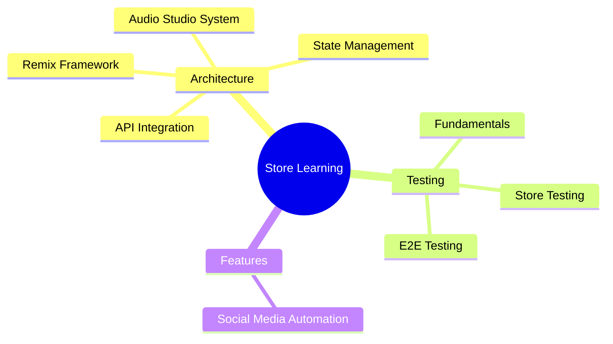
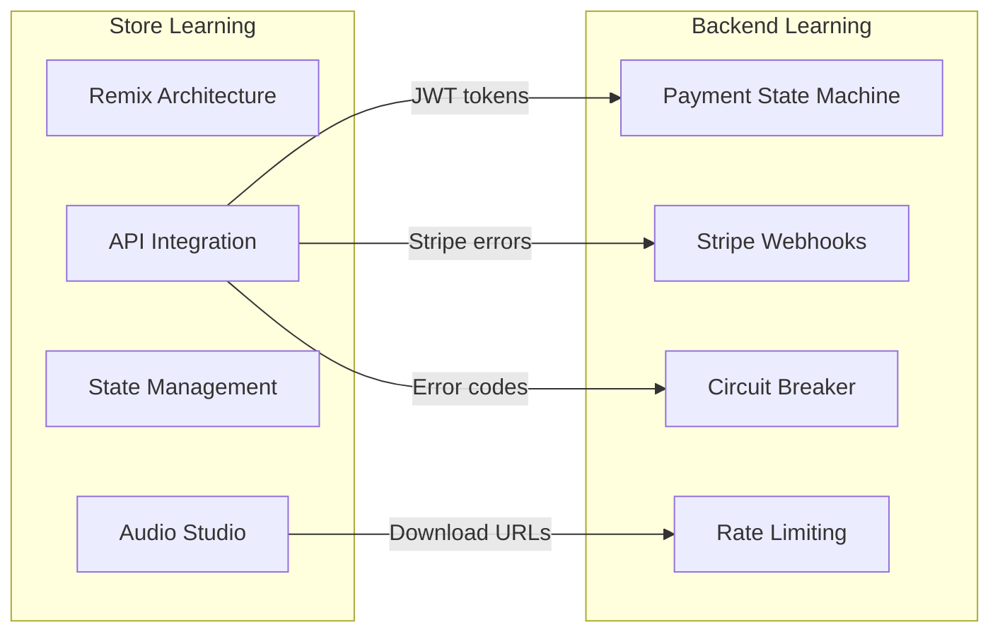

# Store Learning Documentation

Czaba Store-ის frontend არქიტექტურისა და ტექნოლოგიების სასწავლო დოკუმენტაცია.

---

## დოკუმენტაციის რუკა

---

## Tech Stack

| ტექნოლოგია | ვერსია | გამოყენება |
|-------------|--------|-----------|
| **Remix** | v2 | SSR Framework, file-based routing |
| **React** | v19 | UI library, Context API |
| **TypeScript** | strict | ტიპიზაცია |
| **Tailwind CSS** | v4 | CSS-first styling |
| **WaveSurfer.js** | v7 | Waveform ვიზუალიზაცია |
| **Web Audio API** | native | Audio processing, mixing |
| **FFmpeg.wasm** | v0.12 | Client-side audio export |
| **IndexedDB** | native | Audio cache |
| **Firebase** | v10 | Google Sign-In only |

---

## სრული დოკუმენტაციის ცხრილი

### Architecture

| # | დოკუმენტი | თემა | ძირითადი კონცეფციები |
|---|-----------|------|---------------------|
| 01 | [Remix Architecture](./architecture/01-remix-architecture.md) | Remix Framework | SSR/CSR, Loaders, Actions, File-based Routing |
| 02 | [Audio Studio System](./architecture/02-audio-studio-system.md) | 3-Layer Audio | AudioContext, StemsContext, StudioContext, Web Audio API |
| 03 | [State Management](./architecture/03-state-management.md) | React Contexts | 9 Contexts, Provider Hierarchy, Performance |
| 04 | [API Integration](./architecture/04-api-integration.md) | API Client | Token Refresh, Error Handling, Retry Logic |

### Testing

| # | დოკუმენტი | თემა | ძირითადი კონცეფციები |
|---|-----------|------|---------------------|
| 01 | [Fundamentals](./testing/01-fundamentals.md) | ტესტირების საფუძვლები | Unit, Integration, E2E, Mocking |
| 02 | [Store Testing](./testing/02-store-testing.md) | Czaba Store ტესტები | Vitest, React Testing Library, Context Testing |
| 03 | [E2E Testing](./testing/03-e2e-testing.md) | End-to-End | Playwright, User Flows, CI/CD |

### Features

| # | დოკუმენტი | თემა | ძირითადი კონცეფციები |
|---|-----------|------|---------------------|
| 01 | [Social Media Automation](./features/01-social-media-automation.md) | სოციალური მედია | Share Flow, Preview, Platform Integration |

---

## კავშირი Backend Learning-თან

Backend learning docs: [`backend/docs/architecture/learning/`](../../../backend/docs/architecture/learning/README.md)

---

## როგორ წავიკითხოთ

1. **ახალი დეველოპერი** - დაიწყე `architecture/01-remix-architecture.md`-ით
2. **Audio/Studio** - წაიკითხე `architecture/02-audio-studio-system.md`
3. **State management** - `architecture/03-state-management.md` ახსნის 9 Context-ს
4. **API integration** - `architecture/04-api-integration.md` token refresh-ისა და error handling-ისთვის
5. **Testing** - `testing/01-fundamentals.md`-დან დაიწყე

---

## ბოლო განახლება

2026-02-22
