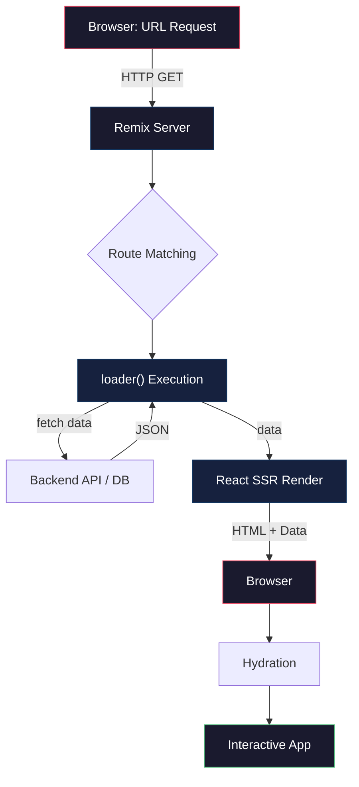
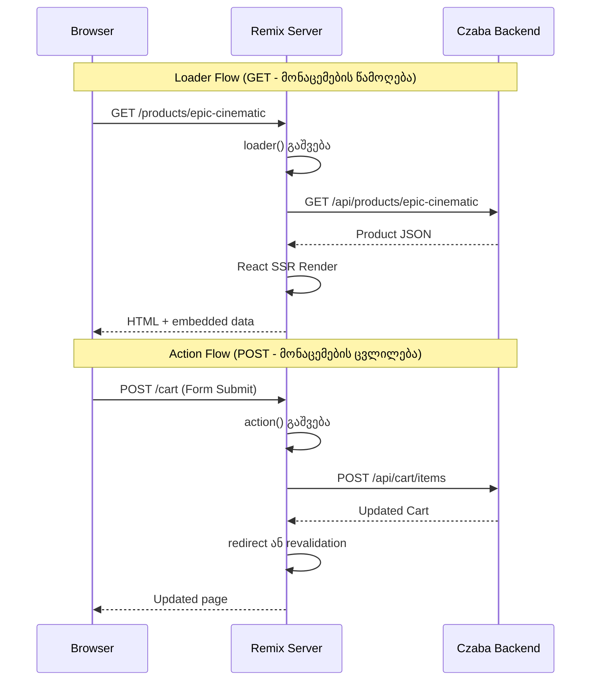
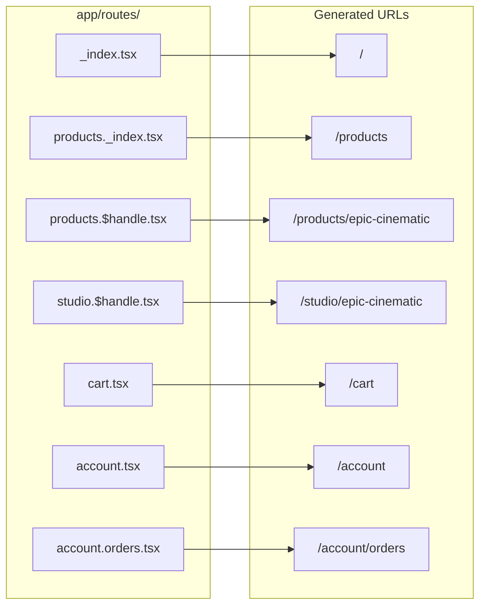
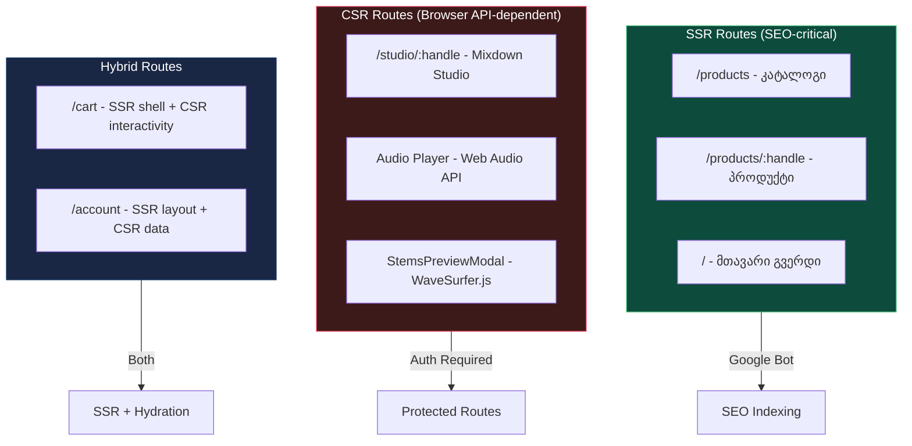
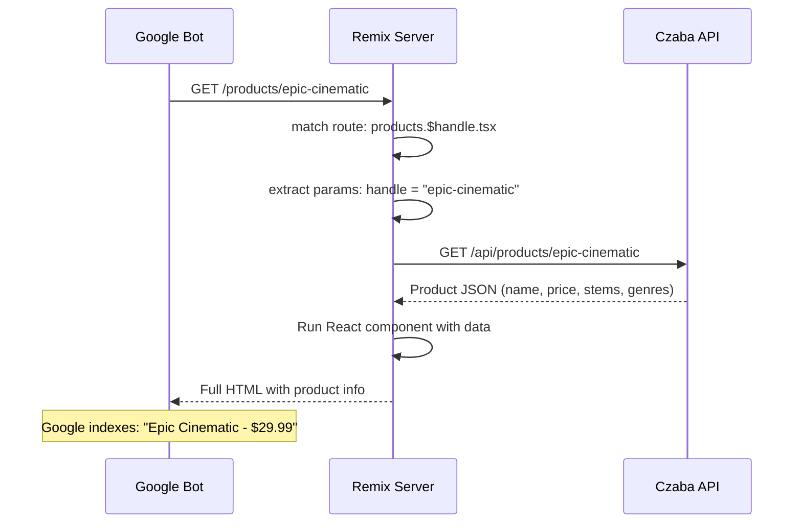
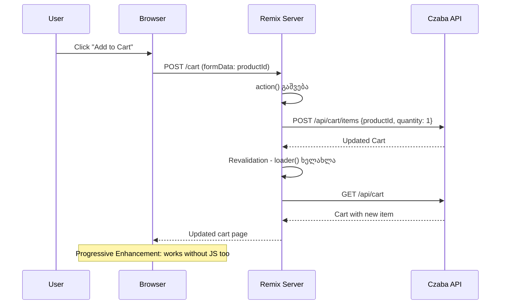

# Remix Architecture - Czaba Store

## წინაპირობები (Prerequisites)

- HTML, CSS, JavaScript საფუძვლები
- React კომპონენტები, hooks, props
- HTTP მეთოდები (GET, POST) და request/response ციკლი
- Node.js-ისა და npm-ის საბაზისო ცოდნა

---

## ტერმინოლოგია

| ტერმინი | განმარტება |
|---------|-----------|
| **SSR (Server-Side Rendering)** | HTML გენერაცია სერვერზე, ბრაუზერამდე მისვლამდე |
| **CSR (Client-Side Rendering)** | HTML გენერაცია ბრაუზერში JavaScript-ით |
| **Hydration** | სერვერზე შექმნილი HTML-ის "გაცოცხლება" ბრაუზერში — event listener-ების მიბმა |
| **Loader** | სერვერის ფუნქცია, რომელიც მონაცემებს აწვდის კომპონენტს render-ის წინ |
| **Action** | სერვერის ფუნქცია, რომელიც form submission-ს ან mutation-ს ამუშავებს |
| **Route Module** | ფაილი `app/routes/`-ში, რომელიც ერთდროულად არის URL, loader, action და კომპონენტი |
| **File-based Routing** | URL-ების ავტომატური გენერაცია ფაილის სახელიდან |
| **Nested Routes** | მშობელ-შვილ route-ების ხისებრი სტრუქტურა |
| **Outlet** | ადგილი მშობელ layout-ში, სადაც შვილი route რენდერდება |
| **Progressive Enhancement** | აპლიკაცია მუშაობს JavaScript-ის გარეშეც, JS ამდიდრებს გამოცდილებას |

---

## პრობლემის აღწერა - რატომ არის ეს საჭირო

Czaba Store არის მუსიკალური პროდუქტების მაღაზია, რომელსაც ორი ფუნდამენტურად განსხვავებული მოთხოვნა აქვს:

**პროდუქტის გვერდები** - SEO-სთვის აუცილებელია სერვერზე რენდერდებოდეს. Google-ის bot-მა უნდა ნახოს პროდუქტის სახელი, აღწერა, ფასი, ჟანრი. თუ ეს მონაცემები მხოლოდ JavaScript-ით ჩაიტვირთება, საძიებო სისტემა ვერ აინდექსებს.

**Personal Mixdown Studio** - მთლიანად client-side აპლიკაციაა. Web Audio API, WaveSurfer.js, IndexedDB - არცერთი მათგანი სერვერზე არ მუშაობს. Studio-ს SEO არ სჭირდება, რადგან მხოლოდ ავტორიზებულ მომხმარებლებს აქვთ წვდომა.

Remix framework ამ ორივე მოთხოვნას ერთ არქიტექტურაში აერთიანებს - SSR იქ სადაც SEO გვჭირდება, CSR იქ სადაც browser API-ები სჭირდება.

---

## ძირითადი კონცეფცია

### Remix Request Lifecycle

Remix-ის მთავარი იდეა: ბრაუზერი და სერვერი ერთი ფაილის ორი მხარეა. Route module-ში `loader` სერვერზე გაეშვება, `default export` კომპონენტი ბრაუზერშიც და სერვერზეც.



### Loader vs Action - მონაცემთა ნაკადი

Loader არის GET request-ების handler - მონაცემების წამოღება. Action არის POST/PUT/DELETE request-ების handler - მონაცემების ცვლილება. ორივე სერვერზე ეშვება.



---

## როგორ მუშაობს - ნაბიჯ-ნაბიჯ

### ნაბიჯი 1: File-based Routing

Remix-ში URL-ების სტრუქტურა ფაილების სახელებით განისაზღვრება. თითოეული ფაილი `app/routes/`-ში ავტომატურად URL ხდება.



`$handle` არის dynamic segment - URL-ის ნაწილი რომელიც ცვლადია. `/products/epic-cinematic`-ში `handle` = `"epic-cinematic"`.

### ნაბიჯი 2: Nested Routes და Layout

Remix-ის nested routing საშუალებას იძლევა მშობელ layout-ში შვილი route ჩაინდოს. მაგალითად, `/account` layout-ს აქვს sidebar ნავიგაცია, და `/account/orders` ამ layout-ში რენდერდება.

```
app/routes/
├── _index.tsx               → / (მთავარი გვერდი)
├── products._index.tsx      → /products (კატალოგი)
├── products.$handle.tsx     → /products/:handle (პროდუქტის გვერდი)
├── studio.$handle.tsx       → /studio/:handle (Personal Mixdown Studio)
├── cart.tsx                 → /cart (კალათა)
├── account.tsx              → /account (layout + sidebar)
└── account.orders.tsx       → /account/orders (account layout-ში)
```

`account.tsx` შეიცავს `<Outlet />`-ს, სადაც `account.orders.tsx` ჩაირენდერება.

### ნაბიჯი 3: SSR vs CSR გადაწყვეტილება Czaba-ში

ყველა route არ საჭიროებს SSR-ს. Czaba-ში მკაფიო დაყოფაა:



**SSR Routes** - loader-ით მონაცემები სერვერზე ჩაიტვირთება, HTML სრულად შეიქმნება. Google bot ნახავს პროდუქტის სახელს, ფასს, აღწერას.

**CSR Routes** - Studio გვერდი `ClientOnly` wrapper-ით ჩაიტვირთება. სერვერი მხოლოდ shell HTML-ს გამოგზავნის, რეალური კონტენტი ბრაუზერში შეიქმნება.

**Hybrid Routes** - Cart-ის shell SSR-ით რენდერდება, მაგრამ ინტერაქტიული ნაწილი (რაოდენობის ცვლილება, წაშლა) hydration-ის შემდეგ ჩაირთვება.

### ნაბიჯი 4: Loader - მონაცემების ჩატვირთვა

Loader ფუნქცია სერვერზე ეშვება ყოველ GET request-ზე. მისი მიზანია მონაცემების მომზადება კომპონენტისთვის.



### ნაბიჯი 5: Action - ფორმის დამუშავება

Action ფუნქცია form-ის submission-ს ამუშავებს. Remix-ში form-ის submit-ი რეალურ HTTP POST request-ს აგზავნის, JavaScript-ით აძლიერებს.



### ნაბიჯი 6: Error Boundaries

Remix-ში ყოველ route-ს შეიძლება ჰქონდეს საკუთარი `ErrorBoundary`. თუ loader-ში ან action-ში შეცდომა მოხდება, მხოლოდ ეს route აჩვენებს შეცდომას - დანარჩენი აპლიკაცია მუშაობს.

```
Root Layout (/root.tsx)
├── Header (მუშაობს)
├── Outlet
│   └── products.$handle.tsx → ErrorBoundary
│       └── "პროდუქტი ვერ მოიძებნა"
└── Footer (მუშაობს)
```

ეს React-ის ErrorBoundary-სგან განსხვავდება - Remix-ის ErrorBoundary loader/action შეცდომებსაც იჭერს, არამარტო render-ის დროინდელს.

---

## Czaba-ში იმპლემენტაცია

### Product Page Loader (SSR)

```tsx
import type { LoaderFunctionArgs } from "@remix-run/node";
import { json } from "@remix-run/node";
import { useLoaderData } from "@remix-run/react";
import { apiClient } from "~/services/api/client";

export async function loader({ params }: LoaderFunctionArgs) {
  const product = await apiClient.getProductByHandle(params.handle!);

  if (!product) {
    throw new Response("Not Found", { status: 404 });
  }

  return json({
    product,
    meta: {
      title: `${product.name} | Czaba`,
      description: product.description,
    },
  });
}

export default function ProductPage() {
  const { product } = useLoaderData<typeof loader>();

  return (
    <div>
      <h1>{product.name}</h1>
      <p>{product.price}</p>
    </div>
  );
}
```

### Studio Page (Client-Only)

```tsx
import { ClientOnly } from "remix-utils/client-only";
import { useParams } from "@remix-run/react";

export default function StudioPage() {
  const { handle } = useParams();

  return (
    <ClientOnly fallback={<StudioSkeleton />}>
      {() => <StudioApp handle={handle!} />}
    </ClientOnly>
  );
}
```

Studio `ClientOnly`-ში არის გახვეული რადგან Web Audio API, WaveSurfer.js და IndexedDB მხოლოდ ბრაუზერში არსებობს. სერვერზე ამ API-ების გამოძახება აფეთქებს აპლიკაციას.

---

## Trade-offs

| გადაწყვეტილება | უპირატესობა | ნაკლოვანება |
|---------------|-------------|-------------|
| **SSR პროდუქტებისთვის** | SEO, სწრაფი First Contentful Paint | სერვერის დატვირთვა ყოველ request-ზე |
| **CSR Studio-სთვის** | Browser API-ები ხელმისაწვდომი | არ ინდექსდება, ცარიელი HTML თავდაპირველად |
| **File-based routing** | ინტუიციური URL სტრუქტურა | რთული dynamic routes-ისთვის |
| **Loader/Action pattern** | სერვერი და UI ერთ ფაილში | სერვერის კოდი შეიძლება bundle-ში მოხვდეს (tree-shaking საჭირო) |
| **Nested routes** | Layout-ების მრავალჯერადი გამოყენება | ღრმა nesting-ი რთულია |
| **Progressive Enhancement** | მუშაობს JS-ის გარეშეც | form-ის state management რთულდება |
| **Remix vs Next.js** | Web standards-ზე დაფუძნებული, მარტივი mental model | ნაკლები ecosystem, ნაკლები third-party library |

---

## დაკავშირებული თემები

- [State Management](./03-state-management.md) - როგორ მართავს Czaba state-ს React Context-ებით
- [API Integration](./04-api-integration.md) - loader-ებიდან და კომპონენტებიდან API-სთან კომუნიკაცია
- [Audio Studio System](./02-audio-studio-system.md) - CSR-only Studio არქიტექტურა
- [Czaba Store CLAUDE.md](../../../CLAUDE.md) - პროექტის ტექნიკური overview

---

## Key Takeaways

- **Remix-ში route module = URL + data loading + UI ერთ ფაილში.** `loader` სერვერზე მუშაობს, კომპონენტი ორივეგან.

- **SSR და CSR არჩევანი content-ის ტიპზეა დამოკიდებული.** Czaba-ში პროდუქტები SSR-ით რენდერდება SEO-სთვის, Studio მთლიანად client-side-ია browser API-ების გამო.

- **File-based routing ავტომატურად ქმნის URL სტრუქტურას.** `products.$handle.tsx` = `/products/:handle`. Dynamic segment-ი `$`-ით იწყება.

- **Progressive Enhancement ნიშნავს რომ form-ები მუშაობს JavaScript-ის გარეშეც.** Remix action-ები რეალურ HTTP POST-ს იყენებს, JS მხოლოდ UX-ს აუმჯობესებს.

- **ErrorBoundary ყოველ route-ს შეიძლება ჰქონდეს.** ერთი route-ის შეცდომა არ კლავს მთელ აპლიკაციას.
