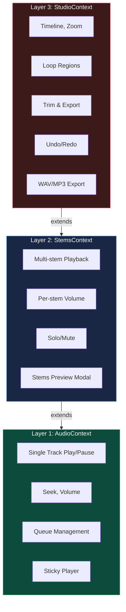
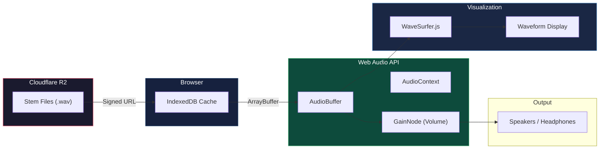
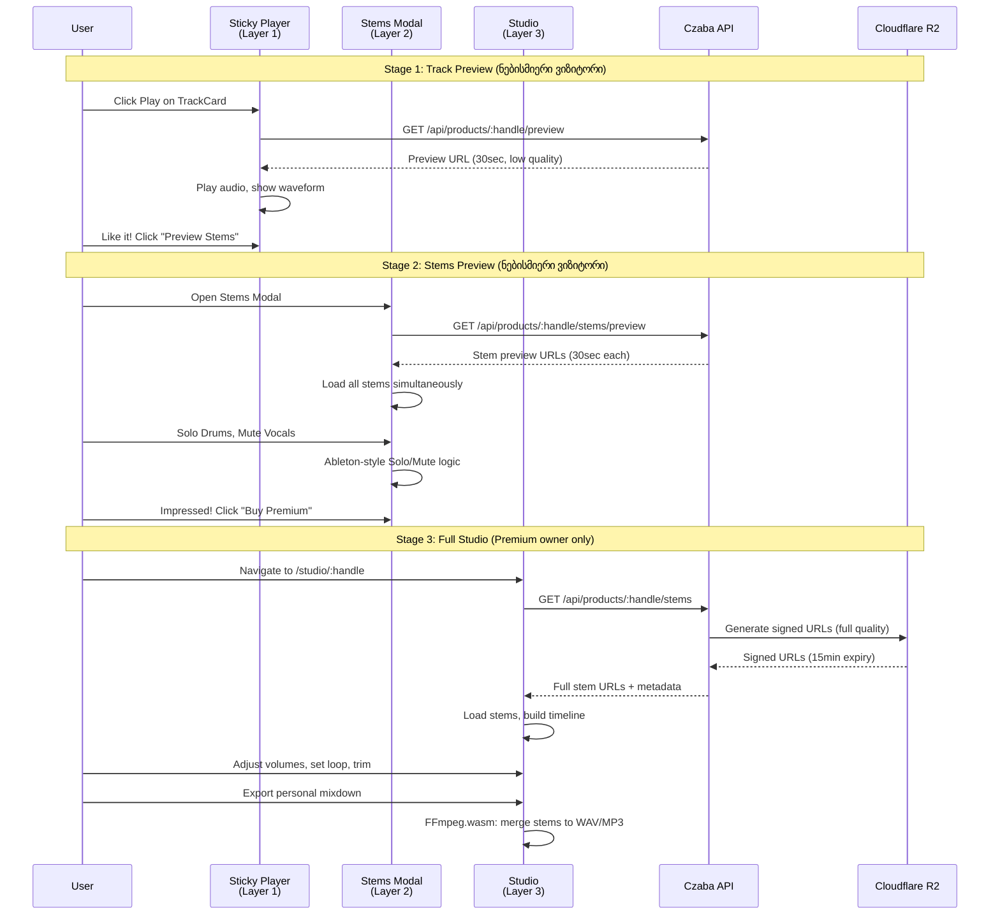
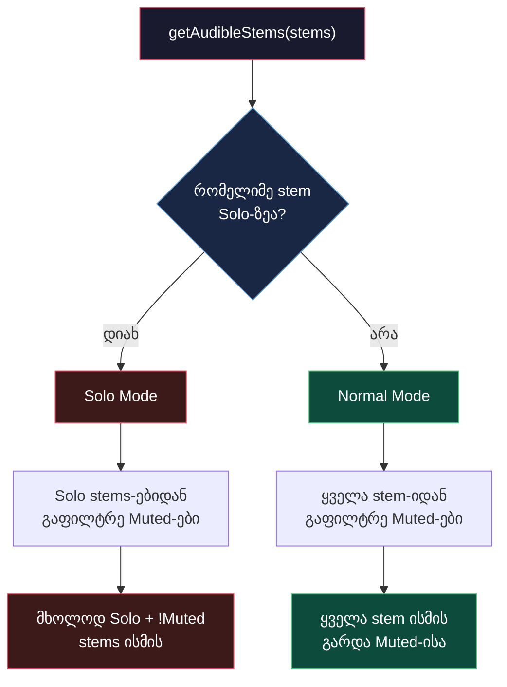
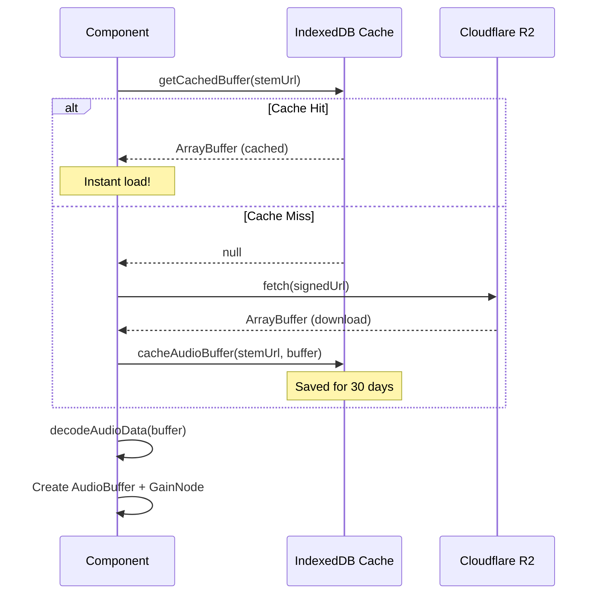
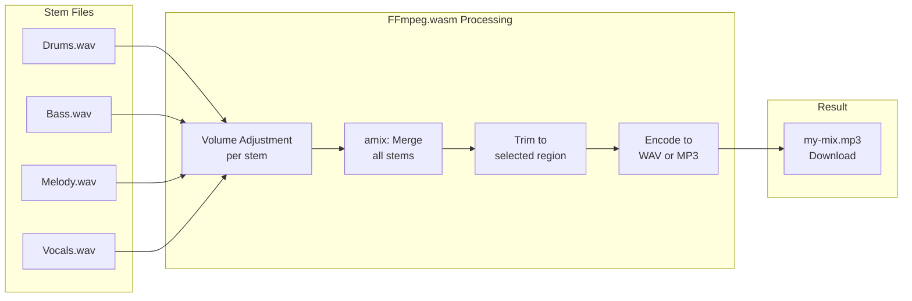

# Audio Studio System - 3-Layer Architecture

## წინაპირობები (Prerequisites)

- React Context API და hooks (useState, useEffect, useCallback, useRef)
- Web Audio API-ის საბაზისო ცოდნა (AudioContext, AudioBuffer, GainNode)
- IndexedDB-ის კონცეფცია (browser-side key-value storage)
- Czaba Store-ის პროდუქტის სტრუქტურა (Track, Stems, Variants)

---

## ტერმინოლოგია

| ტერმინი | განმარტება |
|---------|-----------|
| **Stem** | ტრეკის ერთი აუდიო ფენა (Drums, Bass, Melody, Vocals, FX) |
| **Mixdown** | რამდენიმე stem-ის შერწყმა ერთ ფინალურ ტრეკად |
| **Solo** | ტრეკის იზოლირება - მხოლოდ ეს stem ისმის, დანარჩენი ჩუმდება |
| **Mute** | ტრეკის გაჩუმება - ეს stem არ ისმის |
| **DAW (Digital Audio Workstation)** | აუდიო ფაილების რედაქტორი (Ableton, FL Studio, Logic Pro) |
| **Loop Region** | მონიშნული სეგმენტი რომელიც ციკლურად უკრავს |
| **Trim Region** | ექსპორტისთვის მონიშნული დასაწყისი და დასასრული |
| **WaveSurfer.js** | JavaScript ბიბლიოთეკა waveform-ის ვიზუალიზაციისთვის |
| **Web Audio API** | Browser-ის ჩაშენებული API აუდიო processing-ისთვის |
| **FFmpeg.wasm** | FFmpeg-ის WebAssembly ვერსია, client-side ვიდეო/აუდიო processing |
| **IndexedDB** | Browser-ის ჩაშენებული NoSQL database, დიდი ფაილების შენახვისთვის |
| **AudioBuffer** | Web Audio API-ში decoded აუდიო მონაცემების კონტეინერი |
| **GainNode** | Web Audio API-ში ხმის volume-ის მართვის node |

---

## პრობლემის აღწერა - რატომ არის ეს საჭირო

Czaba Store-ი არის premium cinematic audio assets-ის მაღაზია. მომხმარებელი ყიდულობს მუსიკალურ ტრეკებს ფილმების, თამაშების, რეკლამების და YouTube ვიდეოებისთვის.

**პრობლემა:** მომხმარებელს სურს ტრეკის მორგება საკუთარ პროექტზე. მაგალითად, epic cinematic ტრეკში drums ძალიან ხმამაღლა უკრავს მისი ვიდეოს დიალოგისთვის. ტრადიციული მაღაზია (Epidemic Sound, Artlist) მხოლოდ მზა ტრეკს აძლევს. Czaba-ს **Personal Mixdown Studio** საშუალებას იძლევა:

1. თითოეული stem-ის volume-ის ცვლილება
2. Stem-ების Solo/Mute (Ableton-ის სტილის)
3. Loop region-ით კონკრეტული სექციის მოსმენა
4. Trim-ით საჭირო ნაწილის ამოჭრა
5. WAV/MP3 ექსპორტი პერსონალური mix-ით

ეს არის premium feature - მხოლოდ Premium ვარიანტის მფლობელს აქვს Studio-ზე წვდომა.

**არქიტექტურული გამოწვევა:** აუდიო ფუნქციონალი სამ სხვადასხვა context-ში გამოიყენება: მარტივი preview (ყველგან), stems modal (პროდუქტის გვერდი) და სრული DAW (studio გვერდი). კოდის დუბლირების ნაცვლად, 3-layer სისტემა აწყობილია სადაც ყოველი შემდეგი layer წინას აფართოებს.

---

## ძირითადი კონცეფცია

### 3-Layer Architecture

სისტემა 3 შრისგან შედგება. თითოეული შრე წინა შრის ფუნქციონალს ამდიდრებს ახალი შესაძლებლობებით. ეს არის progression pattern: მარტივიდან რთულისკენ.



**Layer 1 (AudioContext)** - ყველაზე მარტივი. Sticky Player, რომელიც საიტის ნებისმიერ გვერდზე მუშაობს. ერთი ტრეკის play/pause, seek, volume.

**Layer 2 (StemsContext)** - AudioContext-ს ამდიდრებს multi-stem playback-ით. პროდუქტის გვერდზე modal-ში ყიდვამდე შეგიძლია stems-ები მოისმინო, Solo/Mute გააკეთო.

**Layer 3 (StudioContext)** - სრული DAW. StemsContext-ის ყველაფერი + Timeline, Loop Regions, Trim, Export. მხოლოდ `/studio/:handle` route-ზე ჩაიტვირთება.

### მონაცემთა ნაკადი

აუდიო მონაცემები რამდენიმე ფენას გადის: R2 storage-დან IndexedDB cache-ამდე, Web Audio API-ით WaveSurfer.js-მდე, და საბოლოოდ მომხმარებლის ყურსასმენამდე.



---

## როგორ მუშაობს - ნაბიჯ-ნაბიჯ

### User Journey: Preview-დან Studio-მდე

მომხმარებლის გზა 3 ეტაპად იშლება. თითოეულ ეტაპზე უფრო ღრმა ფუნქციონალი ხდება ხელმისაწვდომი.



### Solo/Mute Logic (Ableton-style)

Solo/Mute ლოგიკა Ableton Live-ის მოდელს მიჰყვება. ეს ინტუიციური სისტემაა მუსიკოსებისთვის:

- **Mute** - ტრეკი ჩუმდება
- **Solo** - მხოლოდ solo-ზე დაყენებული ტრეკები ისმის
- **Solo + Mute** - თუ stem solo-ზეა და mute-ზეც, mute იმარჯვებს
- **Multiple Solos** - რამდენიმე stem-ის solo-ზე დაყენება შეიძლება



**პრაქტიკული მაგალითი:**

| Stem | Solo | Mute | ისმის? (რაც Solo ჩართულია) | ისმის? (რაც Solo გამორთულია) |
|------|------|------|---------------------------|----------------------------|
| Drums | ON | OFF | YES | YES |
| Bass | OFF | OFF | NO (Solo mode active) | YES |
| Melody | ON | ON | NO (Mute wins) | NO |
| Vocals | OFF | ON | NO | NO |
| FX | OFF | OFF | NO (Solo mode active) | YES |

### IndexedDB Caching Strategy

აუდიო ფაილები დიდია (10-50MB per stem). ყოველ ჩატვირთვაზე ხელახლა ჩამოტვირთვა არაეფექტურია. IndexedDB cache ინახავს downloaded stem-ებს 30 დღით.



### Export Pipeline

Export-ი client-side-ზე ხდება FFmpeg.wasm-ით. სერვერი საერთოდ არ მონაწილეობს - მომხმარებლის browser-ი თავად ქმნის ფინალურ ფაილს.



---

## Czaba-ში იმპლემენტაცია

### Layer 1: AudioContext - Sticky Player

```tsx
interface AudioState {
  isPlaying: boolean;
  currentTrack: Track | null;
  progress: number;
  duration: number;
  volume: number;
  queue: Track[];
}

interface AudioContextValue extends AudioState {
  play: (track: Track) => void;
  pause: () => void;
  seek: (time: number) => void;
  setVolume: (volume: number) => void;
  addToQueue: (track: Track) => void;
  skipNext: () => void;
  closePlayer: () => void;
}

function TrackCard({ track }: { track: Track }) {
  const { play, pause, isPlaying, currentTrack } = useAudio();
  const isThisTrack = currentTrack?.id === track.id;

  return (
    <button
      onClick={() => (isThisTrack && isPlaying ? pause() : play(track))}
    >
      {isThisTrack && isPlaying ? <PauseIcon /> : <PlayIcon />}
    </button>
  );
}
```

### Layer 2: StemsContext - Solo/Mute Logic

```tsx
interface Stem {
  id: string;
  name: string;
  url: string;
  volume: number;
  isMuted: boolean;
  isSolo: boolean;
  waveform: number[];
}

function getAudibleStems(stems: Stem[]): Stem[] {
  const soloedStems = stems.filter((s) => s.isSolo);

  if (soloedStems.length > 0) {
    return soloedStems.filter((s) => !s.isMuted);
  }

  return stems.filter((s) => !s.isMuted);
}
```

### Layer 3: StudioContext - Loop & Export

```tsx
interface StudioState extends StemsState {
  loop: LoopRegion | null;
  trim: TrimRegion | null;
  isExporting: boolean;
  exportProgress: number;
  zoomLevel: number;
}

interface StudioContextValue extends StudioState {
  setLoop: (start: number, end: number) => void;
  clearLoop: () => void;
  toggleLoop: () => void;
  setTrim: (start: number, end: number) => void;
  exportMix: (format: "wav" | "mp3") => Promise<Blob>;
  undo: () => void;
  redo: () => void;
}
```

---

## Trade-offs

| გადაწყვეტილება | უპირატესობა | ნაკლოვანება |
|---------------|-------------|-------------|
| **3-layer architecture** | კოდის მრავალჯერადი გამოყენება, პროგრესიული სირთულე | ცვლილება Layer 1-ში Layer 2 და 3-ზეც აისახება |
| **Client-side export (FFmpeg.wasm)** | სერვერის რესურსი არ იხარჯება, privacy | FFmpeg.wasm-ის ჩატვირთვა 3-5MB, ნელი ძველ მოწყობილობებზე |
| **IndexedDB caching** | განმეორებითი ჩატვირთვა მყისიერია | Browser storage limit (~50MB default), cache invalidation სირთულე |
| **WaveSurfer.js ვიზუალიზაცია** | მზა waveform rendering, region support | Large dependency (~200KB), ხანდახან performance issues ბევრ stem-ზე |
| **Ableton-style Solo/Mute** | ინტუიციური მუსიკოსებისთვის | ორმაგი state (Solo + Mute) გართულებს UI ლოგიკას |
| **Web Audio API vs HTML5 Audio** | ზუსტი sync, routing, effects | რთული API, cross-browser განსხვავებები |
| **Signed URLs from R2** | უსაფრთხო, დროით შეზღუდული წვდომა | URL-ის ვადის გასვლის დამუშავება საჭირო |

---

## დაკავშირებული თემები

- [Remix Architecture](./01-remix-architecture.md) - ClientOnly wrapper-ით Studio-ს ჩატვირთვა
- [State Management](./03-state-management.md) - 3 Audio Context-ის ადგილი 9 Context-ს შორის
- [API Integration](./04-api-integration.md) - Signed URL-ების მოთხოვნა Backend-იდან
- AUDIO_ARCHITECTURE primitive - `store/.claude/primitives/AUDIO_ARCHITECTURE.md`

---

## Key Takeaways

- **3-layer სისტემა (Audio → Stems → Studio) პროგრესიულად ამდიდრებს ფუნქციონალს.** ყოველი layer წინა layer-ს extends აკეთებს, კოდის დუბლირება არ ხდება.

- **Solo/Mute ლოგიკა Ableton-ის მოდელს მიჰყვება.** თუ რომელიმე stem Solo-ზეა, მხოლოდ Solo-ზე მყოფი stems ისმის. Mute ყოველთვის იმარჯვებს Solo-ზე.

- **IndexedDB cache-ი კრიტიკულად მნიშვნელოვანია performance-ისთვის.** 10-50MB stem ფაილების ყოველ ჩატვირთვაზე download-ი არაპრაქტიკულია.

- **Export მთლიანად client-side-ზე ხდება FFmpeg.wasm-ით.** მომხმარებლის browser-ი არის processor, სერვერის რესურსი არ იხარჯება.

- **StudioContext მხოლოდ `/studio/:handle` route-ზე იტვირთება.** სხვა route-ებზე არ არის Provider tree-ში, რაც performance-ს ინარჩუნებს.
