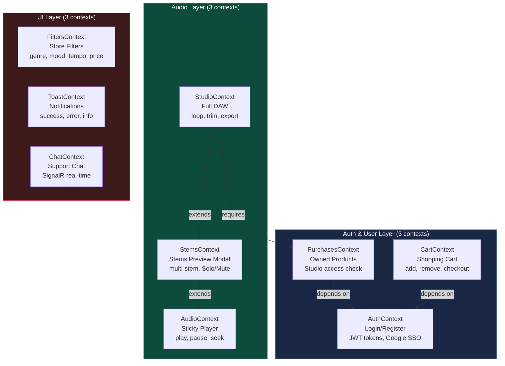
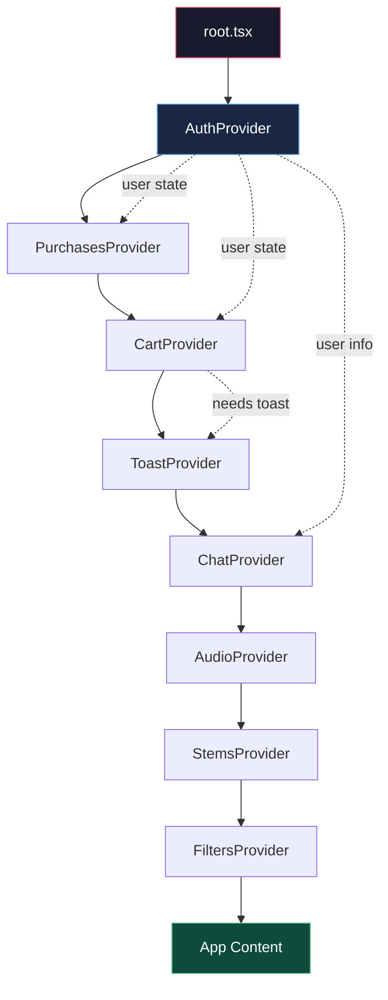
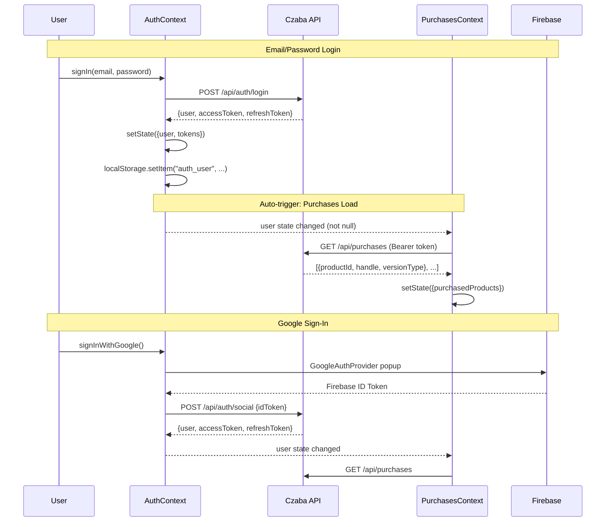
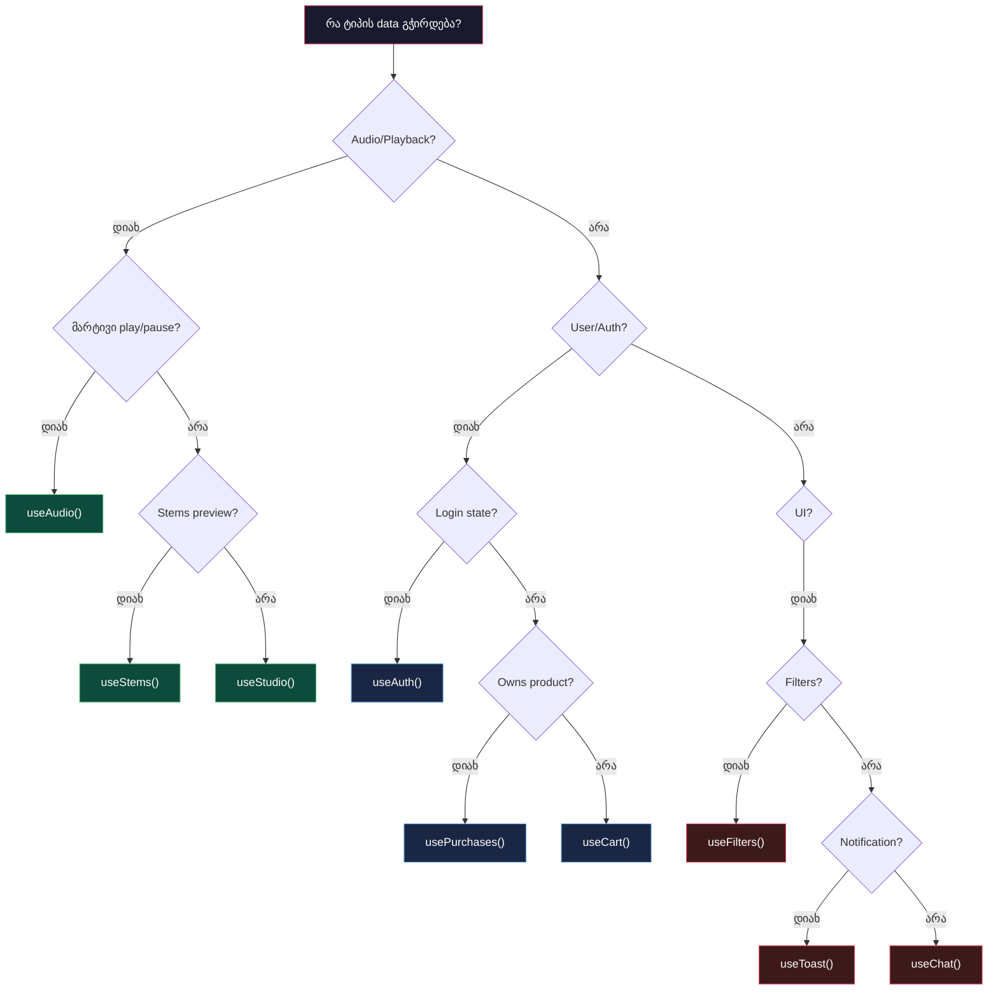

# State Management - 9 React Contexts

## წინაპირობები (Prerequisites)

- React Context API (createContext, useContext, Provider)
- React hooks: useState, useEffect, useCallback, useReducer, useMemo
- JavaScript closures და stale closure პრობლემა
- HTTP ავტორიზაცია (JWT access token, refresh token)
- Czaba Store-ის ბიზნეს ლოგიკა (პროდუქტები, კალათა, Studio)

---

## ტერმინოლოგია

| ტერმინი | განმარტება |
|---------|-----------|
| **Context** | React-ის მექანიზმი component tree-ში მონაცემების გადაცემისთვის prop drilling-ის გარეშე |
| **Provider** | Context-ის wrapper კომპონენტი, რომელიც value-ს აწვდის შვილ კომპონენტებს |
| **Consumer** | კომპონენტი რომელიც useContext-ით კითხულობს context-ის value-ს |
| **Provider Nesting** | Provider-ების ერთმანეთში ჩადგმა, სადაც თანმიმდევრობას მნიშვნელობა აქვს |
| **Prop Drilling** | მონაცემების გადაცემა კომპონენტების ჯაჭვით, თითოეულ დონეზე props-ით |
| **Stale Closure** | JavaScript-ის პრობლემა - callback იყენებს ძველ state-ის მნიშვნელობას |
| **Derived State** | State რომელიც სხვა state-იდან გამოითვლება და არ უნდა იყოს state-ში |
| **Revalidation** | მონაცემების ხელახლა ჩატვირთვა წყაროდან (API, storage) |
| **Domain** | ბიზნეს ლოგიკის ცალკეული სფერო (audio, auth, cart) |
| **SignalR** | Real-time ორმხრივი კომუნიკაციის ბიბლიოთეკა .NET ecosystem-ში |

---

## პრობლემის აღწერა - რატომ არის ეს საჭირო

Czaba Store-ში მრავალი ტიპის global state არსებობს:

- **Audio state** - რა უკრავს, რა ხმაზე, სად არის progress-ი
- **Auth state** - ვინ არის logged in, რა token აქვს
- **Cart state** - რა არის კალათაში
- **Purchases state** - რა პროდუქტები ფლობს მომხმარებელი (Studio-ზე წვდომისთვის)
- **UI state** - ფილტრები, toast-ები, chat

ეს state-ები სხვადასხვა კომპონენტებს სჭირდება, სხვადასხვა გვერდებზე. Prop drilling-ით მათი გადაცემა შეუძლებელია - 10-15 დონის ღრმა კომპონენტების ხეში.

**რატომ Context და არა Redux/Zustand?**

1. **პროექტის ზომა** - Czaba Store საშუალო ზომისაა (9 context). Redux-ის boilerplate და DevTools overhead არ ღირს.
2. **Domain isolation** - 9 ცალკეული context უკეთესია ვიდრე 1 გიგანტური store. Audio-ს ცვლილება Cart-ის re-render-ს არ იწვევს.
3. **Remix integration** - Context კარგად მუშაობს Remix-ის loader-ებთან.
4. **Learning curve** - გუნდის ნებისმიერ წევრს შეუძლია Context-ის გაგება. Redux middleware, selectors, normalization - ზედმეტი სირთულეა.

---

## ძირითადი კონცეფცია

### Context Hierarchy - 3 Layer

9 Context 3 ლოგიკურ ფენად იყოფა: Audio, Auth/User და UI. ეს არ არის შემთხვევითი დაყოფა - თითოეული ფენა სხვადასხვა domain-ს ემსახურება.



### Provider Nesting Order

Provider-ების ჩადგმის თანმიმდევრობა კრიტიკულია. ზედა Provider-ი ქვედას ვერ გამოიყენებს. მაგალითად, PurchasesProvider-ს სჭირდება AuthContext (user), ამიტომ AuthProvider-ი უფრო ზევით უნდა იყოს.



**StudioContext** არ არის root Provider tree-ში. იგი მხოლოდ `/studio/:handle` route-ზე იტვირთება, რადგან სხვა გვერდებზე არ გამოიყენება. ეს performance-ს ზოგავს.

---

## როგორ მუშაობს - ნაბიჯ-ნაბიჯ

### ნაბიჯი 1: Auth Flow - AuthContext + PurchasesContext

მომხმარებლის ლოგინი ორ context-ს ამოქმედებს: AuthContext ინახავს user-ს და token-ებს, PurchasesContext ავტომატურად ჩატვირთავს ნაყიდ პროდუქტებს.



### ნაბიჯი 2: Context არჩევის გზამკვლევი

რომელ სიტუაციაში რომელი Context გამოვიყენოთ:



### ნაბიჯი 3: Contexts ურთიერთკავშირი

Context-ები სრულიად იზოლირებული არ არის. ისინი ერთმანეთთან კომუნიკაციაში არიან:

**AuthContext → PurchasesContext** - user-ის შეცვლისას purchases ხელახლა ჩაიტვირთება. Logout-ისას purchases გასუფთავდება.

**PurchasesContext → ProductPage** - პროდუქტის გვერდზე "Owned" badge ჩანს, Premium owner-ს Studio link აქვს.

**AuthContext → CartContext** - სესიის ID-ით cart backend-თან სინქრონიზებულია. Login-ისას guest cart და user cart merge ხდება.

**AudioContext → StemsContext** - Stems modal-ის გახსნისას Sticky Player pause-ზე დგება, რომ ორი audio ერთდროულად არ უკრას.

**CartContext → ToastContext** - "Added to cart" success toast ჩვენება.

**ChatContext → AuthContext** - Chat session-ში user info (თუ logged in) ავტომატურად იგზავნება.

### ნაბიჯი 4: Performance - რატომ 9 Context და არა 1

React Context-ის re-render ლოგიკა: **Provider-ის value-ის ცვლილება ყველა consumer-ს ხელახლა არენდერებს.**

თუ 1 გიგანტურ context-ს ვიყენებთ:

```
User types in search filter
→ FiltersContext value changes
→ AudioPlayer re-renders (არ სჭირდება!)
→ CartButton re-renders (არ სჭირდება!)
→ ChatWidget re-renders (არ სჭირდება!)
→ ALL consumers re-render
```

9 ცალკეული context-ით:

```
User types in search filter
→ FiltersContext value changes
→ ONLY FiltersContext consumers re-render
→ AudioPlayer, CartButton, ChatWidget - არ იცვლება
```

### ნაბიჯი 5: useCallback და Stale Closure პრევენცია

Context-ის method-ები useCallback-ით არის wrapped. მთავარი წესი: `setState(prev => ...)` pattern იყენე, არა `state` variable-ზე დამოკიდებულებას.

```
სწორი approach:
- togglePlayPause callback depends on: [] (ცარიელი)
- შიგნით: setState(prev => prev.isPlaying ? pause() : play())
- callback არასდროს ხელახლა შეიქმნება
- consumers არ re-render-დებიან callback-ის reference ცვლილების გამო

არასწორი approach:
- togglePlayPause callback depends on: [state]
- შიგნით: if (state.isPlaying) pause()
- ყოველ state ცვლილებაზე ახალი callback
- ყველა consumer ხელახლა re-render-დება
```

---

## Czaba-ში იმპლემენტაცია

### Provider Hierarchy (root.tsx)

```tsx
<AuthProvider>
  <PurchasesProvider>
    <CartProvider onToast={toast}>
      <ToastProvider>
        <ChatProvider>
          <AudioProvider>
            <StemsProvider>
              <FiltersProvider>
                <Outlet />
              </FiltersProvider>
            </StemsProvider>
          </AudioProvider>
        </ChatProvider>
      </ToastProvider>
    </CartProvider>
  </PurchasesProvider>
</AuthProvider>
```

### Context Hook Pattern

```tsx
const AudioContext = createContext<AudioContextValue | null>(null);

function AudioProvider({ children }: { children: React.ReactNode }) {
  const [state, setState] = useState<AudioState>(initialState);

  const play = useCallback((track: Track) => {
    setState((prev) => ({
      ...prev,
      currentTrack: track,
      isPlaying: true,
    }));
  }, []);

  const pause = useCallback(() => {
    setState((prev) => ({ ...prev, isPlaying: false }));
  }, []);

  const value = useMemo(
    () => ({ ...state, play, pause }),
    [state, play, pause]
  );

  return (
    <AudioContext.Provider value={value}>
      {children}
    </AudioContext.Provider>
  );
}

function useAudio(): AudioContextValue {
  const context = useContext(AudioContext);
  if (!context) {
    throw new Error("useAudio must be used within AudioProvider");
  }
  return context;
}
```

---

## Trade-offs

| გადაწყვეტილება | უპირატესობა | ნაკლოვანება |
|---------------|-------------|-------------|
| **9 ცალკეული Context** | Domain isolation, targeted re-renders | Provider nesting depth (8 levels) |
| **Context API vs Redux** | მარტივი, Remix-თან კარგი ინტეგრაცია | DevTools არ არის, time-travel debugging არ არის |
| **Context API vs Zustand** | არ სჭირდება dependencies, React-native | Zustand-ი უფრო performant-ია selector-ებით |
| **useCallback + empty deps** | Stable references, ნაკლები re-render | setState(prev => ...) ყველგან, verbose syntax |
| **StudioContext route-level** | არ იტვირთება სხვა გვერდებზე | Context split - ზოგი audio state global, ზოგი local |
| **localStorage token storage** | მარტივი, SSR-compatible | XSS vulnerability (httpOnly cookie უკეთესია) |
| **Derived state (no duplication)** | Single source of truth | ყოველ render-ზე ხელახლა გამოითვლება (useMemo-ით მოგვარდება) |

---

## დაკავშირებული თემები

- [Audio Studio System](./02-audio-studio-system.md) - 3 Audio Context-ის დეტალური არქიტექტურა
- [API Integration](./04-api-integration.md) - AuthContext-ის token refresh ლოგიკა
- [Remix Architecture](./01-remix-architecture.md) - Provider-ების ადგილი Remix app-ში
- State Management doc - `store/docs/technical/architecture/state-management.md`

---

## Key Takeaways

- **9 Context 3 domain-ად იყოფა: Audio (3), Auth/User (3), UI (3).** თითოეული domain-ი იზოლირებულია - ერთის ცვლილება მეორის re-render-ს არ იწვევს.

- **Provider-ების თანმიმდევრობა კრიტიკულია.** AuthProvider პირველია რადგან PurchasesProvider-ს და CartProvider-ს user state სჭირდებათ. StudioContext root-ში არ არის - მხოლოდ Studio route-ზე.

- **useCallback + setState(prev => ...) pattern stale closure-ს ხსნის.** Callback-ი არასდროს ხელახლა შეიქმნება, მაგრამ ყოველთვის fresh state-ს იყენებს.

- **Derived state არასდროს state-ში.** `anySoloed = stems.some(s => s.isSolo)` ყოველ render-ზე გამოითვლება, არა state-ში ინახება.

- **Redux/Zustand არ ღირს Czaba-ს ზომის პროექტისთვის.** 9 domain-ად დაყოფილი Context API საკმარისი performance-ს იძლევა React-ის re-render ოპტიმიზაციით.
