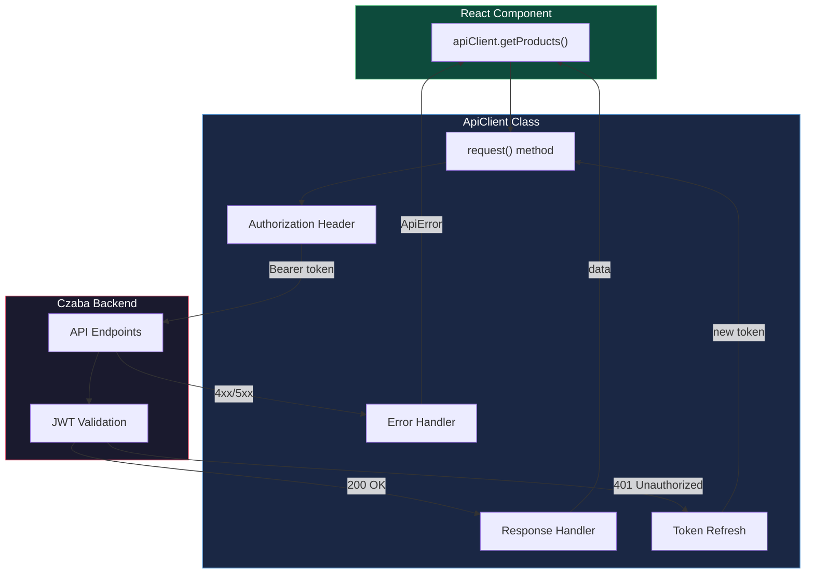
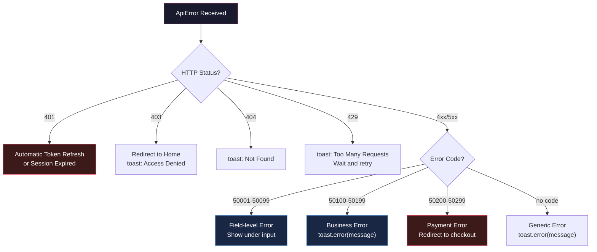
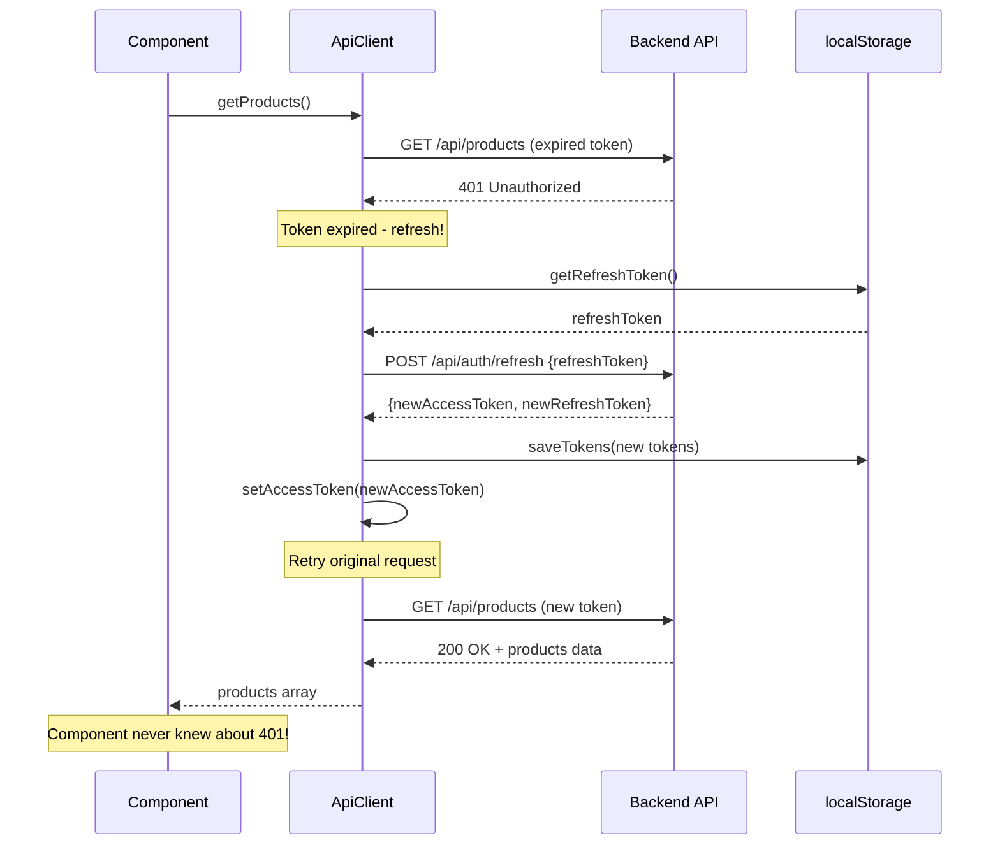
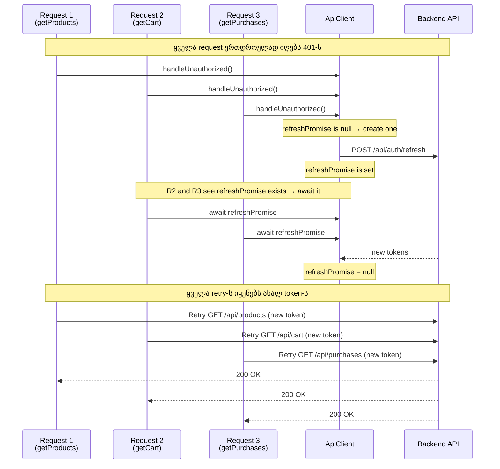
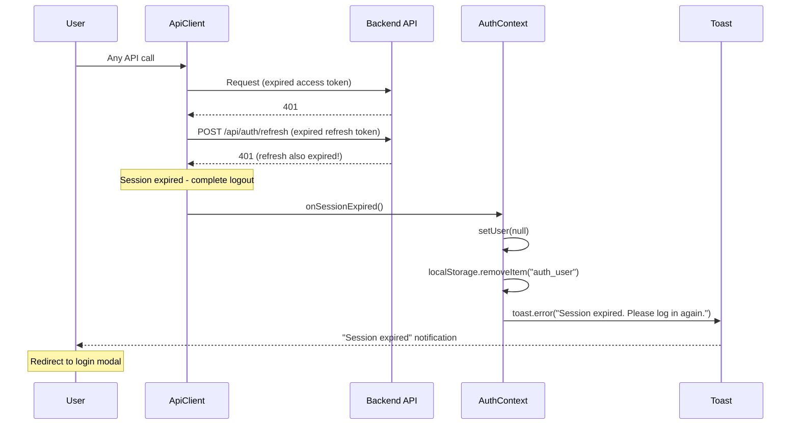

# API Integration - Client Patterns

## წინაპირობები (Prerequisites)

- HTTP protocol (methods, status codes, headers)
- JSON Web Token (JWT) კონცეფცია (access token, refresh token)
- JavaScript Promises, async/await
- Fetch API საფუძვლები
- Czaba Store-ის AuthContext (user state, token storage)

---

## ტერმინოლოგია

| ტერმინი | განმარტება |
|---------|-----------|
| **JWT (JSON Web Token)** | ციფრულად ხელმოწერილი token ავტორიზაციისთვის |
| **Access Token** | მოკლევადიანი token (15-30 წუთი) API-სთან წვდომისთვის |
| **Refresh Token** | გრძელვადიანი token (7-30 დღე) ახალი access token-ის მისაღებად |
| **Token Refresh** | ვადაგასული access token-ის ჩანაცვლება ახლით, refresh token-ის გამოყენებით |
| **Interceptor** | middleware რომელიც request-ს ან response-ს ამუშავებს fetch-ის წინ/შემდეგ |
| **Race Condition** | პრობლემა როცა ორი პროცესი ერთდროულად ცვლის ერთსა და იმავე მონაცემს |
| **Retry** | წარუმატებელი request-ის ხელახლა შესრულება |
| **Error Code** | Backend-ის მიერ მინიჭებული რიცხვითი კოდი კონკრეტული შეცდომისთვის (50001-50399) |
| **Idempotency** | ერთი და იგივე ოპერაციის რამდენჯერმე შესრულება იგივე შედეგს იძლევა |
| **Session Expiration** | ორივე token-ის ვადის გასვლა - მომხმარებელმა ხელახლა უნდა დალოგინდეს |
| **Bearer Token** | HTTP Authorization header-ში JWT token-ის გადაცემის სტანდარტი |

---

## პრობლემის აღწერა - რატომ არის ეს საჭირო

Czaba Store frontend-ი Czaba .NET Backend API-ს უკავშირდება (localhost:5199). ამ კომუნიკაციაში რამდენიმე გამოწვევაა:

**Token management** - Access token 15-30 წუთში იწურება. მომხმარებელი შეიძლება 2 საათს ატარებდეს საიტზე. ყოველ 15 წუთში ხელახლა ლოგინი არ უნდა მოუწიოს - token ავტომატურად უნდა განახლდეს.

**Concurrent refresh** - თუ 3 request-ი ერთდროულად მიიღებს 401-ს, სამივე დამოუკიდებლად ცდილობს token refresh-ს. ეს 3 refresh request-ს გაგზავნის, მაგრამ მხოლოდ 1 გაივლის (refresh token ერთხელ გამოიყენება). 2 request ჩავარდება.

**Error handling** - Backend-ი სხვადასხვა ტიპის შეცდომებს აბრუნებს: validation errors (50001-50099), business errors (50100-50199), payment errors (50200-50299). Frontend-მა უნდა იცოდეს რომელი შეცდომა სად აჩვენოს - field-level-ზე თუ toast-ში.

**Network resilience** - მომხმარებელი შეიძლება არასტაბილურ ინტერნეტზე იყოს. Request timeout, network error, 500 Server Error - ყველა სხვადასხვა handling-ს მოითხოვს.

---

## ძირითადი კონცეფცია

### API Client Architecture

ApiClient არის სინგლტონი, რომელიც ყველა HTTP request-ს მართავს. მას აქვს token management, automatic retry, error extraction.



### Error Code System

Czaba Backend-ი structured error codes-ს იყენებს. ეს საშუალებას იძლევა frontend-მა ზუსტად იცოდეს რა ტიპის შეცდომაა და სად აჩვენოს.



---

## როგორ მუშაობს - ნაბიჯ-ნაბიჯ

### ნაბიჯი 1: ნორმალური Request Flow

უმეტესი request-ი მარტივ path-ს გადის: token header-ში, data response-ში.

```
Component calls apiClient.getProducts()
→ ApiClient adds "Authorization: Bearer {accessToken}" header
→ fetch("https://api.czaba.ge/api/products", { headers })
→ Backend validates JWT
→ 200 OK + JSON data
→ Component receives products array
```

### ნაბიჯი 2: Token Refresh (401 Handling)

როცა access token-ი იწურება, backend 401 აბრუნებს. ApiClient ავტომატურად refresh-ს ცდილობს.



### ნაბიჯი 3: Concurrent Refresh Prevention

რა ხდება როცა რამდენიმე request ერთდროულად მიიღებს 401-ს? გადაწყვეტა: **Single Promise pattern**.



**Single Promise pattern-ის არსი:** `refreshPromise` არის shared variable. პირველი 401-ი ქმნის Promise-ს, დანარჩენი 401-ები იგივე Promise-ს await-ენ. შედეგად, 3 concurrent 401-ის ნაცვლად, მხოლოდ 1 refresh request იგზავნება.

### ნაბიჯი 4: Session Expiration

თუ refresh token-იც ვადაგასულია (7-30 დღის შემდეგ), სესია სრულად იწურება.



### ნაბიჯი 5: Error Message Extraction

Backend-ი სხვადასხვა ფორმატით აბრუნებს შეცდომებს. `getErrorMessage` utility ყველა ფორმატს სტანდარტიზებს.

```
Backend response formats:
1. { "message": "Product not found" }
2. { "error": { "message": "Validation failed" } }
3. { "response": { "data": { "message": "..." } } }
4. Plain string
5. Network Error (no response)

getErrorMessage() → ყოველთვის string: "Product not found"
```

### ნაბიჯი 6: Stripe Payment Error Handling

Stripe-თან დაკავშირებული შეცდომები სპეციფიკურ handling-ს მოითხოვს:

```
Error Code 50200-50299 = Payment errors

50200 - Card declined → "Your card was declined. Please try another card."
50201 - Insufficient funds → "Insufficient funds."
50202 - Expired card → "Your card has expired."
50203 - Processing error → "Processing error. Please try again."
50210 - Checkout session expired → Redirect to new checkout
50220 - Webhook validation failed → Internal, user never sees

Payment errors → redirect back to cart/checkout
Non-payment errors → toast notification
```

---

## Czaba-ში იმპლემენტაცია

### ApiClient - Token Refresh with Single Promise

```tsx
class ApiClient {
  private accessToken?: string;
  private refreshPromise: Promise<AuthResponse> | null = null;
  private onSessionExpired?: () => void;

  private async request<T>(
    method: string,
    url: string,
    data?: unknown,
    skipAuthRefresh = false
  ): Promise<T> {
    try {
      const response = await fetch(url, {
        method,
        headers: {
          "Content-Type": "application/json",
          ...(this.accessToken && {
            Authorization: `Bearer ${this.accessToken}`,
          }),
        },
        body: data ? JSON.stringify(data) : undefined,
      });

      if (response.status === 401 && !skipAuthRefresh) {
        return this.handleUnauthorized(method, url, data);
      }

      if (!response.ok) {
        const error = await response.json();
        throw new ApiError(response.status, error.message, error.errorCode);
      }

      return response.json();
    } catch (error) {
      if (error instanceof ApiError) throw error;
      throw new ApiError(500, "Network error");
    }
  }
}
```

### Error Code to Action Mapping

```tsx
function handleApiError(error: ApiError) {
  const { status, errorCode, message } = error;

  if (status === 401) return;

  if (status === 403) {
    toast.error("Access denied");
    navigate("/");
    return;
  }

  if (status === 404) {
    toast.error(message || "Not found");
    return;
  }

  if (errorCode && errorCode >= 50001 && errorCode <= 50099) {
    throw error;
  }

  toast.error(message || getHttpErrorMessage(status));
}

function getHttpErrorMessage(status: number): string {
  const messages: Record<number, string> = {
    400: "Invalid request",
    401: "Please log in",
    403: "Access denied",
    404: "Not found",
    409: "Already exists",
    429: "Too many requests. Please wait.",
    500: "Server error. Please try again.",
  };
  return messages[status] || "Something went wrong";
}
```

---

## Trade-offs

| გადაწყვეტილება | უპირატესობა | ნაკლოვანება |
|---------------|-------------|-------------|
| **Automatic token refresh** | მომხმარებელი ვერ ხვდება token-ის ვადის გასვლას | სირთულე: concurrent refresh, race conditions |
| **Single Promise pattern** | 1 refresh request N concurrent 401-ისთვის | თუ refresh fails, ყველა pending request ვარდება |
| **localStorage tokens** | მარტივი implementation, SSR-compatible | XSS vulnerability - httpOnly cookie უკეთესია |
| **Error codes (50001-50399)** | პრეციზიული error handling | Frontend-მა უნდა იცოდეს ყველა error code range |
| **Fetch API vs Axios** | No dependency, browser native | Axios-ს interceptors და cancel უფრო მარტივი აქვს |
| **Centralized ApiClient** | ერთი ადგილი token/error logic-ისთვის | სინგლტონი ართულებს testing-ს |
| **skipAuthRefresh flag** | ხელახლა refresh-ს არ ცდილობს | მეტი კოდი ყოველ retry-ზე |

---

## დაკავშირებული თემები

- [State Management](./03-state-management.md) - AuthContext, token storage, session management
- [Remix Architecture](./01-remix-architecture.md) - loader-ებიდან API calls
- [Audio Studio System](./02-audio-studio-system.md) - Signed URL-ების მოთხოვნა R2-დან
- API_ERROR_HANDLING primitive - `store/.claude/primitives/API_ERROR_HANDLING.md`
- Backend Error Taxonomy - `store/.claude/primitives/ERROR_TAXONOMY.md`
- Backend Refresh Token Rotation - `backend/docs/architecture/learning/14-REFRESH-TOKEN-ROTATION.md`

---

## Key Takeaways

- **Token refresh ავტომატურია და გამჭვირვალე.** კომპონენტი არასდროს ხედავს 401-ს - ApiClient თავად ცდილობს refresh-ს და retry-ს. მხოლოდ სრული session expiration იწვევს logout-ს.

- **Single Promise pattern ხსნის concurrent refresh პრობლემას.** რამდენიც request-იც არ უნდა მიიღოს 401-ს ერთდროულად, მხოლოდ ერთი refresh request იგზავნება.

- **Error codes (50001-50399) განსაზღვრავს სად აჩვენო შეცდომა.** 50001-50099 → field-level, 50100-50199 → toast, 50200-50299 → payment redirect.

- **ApiClient სინგლტონია ერთი პასუხისმგებლობით.** ყველა HTTP request გადის ApiClient-ზე, რომელიც token management-ს, error extraction-ს და retry logic-ს უზრუნველყოფს.

- **Network resilience მინიმალურია მაგრამ საკმარისი.** Timeout, catch-all error handler, HTTP status message mapping. Full retry-with-backoff Czaba-ს ზომისთვის ზედმეტია.
