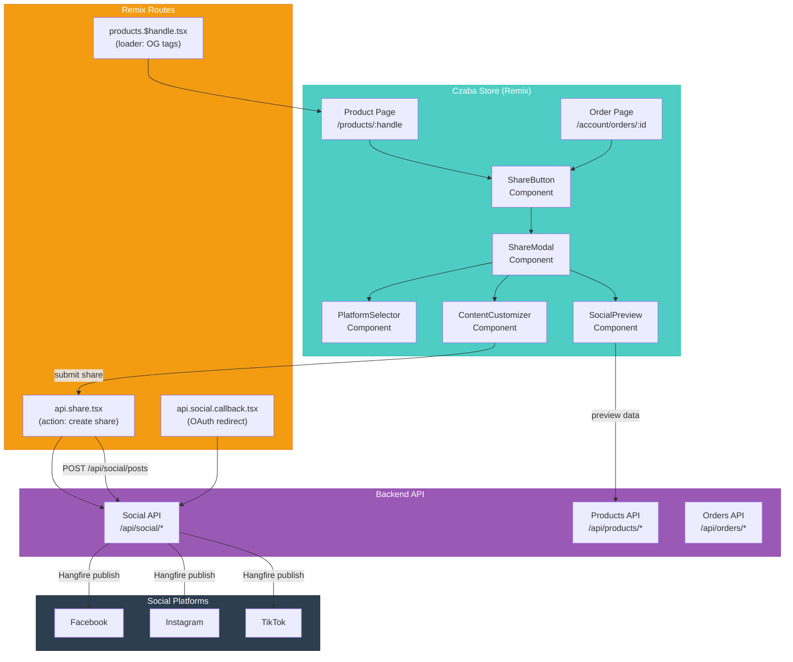
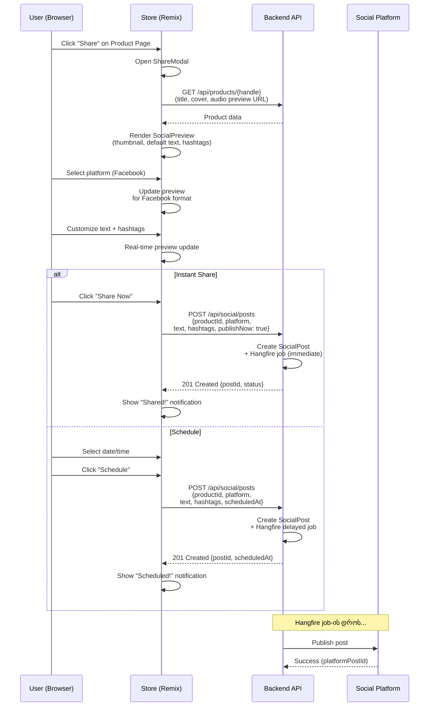
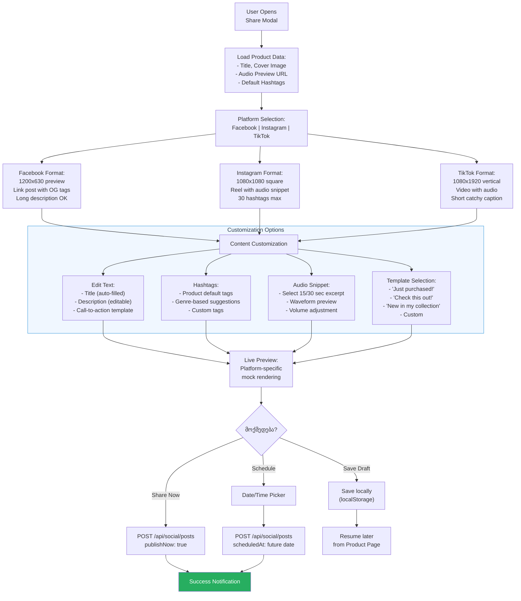

# Social Media Automation (Store Perspective)

## წინაპირობები

| თემა | რატომ არის საჭირო |
|------|-------------------|
| Remix Framework | loader/action pattern, route-based data fetching |
| React Context | state management, Provider pattern |
| REST API integration | apiClient, token-based requests |
| `architecture/04-api-integration.md` | Store-ის API ინტეგრაციის pattern |
| `architecture/03-state-management.md` | React Context state management |
| Backend: `18-SOCIAL-MEDIA-AUTOMATION.md` | სერვერის მხარეს არქიტექტურა |
| Backend: `19-HANGFIRE-JOB-SCHEDULING.md` | Background job scheduling |

---

## ტერმინოლოგია

| ტერმინი | განმარტება |
|---------|-----------|
| **Social Share** | პროდუქტის ან შეძენის სოციალურ ქსელში გაზიარება |
| **Share Button** | UI კომპონენტი, რომელიც social sharing flow-ს იწყებს |
| **Social Preview** | პოსტის წინასწარი ხედვა (thumbnail, ტექსტი, hashtag-ები) |
| **Platform Selector** | UI, სადაც user ირჩევს სად გაზიაროს (FB, IG, TT) |
| **Content Customization** | პოსტის ტექსტის, hashtag-ების, აუდიო snippet-ის პერსონალიზაცია |
| **Scheduled Post** | მომავალი თარიღით დაგეგმილი პოსტი |
| **Instant Share** | მყისიერი გაზიარება (publish now) |
| **Deep Link** | პირდაპირი ლინკი პროდუქტის გვერდზე (`czaba.ge/products/handle`) |
| **OG Tags** | Open Graph meta tags, რომლებიც social preview-ს განსაზღვრავს |
| **Audio Snippet** | 15-30 წამიანი აუდიო preview sharing-ისთვის |
| **Share Analytics** | sharing-ის მეტრიკები (clicks, shares, conversions) |
| **Promotional Content** | მარკეტინგული კონტენტი პროდუქტის პოპულარიზაციისთვის |

---

## პრობლემის აღწერა

Czaba-ს Store-ს ორი ტიპის მომხმარებელი ჰყავს, რომლებსაც სოციალურ ქსელებში sharing სჭირდებათ:

**არტისტები/პროდიუსერები (მყიდველები):**
- იყიდიან cinematic track-ს ან SFX pack-ს
- სურთ თავიანთ სოციალურ ქსელებში გაზიარება: "ამ ტრეკით ვიყენებ ჩემს ახალ პროექტში"
- სურთ აუდიო snippet-ის preview-ით sharing, არა მხოლოდ ლინკით
- სხვადასხვა პლატფორმაზე სხვადასხვა ფორმატი სჭირდებათ

**Czaba-ს ადმინისტრატორი (მარკეტინგი):**
- ამზადებს ვიდეო-კონტენტს 30-დღიანი კამპანიებისთვის (Admin Panel-ით)
- Store-ის პროდუქტებს უკავშირებს სოციალურ პოსტებს (deep links)
- აკონტროლებს sharing-ის ანალიტიკას

**რატომ სჭირდება Store-ს ცალკე social integration:**

1. **Product Page → Social** -- პროდუქტის გვერდიდან პირდაპირ sharing, Open Graph tags-ით რომ preview ლამაზი იყოს
2. **Purchase → Share** -- შეძენის შემდეგ "Share your purchase" flow, რომელიც მყიდველს promotional content-ის გაზიარებას სთავაზობს
3. **Audio Preview in Social** -- სტანდარტული URL sharing-ს აუდიო preview არ აქვს. Store-მ უნდა დაუკავშიროს პროდუქტის ვიდეო/აუდიო snippet social post-ს
4. **Cross-promotion** -- მყიდველები ფაქტობრივად Czaba-ს "ambassador"-ები ხდებიან, მათი sharing organic reach-ს ზრდის

---

## ძირითადი კონცეფცია

### Store-ის Social Integration არქიტექტურა

Store (frontend) Backend API-სთან კომუნიკაციით მართავს social sharing-ს. Store-ი მხოლოდ UI და preview-ს უზრუნველყოფს, ფაქტობრივი publishing Backend-ის მეშვეობით ხდება.



**Store-ის როლი** -- UI components (ShareButton, SocialPreview, PlatformSelector, ContentCustomizer) და Remix routes (loader-ები OG tags-ისთვის, action-ები share request-ებისთვის).

**Backend-ის როლი** -- OAuth token management, ფაქტობრივი publishing Hangfire-ით, rate limiting, analytics.

**Store არ ფლობს OAuth token-ებს** -- token-ები backend DB-ში ინახება encrypted. Store მხოლოდ API request-ს აგზავნის, backend ანგარიშის token-ით publish-ს აკეთებს.

### მომხმარებლის Sharing Flow

მომხმარებელი პროდუქტის გვერდზე Share ღილაკზე აჭერს, ირჩევს პლატფორმას, აკასტომიზებს ტექსტს, ხედავს preview-ს, და publish/schedule-ს ირჩევს.



**Share Now vs Schedule** -- მომხმარებელს ორი ვარიანტი აქვს: მყისიერი გაზიარება (Hangfire fire-and-forget job) ან კონკრეტულ თარიღზე დაგეგმვა (Hangfire delayed job).

**Real-time Preview** -- ტექსტის ან hashtag-ების შეცვლისას preview მყისიერად განახლდება. Platform-ის არჩევისას preview format-ი იცვლება (Facebook: horizontal card, Instagram: square, TikTok: vertical).

**Backend handling** -- Store მხოლოდ POST request-ს აგზავნის. Backend SocialPost record-ს ქმნის, Hangfire job-ს schedule-ს აკეთებს, და publish-ს backend-ის მხარეს ასრულებს.

### Content Customization და Preview Flow



**Template Selection** -- წინასწარ განსაზღვრული ტექსტის ტემპლეიტები sharing-ის გამარტივებისთვის. მომხმარებელს არ უწევს ყოველ ჯერზე ტექსტის წერა.

**Platform-specific Format** -- ყოველი პლატფორმის preview სხვადასხვა ზომისა და ფორმატის არის. Facebook-ზე horizontal card, Instagram-ზე square/reel, TikTok-ზე vertical video.

**Audio Snippet** -- Czaba-ს უნიკალური ფუნქცია: მომხმარებელს შეუძლია ტრეკის 15 ან 30 წამიანი ფრაგმენტი შეარჩიოს waveform-ის მეშვეობით. ეს snippet social post-ს თან ერთვის ვიდეო/აუდიო preview-ად.

**Save Draft** -- თუ მომხმარებელს არ სურს ახლავე sharing, draft localStorage-ში ინახება და პროდუქტის გვერდზე დაბრუნებისას შეუძლია გააგრძელოს.

---

## როგორ მუშაობს

### Open Graph Tags და Social Preview

როცა social platform URL-ს აანალიზებს (Facebook scraper, Twitter card validator), OG tags-ს კითხულობს. Czaba-ს product page-ს სპეციალური OG tags უნდა ჰქონდეს, რომ social preview ლამაზი იყოს.

Remix-ის `meta` ფუნქცია loader-ის მონაცემებით OG tags-ს გენერირებს:
- `og:title` -- პროდუქტის სახელი
- `og:description` -- პროდუქტის აღწერა
- `og:image` -- cover image (1200x630 Facebook-ისთვის)
- `og:audio` -- აუდიო preview URL
- `og:url` -- canonical URL
- `og:type` -- "music.song"

ეს OG tags-ი უზრუნველყოფს, რომ URL-ის გაზიარებისას (copy-paste) ნებისმიერ პლატფორმაზე ლამაზი preview card ჩანდეს: cover image, სათაური, და აღწერა.

### ShareButton Component-ის ქცევა

ShareButton სხვადასხვა კონტექსტში სხვადასხვანაირად მუშაობს:

**Product Page-ზე:**
- ნებისმიერ მომხმარებელს ჩანს (auth არ სჭირდება URL sharing-ისთვის)
- არაავტორიზებული user-ისთვის: Web Share API ან clipboard copy
- ავტორიზებული user-ისთვის: სრული ShareModal ტექსტის კასტომიზაციით

**Order Confirmation Page-ზე:**
- მხოლოდ ავტორიზებულ user-ს ჩანს
- "Share your purchase" CTA
- Product-ის მონაცემები ავტომატურად ივსება
- "Just purchased on Czaba!" ტემპლეიტი default-ად

**My Library Page-ზე:**
- შეძენილი პროდუქტების სიაში ყოველ item-ს Share ღილაკი
- "From my collection" ტემპლეიტი default-ად

### Store-Backend კომუნიკაციის პატერნი

Store Backend-თან ორი სახით ურთიერთობს social sharing-ის კონტექსტში:

**Read operations (GET):**
- პროდუქტის მონაცემები preview-სთვის (`GET /api/products/{handle}`)
- მომხმარებლის connected accounts (`GET /api/social/accounts`)
- share history (`GET /api/social/posts?userId=current`)

**Write operations (POST):**
- ახალი share-ის შექმნა (`POST /api/social/posts`)
- OAuth flow-ის initiation (`POST /api/social/accounts/meta/connect`)

Store-ის API client `apiClient.ts` მეშვეობით ხდება ყველა API call. Token refresh ავტომატურია (იხ. `architecture/04-api-integration.md`).

### Connected Accounts -- Store vs Admin

მნიშვნელოვანი განსხვავება: Store-ში მომხმარებელი საკუთარ პირად social account-ს აკავშირებს. Admin Panel-ში ადმინი Czaba-ს ოფიციალურ Page/Account-ებს აკავშირებს.

| ასპექტი | Store (User) | Admin (Czaba) |
|---------|-------------|---------------|
| Account-ის მფლობელი | მომხმარებელი | Czaba-ს brand page |
| OAuth scope | შეზღუდული (post-only) | სრული (manage, analytics) |
| Token storage | user-ის account-ზე მიბმული | global social accounts |
| გამოყენება | პერსონალური sharing | მარკეტინგული კამპანიები |
| Publishing | მომხმარებლის feed-ში | Czaba-ს Page/Profile-ზე |

---

## Czaba-ში იმპლემენტაცია

### Product Page OG Tags (Remix Loader)

```typescript
export const meta: MetaFunction<typeof loader> = ({ data }) => {
  if (!data?.product) return [];

  const { product } = data;
  return [
    { title: `${product.title} | Czaba` },
    { name: "description", content: product.description },
    { property: "og:title", content: product.title },
    { property: "og:description", content: product.description },
    { property: "og:image", content: product.coverImageUrl },
    { property: "og:image:width", content: "1200" },
    { property: "og:image:height", content: "630" },
    { property: "og:audio", content: product.previewAudioUrl },
    { property: "og:url", content: `https://czaba.ge/products/${product.handle}` },
    { property: "og:type", content: "music.song" },
    { property: "og:site_name", content: "Czaba" },
    { name: "twitter:card", content: "summary_large_image" },
    { name: "twitter:title", content: product.title },
    { name: "twitter:description", content: product.description },
    { name: "twitter:image", content: product.coverImageUrl },
  ];
};
```

ეს meta ფუნქცია loader-ის მონაცემებიდან OG tags-ს გენერირებს. `og:image` 1200x630 ზომის უნდა იყოს Facebook-ის ოპტიმალური preview-სთვის. `og:audio` tag-ი Chrome-ის და სხვა clients-ის მიერ არ არის უნივერსალურად supported, მაგრამ Facebook-ი ცნობს.

### ShareButton Component

```tsx
const ShareButton = forwardRef<HTMLButtonElement, ShareButtonProps>(
  ({ productId, productTitle, productHandle, variant = "icon", className }, ref) => {
    const [isModalOpen, setIsModalOpen] = useState(false);
    const { user } = useAuth();

    const handleShare = async () => {
      if (!user) {
        if (navigator.share) {
          await navigator.share({
            title: productTitle,
            url: `https://czaba.ge/products/${productHandle}`,
          });
          return;
        }
        await navigator.clipboard.writeText(
          `https://czaba.ge/products/${productHandle}`
        );
        toast.success("Link copied!");
        return;
      }
      setIsModalOpen(true);
    };

    return (
      <>
        <Button ref={ref} variant={variant} onClick={handleShare} className={className}>
          <ShareIcon />
          {variant !== "icon" && <span>Share</span>}
        </Button>
        {isModalOpen && (
          <ShareModal
            productId={productId}
            onClose={() => setIsModalOpen(false)}
          />
        )}
      </>
    );
  }
);
```

**არაავტორიზებული user** -- Web Share API (მობილურზე) ან clipboard copy. მარტივი, სწრაფი, OAuth არ სჭირდება.

**ავტორიზებული user** -- ShareModal იხსნება სრული customization-ით: platform selection, text editing, preview, schedule/publish.

ეს ორი flow საშუალებას აძლევს ნებისმიერ ვიზიტორს URL-ის გაზიარება, ხოლო რეგისტრირებულ მომხმარებლებს სრულ social posting ფუნქციონალს სთავაზობს.

---

## Trade-offs

### როდის გამოვიყენოთ Store-based Social Sharing

- **Product promotion** -- მომხმარებლის organic sharing ყველაზე ეფექტური მარკეტინგია
- **Post-purchase engagement** -- შეძენის შემდეგ "share" CTA conversion-ს ზრდის
- **SEO და social presence** -- OG tags-ით ყოველი product page social-ready არის
- **Audio preview** -- მუსიკალური პროდუქტის sharing-ისას აუდიო snippet critical-ია

### როდის არ გამოვიყენოთ

- **მასშტაბური კამპანიები** -- 30+ post-ის batch scheduling Admin Panel-ის საქმეა, არა Store-ის
- **Analytics deep dive** -- engagement metrics Admin Dashboard-ზე უკეთესია
- **Video content creation** -- ვიდეო merge (ffmpeg) Admin Panel-ის Content Library-ში ხდება
- **Bot/automated posting** -- ავტომატური brand posting Admin-ის Hangfire pipeline-ით

### Native Share API vs Custom Modal

| ასპექტი | Web Share API | Custom ShareModal |
|---------|---------------|-------------------|
| Setup | ნულოვანი | კომპონენტების შემუშავება |
| UX | OS-native, ნაცნობი | Czaba-ს brand, rich preview |
| Customization | მინიმალური | სრული (text, hashtags, audio) |
| Platform support | ბრაუზერზე დამოკიდებული | ყველა ბრაუზერში |
| Analytics | არ აქვს | სრული tracking |
| Audio snippet | ვერ | შესაძლებელი |
| Auth required | არა | კი (full features-ისთვის) |
| Czaba-ს არჩევანი | fallback (არაავტორიზებული) | primary (ავტორიზებული) |

### OG Tags -- Static vs Dynamic

| მიდგომა | უპირატესობა | ნაკლი |
|---------|-------------|-------|
| Static (build-time) | სწრაფი, CDN cache | პროდუქტის ცვლილება ვერ ჩანს |
| Dynamic (loader) | ყოველთვის fresh data | server render ყოველ request-ზე |
| Czaba-ს არჩევანი | Dynamic (Remix loader) | პროდუქტი ცვალებადია (ფასი, სტატუსი) |

### ხშირი შეცდომები

1. **OG image-ის ზომის უგულებელყოფა** -- Facebook 1200x630 ოპტიმალურია, ამაზე პატარა ზომის image-ი blur-ით ჩანს ან საერთოდ არ ჩანს
2. **Web Share API-ის ყველა ბრაუზერში მოლოდინი** -- Desktop Chrome-ს Web Share API-ს მხოლოდ ნაწილობრივი support აქვს. ყოველთვის clipboard fallback საჭიროა
3. **Sharing-ისთვის ავტორიზაციის მოთხოვნა** -- URL copy/paste ყველას უნდა შეეძლოს. OAuth-based rich sharing მხოლოდ registered user-ებისთვის
4. **Audio preview-ის ხანგრძლივობა** -- 15-30 წამიანი snippet ოპტიმალურია. სრული ტრეკის sharing copyright-ის და bandwidth-ის პრობლემაა
5. **Cross-origin OG scraping** -- Facebook scraper server-side render-ს მოითხოვს. Remix SSR ამას ავტომატურად უზრუნველყოფს, SPA-ს ვერ

---

## დაკავშირებული თემები

| თემა | ფაილი | კავშირი |
|------|-------|--------|
| Remix Architecture | `architecture/01-remix-architecture.md` | Loader/action pattern sharing flow-ში |
| API Integration | `architecture/04-api-integration.md` | Backend API client social endpoints |
| State Management | `architecture/03-state-management.md` | ShareModal state management |
| Audio Studio System | `architecture/02-audio-studio-system.md` | Audio snippet selection (waveform) |
| Backend: Social Automation | `backend/docs/architecture/learning/18-SOCIAL-MEDIA-AUTOMATION.md` | სრული backend არქიტექტურა |
| Backend: OAuth | `backend/docs/architecture/learning/20-OAUTH-PLATFORM-INTEGRATION.md` | Token management |
| Backend: Hangfire | `backend/docs/architecture/learning/19-HANGFIRE-JOB-SCHEDULING.md` | Scheduled publishing |

---

## Key Takeaways

- **Store-ის social integration ორ დონეზე მუშაობს:** არაავტორიზებული user-ებისთვის Web Share API / clipboard copy (ნულოვანი ბარიერი), ავტორიზებული user-ებისთვის სრული ShareModal platform selection-ით, content customization-ით და schedule/publish ფუნქციონალით.

- **OG Tags Remix SSR-ით** უზრუნველყოფს, რომ ყოველი product page-ის URL-ის გაზიარებისას Facebook, Twitter და სხვა პლატფორმები ლამაზ preview card-ს აჩვენებს cover image-ით, სათაურით და აღწერით. ეს არ მოითხოვს user-ის რაიმე ქმედებას -- URL copy-paste საკმარისია.

- **Audio snippet sharing Czaba-ს უნიკალური ფუნქციაა** -- მუსიკალური პროდუქტის sharing-ისას 15-30 წამიანი აუდიო ფრაგმენტის წინასწარი ხედვა მნიშვნელოვნად ზრდის engagement-ს. Waveform-based selection Studio-ს არსებულ კომპონენტებს იყენებს.

- **Store არ ფლობს OAuth token-ებს და publishing ლოგიკას** -- ყველა social API call Backend-ის მეშვეობით ხდება. Store მხოლოდ POST request-ს აგზავნის product/text/platform მონაცემებით, Backend Hangfire job-ით publish-ს ასრულებს. ეს სეკურიტის და maintenance-ის თვალსაზრისით სწორი separation-ია.

- **ორი sharing paradigma ერთმანეთს ავსებს:** მომხმარებლის organic sharing (Store) და ბრენდის მარკეტინგული კამპანიები (Admin Panel). Store-ი მომხმარებელს "ambassador"-ად აქცევს, Admin Panel-ი 30-დღიან automated posting pipeline-ს მართავს.
