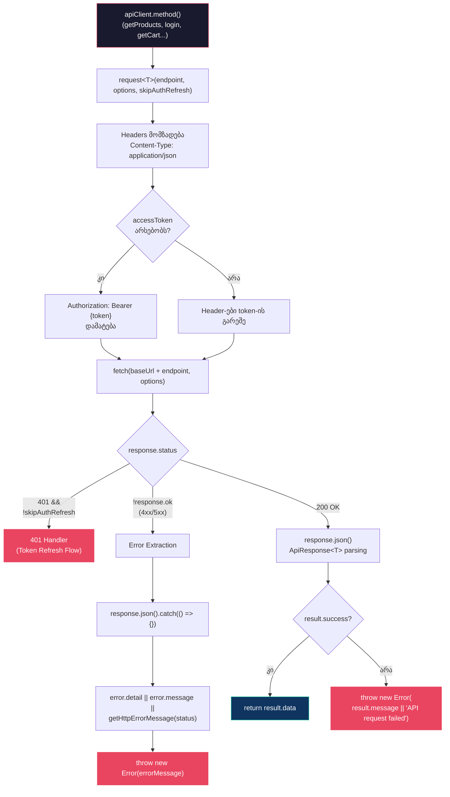
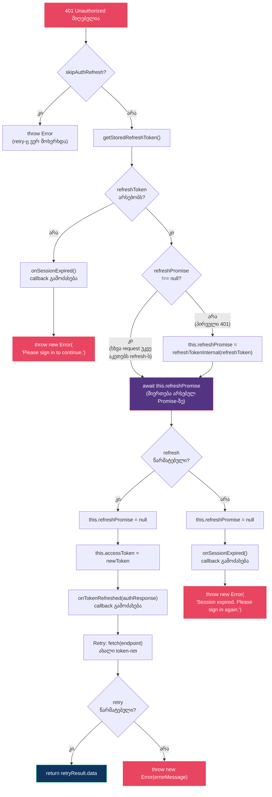
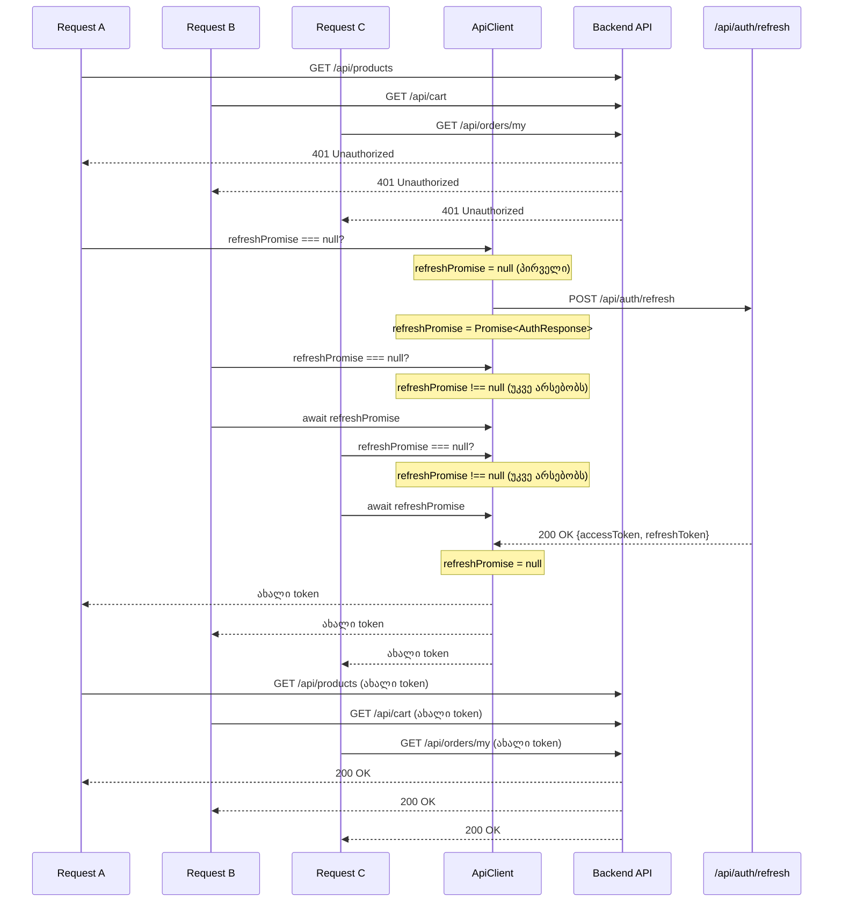
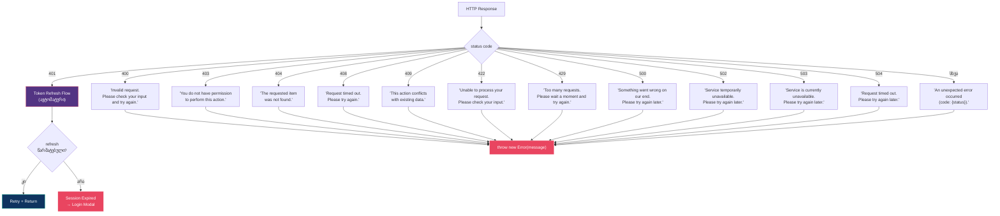
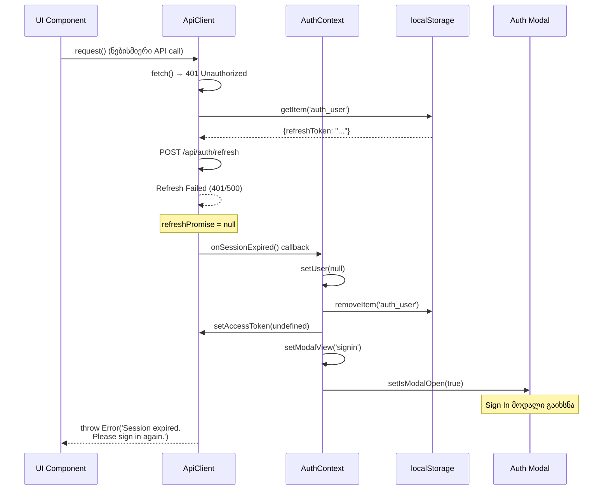
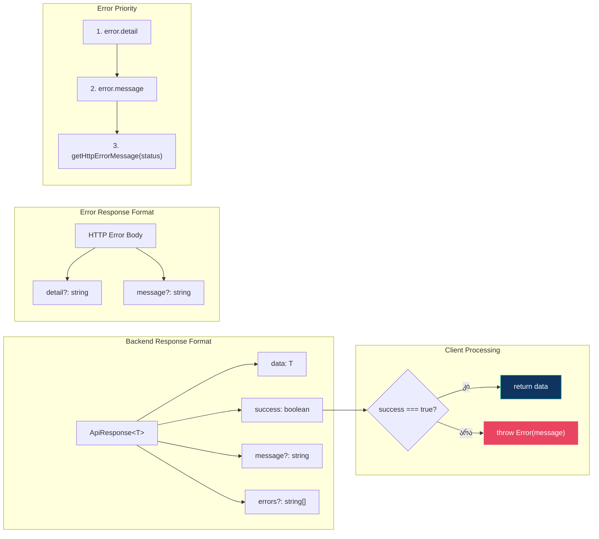
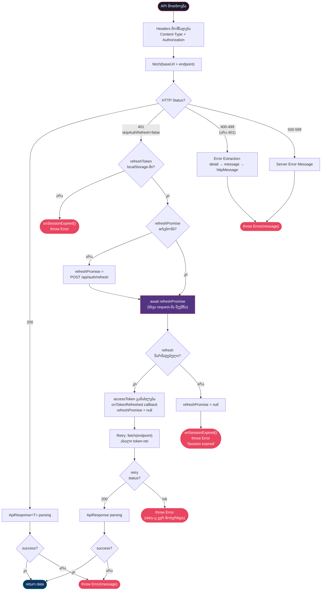

# API Client Flow

## აღწერა

CZABA Store-ის API Client (`app/services/api/client.ts`) HTTP მოთხოვნების სრული ციკლი: request მომზადება, Authorization header-ის დამატება, 401 Unauthorized-ის დამუშავება, token refresh singleton pattern, retry logic და session expiration flow.

API Client არის singleton ინსტანცია (`ApiClient` კლასი), რომელიც მართავს ყველა HTTP კომუნიკაციას Czaba .NET Backend-თან (`localhost:5199`).

---

## 1. HTTP Request Lifecycle

მოთხოვნის სრული ციკლი - მომზადებიდან პასუხის დაბრუნებამდე.



---

## 2. Token Refresh Singleton Pattern

401 მიღებისას მხოლოდ ერთი refresh მოთხოვნა იგზავნება. პარალელური მოთხოვნები იმავე Promise-ს იყენებენ.



---

## 3. Concurrent Requests During Token Refresh

რამდენიმე პარალელური მოთხოვნა 401-ის მიღებისას - Singleton Promise pattern.



---

## 4. Error Classification

HTTP status კოდების კლასიფიკაცია და შესაბამისი User-facing შეტყობინებები.



---

## 5. Session Expiration Flow

Token refresh წარუმატებლობისას - სრული logout ციკლი.



---

## 6. ApiResponse Wrapper

Backend API-ს პასუხის სტანდარტული ფორმატი და მისი დამუშავება.



---

## 7. AuthContext - ApiClient ინტეგრაცია

ApiClient-ის callback-ების რეგისტრაცია და token management.

```mermaid
flowchart TD
    subgraph "აპლიკაციის ინიციალიზაცია"
        A["AuthProvider mount"] --> B["apiClient.setTokenRefreshCallback()"]
        A --> C["apiClient.setSessionExpiredCallback()"]
        A --> D["localStorage.getItem('auth_user')"]
        D --> E{stored user<br/>არსებობს?}
        E -- კი --> F["apiClient.setAccessToken(token)"]
        F --> G["apiClient.getProfile()<br/>(token ვალიდაციისთვის)"]
        G --> G1{პროფილი<br/>ჩაიტვირთა?}
        G1 -- კი --> G2["setUser(customer)"]
        G1 -- არა --> G3["localStorage.removeItem()<br/>apiClient.setAccessToken(undefined)"]
        E -- არა --> H["setIsInitializing(false)"]
    end

    subgraph "Token Refresh Callback"
        I["onTokenRefreshed(response)"] --> J["setUser: update tokens"]
        J --> K["localStorage.setItem('auth_user')"]
    end

    subgraph "Session Expired Callback"
        L["onSessionExpired()"] --> M["setUser(null)"]
        M --> N["localStorage.removeItem('auth_user')"]
        N --> O["apiClient.setAccessToken(undefined)"]
        O --> P["Auth Modal: Sign In"]
    end

    subgraph "Multi-Tab Sync"
        Q["storage event listener"] --> R{key === 'auth_user'?}
        R -- "newValue === null" --> S["setUser(null)<br/>(სხვა tab-ში გავიდა)"]
        R -- "newValue !== null" --> T["setUser(parsed)<br/>apiClient.setAccessToken()<br/>(სხვა tab-ში token განახლდა)"]
    end

    style A fill:#1a1a2e,stroke:#e94560,color:#fff
    style G2 fill:#0f3460,stroke:#16c79a,color:#fff
    style G3 fill:#e94560,stroke:#fff,color:#fff
    style P fill:#e94560,stroke:#fff,color:#fff
```



---

## 8. სრული Request → Refresh → Retry Flowchart

ერთიანი სქემა - მოთხოვნის სრული ციკლი ყველა შესაძლო სცენარით.



---

## ძირითადი ფაილები

| ფაილი | როლი |
|-------|------|
| `app/services/api/client.ts` | ApiClient კლასი - HTTP layer, token refresh, retry |
| `app/contexts/AuthContext.tsx` | Token management, callback-ების რეგისტრაცია |
| `app/lib/auth.ts` | Auth ფუნქციები (signIn, signUp, signInWithGoogle) |
| `app/types/auth.ts` | User, AuthContextValue, AUTH_ERRORS ტიპები |
| `app/lib/firebase.client.ts` | Firebase Google Sign-In (მხოლოდ ID token-ისთვის) |

## Token Storage

```
localStorage['auth_user'] = {
  id, email, firstName, lastName, name,
  accessToken,      // JWT - API მოთხოვნებისთვის
  refreshToken,     // Refresh token - accessToken-ის განახლებისთვის
  accessTokenExpires // Token-ის ვადა
}
```

## ძირითადი პრინციპები

- **Singleton Refresh**: ერთდროულად მხოლოდ ერთი refresh მოთხოვნა (`refreshPromise` pattern)
- **ავტომატური Retry**: 401-ის შემდეგ token refresh და ორიგინალი მოთხოვნის ხელახლა გაგზავნა
- **skipAuthRefresh flag**: retry მოთხოვნა იგზავნება `skipAuthRefresh=true`-ით, რათა თავიდან აირიდოს უსასრულო ციკლი
- **Callback Pattern**: `onTokenRefreshed` და `onSessionExpired` callback-ები AuthContext-თან ინტეგრაციისთვის
- **Multi-Tab Sync**: `storage` event listener სხვა tab-ებთან სინქრონიზაციისთვის
