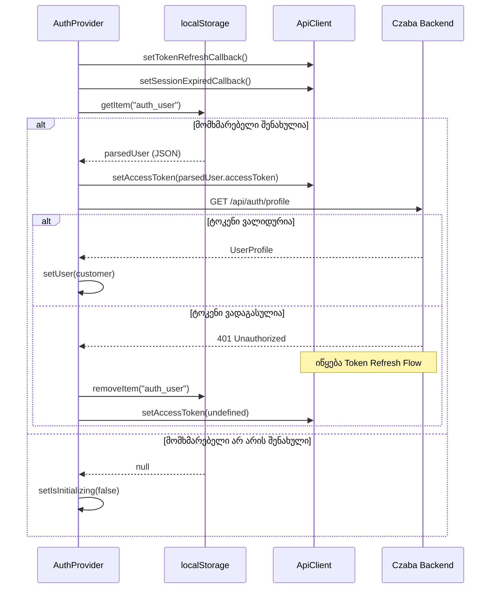
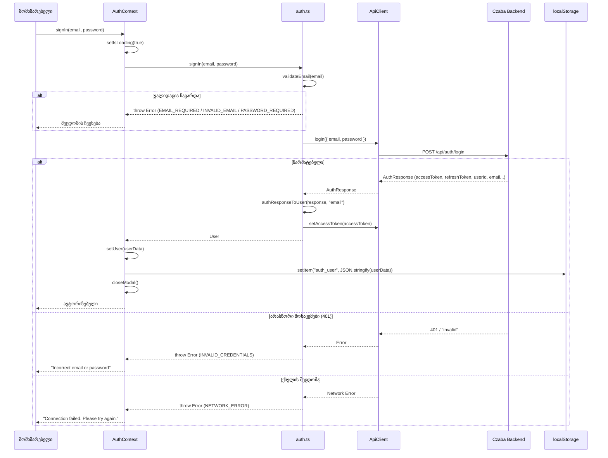
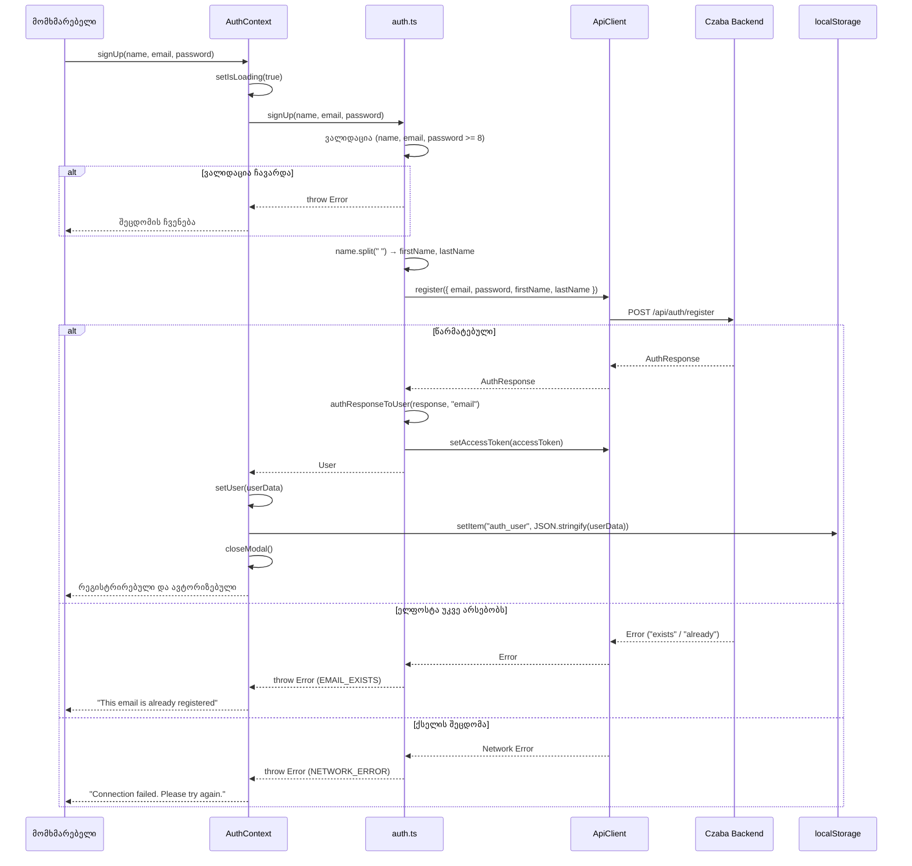
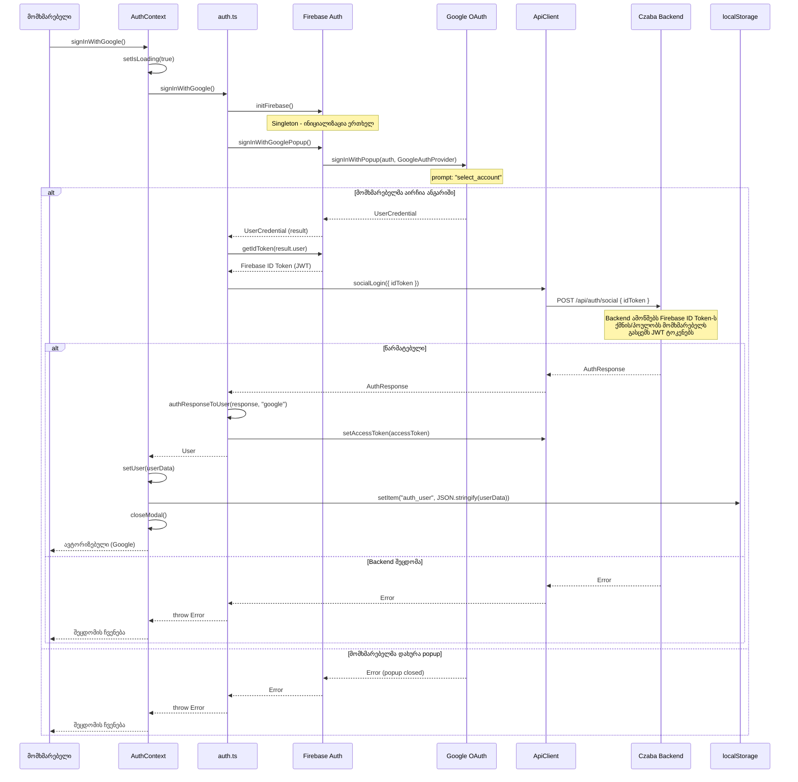
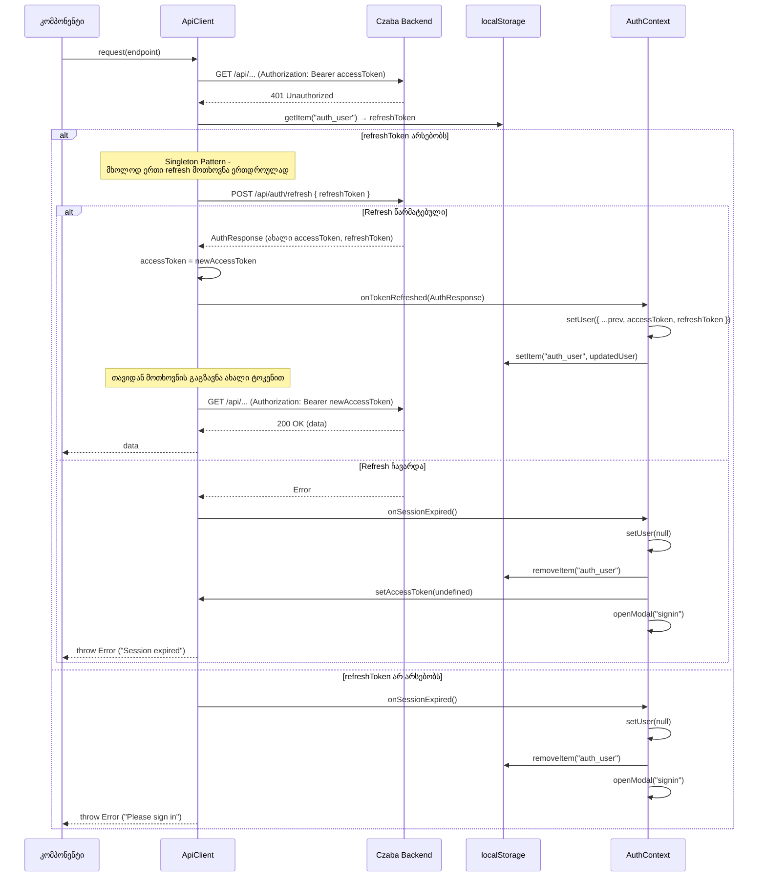
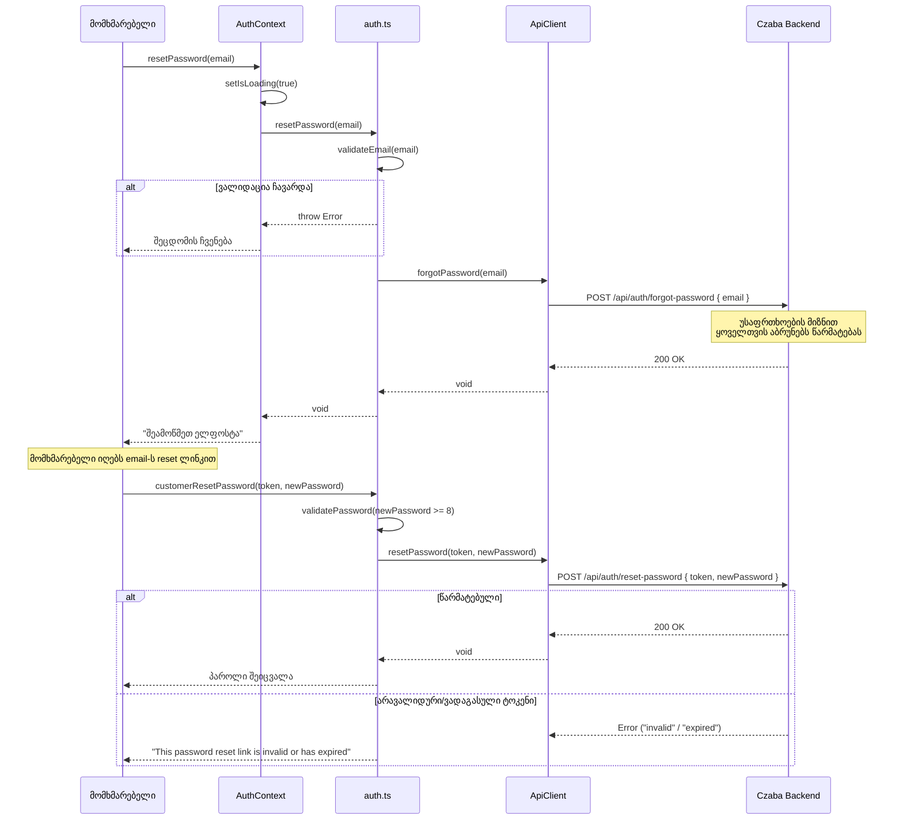
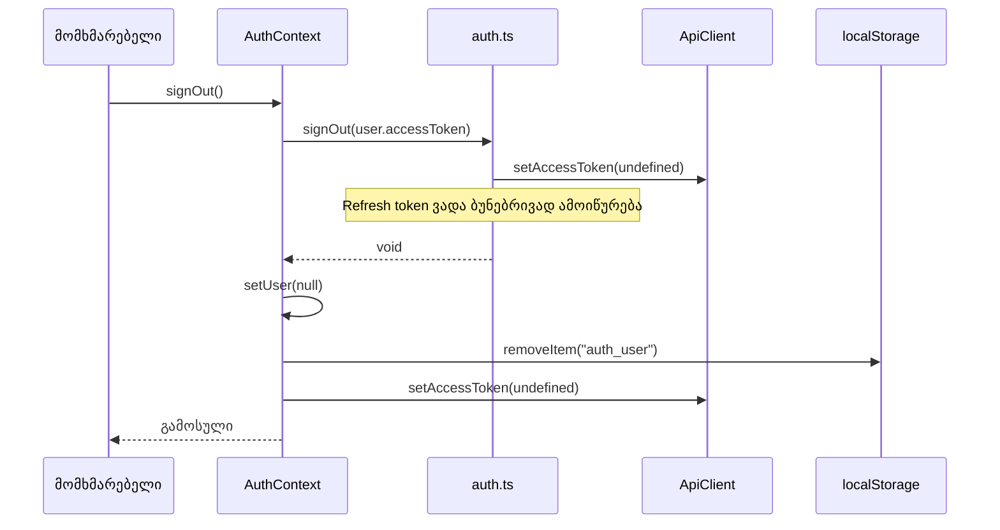
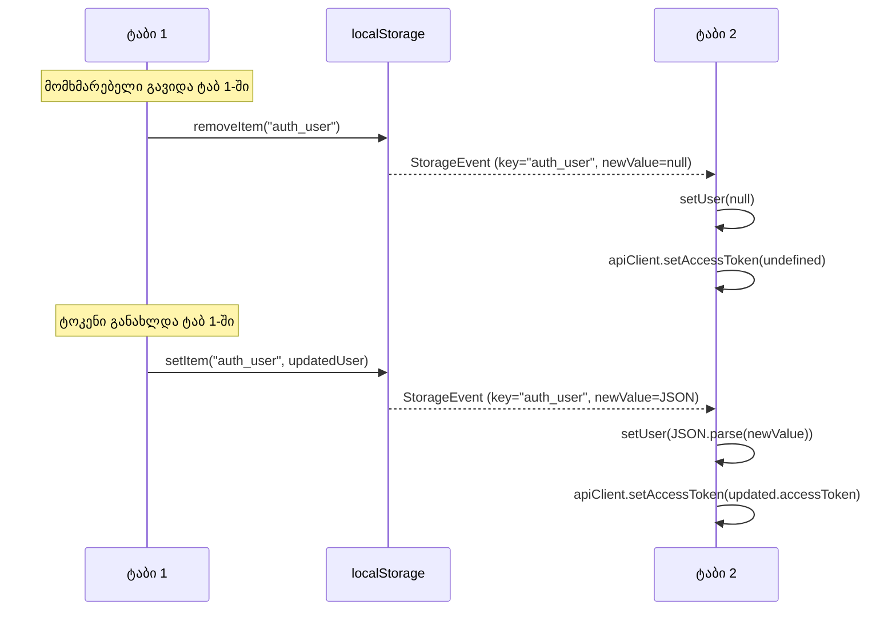
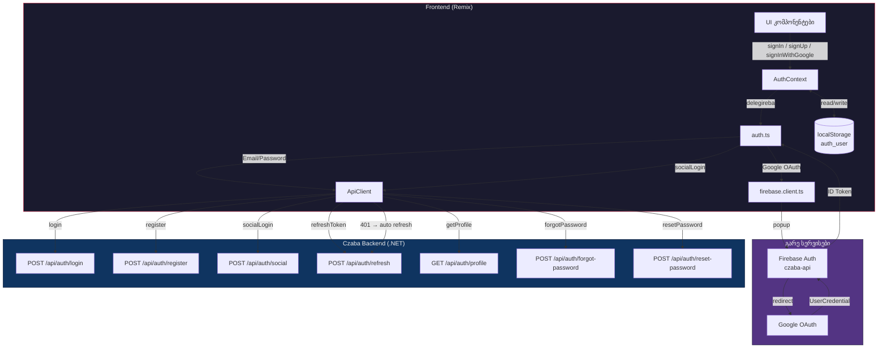

# Auth Flow - CZABA Store

## აღწერა

CZABA Store-ის ავტორიზაციის სისტემა მოიცავს სამ ძირითად flow-ს:
- **Email/Password** - რეგისტრაცია და შესვლა Czaba Backend API-ის მეშვეობით
- **Google OAuth** - Firebase popup-ით ID Token-ის მიღება და Backend-ზე გადაგზავნა
- **Token Refresh** - ავტომატური ტოკენის განახლება 401 შეცდომისას

ტოკენები ინახება `localStorage.auth_user`-ში და სინქრონიზდება ტაბებს შორის `StorageEvent`-ით.

---

## 1. აპლიკაციის ინიციალიზაცია

აპლიკაციის ჩატვირთვისას `AuthProvider` ამოწმებს შენახულ სესიას.

---

## 2. Email/Password - შესვლა

---

## 3. Email/Password - რეგისტრაცია

---

## 4. Google OAuth

Firebase popup-ით Google ავტორიზაცია და Backend-ზე ვერიფიკაცია.

---

## 5. Token Refresh (ავტომატური)

API Client ავტომატურად ანახლებს ტოკენს 401 პასუხისას.

---

## 6. პაროლის აღდგენა

---

## 7. გასვლა (Sign Out)

---

## 8. მრავალ-ტაბის სინქრონიზაცია

---

## არქიტექტურის მიმოხილვა

---

## ფაილების მაპინგი

| ფაილი | როლი |
|-------|------|
| `app/contexts/AuthContext.tsx` | State management, localStorage, მრავალ-ტაბი სინქრონიზაცია |
| `app/lib/auth.ts` | ვალიდაცია, auth ფუნქციები, User ობიექტის ფორმირება |
| `app/lib/firebase.client.ts` | Firebase ინიციალიზაცია, Google/Facebook popup |
| `app/services/api/client.ts` | HTTP მოთხოვნები, ავტომატური token refresh, 401 handling |
| `app/types/auth.ts` | TypeScript ტიპები (User, AuthContextValue, AUTH_ERRORS) |
