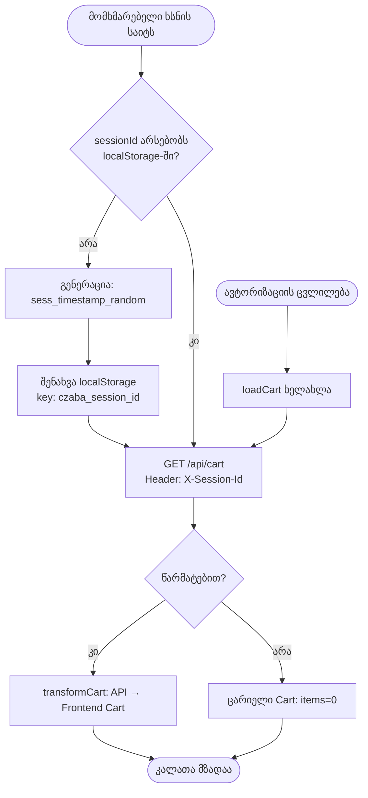
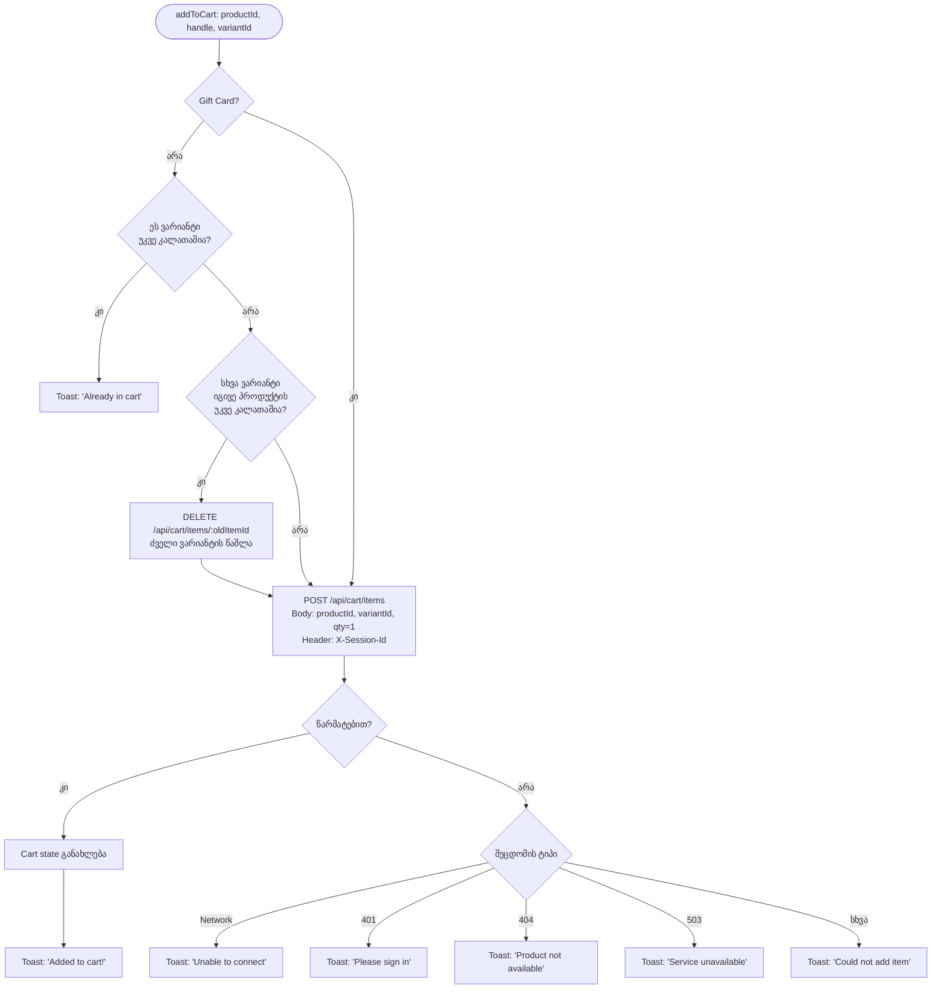
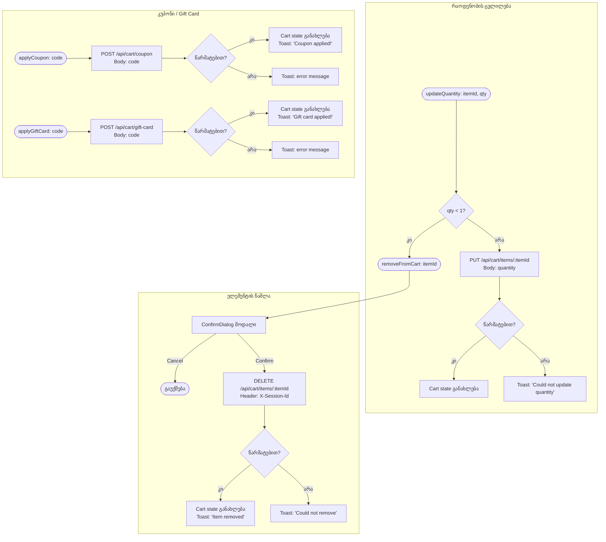
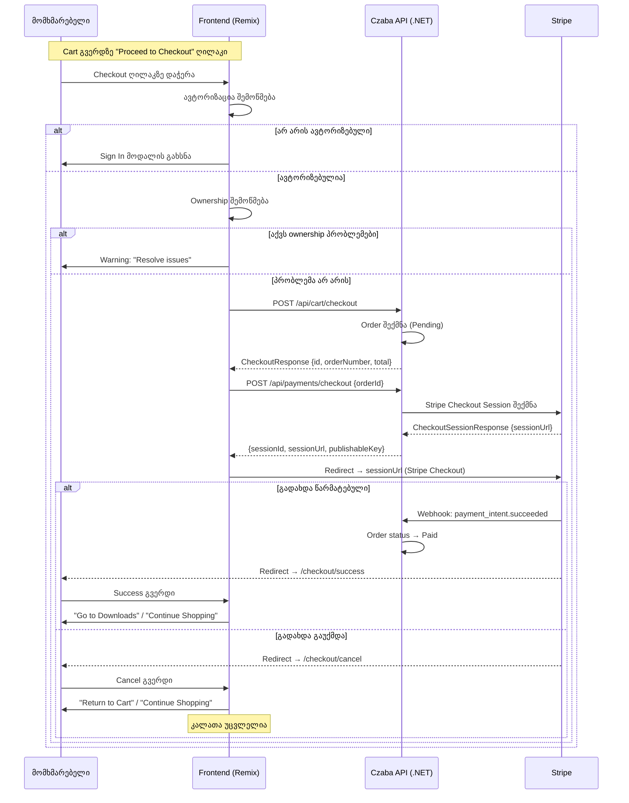
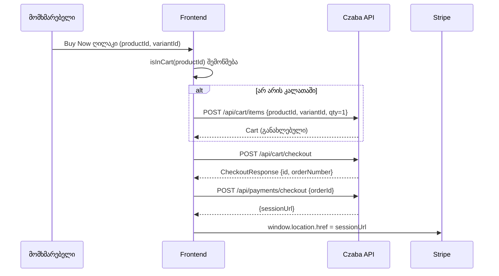
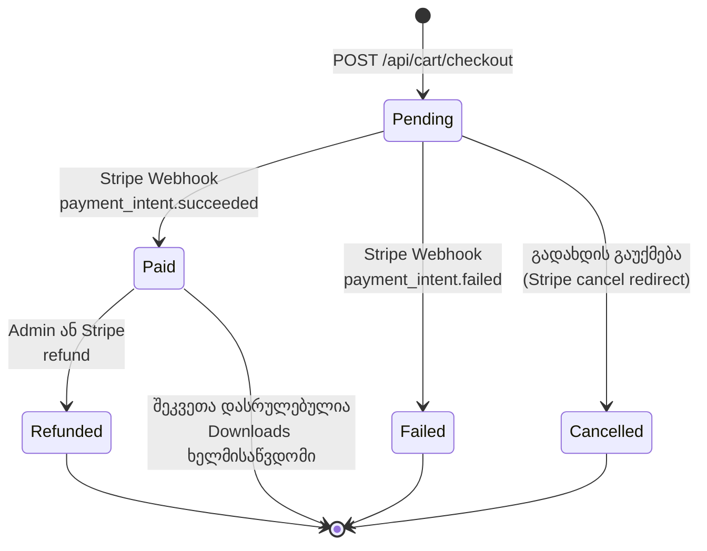
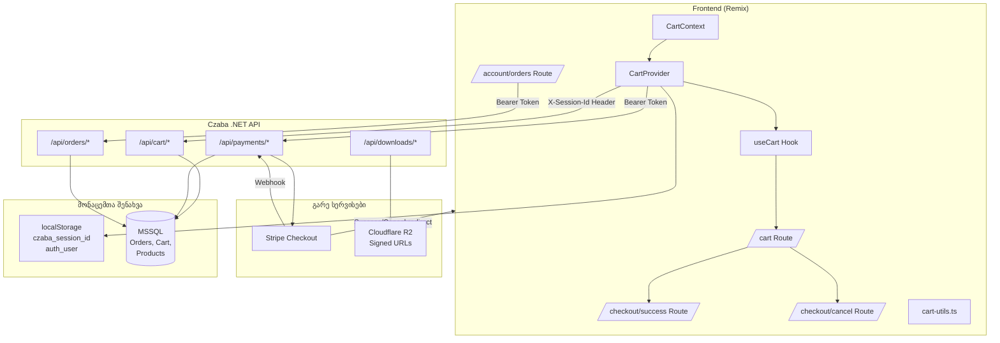

# Cart → Checkout → Order Lifecycle

## აღწერა

CZABA Store-ის სრული შეკვეთის ციკლი: პროდუქტის კალათაში დამატებიდან გადახდის დასრულებამდე.
სისტემა იყენებს session-based კალათას (localStorage `czaba_session_id`), Czaba .NET Backend API-ს
და Stripe Checkout-ს გადახდებისთვის.

---

## 1. კალათის მართვა (Cart Management)

---

## 2. პროდუქტის კალათაში დამატება (Add to Cart)

---

## 3. კალათის რედაქტირება (Update & Remove)

---

## 4. Checkout პროცესი (Cart → Order → Stripe → Result)

---

## 5. Buy Now Flow (სწრაფი შეძენა)

---

## 6. Order Lifecycle (State Machine)

---

## 7. Order Payment Status Badge-ები

| სტატუსი | ფერი | აღწერა |
|---------|------|--------|
| **Paid** | Emerald | გადახდილი - downloads ხელმისაწვდომია |
| **Pending** | Yellow | მოლოდინში - გადახდა პროცესშია |
| **Failed** | Red | ვერ გადაიხადა |
| **Refunded** | Orange | თანხა დაბრუნებულია |

---

## 8. სრული არქიტექტურის დიაგრამა

